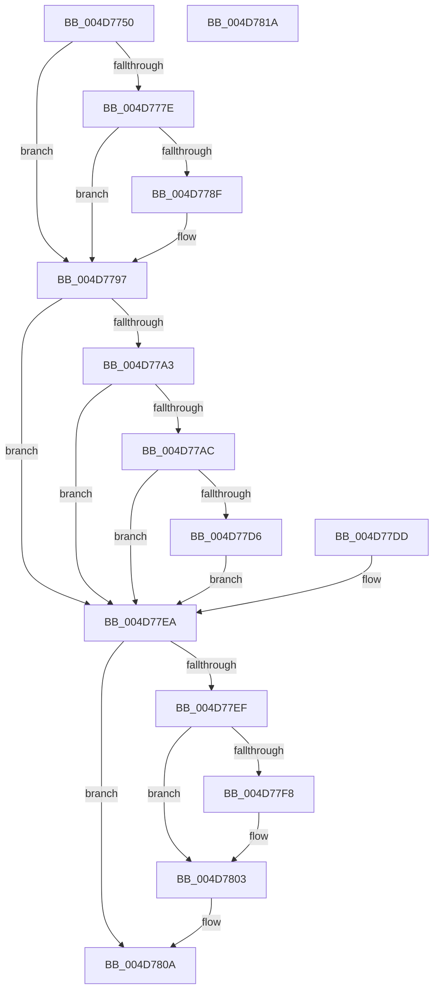

# KeRaiseUserException

- RVA: `0x004D7750`–`0x004D781B` (길이 `203` bytes)
- VA: `0x00000001404D7750`
- 실행 섹션: `.text`
- PDB 이름 있음: `예`; PDB Function 태그: `아니요`
- unwind 정보 RVA: `0x000BE660`
- 디코드: `53`개 명령, `203/203` bytes 표시
- 미해석 바이트: `0` (있으면 어셈블리에 `.byte`로 보존)

> 이 문서는 커널 이미지의 기계어와 PDB 기호를 분석해 생성했습니다. 4번과 5번은 함수 원형과 자료형을 바이너리 사용 방식에서 추정한 C 해석이며 원본 소스 복구 결과는 아닙니다.

## 1. Dependencies

- 직접 호출 지점: **3**; 고유 호출 대상: **3**
- 직접 호출자로 확인된 함수: **5**
- RIP 상대 이미지 참조: **2**

### Outgoing calls
- `0x004D7792` → [KiRaiseIrqlProcessIrqlFlags](../4F/KiRaiseIrqlProcessIrqlFlags_function_004F56FC.md) (function, `0x004F56FC`)
- `0x004D77D6` → [KiSetupForInstrumentationReturn](../45/KiSetupForInstrumentationReturn_function_00459300.md) (function, `0x00459300`)
- `0x004D77FE` → [KiLowerIrqlProcessIrqlFlags](../4F/KiLowerIrqlProcessIrqlFlags_function_004F5698.md) (function, `0x004F5698`)

### Direct callers
- [sub_006EF914](../6E/Unknown_function_006EF914.md) at `0x006EFA15`
- [ObpCloseHandle](../../page/86/ObpCloseHandle_function_008685B0.md) at `0x008687BE`
- [NtClose](../../page/86/NtClose_function_00868870.md) at `0x00868AA0`
- [ObCloseHandleTableEntry](../../page/86/ObCloseHandleTableEntry_function_00869E20.md) at `0x0086A6AE`
- [PspInsertThread](../../page/9F/PspInsertThread_function_009F0314.md) at `0x009F0C88`

### Static image references
- `0x004D7786` → RVA `0x00FC6D20` (`ALMOSTRO`; read)
- `0x004D77C2` → RVA `0x00FC74B0` (`ALMOSTRO`; read)

## 2. Other-region calls and transfers

- 다른 실행 섹션으로 향하는 call: **0**
- 별도 외부 분기/꼬리 이동을 확인하지 못했습니다.

## 3. Assembly (complete function range)

```asm
004D7750  48 89 5C 24 18                  mov qword ptr [rsp + 0x18], rbx
004D7755  89 4C 24 08                     mov dword ptr [rsp + 8], ecx
004D7759  56                              push rsi
004D775A  57                              push rdi
004D775B  41 56                           push r14
004D775D  48 83 EC 20                     sub rsp, 0x20
004D7761  8B F1                           mov esi, ecx
004D7763  65 4C 8B 34 25 88 01 00 00      mov r14, qword ptr gs:[0x188]
004D776C  44 0F 20 C3                     mov rbx, cr8
004D7770  88 5C 24 48                     mov byte ptr [rsp + 0x48], bl
004D7774  BF 01 00 00 00                  mov edi, 1
004D7779  40 3A DF                        cmp bl, dil
004D777C  73 19                           jae 0x1404d7797
004D777E  44 0F 20 C1                     mov rcx, cr8
004D7782  44 0F 22 C7                     mov cr8, rdi
004D7786  83 3D 93 F5 AE 00 00            cmp dword ptr [rip + 0xaef593], 0
004D778D  74 08                           je 0x1404d7797
004D778F  40 8A D7                        mov dl, dil
004D7792  E8 65 DF 01 00                  call 0x1404f56fc
004D7797  49 8B 8E 90 00 00 00            mov rcx, qword ptr [r14 + 0x90]
004D779E  48 85 C9                        test rcx, rcx
004D77A1  74 47                           je 0x1404d77ea
004D77A3  40 84 B9 70 01 00 00            test byte ptr [rcx + 0x170], dil
004D77AA  74 3E                           je 0x1404d77ea
004D77AC  49 8B 86 F0 00 00 00            mov rax, qword ptr [r14 + 0xf0]
004D77B3  89 B0 C0 02 00 00               mov dword ptr [rax + 0x2c0], esi
004D77B9  66 C7 81 70 01 00 00 33 00      mov word ptr [rcx + 0x170], 0x33
004D77C2  48 8B 05 E7 FC AE 00            mov rax, qword ptr [rip + 0xaefce7]
004D77C9  48 89 81 68 01 00 00            mov qword ptr [rcx + 0x168], rax
004D77D0  80 79 2B 02                     cmp byte ptr [rcx + 0x2b], 2
004D77D4  74 14                           je 0x1404d77ea
004D77D6  E8 25 1B F8 FF                  call 0x140459300
004D77DB  EB 0D                           jmp 0x1404d77ea
004D77DD  BF 01 00 00 00                  mov edi, 1
004D77E2  8B 74 24 40                     mov esi, dword ptr [rsp + 0x40]
004D77E6  8A 5C 24 48                     mov bl, byte ptr [rsp + 0x48]
004D77EA  40 3A DF                        cmp bl, dil
004D77ED  73 1B                           jae 0x1404d780a
004D77EF  83 3D 2A F5 AE 00 00            cmp dword ptr [rip + 0xaef52a], 0
004D77F6  74 0B                           je 0x1404d7803
004D77F8  44 0F 20 C1                     mov rcx, cr8
004D77FC  8A D3                           mov dl, bl
004D77FE  E8 95 DE 01 00                  call 0x1404f5698
004D7803  0F B6 C3                        movzx eax, bl
004D7806  44 0F 22 C0                     mov cr8, rax
004D780A  8B C6                           mov eax, esi
004D780C  48 8B 5C 24 50                  mov rbx, qword ptr [rsp + 0x50]
004D7811  48 83 C4 20                     add rsp, 0x20
004D7815  41 5E                           pop r14
004D7817  5F                              pop rdi
004D7818  5E                              pop rsi
004D7819  C3                              ret
004D781A  CC                              int3
```

## 4. C-style interpretation (structured pseudocode)

```c
__int64 __fastcall KeRaiseUserException(int a1)
{
    __int64 result;
    __int64 v_rsp;
    unsigned __int8 v_stack_p10;
    unsigned __int64 v_stack_p18;
    unsigned int v_stack_p8;

    v_stack_p18 = v_rbx;
    v_stack_p8 = a1;
    v_rsp = (v_rsp) - (32);
    v_stack_p10 = (unsigned __int8)(v_cr8);
    if (((unsigned __int8)(v_cr8)) >= 1) goto loc_004D7797;
    if ((*(unsigned int *)(v_rip + 11466131)) != 0) {
        a2 = 1;
        result = KiRaiseIrqlProcessIrqlFlags(v_cr8, a2, a3, a4);
    }
    if (*(unsigned __int64 *)(*(unsigned __int64 *)(gs_base + (0 + 392)) + 144) == 0) goto loc_004D77EA;
    if (((*(unsigned __int8 *)(*(unsigned __int64 *)(*(unsigned __int64 *)(gs_base + (0 + 392)) + 144) + 368)) & (1)) == 0) goto loc_004D77EA;
    *(unsigned int *)(*(unsigned __int64 *)(*(unsigned __int64 *)(gs_base + (0 + 392)) + 240) + 704) = (unsigned int)((unsigned int)(a1));
    *(unsigned __int16 *)(*(unsigned __int64 *)(*(unsigned __int64 *)(gs_base + (0 + 392)) + 144) + 368) = 51;
    *(unsigned __int64 *)(*(unsigned __int64 *)(*(unsigned __int64 *)(gs_base + (0 + 392)) + 144) + 360) = *(unsigned __int64 *)(v_rip + 11468007);
    if ((*(unsigned __int8 *)(*(unsigned __int64 *)(*(unsigned __int64 *)(gs_base + (0 + 392)) + 144) + 43)) == 2) goto loc_004D77EA;
    result = KiSetupForInstrumentationReturn(*(unsigned __int64 *)(*(unsigned __int64 *)(gs_base + (0 + 392)) + 144), a2, a3, a4);
    goto loc_004D77EA;
loc_004D77EA:
    if (((unsigned __int8)(v_cr8)) >= 1) goto loc_004D780A;
    if ((*(unsigned int *)(v_rip + 11466026)) != 0) {
        a1 = 1;
        a2 = (unsigned __int8)(v_cr8);
        result = KiLowerIrqlProcessIrqlFlags(a1, a2, a3, a4);
    }
loc_004D780A:
    v_rsp = (v_rsp) + (32);
    return (unsigned int)((unsigned int)((unsigned int)(a1)));
}
```

## 5. (Beta) C Style

```c
int64_t KeRaiseUserException(int32_t Arg1)
{
    int64_t result;
    int64_t local_rsp;
    uint8_t v_stack_p10;
    uint64_t v_stack_p18;
    uint32_t v_stack_p8;

    v_stack_p18 = local_rbx;
    v_stack_p8 = Arg1;
    local_rsp = (local_rsp) - (32);
    v_stack_p10 = (uint8_t)(v_cr8);
    if (((uint8_t)(v_cr8)) >= 1) goto loc_004D7797;
    if ((*(uint32_t *)(v_rip + 0xAEF593)) != 0) {
        a2 = 1;
        result = KiRaiseIrqlProcessIrqlFlags(v_cr8, a2, a3, a4);
    }
    if (*(uint64_t *)(*(uint64_t *)(gs_base + (0 + 0x188)) + 0x90) == 0) goto loc_004D77EA;
    if (((*(uint8_t *)(*(uint64_t *)(*(uint64_t *)(gs_base + (0 + 0x188)) + 0x90) + 0x170)) & (1)) == 0) goto loc_004D77EA;
    *(uint32_t *)(*(uint64_t *)(*(uint64_t *)(gs_base + (0 + 0x188)) + 0xF0) + 0x2C0) = (uint32_t)((uint32_t)(Arg1));
    *(uint16_t *)(*(uint64_t *)(*(uint64_t *)(gs_base + (0 + 0x188)) + 0x90) + 0x170) = 51;
    *(uint64_t *)(*(uint64_t *)(*(uint64_t *)(gs_base + (0 + 0x188)) + 0x90) + 0x168) = *(uint64_t *)(v_rip + 0xAEFCE7);
    if ((*(uint8_t *)(*(uint64_t *)(*(uint64_t *)(gs_base + (0 + 0x188)) + 0x90) + 0x2B)) == 2) goto loc_004D77EA;
    result = KiSetupForInstrumentationReturn(*(uint64_t *)(*(uint64_t *)(gs_base + (0 + 0x188)) + 0x90), a2, a3, a4);
    goto loc_004D77EA;
loc_004D77EA:
    if (((uint8_t)(v_cr8)) >= 1) goto loc_004D780A;
    if ((*(uint32_t *)(v_rip + 0xAEF52A)) != 0) {
        Arg1 = 1;
        a2 = (uint8_t)(v_cr8);
        result = KiLowerIrqlProcessIrqlFlags(Arg1, a2, a3, a4);
    }
loc_004D780A:
    local_rsp = (local_rsp) + (32);
    return (uint32_t)((uint32_t)((uint32_t)(Arg1)));
}
```

## 6. Execution-region graph

[열기: 2D/3D 그래프와 함수 탐색 컨트롤 패널](../../../control-panel.html?section=text&rva=0x004D7750&view=graph)

- 2D 그래프는 위에서 아래로 흐르고, 3D 그래프는 빈 공간을 드래그해 회전합니다. Shift+드래그는 이동, 휠은 확대·축소, 함수 노드 선택은 대상 보고서 이동입니다.

### Static fallback


