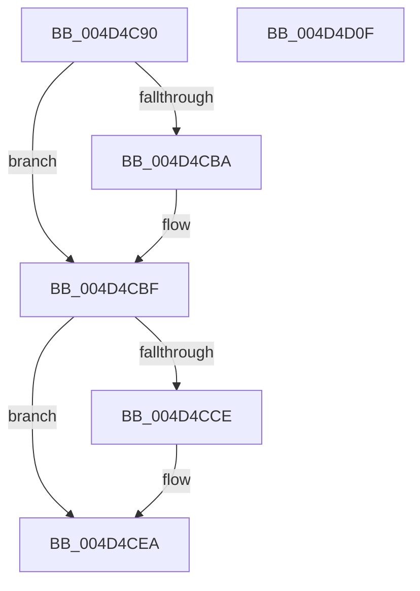

# KeRestoreProcessorSpecificFeatures

- RVA: `0x004D4C90`–`0x004D4D10` (길이 `128` bytes)
- VA: `0x00000001404D4C90`
- 실행 섹션: `.text`
- PDB 이름 있음: `예`; PDB Function 태그: `아니요`
- unwind 정보 RVA: `0x000BE218`
- 디코드: `35`개 명령, `128/128` bytes 표시
- 미해석 바이트: `0` (있으면 어셈블리에 `.byte`로 보존)

> 이 문서는 커널 이미지의 기계어와 PDB 기호를 분석해 생성했습니다. 4번과 5번은 함수 원형과 자료형을 바이너리 사용 방식에서 추정한 C 해석이며 원본 소스 복구 결과는 아닙니다.

## 1. Dependencies

- 직접 호출 지점: **5**; 고유 호출 대상: **5**
- 직접 호출자로 확인된 함수: **2**
- RIP 상대 이미지 참조: **2**

### Outgoing calls
- `0x004D4CAC` → [KiSetPageAttributesTable](../../pagelk/B7/KiSetPageAttributesTable_function_00B7D7FC.md) (function, `0x00B7D7FC`)
- `0x004D4CBA` → [KiDisableCacheErrataSource](../5C/KiDisableCacheErrataSource_function_005C4DC8.md) (function, `0x005C4DC8`)
- `0x004D4CED` → [KiRestoreXSaveSupport](../../pagelk/B5/KiRestoreXSaveSupport_function_00B5B110.md) (function, `0x00B5B110`)
- `0x004D4CF2` → [KiRestoreFeatureBits](KiRestoreFeatureBits_function_004D4D18.md) (function, `0x004D4D18`)
- `0x004D4CFF` → [_security_check_cookie](../6A/_security_check_cookie_function_006AC640.md) (function, `0x006AC640`)

### Direct callers
- [PnprQuiesceProcessorDpc](../../pagelk/B6/PnprQuiesceProcessorDpc_function_00B64B50.md) at `0x00B64DB7`
- [PopHandleNextState](../../pagelk/B7/PopHandleNextState_function_00B77350.md) at `0x00B77648`

### Static image references
- `0x004D4C9A` → RVA `0x00E0A740` (`.data`; read)
- `0x004D4CB1` → RVA `0x00FC6C70` (`ALMOSTRO`; read)

## 2. Other-region calls and transfers

- 다른 실행 섹션으로 향하는 call: **2**
  - `0x004D4CAC` → [KiSetPageAttributesTable](../../pagelk/B7/KiSetPageAttributesTable_function_00B7D7FC.md) (`.text` → `PAGELK`)
  - `0x004D4CED` → [KiRestoreXSaveSupport](../../pagelk/B5/KiRestoreXSaveSupport_function_00B5B110.md) (`.text` → `PAGELK`)
- 별도 외부 분기/꼬리 이동을 확인하지 못했습니다.

## 3. Assembly (complete function range)

```asm
004D4C90  48 89 5C 24 08                  mov qword ptr [rsp + 8], rbx
004D4C95  57                              push rdi
004D4C96  48 83 EC 40                     sub rsp, 0x40
004D4C9A  48 8B 05 9F 5A 93 00            mov rax, qword ptr [rip + 0x935a9f]
004D4CA1  48 33 C4                        xor rax, rsp
004D4CA4  48 89 44 24 30                  mov qword ptr [rsp + 0x30], rax
004D4CA9  48 8B F9                        mov rdi, rcx
004D4CAC  E8 4B 8B 6A 00                  call 0x140b7d7fc
004D4CB1  83 3D B8 1F AF 00 00            cmp dword ptr [rip + 0xaf1fb8], 0
004D4CB8  74 05                           je 0x1404d4cbf
004D4CBA  E8 09 01 0F 00                  call 0x1405c4dc8
004D4CBF  33 C9                           xor ecx, ecx
004D4CC1  B8 01 00 00 80                  mov eax, 0x80000001
004D4CC6  0F A2                           cpuid
004D4CC8  0F BA E2 19                     bt edx, 0x19
004D4CCC  73 1C                           jae 0x1404d4cea
004D4CCE  B9 80 00 00 C0                  mov ecx, 0xc0000080
004D4CD3  0F 32                           rdmsr
004D4CD5  48 C1 E2 20                     shl rdx, 0x20
004D4CD9  48 0B C2                        or rax, rdx
004D4CDC  48 0F BA E8 0E                  bts rax, 0xe
004D4CE1  48 8B D0                        mov rdx, rax
004D4CE4  48 C1 EA 20                     shr rdx, 0x20
004D4CE8  0F 30                           wrmsr
004D4CEA  48 8B CF                        mov rcx, rdi
004D4CED  E8 1E 64 68 00                  call 0x140b5b110
004D4CF2  E8 21 00 00 00                  call 0x1404d4d18
004D4CF7  48 8B 4C 24 30                  mov rcx, qword ptr [rsp + 0x30]
004D4CFC  48 33 CC                        xor rcx, rsp
004D4CFF  E8 3C 79 1D 00                  call 0x1406ac640
004D4D04  48 8B 5C 24 50                  mov rbx, qword ptr [rsp + 0x50]
004D4D09  48 83 C4 40                     add rsp, 0x40
004D4D0D  5F                              pop rdi
004D4D0E  C3                              ret
004D4D0F  CC                              int3
```

## 4. C-style interpretation (structured pseudocode)

```c
__int64 __fastcall KeRestoreProcessorSpecificFeatures(__int64 a1, __int64 a2)
{
    __int64 result;
    __int64 v_rsp;
    unsigned __int64 v_stack_m18;
    unsigned __int64 v_stack_p8;

    v_stack_p8 = v_rbx;
    v_rsp = (v_rsp) - (64);
    result = (*(unsigned __int64 *)(v_rip + 9656991)) ^ (v_rsp);
    v_stack_m18 = result;
    result = KiSetPageAttributesTable(a1, a2, a3, a4);
    if ((*(unsigned int *)(v_rip + 11476920)) != 0) {
        result = KiDisableCacheErrataSource(a1, a2, a3, a4);
    }
    a1 = 0;
    result = (unsigned int)(0x80000001ULL);
    if (!(condition_is_above_or_equal)) {
        a1 = 0xC0000080ULL;
        a2 = (a2) << (32);
        result = ((unsigned int)(0x80000001ULL)) | (a2);
        a2 = result;
        a2 = (a2) >> (32);
    }
    result = KiRestoreXSaveSupport(a1, a2, a3, a4);
    result = KiRestoreFeatureBits(a1, a2, a3, a4);
    a1 = (v_stack_m18) ^ (v_rsp);
    result = _security_check_cookie(a1, a2, a3, a4);
    v_rsp = (v_rsp) + (64);
    return result;
}
```

## 5. (Beta) C Style

```c
int64_t KeRestoreProcessorSpecificFeatures(int64_t Arg1, int64_t Arg2)
{
    int64_t result;
    int64_t local_rsp;
    uint64_t v_stack_m18;
    uint64_t v_stack_p8;

    v_stack_p8 = local_rbx;
    local_rsp = (local_rsp) - (64);
    result = (*(uint64_t *)(v_rip + 0x935A9F)) ^ (local_rsp);
    v_stack_m18 = result;
    result = KiSetPageAttributesTable(Arg1, Arg2, a3, a4);
    if ((*(uint32_t *)(v_rip + 0xAF1FB8)) != 0) {
        result = KiDisableCacheErrataSource(Arg1, Arg2, a3, a4);
    }
    Arg1 = 0;
    result = (uint32_t)(0x80000001ULL);
    if (!(condition_is_above_or_equal)) {
        Arg1 = 0xC0000080ULL;
        Arg2 = (Arg2) << (32);
        result = ((uint32_t)(0x80000001ULL)) | (Arg2);
        Arg2 = result;
        Arg2 = (Arg2) >> (32);
    }
    result = KiRestoreXSaveSupport(Arg1, Arg2, a3, a4);
    result = KiRestoreFeatureBits(Arg1, Arg2, a3, a4);
    Arg1 = (v_stack_m18) ^ (local_rsp);
    result = _security_check_cookie(Arg1, Arg2, a3, a4);
    local_rsp = (local_rsp) + (64);
    return result;
}
```

## 6. Execution-region graph

[열기: 2D/3D 그래프와 함수 탐색 컨트롤 패널](../../../control-panel.html?section=text&rva=0x004D4C90&view=graph)

- 2D 그래프는 위에서 아래로 흐르고, 3D 그래프는 빈 공간을 드래그해 회전합니다. Shift+드래그는 이동, 휠은 확대·축소, 함수 노드 선택은 대상 보고서 이동입니다.

### Static fallback


