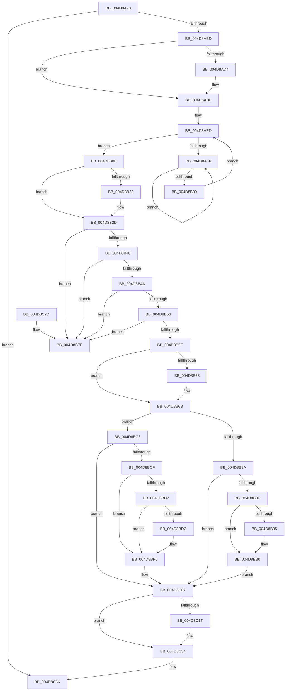

# KeRevertToUserMultipleGroupAffinityThread

- RVA: `0x004D8A90`–`0x004D8C95` (길이 `517` bytes)
- VA: `0x00000001404D8A90`
- 실행 섹션: `.text`
- PDB 이름 있음: `예`; PDB Function 태그: `아니요`
- unwind 정보 RVA: `0x000BE80C`
- 디코드: `136`개 명령, `517/517` bytes 표시
- 미해석 바이트: `0` (있으면 어셈블리에 `.byte`로 보존)

> 이 문서는 커널 이미지의 기계어와 PDB 기호를 분석해 생성했습니다. 4번과 5번은 함수 원형과 자료형을 바이너리 사용 방식에서 추정한 C 해석이며 원본 소스 복구 결과는 아닙니다.

## 1. Dependencies

- 직접 호출 지점: **12**; 고유 호출 대상: **9**
- 직접 호출자로 확인된 함수: **2**
- RIP 상대 이미지 참조: **2**

### Outgoing calls
- `0x004D8ADA` → [KiRaiseIrqlProcessIrqlFlags](../4F/KiRaiseIrqlProcessIrqlFlags_function_004F56FC.md) (function, `0x004F56FC`)
- `0x004D8AFB` → [KeYieldProcessorEx](../3F/KeYieldProcessorEx_function_003FBD00.md) (function, `0x003FBD00`)
- `0x004D8B79` → [memset](../6C/memset_function_006C6C40.md) (function, `0x006C6C40`)
- `0x004D8BAA` → [KeBugCheckEx](../4F/KeBugCheckEx_function_004FD660.md) (function, `0x004FD660`)
- `0x004D8BBC` → [KeAddGroupAffinityEx](../25/KeAddGroupAffinityEx_function_0025B6C0.md) (function, `0x0025B6C0`)
- `0x004D8BF0` → [KeBugCheckEx](../4F/KeBugCheckEx_function_004FD660.md) (function, `0x004FD660`)
- `0x004D8C02` → [KiCopyAffinityEx](../2C/KiCopyAffinityEx_function_002CE860.md) (function, `0x002CE860`)
- `0x004D8C0E` → [KeIsEmptyAffinityEx](../2D/KeIsEmptyAffinityEx_function_002D1580.md) (function, `0x002D1580`)
- `0x004D8C25` → [KiCopyAffinityEx](../2C/KiCopyAffinityEx_function_002CE860.md) (function, `0x002CE860`)
- `0x004D8C51` → [KiSetSystemAffinityThread](../39/KiSetSystemAffinityThread_function_003993E0.md) (function, `0x003993E0`)
- `0x004D8C61` → [KiProcessDeferredReadyList](../25/KiProcessDeferredReadyList_function_00250800.md) (function, `0x00250800`)
- `0x004D8C8F` → [KeBugCheckEx](../4F/KeBugCheckEx_function_004FD660.md) (function, `0x004FD660`)

### Direct callers
- [PsRevertToUserMultipleGroupAffinityThread](../5E/PsRevertToUserMultipleGroupAffinityThread_function_005E3490.md) at `0x005E3494`
- [MiCombineAllPhysicalMemory](../../page/9F/MiCombineAllPhysicalMemory_function_009F6B6C.md) at `0x009F6D65`

### Static image references
- `0x004D8ACB` → RVA `0x00FC6D20` (`ALMOSTRO`; read)
- `0x004D8B17` → RVA `0x00FC7120` (`ALMOSTRO`; read)

## 2. Other-region calls and transfers

- 다른 실행 섹션으로 향하는 call: **0**
- 별도 외부 분기/꼬리 이동을 확인하지 못했습니다.

## 3. Assembly (complete function range)

```asm
004D8A90  48 89 5C 24 08                  mov qword ptr [rsp + 8], rbx
004D8A95  48 89 6C 24 20                  mov qword ptr [rsp + 0x20], rbp
004D8A9A  56                              push rsi
004D8A9B  57                              push rdi
004D8A9C  41 55                           push r13
004D8A9E  41 56                           push r14
004D8AA0  41 57                           push r15
004D8AA2  48 83 EC 30                     sub rsp, 0x30
004D8AA6  65 48 8B 1C 25 88 01 00 00      mov rbx, qword ptr gs:[0x188]
004D8AAF  48 8B F9                        mov rdi, rcx
004D8AB2  8B 43 74                        mov eax, dword ptr [rbx + 0x74]
004D8AB5  A8 08                           test al, 8
004D8AB7  0F 84 A9 01 00 00               je 0x1404d8c66
004D8ABD  45 0F 20 C6                     mov r14, cr8
004D8AC1  41 BD 02 00 00 00               mov r13d, 2
004D8AC7  45 0F 22 C5                     mov cr8, r13
004D8ACB  83 3D 4E E2 AE 00 00            cmp dword ptr [rip + 0xaee24e], 0
004D8AD2  74 0B                           je 0x1404d8adf
004D8AD4  41 8A D5                        mov dl, r13b
004D8AD7  41 8A CE                        mov cl, r14b
004D8ADA  E8 1D CC 01 00                  call 0x1404f56fc
004D8ADF  65 4C 8B 3C 25 20 00 00 00      mov r15, qword ptr gs:[0x20]
004D8AE8  83 64 24 68 00                  and dword ptr [rsp + 0x68], 0
004D8AED  F0 48 0F BA 6B 40 00            lock bts qword ptr [rbx + 0x40], 0
004D8AF4  73 15                           jae 0x1404d8b0b
004D8AF6  48 8D 4C 24 68                  lea rcx, [rsp + 0x68]
004D8AFB  E8 00 32 F2 FF                  call 0x1403fbd00
004D8B00  48 8B 43 40                     mov rax, qword ptr [rbx + 0x40]
004D8B04  48 85 C0                        test rax, rax
004D8B07  75 ED                           jne 0x1404d8af6
004D8B09  EB E2                           jmp 0x1404d8aed
004D8B0B  48 8B 8B 50 04 00 00            mov rcx, qword ptr [rbx + 0x450]
004D8B12  BD 00 08 00 00                  mov ebp, 0x800
004D8B17  0F B7 15 02 E6 AE 00            movzx edx, word ptr [rip + 0xaee602]
004D8B1E  48 85 C9                        test rcx, rcx
004D8B21  74 0A                           je 0x1404d8b2d
004D8B23  48 8B 01                        mov rax, qword ptr [rcx]
004D8B26  48 89 83 50 04 00 00            mov qword ptr [rbx + 0x450], rax
004D8B2D  48 8B 77 18                     mov rsi, qword ptr [rdi + 0x18]
004D8B31  41 B8 01 00 00 00               mov r8d, 1
004D8B37  66 39 16                        cmp word ptr [rsi], dx
004D8B3A  0F 87 3E 01 00 00               ja 0x1404d8c7e
004D8B40  66 39 56 02                     cmp word ptr [rsi + 2], dx
004D8B44  0F 82 34 01 00 00               jb 0x1404d8c7e
004D8B4A  8A 47 13                        mov al, byte ptr [rdi + 0x13]
004D8B4D  41 84 C0                        test r8b, al
004D8B50  0F 84 28 01 00 00               je 0x1404d8c7e
004D8B56  48 3B CF                        cmp rcx, rdi
004D8B59  0F 85 1F 01 00 00               jne 0x1404d8c7e
004D8B5F  44 38 47 12                     cmp byte ptr [rdi + 0x12], r8b
004D8B63  75 06                           jne 0x1404d8b6b
004D8B65  41 22 C5                        and al, r13b
004D8B68  88 47 12                        mov byte ptr [rdi + 0x12], al
004D8B6B  44 0F B7 06                     movzx r8d, word ptr [rsi]
004D8B6F  48 8D 4E 08                     lea rcx, [rsi + 8]
004D8B73  49 C1 E0 03                     shl r8, 3
004D8B77  33 D2                           xor edx, edx
004D8B79  E8 C2 E0 1E 00                  call 0x1406c6c40
004D8B7E  66 C7 06 01 00                  mov word ptr [rsi], 1
004D8B83  8A 47 12                        mov al, byte ptr [rdi + 0x12]
004D8B86  84 C0                           test al, al
004D8B88  74 39                           je 0x1404d8bc3
004D8B8A  41 3A C5                        cmp al, r13b
004D8B8D  75 78                           jne 0x1404d8c07
004D8B8F  44 84 6F 13                     test byte ptr [rdi + 0x13], r13b
004D8B93  75 1B                           jne 0x1404d8bb0
004D8B95  48 83 64 24 20 00               and qword ptr [rsp + 0x20], 0
004D8B9B  45 33 C9                        xor r9d, r9d
004D8B9E  48 8B D3                        mov rdx, rbx
004D8BA1  B9 E8 01 00 00                  mov ecx, 0x1e8
004D8BA6  45 8D 41 03                     lea r8d, [r9 + 3]
004D8BAA  E8 B1 4A 02 00                  call 0x1404fd660
004D8BAF  CC                              int3
004D8BB0  4C 8B 47 08                     mov r8, qword ptr [rdi + 8]
004D8BB4  0F B7 57 10                     movzx edx, word ptr [rdi + 0x10]
004D8BB8  48 8B 4F 18                     mov rcx, qword ptr [rdi + 0x18]
004D8BBC  E8 FF 2A D8 FF                  call 0x14025b6c0
004D8BC1  EB 44                           jmp 0x1404d8c07
004D8BC3  4C 8B 83 50 04 00 00            mov r8, qword ptr [rbx + 0x450]
004D8BCA  4D 85 C0                        test r8, r8
004D8BCD  74 38                           je 0x1404d8c07
004D8BCF  41 8A 40 12                     mov al, byte ptr [r8 + 0x12]
004D8BD3  84 C0                           test al, al
004D8BD5  74 1F                           je 0x1404d8bf6
004D8BD7  41 3A C5                        cmp al, r13b
004D8BDA  74 1A                           je 0x1404d8bf6
004D8BDC  48 83 64 24 20 00               and qword ptr [rsp + 0x20], 0
004D8BE2  45 33 C9                        xor r9d, r9d
004D8BE5  4D 8B C5                        mov r8, r13
004D8BE8  48 8B D3                        mov rdx, rbx
004D8BEB  B9 E8 01 00 00                  mov ecx, 0x1e8
004D8BF0  E8 6B 4A 02 00                  call 0x1404fd660
004D8BF5  CC                              int3
004D8BF6  48 8B 4F 18                     mov rcx, qword ptr [rdi + 0x18]
004D8BFA  4D 8B 40 18                     mov r8, qword ptr [r8 + 0x18]
004D8BFE  0F B7 51 02                     movzx edx, word ptr [rcx + 2]
004D8C02  E8 59 5C DF FF                  call 0x1402ce860
004D8C07  48 8B 77 18                     mov rsi, qword ptr [rdi + 0x18]
004D8C0B  48 8B CE                        mov rcx, rsi
004D8C0E  E8 6D 89 DF FF                  call 0x1402d1580
004D8C13  85 C0                           test eax, eax
004D8C15  74 1D                           je 0x1404d8c34
004D8C17  4C 8B 83 28 02 00 00            mov r8, qword ptr [rbx + 0x228]
004D8C1E  48 8B CE                        mov rcx, rsi
004D8C21  0F B7 56 02                     movzx edx, word ptr [rsi + 2]
004D8C25  E8 36 5C DF FF                  call 0x1402ce860
004D8C2A  83 63 74 F7                     and dword ptr [rbx + 0x74], 0xfffffff7
004D8C2E  8B AB C4 00 00 00               mov ebp, dword ptr [rbx + 0xc4]
004D8C34  48 8B 57 18                     mov rdx, qword ptr [rdi + 0x18]
004D8C38  48 8D 44 24 70                  lea rax, [rsp + 0x70]
004D8C3D  48 83 64 24 70 00               and qword ptr [rsp + 0x70], 0
004D8C43  44 8B CD                        mov r9d, ebp
004D8C46  45 33 C0                        xor r8d, r8d
004D8C49  48 89 44 24 20                  mov qword ptr [rsp + 0x20], rax
004D8C4E  49 8B CF                        mov rcx, r15
004D8C51  E8 8A 07 EC FF                  call 0x1403993e0
004D8C56  45 8A C6                        mov r8b, r14b
004D8C59  48 8D 54 24 70                  lea rdx, [rsp + 0x70]
004D8C5E  49 8B CF                        mov rcx, r15
004D8C61  E8 9A 7B D7 FF                  call 0x140250800
004D8C66  48 8B 5C 24 60                  mov rbx, qword ptr [rsp + 0x60]
004D8C6B  48 8B 6C 24 78                  mov rbp, qword ptr [rsp + 0x78]
004D8C70  48 83 C4 30                     add rsp, 0x30
004D8C74  41 5F                           pop r15
004D8C76  41 5E                           pop r14
004D8C78  41 5D                           pop r13
004D8C7A  5F                              pop rdi
004D8C7B  5E                              pop rsi
004D8C7C  C3                              ret
004D8C7D  CC                              int3
004D8C7E  48 83 64 24 20 00               and qword ptr [rsp + 0x20], 0
004D8C84  45 33 C9                        xor r9d, r9d
004D8C87  48 8B D3                        mov rdx, rbx
004D8C8A  B9 E8 01 00 00                  mov ecx, 0x1e8
004D8C8F  E8 CC 49 02 00                  call 0x1404fd660
004D8C94  CC                              int3
```

## 4. C-style interpretation (structured pseudocode)

```c
__int64 __fastcall KeRevertToUserMultipleGroupAffinityThread(__int64 a1, __int64 a2, __int64 a3, int a4)
{
    __int64 result;
    __int64 v_rbp;
    __int64 v_rsp;
    unsigned __int64 v_stack_m38;
    unsigned int v_stack_p10;
    unsigned __int64 v_stack_p18;
    unsigned __int64 v_stack_p20;
    unsigned __int64 v_stack_p8;

    v_stack_p8 = v_rbx;
    v_stack_p20 = v_rbp;
    v_rsp = (v_rsp) - (48);
    if ((((unsigned __int8)((unsigned int)(*(unsigned int *)(*(unsigned __int64 *)(gs_base + (0 + 392)) + 116)))) & (8)) == 0) goto loc_004D8C66;
    result = (unsigned int)(*(unsigned int *)(*(unsigned __int64 *)(gs_base + (0 + 392)) + 116));
    if ((*(unsigned int *)(v_rip + 11461198)) != 0) {
        a2 = 2;
        a1 = (unsigned __int8)(v_cr8);
        result = KiRaiseIrqlProcessIrqlFlags(a1, a2, a3, a4);
    }
loc_004D8AED:
    if ((*(unsigned int *)(v_rip + 11461198)) >= 0) goto loc_004D8B0B;
loc_004D8AF6:
    result = KeYieldProcessorEx(v_stack_p10, a2, a3, a4);
    if (*(unsigned __int64 *)(*(unsigned __int64 *)(gs_base + (0 + 392)) + 64) != 0) goto loc_004D8AF6;
    goto loc_004D8AED;
loc_004D8B0B:
    result = *(unsigned __int64 *)(*(unsigned __int64 *)(gs_base + (0 + 392)) + 64);
    if (*(unsigned __int64 *)(*(unsigned __int64 *)(gs_base + (0 + 392)) + 1104) != 0) {
        result = *(unsigned __int64 *)(*(unsigned __int64 *)(*(unsigned __int64 *)(gs_base + (0 + 392)) + 1104));
        *(unsigned __int64 *)(*(unsigned __int64 *)(gs_base + (0 + 392)) + 1104) = result;
    }
    if ((*(unsigned __int16 *)(*(unsigned __int64 *)(a1 + 24))) > ((unsigned __int16)(*(unsigned __int16 *)(v_rip + 11462146)))) goto loc_004D8C7E;
    if ((*(unsigned __int16 *)(*(unsigned __int64 *)(a1 + 24) + 2)) < ((unsigned __int16)(*(unsigned __int16 *)(v_rip + 11462146)))) goto loc_004D8C7E;
    if (((1) & ((unsigned __int8)(*(unsigned __int8 *)(a1 + 19)))) == 0) goto loc_004D8C7E;
    if ((*(unsigned __int64 *)(*(unsigned __int64 *)(gs_base + (0 + 392)) + 1104)) != a1) goto loc_004D8C7E;
    result = *(unsigned __int8 *)(a1 + 19);
    if ((*(unsigned __int8 *)(a1 + 18)) == 1) {
        result = (unsigned __int8)((*(unsigned __int8 *)(a1 + 19)) & (2));
        *(unsigned __int8 *)(a1 + 18) = (unsigned __int8)(result);
    }
    a3 = (*(unsigned __int16 *)(*(unsigned __int64 *)(a1 + 24))) << (3);
    a2 = 0;
    result = memset(*(unsigned __int64 *)(a1 + 24) + 8, a2, a3, a4);
    *(unsigned __int16 *)(*(unsigned __int64 *)(a1 + 24)) = 1;
    if ((unsigned __int8)(*(unsigned __int8 *)(a1 + 18)) == 0) goto loc_004D8BC3;
    if (((unsigned __int8)(*(unsigned __int8 *)(a1 + 18))) != 2) goto loc_004D8C07;
    result = *(unsigned __int8 *)(a1 + 18);
    if (((*(unsigned __int8 *)(a1 + 19)) & (2)) == 0) {
        a4 = 0;
        a2 = *(unsigned __int64 *)(gs_base + (0 + 392));
        a1 = 488;
        a3 = a4 + 3;
        result = KeBugCheckEx(a1, a2, a3, a4);
    }
    result = KeAddGroupAffinityEx(*(unsigned __int64 *)(a1 + 24), *(unsigned __int16 *)(a1 + 16), *(unsigned __int64 *)(a1 + 8), a4);
    goto loc_004D8C07;
loc_004D8BC3:
    if (*(unsigned __int64 *)(*(unsigned __int64 *)(gs_base + (0 + 392)) + 1104) == 0) goto loc_004D8C07;
    if ((unsigned __int8)(*(unsigned __int8 *)(*(unsigned __int64 *)(*(unsigned __int64 *)(gs_base + (0 + 392)) + 1104) + 18)) == 0) goto loc_004D8BF6;
    result = *(unsigned __int8 *)(*(unsigned __int64 *)(*(unsigned __int64 *)(gs_base + (0 + 392)) + 1104) + 18);
    if (((unsigned __int8)(*(unsigned __int8 *)(*(unsigned __int64 *)(*(unsigned __int64 *)(gs_base + (0 + 392)) + 1104) + 18))) != 2) {
        a4 = 0;
        a3 = 2;
        a2 = *(unsigned __int64 *)(gs_base + (0 + 392));
        a1 = 488;
        result = KeBugCheckEx(a1, a2, a3, a4);
    }
    result = KiCopyAffinityEx(*(unsigned __int64 *)(a1 + 24), *(unsigned __int16 *)(*(unsigned __int64 *)(a1 + 24) + 2), *(unsigned __int64 *)(a3 + 24), a4);
loc_004D8C07:
    result = KeIsEmptyAffinityEx(*(unsigned __int64 *)(a1 + 24), *(unsigned __int16 *)(*(unsigned __int64 *)(a1 + 24) + 2), *(unsigned __int64 *)(a3 + 24), a4);
    v_rbp = (unsigned int)(0x800ULL);
    if ((unsigned int)(result) != 0) {
        a3 = *(unsigned __int64 *)(*(unsigned __int64 *)(gs_base + (0 + 392)) + 552);
        a1 = *(unsigned __int64 *)(a1 + 24);
        a2 = *(unsigned __int16 *)(*(unsigned __int64 *)(a1 + 24) + 2);
        result = KiCopyAffinityEx(a1, a2, a3, a4);
        v_rbp = *(unsigned int *)(*(unsigned __int64 *)(gs_base + (0 + 392)) + 196);
    }
    a3 = 0;
    v_stack_m38 = v_stack_p18;
    result = KiSetSystemAffinityThread(*(unsigned __int64 *)(gs_base + (0 + 32)), *(unsigned __int64 *)(a1 + 24), a3, (unsigned int)((unsigned int)(v_rbp)));
    result = KiProcessDeferredReadyList(*(unsigned __int64 *)(gs_base + (0 + 32)), v_stack_p18, (unsigned __int8)(v_cr8), (unsigned int)((unsigned int)(v_rbp)));
loc_004D8C66:
    v_rsp = (v_rsp) + (48);
    return result;
loc_004D8C7E:
    a4 = 0;
    result = KeBugCheckEx(488, v_stack_p8, (unsigned __int8)(v_cr8), a4);
    return result;
}
```

## 5. (Beta) C Style

```c
int64_t KeRevertToUserMultipleGroupAffinityThread(void *Arg1, int64_t Arg2, int64_t Arg3, int32_t Arg4)
{
    uint8_t *arg1 = (uint8_t *)Arg1;

    int64_t result;
    int64_t local_rbp;
    int64_t local_rsp;
    uint64_t v_stack_m38;
    uint32_t v_stack_p10;
    uint64_t v_stack_p18;
    uint64_t v_stack_p20;
    uint64_t v_stack_p8;

    v_stack_p8 = local_rbx;
    v_stack_p20 = local_rbp;
    local_rsp = (local_rsp) - (48);
    if ((((uint8_t)((uint32_t)(*(uint32_t *)(*(uint64_t *)(gs_base + (0 + 0x188)) + 0x74)))) & (8)) == 0) goto loc_004D8C66;
    result = (uint32_t)(*(uint32_t *)(*(uint64_t *)(gs_base + (0 + 0x188)) + 0x74));
    if ((*(uint32_t *)(v_rip + 0xAEE24E)) != 0) {
        Arg2 = 2;
        Arg1 = (uint8_t)(v_cr8);
        result = KiRaiseIrqlProcessIrqlFlags(Arg1, Arg2, Arg3, Arg4);
    }
loc_004D8AED:
    if ((*(uint32_t *)(v_rip + 0xAEE24E)) >= 0) goto loc_004D8B0B;
loc_004D8AF6:
    result = KeYieldProcessorEx(v_stack_p10, Arg2, Arg3, Arg4);
    if (*(uint64_t *)(*(uint64_t *)(gs_base + (0 + 0x188)) + 0x40) != 0) goto loc_004D8AF6;
    goto loc_004D8AED;
loc_004D8B0B:
    result = *(uint64_t *)(*(uint64_t *)(gs_base + (0 + 0x188)) + 0x40);
    if (*(uint64_t *)(*(uint64_t *)(gs_base + (0 + 0x188)) + 0x450) != 0) {
        result = *(uint64_t *)(*(uint64_t *)(*(uint64_t *)(gs_base + (0 + 0x188)) + 0x450));
        *(uint64_t *)(*(uint64_t *)(gs_base + (0 + 0x188)) + 0x450) = result;
    }
    if ((*(uint16_t *)(*(uint64_t *)(arg1 + 0x18))) > ((uint16_t)(*(uint16_t *)(v_rip + 0xAEE602)))) goto loc_004D8C7E;
    if ((*(uint16_t *)(*(uint64_t *)(arg1 + 0x18) + 0x2)) < ((uint16_t)(*(uint16_t *)(v_rip + 0xAEE602)))) goto loc_004D8C7E;
    if (((1) & ((uint8_t)(*(uint8_t *)(arg1 + 0x13)))) == 0) goto loc_004D8C7E;
    if ((*(uint64_t *)(*(uint64_t *)(gs_base + (0 + 0x188)) + 0x450)) != Arg1) goto loc_004D8C7E;
    result = *(uint8_t *)(arg1 + 0x13);
    if ((*(uint8_t *)(arg1 + 0x12)) == 1) {
        result = (uint8_t)((*(uint8_t *)(arg1 + 0x13)) & (2));
        *(uint8_t *)(arg1 + 0x12) = (uint8_t)(result);
    }
    Arg3 = (*(uint16_t *)(*(uint64_t *)(arg1 + 0x18))) << (3);
    Arg2 = 0;
    result = memset(*(uint64_t *)(arg1 + 0x18) + 8, Arg2, Arg3, Arg4);
    *(uint16_t *)(*(uint64_t *)(arg1 + 0x18)) = 1;
    if ((uint8_t)(*(uint8_t *)(arg1 + 0x12)) == 0) goto loc_004D8BC3;
    if (((uint8_t)(*(uint8_t *)(arg1 + 0x12))) != 2) goto loc_004D8C07;
    result = *(uint8_t *)(arg1 + 0x12);
    if (((*(uint8_t *)(arg1 + 0x13)) & (2)) == 0) {
        Arg4 = 0;
        Arg2 = *(uint64_t *)(gs_base + (0 + 0x188));
        Arg1 = 488;
        Arg3 = Arg4 + 3;
        result = KeBugCheckEx(Arg1, Arg2, Arg3, Arg4);
    }
    result = KeAddGroupAffinityEx(*(uint64_t *)(arg1 + 0x18), *(uint16_t *)(arg1 + 0x10), *(uint64_t *)(arg1 + 0x8), Arg4);
    goto loc_004D8C07;
loc_004D8BC3:
    if (*(uint64_t *)(*(uint64_t *)(gs_base + (0 + 0x188)) + 0x450) == 0) goto loc_004D8C07;
    if ((uint8_t)(*(uint8_t *)(*(uint64_t *)(*(uint64_t *)(gs_base + (0 + 0x188)) + 0x450) + 0x12)) == 0) goto loc_004D8BF6;
    result = *(uint8_t *)(*(uint64_t *)(*(uint64_t *)(gs_base + (0 + 0x188)) + 0x450) + 0x12);
    if (((uint8_t)(*(uint8_t *)(*(uint64_t *)(*(uint64_t *)(gs_base + (0 + 0x188)) + 0x450) + 0x12))) != 2) {
        Arg4 = 0;
        Arg3 = 2;
        Arg2 = *(uint64_t *)(gs_base + (0 + 0x188));
        Arg1 = 488;
        result = KeBugCheckEx(Arg1, Arg2, Arg3, Arg4);
    }
    result = KiCopyAffinityEx(*(uint64_t *)(arg1 + 0x18), *(uint16_t *)(*(uint64_t *)(arg1 + 0x18) + 0x2), *(uint64_t *)(Arg3 + 0x18), Arg4);
loc_004D8C07:
    result = KeIsEmptyAffinityEx(*(uint64_t *)(arg1 + 0x18), *(uint16_t *)(*(uint64_t *)(arg1 + 0x18) + 0x2), *(uint64_t *)(Arg3 + 0x18), Arg4);
    local_rbp = (uint32_t)(0x800ULL);
    if ((uint32_t)(result) != 0) {
        Arg3 = *(uint64_t *)(*(uint64_t *)(gs_base + (0 + 0x188)) + 0x228);
        Arg1 = *(uint64_t *)(arg1 + 0x18);
        Arg2 = *(uint16_t *)(*(uint64_t *)(arg1 + 0x18) + 0x2);
        result = KiCopyAffinityEx(Arg1, Arg2, Arg3, Arg4);
        local_rbp = *(uint32_t *)(*(uint64_t *)(gs_base + (0 + 0x188)) + 0xC4);
    }
    Arg3 = 0;
    v_stack_m38 = v_stack_p18;
    result = KiSetSystemAffinityThread(*(uint64_t *)(gs_base + (0 + 0x20)), *(uint64_t *)(arg1 + 0x18), Arg3, (uint32_t)((uint32_t)(local_rbp)));
    result = KiProcessDeferredReadyList(*(uint64_t *)(gs_base + (0 + 0x20)), v_stack_p18, (uint8_t)(v_cr8), (uint32_t)((uint32_t)(local_rbp)));
loc_004D8C66:
    local_rsp = (local_rsp) + (48);
    return result;
loc_004D8C7E:
    Arg4 = 0;
    result = KeBugCheckEx(488, v_stack_p8, (uint8_t)(v_cr8), Arg4);
    return result;
}
```

### 관측된 메모리 오프셋

구조체 형식이 확인되지 않은 접근은 인자 기준의 오프셋으로만 기록했습니다.

| 기준 인자 | 오프셋 표현 | 폭 (bit) | 접근 |
|---|---:|---:|---|
| `Arg1` | `+ 0x8` | `64` | `R` |
| `Arg1` | `+ 0x10` | `16` | `R` |
| `Arg1` | `+ 0x12` | `8` | `R` |
| `Arg1` | `+ 0x12` | `8` | `W` |
| `Arg1` | `+ 0x13` | `8` | `R` |
| `Arg1` | `+ 0x18` | `64` | `R` |

## 6. Execution-region graph

[열기: 2D/3D 그래프와 함수 탐색 컨트롤 패널](../../../control-panel.html?section=text&rva=0x004D8A90&view=graph)

- 2D 그래프는 위에서 아래로 흐르고, 3D 그래프는 빈 공간을 드래그해 회전합니다. Shift+드래그는 이동, 휠은 확대·축소, 함수 노드 선택은 대상 보고서 이동입니다.

### Static fallback


