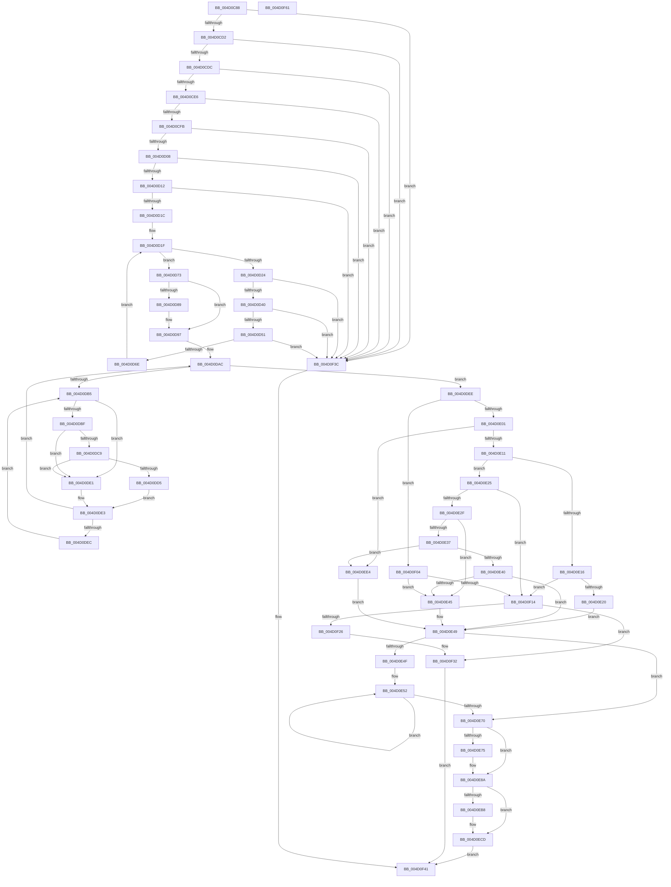

# KeSetSystemMultipleGroupAffinityThread

- RVA: `0x004D0C88`–`0x004D0F62` (길이 `730` bytes)
- VA: `0x00000001404D0C88`
- 실행 섹션: `.text`
- PDB 이름 있음: `예`; PDB Function 태그: `아니요`
- unwind 정보 RVA: `0x000AC264`
- 디코드: `188`개 명령, `730/730` bytes 표시
- 미해석 바이트: `0` (있으면 어셈블리에 `.byte`로 보존)

> 이 문서는 커널 이미지의 기계어와 PDB 기호를 분석해 생성했습니다. 4번과 5번은 함수 원형과 자료형을 바이너리 사용 방식에서 추정한 C 해석이며 원본 소스 복구 결과는 아닙니다.

## 1. Dependencies

- 직접 호출 지점: **9**; 고유 호출 대상: **9**
- 직접 호출자로 확인된 함수: **2**
- RIP 상대 이미지 참조: **6**

### Outgoing calls
- `0x004D0D8F` → [KiRaiseIrqlProcessIrqlFlags](../4F/KiRaiseIrqlProcessIrqlFlags_function_004F56FC.md) (function, `0x004F56FC`)
- `0x004D0DC9` → [KiCheckVpBackingLongSpinWaitHypercall](../30/KiCheckVpBackingLongSpinWaitHypercall_function_0030F490.md) (function, `0x0030F490`)
- `0x004D0DD7` → [HvlNotifyLongSpinWait](../30/HvlNotifyLongSpinWait_function_0030F460.md) (function, `0x0030F460`)
- `0x004D0E60` → [KeAddGroupAffinityEx](../25/KeAddGroupAffinityEx_function_0025B6C0.md) (function, `0x0025B6C0`)
- `0x004D0EA7` → [KiSetSystemAffinityThread](../39/KiSetSystemAffinityThread_function_003993E0.md) (function, `0x003993E0`)
- `0x004D0EC8` → [KiCpuPartitionCheckAffinitization](../5C/KiCpuPartitionCheckAffinitization_function_005C1420.md) (function, `0x005C1420`)
- `0x004D0EDB` → [KiProcessDeferredReadyList](../25/KiProcessDeferredReadyList_function_00250800.md) (function, `0x00250800`)
- `0x004D0EEF` → [KeFirstGroupAffinityEx](../46/KeFirstGroupAffinityEx_function_00463810.md) (function, `0x00463810`)
- `0x004D0F2D` → [KiLowerIrqlProcessIrqlFlags](../4F/KiLowerIrqlProcessIrqlFlags_function_004F5698.md) (function, `0x004F5698`)

### Direct callers
- [PsSetSystemMultipleGroupAffinityThread](../5E/PsSetSystemMultipleGroupAffinityThread_function_005E34B0.md) at `0x005E34B4`
- [MiCombineAllPhysicalMemory](../../page/9F/MiCombineAllPhysicalMemory_function_009F6B6C.md) at `0x009F6CF6`

### Static image references
- `0x004D0CB9` → RVA `0x00FC7120` (`ALMOSTRO`; read)
- `0x004D0D51` → RVA `0x00FC7128` (`ALMOSTRO`; read)
- `0x004D0D80` → RVA `0x00FC6D20` (`ALMOSTRO`; read)
- `0x004D0DB7` → RVA `0x00FC52AC` (`ALMOSTRO`; reference)
- `0x004D0DBF` → RVA `0x00FC6AB8` (`ALMOSTRO`; read)
- `0x004D0EAC` → RVA `0x00FC6B14` (`ALMOSTRO`; read)

## 2. Other-region calls and transfers

- 다른 실행 섹션으로 향하는 call: **0**
- 별도 외부 분기/꼬리 이동을 확인하지 못했습니다.

## 3. Assembly (complete function range)

```asm
004D0C88  48 8B C4                        mov rax, rsp
004D0C8B  48 89 58 08                     mov qword ptr [rax + 8], rbx
004D0C8F  48 89 68 10                     mov qword ptr [rax + 0x10], rbp
004D0C93  48 89 70 18                     mov qword ptr [rax + 0x18], rsi
004D0C97  57                              push rdi
004D0C98  41 54                           push r12
004D0C9A  41 55                           push r13
004D0C9C  41 56                           push r14
004D0C9E  41 57                           push r15
004D0CA0  48 83 EC 40                     sub rsp, 0x40
004D0CA4  45 33 D2                        xor r10d, r10d
004D0CA7  44 0F B7 FA                     movzx r15d, dx
004D0CAB  4C 89 50 20                     mov qword ptr [rax + 0x20], r10
004D0CAF  49 8B D8                        mov rbx, r8
004D0CB2  4C 8B E1                        mov r12, rcx
004D0CB5  44 0F 20 C0                     mov rax, cr8
004D0CB9  44 0F B7 05 5F 64 AF 00         movzx r8d, word ptr [rip + 0xaf645f]
004D0CC1  44 0F 20 C0                     mov rax, cr8
004D0CC5  41 8D 7A 02                     lea edi, [r10 + 2]
004D0CC9  40 3A C7                        cmp al, dil
004D0CCC  0F 87 6A 02 00 00               ja 0x1404d0f3c
004D0CD2  66 45 3B F8                     cmp r15w, r8w
004D0CD6  0F 87 60 02 00 00               ja 0x1404d0f3c
004D0CDC  80 7B 12 03                     cmp byte ptr [rbx + 0x12], 3
004D0CE0  0F 83 56 02 00 00               jae 0x1404d0f3c
004D0CE6  48 8B 43 18                     mov rax, qword ptr [rbx + 0x18]
004D0CEA  45 8D 5A 01                     lea r11d, [r10 + 1]
004D0CEE  0F B7 10                        movzx edx, word ptr [rax]
004D0CF1  66 41 3B D3                     cmp dx, r11w
004D0CF5  0F 82 41 02 00 00               jb 0x1404d0f3c
004D0CFB  0F B7 48 02                     movzx ecx, word ptr [rax + 2]
004D0CFF  66 3B D1                        cmp dx, cx
004D0D02  0F 87 34 02 00 00               ja 0x1404d0f3c
004D0D08  44 39 50 04                     cmp dword ptr [rax + 4], r10d
004D0D0C  0F 85 2A 02 00 00               jne 0x1404d0f3c
004D0D12  66 41 3B C8                     cmp cx, r8w
004D0D16  0F 82 20 02 00 00               jb 0x1404d0f3c
004D0D1C  45 8B C2                        mov r8d, r10d
004D0D1F  45 3B C7                        cmp r8d, r15d
004D0D22  73 4F                           jae 0x1404d0d73
004D0D24  41 8B D0                        mov edx, r8d
004D0D27  48 C1 E2 04                     shl rdx, 4
004D0D2B  49 03 D4                        add rdx, r12
004D0D2E  0F B7 4A 0E                     movzx ecx, word ptr [rdx + 0xe]
004D0D32  66 0B 4A 0C                     or cx, word ptr [rdx + 0xc]
004D0D36  66 0B 4A 0A                     or cx, word ptr [rdx + 0xa]
004D0D3A  0F 85 FC 01 00 00               jne 0x1404d0f3c
004D0D40  0F B7 42 08                     movzx eax, word ptr [rdx + 8]
004D0D44  66 3B 05 D5 63 AF 00            cmp ax, word ptr [rip + 0xaf63d5]
004D0D4B  0F 83 EB 01 00 00               jae 0x1404d0f3c
004D0D51  48 8D 0D D0 63 AF 00            lea rcx, [rip + 0xaf63d0]
004D0D58  48 8B 0C C1                     mov rcx, qword ptr [rcx + rax*8]
004D0D5C  48 8B 12                        mov rdx, qword ptr [rdx]
004D0D5F  48 8B C2                        mov rax, rdx
004D0D62  48 23 C1                        and rax, rcx
004D0D65  48 3B C2                        cmp rax, rdx
004D0D68  0F 85 CE 01 00 00               jne 0x1404d0f3c
004D0D6E  45 03 C3                        add r8d, r11d
004D0D71  EB AC                           jmp 0x1404d0d1f
004D0D73  44 0F 20 C5                     mov rbp, cr8
004D0D77  48 89 6C 24 30                  mov qword ptr [rsp + 0x30], rbp
004D0D7C  44 0F 22 C7                     mov cr8, rdi
004D0D80  44 39 15 99 5F AF 00            cmp dword ptr [rip + 0xaf5f99], r10d
004D0D87  74 0E                           je 0x1404d0d97
004D0D89  40 8A D7                        mov dl, dil
004D0D8C  40 8A CD                        mov cl, bpl
004D0D8F  E8 68 49 02 00                  call 0x1404f56fc
004D0D94  45 33 D2                        xor r10d, r10d
004D0D97  65 4C 8B 2C 25 20 00 00 00      mov r13, qword ptr gs:[0x20]
004D0DA0  41 8B F2                        mov esi, r10d
004D0DA3  BD 01 00 00 00                  mov ebp, 1
004D0DA8  49 8B 7D 08                     mov rdi, qword ptr [r13 + 8]
004D0DAC  F0 48 0F BA 6F 40 00            lock bts qword ptr [rdi + 0x40], 0
004D0DB3  73 39                           jae 0x1404d0dee
004D0DB5  03 F5                           add esi, ebp
004D0DB7  85 35 EF 44 AF 00               test dword ptr [rip + 0xaf44ef], esi
004D0DBD  75 22                           jne 0x1404d0de1
004D0DBF  8B 05 F3 5C AF 00               mov eax, dword ptr [rip + 0xaf5cf3]
004D0DC5  A8 40                           test al, 0x40
004D0DC7  74 18                           je 0x1404d0de1
004D0DC9  E8 C2 E6 E3 FF                  call 0x14030f490
004D0DCE  45 33 D2                        xor r10d, r10d
004D0DD1  84 C0                           test al, al
004D0DD3  74 0C                           je 0x1404d0de1
004D0DD5  8B CE                           mov ecx, esi
004D0DD7  E8 84 E6 E3 FF                  call 0x14030f460
004D0DDC  45 33 D2                        xor r10d, r10d
004D0DDF  EB 02                           jmp 0x1404d0de3
004D0DE1  F3 90                           pause
004D0DE3  48 8B 47 40                     mov rax, qword ptr [rdi + 0x40]
004D0DE7  48 85 C0                        test rax, rax
004D0DEA  74 C0                           je 0x1404d0dac
004D0DEC  EB C7                           jmp 0x1404d0db5
004D0DEE  8B 47 74                        mov eax, dword ptr [rdi + 0x74]
004D0DF1  44 8A F5                        mov r14b, bpl
004D0DF4  48 8B 6C 24 30                  mov rbp, qword ptr [rsp + 0x30]
004D0DF9  A8 08                           test al, 8
004D0DFB  0F 84 03 01 00 00               je 0x1404d0f04
004D0E01  48 8B 8F 50 04 00 00            mov rcx, qword ptr [rdi + 0x450]
004D0E08  48 85 C9                        test rcx, rcx
004D0E0B  0F 84 D3 00 00 00               je 0x1404d0ee4
004D0E11  48 3B CB                        cmp rcx, rbx
004D0E14  75 0F                           jne 0x1404d0e25
004D0E16  44 38 73 12                     cmp byte ptr [rbx + 0x12], r14b
004D0E1A  0F 84 F4 00 00 00               je 0x1404d0f14
004D0E20  45 8A F2                        mov r14b, r10b
004D0E23  EB 24                           jmp 0x1404d0e49
004D0E25  44 84 73 13                     test byte ptr [rbx + 0x13], r14b
004D0E29  0F 85 E5 00 00 00               jne 0x1404d0f14
004D0E2F  0F B6 49 12                     movzx ecx, byte ptr [rcx + 0x12]
004D0E33  85 C9                           test ecx, ecx
004D0E35  74 0E                           je 0x1404d0e45
004D0E37  83 E9 01                        sub ecx, 1
004D0E3A  0F 84 A4 00 00 00               je 0x1404d0ee4
004D0E40  83 F9 01                        cmp ecx, 1
004D0E43  75 04                           jne 0x1404d0e49
004D0E45  44 88 53 12                     mov byte ptr [rbx + 0x12], r10b
004D0E49  66 45 3B D7                     cmp r10w, r15w
004D0E4D  73 21                           jae 0x1404d0e70
004D0E4F  49 8B F7                        mov rsi, r15
004D0E52  4D 8B 04 24                     mov r8, qword ptr [r12]
004D0E56  41 0F B7 54 24 08               movzx edx, word ptr [r12 + 8]
004D0E5C  48 8B 4B 18                     mov rcx, qword ptr [rbx + 0x18]
004D0E60  E8 5B A8 D8 FF                  call 0x14025b6c0
004D0E65  4D 8D 64 24 10                  lea r12, [r12 + 0x10]
004D0E6A  48 83 EE 01                     sub rsi, 1
004D0E6E  75 E2                           jne 0x1404d0e52
004D0E70  45 84 F6                        test r14b, r14b
004D0E73  74 15                           je 0x1404d0e8a
004D0E75  80 4B 13 01                     or byte ptr [rbx + 0x13], 1
004D0E79  48 8B 87 50 04 00 00            mov rax, qword ptr [rdi + 0x450]
004D0E80  48 89 03                        mov qword ptr [rbx], rax
004D0E83  48 89 9F 50 04 00 00            mov qword ptr [rdi + 0x450], rbx
004D0E8A  48 8B 53 18                     mov rdx, qword ptr [rbx + 0x18]
004D0E8E  48 8D 84 24 88 00 00 00         lea rax, [rsp + 0x88]
004D0E96  41 B9 00 08 00 00               mov r9d, 0x800
004D0E9C  48 89 44 24 20                  mov qword ptr [rsp + 0x20], rax
004D0EA1  45 33 C0                        xor r8d, r8d
004D0EA4  49 8B CD                        mov rcx, r13
004D0EA7  E8 34 85 EC FF                  call 0x1403993e0
004D0EAC  F7 05 5E 5C AF 00 00 02 00 00   test dword ptr [rip + 0xaf5c5e], 0x200
004D0EB6  74 15                           je 0x1404d0ecd
004D0EB8  48 8B 97 40 02 00 00            mov rdx, qword ptr [rdi + 0x240]
004D0EBF  45 33 C9                        xor r9d, r9d
004D0EC2  41 B0 01                        mov r8b, 1
004D0EC5  48 8B CF                        mov rcx, rdi
004D0EC8  E8 53 05 0F 00                  call 0x1405c1420
004D0ECD  44 8A C5                        mov r8b, bpl
004D0ED0  48 8D 94 24 88 00 00 00         lea rdx, [rsp + 0x88]
004D0ED8  49 8B CD                        mov rcx, r13
004D0EDB  E8 20 F9 D7 FF                  call 0x140250800
004D0EE0  33 DB                           xor ebx, ebx
004D0EE2  EB 5D                           jmp 0x1404d0f41
004D0EE4  48 8B 97 40 02 00 00            mov rdx, qword ptr [rdi + 0x240]
004D0EEB  48 8D 4B 08                     lea rcx, [rbx + 8]
004D0EEF  E8 1C 29 F9 FF                  call 0x140463810
004D0EF4  80 4B 13 02                     or byte ptr [rbx + 0x13], 2
004D0EF8  45 33 D2                        xor r10d, r10d
004D0EFB  C6 43 12 02                     mov byte ptr [rbx + 0x12], 2
004D0EFF  E9 45 FF FF FF                  jmp 0x1404d0e49
004D0F04  83 C8 08                        or eax, 8
004D0F07  89 47 74                        mov dword ptr [rdi + 0x74], eax
004D0F0A  44 84 73 13                     test byte ptr [rbx + 0x13], r14b
004D0F0E  0F 84 31 FF FF FF               je 0x1404d0e45
004D0F14  4C 89 57 40                     mov qword ptr [rdi + 0x40], r10
004D0F18  BB 0D 00 00 C0                  mov ebx, 0xc000000d
004D0F1D  44 39 15 FC 5D AF 00            cmp dword ptr [rip + 0xaf5dfc], r10d
004D0F24  74 0C                           je 0x1404d0f32
004D0F26  44 0F 20 C1                     mov rcx, cr8
004D0F2A  40 8A D5                        mov dl, bpl
004D0F2D  E8 66 47 02 00                  call 0x1404f5698
004D0F32  40 0F B6 C5                     movzx eax, bpl
004D0F36  44 0F 22 C0                     mov cr8, rax
004D0F3A  EB 05                           jmp 0x1404d0f41
004D0F3C  BB 0D 00 00 C0                  mov ebx, 0xc000000d
004D0F41  4C 8D 5C 24 40                  lea r11, [rsp + 0x40]
004D0F46  8B C3                           mov eax, ebx
004D0F48  49 8B 5B 30                     mov rbx, qword ptr [r11 + 0x30]
004D0F4C  49 8B 6B 38                     mov rbp, qword ptr [r11 + 0x38]
004D0F50  49 8B 73 40                     mov rsi, qword ptr [r11 + 0x40]
004D0F54  49 8B E3                        mov rsp, r11
004D0F57  41 5F                           pop r15
004D0F59  41 5E                           pop r14
004D0F5B  41 5D                           pop r13
004D0F5D  41 5C                           pop r12
004D0F5F  5F                              pop rdi
004D0F60  C3                              ret
004D0F61  CC                              int3
```

## 4. C-style interpretation (structured pseudocode)

```c
__int64 __fastcall KeSetSystemMultipleGroupAffinityThread(__int64 a1, unsigned __int16 a2, __int64 a3)
{
    __int64 result;
    __int64 v_r10;
    __int64 v_rbx;
    __int64 v_rsi;
    __int64 v_rsp;
    unsigned __int64 v_stack_m28;
    unsigned __int64 v_stack_m38;
    unsigned __int64 v_stack_m48;
    unsigned __int64 v_stack_p20;

    *(unsigned __int64 *)(v_rsp + 8) = v_rbx;
    *(unsigned __int64 *)(v_rsp + 16) = v_rbp;
    *(unsigned __int64 *)(v_rsp + 24) = v_rsi;
    v_rsp = (v_rsp) - (64);
    v_r10 = 0;
    *(unsigned __int64 *)(v_rsp + 32) = 0;
    if (((unsigned __int8)(v_cr8)) > ((unsigned __int8)(v_r10 + 2))) goto loc_004D0F3C;
    if (a2 > ((unsigned __int16)(*(unsigned __int16 *)(v_rip + 11494495)))) goto loc_004D0F3C;
    if ((*(unsigned __int8 *)(a3 + 18)) >= 3) goto loc_004D0F3C;
    if (((unsigned __int16)(*(unsigned __int16 *)(*(unsigned __int64 *)(a3 + 24)))) < ((unsigned __int16)(v_r10 + 1))) goto loc_004D0F3C;
    if (((unsigned __int16)(*(unsigned __int16 *)(*(unsigned __int64 *)(a3 + 24)))) > ((unsigned __int16)(*(unsigned __int16 *)(*(unsigned __int64 *)(a3 + 24) + 2)))) goto loc_004D0F3C;
    if ((*(unsigned int *)(*(unsigned __int64 *)(a3 + 24) + 4)) != 0) goto loc_004D0F3C;
    if (((unsigned __int16)(*(unsigned __int16 *)(*(unsigned __int64 *)(a3 + 24) + 2))) < ((unsigned __int16)(*(unsigned __int16 *)(v_rip + 11494495)))) goto loc_004D0F3C;
loc_004D0D1F:
    if (0 >= a2) goto loc_004D0D73;
    a2 = (0) << (4);
    a2 = (a2) + (a1);
    a1 = (unsigned __int16)((*(unsigned __int16 *)(a2 + 14)) | (*(unsigned __int16 *)(a2 + 12)));
    a1 = (unsigned __int16)((a1) | (*(unsigned __int16 *)(a2 + 10)));
    if (condition_is_not_equal) goto loc_004D0F3C;
    if (((unsigned __int16)(*(unsigned __int16 *)(a2 + 8))) >= (*(unsigned __int16 *)(v_rip + 11494357))) goto loc_004D0F3C;
    result = (*(unsigned __int64 *)(a2)) & (*(unsigned __int64 *)(v_rip + 11494352 + *(unsigned __int16 *)(a2 + 8) * 8));
    if (result != (*(unsigned __int64 *)(a2))) goto loc_004D0F3C;
    a3 = (unsigned int)((0) + ((unsigned int)(v_r10 + 1)));
    goto loc_004D0D1F;
loc_004D0D73:
    v_stack_m38 = v_cr8;
    if ((*(unsigned int *)(v_rip + 11493273)) != 0) {
        a2 = (unsigned __int8)(v_r10 + 2);
        a1 = (unsigned __int8)(v_cr8);
        result = KiRaiseIrqlProcessIrqlFlags(a1, a2, a3, a4);
        v_r10 = 0;
    }
loc_004D0DAC:
    if (condition_is_above_or_equal) goto loc_004D0DEE;
loc_004D0DB5:
    v_rsi = (unsigned int)((0) + (1));
    if (((*(unsigned int *)(v_rip + 11486447)) & ((unsigned int)(v_rsi))) != 0) goto loc_004D0DE1;
    if ((((unsigned __int8)((unsigned int)(*(unsigned int *)(v_rip + 11492595)))) & (64)) == 0) goto loc_004D0DE1;
    result = KiCheckVpBackingLongSpinWaitHypercall(a1, a2, a3, a4);
    v_r10 = 0;
    if ((unsigned __int8)(result) == 0) goto loc_004D0DE1;
    result = HvlNotifyLongSpinWait((unsigned int)((unsigned int)(v_rsi)), a2, a3, a4);
    v_r10 = 0;
    goto loc_004D0DE3;
loc_004D0DE1:
loc_004D0DE3:
    if (*(unsigned __int64 *)(*(unsigned __int64 *)(*(unsigned __int64 *)(gs_base + (0 + 32)) + 8) + 64) == 0) goto loc_004D0DAC;
    goto loc_004D0DB5;
loc_004D0DEE:
    if ((((unsigned __int8)((unsigned int)(*(unsigned int *)(*(unsigned __int64 *)(*(unsigned __int64 *)(gs_base + (0 + 32)) + 8) + 116)))) & (8)) == 0) goto loc_004D0F04;
    if (*(unsigned __int64 *)(*(unsigned __int64 *)(*(unsigned __int64 *)(gs_base + (0 + 32)) + 8) + 1104) == 0) goto loc_004D0EE4;
    if ((*(unsigned __int64 *)(*(unsigned __int64 *)(*(unsigned __int64 *)(gs_base + (0 + 32)) + 8) + 1104)) != a3) goto loc_004D0E25;
    if ((*(unsigned __int8 *)(a3 + 18)) == 1) goto loc_004D0F14;
    goto loc_004D0E49;
loc_004D0E25:
    if (((*(unsigned __int8 *)(a3 + 19)) & (0)) != 0) goto loc_004D0F14;
    if ((unsigned int)(*(unsigned __int8 *)(*(unsigned __int64 *)(*(unsigned __int64 *)(*(unsigned __int64 *)(gs_base + (0 + 32)) + 8) + 1104) + 18)) == 0) goto loc_004D0E45;
    a1 = (unsigned int)((*(unsigned __int8 *)(*(unsigned __int64 *)(*(unsigned __int64 *)(*(unsigned __int64 *)(gs_base + (0 + 32)) + 8) + 1104) + 18)) - (1));
    if (condition_is_equal) goto loc_004D0EE4;
    if (((unsigned int)(a1)) == 1) {
        *(unsigned __int8 *)(a3 + 18) = 0;
    }
    if (0 >= a2) goto loc_004D0E70;
loc_004D0E52:
    result = KeAddGroupAffinityEx(*(unsigned __int64 *)(a3 + 24), *(unsigned __int16 *)(a1 + 8), *(unsigned __int64 *)(a1), a4);
    v_rsi = (a2) - (1);
    if (condition_is_not_equal) goto loc_004D0E52;
loc_004D0E70:
    if (0 != 0) {
        result = *(unsigned __int64 *)(*(unsigned __int64 *)(*(unsigned __int64 *)(gs_base + (0 + 32)) + 8) + 1104);
        *(unsigned __int64 *)(a3) = result;
        *(unsigned __int64 *)(*(unsigned __int64 *)(*(unsigned __int64 *)(gs_base + (0 + 32)) + 8) + 1104) = a3;
    }
    v_stack_m48 = v_stack_p20;
    a3 = 0;
    result = KiSetSystemAffinityThread(*(unsigned __int64 *)(gs_base + (0 + 32)), *(unsigned __int64 *)(a3 + 24), a3, (unsigned int)(0x800ULL));
    if (((*(unsigned int *)(v_rip + 11492446)) & (512)) != 0) {
        a2 = *(unsigned __int64 *)(*(unsigned __int64 *)(*(unsigned __int64 *)(gs_base + (0 + 32)) + 8) + 576);
        a4 = 0;
        a3 = 1;
        a1 = *(unsigned __int64 *)(*(unsigned __int64 *)(gs_base + (0 + 32)) + 8);
        result = KiCpuPartitionCheckAffinitization(a1, a2, a3, a4);
    }
    result = KiProcessDeferredReadyList(*(unsigned __int64 *)(gs_base + (0 + 32)), v_stack_p20, (unsigned __int8)(v_stack_m38), a4);
    v_rbx = 0;
    goto loc_004D0F41;
loc_004D0EE4:
    result = KeFirstGroupAffinityEx(v_rbx + 8, *(unsigned __int64 *)(*(unsigned __int64 *)(*(unsigned __int64 *)(gs_base + (0 + 32)) + 8) + 576), (unsigned __int8)(v_stack_m38), a4);
    v_r10 = 0;
    *(unsigned __int8 *)(v_rbx + 18) = 2;
    goto loc_004D0E49;
loc_004D0F04:
    result = (unsigned int)((result) | (8));
    *(unsigned int *)(*(unsigned __int64 *)(*(unsigned __int64 *)(gs_base + (0 + 32)) + 8) + 116) = (unsigned int)(result);
    if (((*(unsigned __int8 *)(v_rbx + 19)) & (0)) == 0) goto loc_004D0E45;
loc_004D0F14:
    *(unsigned __int64 *)(*(unsigned __int64 *)(*(unsigned __int64 *)(gs_base + (0 + 32)) + 8) + 64) = 0;
    if ((*(unsigned int *)(v_rip + 11492860)) != 0) {
        a1 = v_r10 + 2;
        a2 = (unsigned __int8)(v_stack_m38);
        result = KiLowerIrqlProcessIrqlFlags(a1, a2, (unsigned __int8)(v_stack_m38), a4);
    }
    goto loc_004D0F41;
loc_004D0F3C:
loc_004D0F41:
    return (unsigned int)((unsigned int)((unsigned int)(0xC000000DULL)));
}
```

## 5. (Beta) C Style

```c
int64_t KeSetSystemMultipleGroupAffinityThread(void *Arg1, uint16_t Arg2, void *Arg3)
{
    uint8_t *arg1 = (uint8_t *)Arg1;
    uint8_t *arg3 = (uint8_t *)Arg3;

    int64_t result;
    int64_t local_r10;
    int64_t local_rbx;
    int64_t local_rsi;
    int64_t local_rsp;
    uint64_t v_stack_m28;
    uint64_t v_stack_m38;
    uint64_t v_stack_m48;
    uint64_t v_stack_p20;

    *(uint64_t *)(local_rsp + 0x8) = local_rbx;
    *(uint64_t *)(local_rsp + 0x10) = local_rbp;
    *(uint64_t *)(local_rsp + 0x18) = local_rsi;
    local_rsp = (local_rsp) - (64);
    local_r10 = 0;
    *(uint64_t *)(local_rsp + 0x20) = 0;
    if (((uint8_t)(v_cr8)) > ((uint8_t)(local_r10 + 2))) goto loc_004D0F3C;
    if (Arg2 > ((uint16_t)(*(uint16_t *)(v_rip + 0xAF645F)))) goto loc_004D0F3C;
    if ((*(uint8_t *)(arg3 + 0x12)) >= 3) goto loc_004D0F3C;
    if (((uint16_t)(*(uint16_t *)(*(uint64_t *)(arg3 + 0x18)))) < ((uint16_t)(local_r10 + 1))) goto loc_004D0F3C;
    if (((uint16_t)(*(uint16_t *)(*(uint64_t *)(arg3 + 0x18)))) > ((uint16_t)(*(uint16_t *)(*(uint64_t *)(arg3 + 0x18) + 0x2)))) goto loc_004D0F3C;
    if ((*(uint32_t *)(*(uint64_t *)(arg3 + 0x18) + 0x4)) != 0) goto loc_004D0F3C;
    if (((uint16_t)(*(uint16_t *)(*(uint64_t *)(arg3 + 0x18) + 0x2))) < ((uint16_t)(*(uint16_t *)(v_rip + 0xAF645F)))) goto loc_004D0F3C;
loc_004D0D1F:
    if (0 >= Arg2) goto loc_004D0D73;
    Arg2 = (0) << (4);
    Arg2 = (Arg2) + (Arg1);
    Arg1 = (uint16_t)((*(uint16_t *)(Arg2 + 0xE)) | (*(uint16_t *)(Arg2 + 0xC)));
    Arg1 = (uint16_t)((Arg1) | (*(uint16_t *)(Arg2 + 0xA)));
    if (condition_is_not_equal) goto loc_004D0F3C;
    if (((uint16_t)(*(uint16_t *)(Arg2 + 0x8))) >= (*(uint16_t *)(v_rip + 0xAF63D5))) goto loc_004D0F3C;
    result = (*(uint64_t *)(Arg2)) & (*(uint64_t *)(v_rip + 0xAF63D0 + *(uint16_t *)(Arg2 + 0x8) * 8));
    if (result != (*(uint64_t *)(Arg2))) goto loc_004D0F3C;
    Arg3 = (uint32_t)((0) + ((uint32_t)(local_r10 + 1)));
    goto loc_004D0D1F;
loc_004D0D73:
    v_stack_m38 = v_cr8;
    if ((*(uint32_t *)(v_rip + 0xAF5F99)) != 0) {
        Arg2 = (uint8_t)(local_r10 + 2);
        Arg1 = (uint8_t)(v_cr8);
        result = KiRaiseIrqlProcessIrqlFlags(Arg1, Arg2, Arg3, a4);
        local_r10 = 0;
    }
loc_004D0DAC:
    if (condition_is_above_or_equal) goto loc_004D0DEE;
loc_004D0DB5:
    local_rsi = (uint32_t)((0) + (1));
    if (((*(uint32_t *)(v_rip + 0xAF44EF)) & ((uint32_t)(local_rsi))) != 0) goto loc_004D0DE1;
    if ((((uint8_t)((uint32_t)(*(uint32_t *)(v_rip + 0xAF5CF3)))) & (64)) == 0) goto loc_004D0DE1;
    result = KiCheckVpBackingLongSpinWaitHypercall(Arg1, Arg2, Arg3, a4);
    local_r10 = 0;
    if ((uint8_t)(result) == 0) goto loc_004D0DE1;
    result = HvlNotifyLongSpinWait((uint32_t)((uint32_t)(local_rsi)), Arg2, Arg3, a4);
    local_r10 = 0;
    goto loc_004D0DE3;
loc_004D0DE1:
loc_004D0DE3:
    if (*(uint64_t *)(*(uint64_t *)(*(uint64_t *)(gs_base + (0 + 0x20)) + 0x8) + 0x40) == 0) goto loc_004D0DAC;
    goto loc_004D0DB5;
loc_004D0DEE:
    if ((((uint8_t)((uint32_t)(*(uint32_t *)(*(uint64_t *)(*(uint64_t *)(gs_base + (0 + 0x20)) + 0x8) + 0x74)))) & (8)) == 0) goto loc_004D0F04;
    if (*(uint64_t *)(*(uint64_t *)(*(uint64_t *)(gs_base + (0 + 0x20)) + 0x8) + 0x450) == 0) goto loc_004D0EE4;
    if ((*(uint64_t *)(*(uint64_t *)(*(uint64_t *)(gs_base + (0 + 0x20)) + 0x8) + 0x450)) != Arg3) goto loc_004D0E25;
    if ((*(uint8_t *)(arg3 + 0x12)) == 1) goto loc_004D0F14;
    goto loc_004D0E49;
loc_004D0E25:
    if (((*(uint8_t *)(arg3 + 0x13)) & (0)) != 0) goto loc_004D0F14;
    if ((uint32_t)(*(uint8_t *)(*(uint64_t *)(*(uint64_t *)(*(uint64_t *)(gs_base + (0 + 0x20)) + 0x8) + 0x450) + 0x12)) == 0) goto loc_004D0E45;
    Arg1 = (uint32_t)((*(uint8_t *)(*(uint64_t *)(*(uint64_t *)(*(uint64_t *)(gs_base + (0 + 0x20)) + 0x8) + 0x450) + 0x12)) - (1));
    if (condition_is_equal) goto loc_004D0EE4;
    if (((uint32_t)(Arg1)) == 1) {
        *(uint8_t *)(arg3 + 0x12) = 0;
    }
    if (0 >= Arg2) goto loc_004D0E70;
loc_004D0E52:
    result = KeAddGroupAffinityEx(*(uint64_t *)(arg3 + 0x18), *(uint16_t *)(arg1 + 0x8), *(uint64_t *)(arg1), a4);
    local_rsi = (Arg2) - (1);
    if (condition_is_not_equal) goto loc_004D0E52;
loc_004D0E70:
    if (0 != 0) {
        result = *(uint64_t *)(*(uint64_t *)(*(uint64_t *)(gs_base + (0 + 0x20)) + 0x8) + 0x450);
        *(uint64_t *)(arg3) = result;
        *(void **)(*(uint64_t *)(*(uint64_t *)(gs_base + (0 + 0x20)) + 0x8) + 0x450) = Arg3;
    }
    v_stack_m48 = v_stack_p20;
    Arg3 = 0;
    result = KiSetSystemAffinityThread(*(uint64_t *)(gs_base + (0 + 0x20)), *(uint64_t *)(arg3 + 0x18), Arg3, (uint32_t)(0x800ULL));
    if (((*(uint32_t *)(v_rip + 0xAF5C5E)) & (512)) != 0) {
        Arg2 = *(uint64_t *)(*(uint64_t *)(*(uint64_t *)(gs_base + (0 + 0x20)) + 0x8) + 0x240);
        a4 = 0;
        Arg3 = 1;
        Arg1 = *(uint64_t *)(*(uint64_t *)(gs_base + (0 + 0x20)) + 0x8);
        result = KiCpuPartitionCheckAffinitization(Arg1, Arg2, Arg3, a4);
    }
    result = KiProcessDeferredReadyList(*(uint64_t *)(gs_base + (0 + 0x20)), v_stack_p20, (uint8_t)(v_stack_m38), a4);
    local_rbx = 0;
    goto loc_004D0F41;
loc_004D0EE4:
    result = KeFirstGroupAffinityEx(local_rbx + 8, *(uint64_t *)(*(uint64_t *)(*(uint64_t *)(gs_base + (0 + 0x20)) + 0x8) + 0x240), (uint8_t)(v_stack_m38), a4);
    local_r10 = 0;
    *(uint8_t *)(local_rbx + 0x12) = 2;
    goto loc_004D0E49;
loc_004D0F04:
    result = (uint32_t)((result) | (8));
    *(uint32_t *)(*(uint64_t *)(*(uint64_t *)(gs_base + (0 + 0x20)) + 0x8) + 0x74) = (uint32_t)(result);
    if (((*(uint8_t *)(local_rbx + 0x13)) & (0)) == 0) goto loc_004D0E45;
loc_004D0F14:
    *(uint64_t *)(*(uint64_t *)(*(uint64_t *)(gs_base + (0 + 0x20)) + 0x8) + 0x40) = 0;
    if ((*(uint32_t *)(v_rip + 0xAF5DFC)) != 0) {
        Arg1 = local_r10 + 2;
        Arg2 = (uint8_t)(v_stack_m38);
        result = KiLowerIrqlProcessIrqlFlags(Arg1, Arg2, (uint8_t)(v_stack_m38), a4);
    }
    goto loc_004D0F41;
loc_004D0F3C:
loc_004D0F41:
    return (uint32_t)((uint32_t)((uint32_t)(0xC000000DULL)));
}
```

### 관측된 메모리 오프셋

구조체 형식이 확인되지 않은 접근은 인자 기준의 오프셋으로만 기록했습니다.

| 기준 인자 | 오프셋 표현 | 폭 (bit) | 접근 |
|---|---:|---:|---|
| `Arg1` | `+ 0x0` | `64` | `R` |
| `Arg1` | `+ 0x8` | `16` | `R` |
| `Arg1` | `+ 0x10` | `64` | `R` |
| `Arg3` | `+ 0x0` | `64` | `W` |
| `Arg3` | `+ 0x8` | `64` | `R` |
| `Arg3` | `+ 0x12` | `8` | `R` |
| `Arg3` | `+ 0x12` | `8` | `W` |
| `Arg3` | `+ 0x13` | `8` | `R` |
| `Arg3` | `+ 0x13` | `8` | `R/W` |
| `Arg3` | `+ 0x18` | `64` | `R` |

## 6. Execution-region graph

[열기: 2D/3D 그래프와 함수 탐색 컨트롤 패널](../../../control-panel.html?section=text&rva=0x004D0C88&view=graph)

- 2D 그래프는 위에서 아래로 흐르고, 3D 그래프는 빈 공간을 드래그해 회전합니다. Shift+드래그는 이동, 휠은 확대·축소, 함수 노드 선택은 대상 보고서 이동입니다.

### Static fallback


