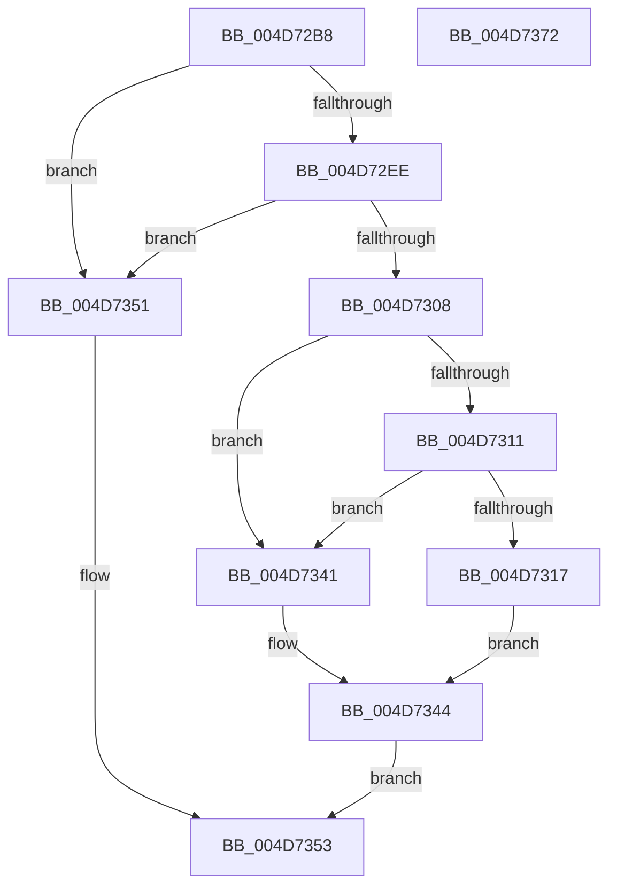

# KeTryToInsertQueueApc

- RVA: `0x004D72B8`–`0x004D7373` (길이 `187` bytes)
- VA: `0x00000001404D72B8`
- 실행 섹션: `.text`
- PDB 이름 있음: `예`; PDB Function 태그: `아니요`
- unwind 정보 RVA: `0x0005FEF8`
- 디코드: `53`개 명령, `187/187` bytes 표시
- 미해석 바이트: `0` (있으면 어셈블리에 `.byte`로 보존)

> 이 문서는 커널 이미지의 기계어와 PDB 기호를 분석해 생성했습니다. 4번과 5번은 함수 원형과 자료형을 바이너리 사용 방식에서 추정한 C 해석이며 원본 소스 복구 결과는 아닙니다.

## 1. Dependencies

- 직접 호출 지점: **4**; 고유 호출 대상: **4**
- 직접 호출자로 확인된 함수: **2**
- RIP 상대 이미지 참조: **0**

### Outgoing calls
- `0x004D72E5` → [KeIsThreadRunning](../39/KeIsThreadRunning_function_00396720.md) (function, `0x00396720`)
- `0x004D72EE` → [KeGetEffectiveIrql](../2F/KeGetEffectiveIrql_function_002F8030.md) (function, `0x002F8030`)
- `0x004D7329` → [KiInsertQueueApc](../20/KiInsertQueueApc_function_002041F0.md) (function, `0x002041F0`)
- `0x004D733A` → [KiSignalThreadForApc](../20/KiSignalThreadForApc_function_00204360.md) (function, `0x00204360`)

### Direct callers
- [EtwpQueueApc](../20/EtwpQueueApc_function_00203B7C.md) at `0x00203D57`
- [EtwpCovSampCaptureQueueApc](../65/EtwpCovSampCaptureQueueApc_function_00653CF0.md) at `0x00653E46`

### Static image references
- 디코드된 RIP-relative 메모리 참조가 없습니다.

## 2. Other-region calls and transfers

- 다른 실행 섹션으로 향하는 call: **0**
- 별도 외부 분기/꼬리 이동을 확인하지 못했습니다.

## 3. Assembly (complete function range)

```asm
004D72B8  48 8B C4                        mov rax, rsp
004D72BB  48 89 58 08                     mov qword ptr [rax + 8], rbx
004D72BF  48 89 68 10                     mov qword ptr [rax + 0x10], rbp
004D72C3  48 89 70 18                     mov qword ptr [rax + 0x18], rsi
004D72C7  48 89 78 20                     mov qword ptr [rax + 0x20], rdi
004D72CB  41 54                           push r12
004D72CD  41 56                           push r14
004D72CF  41 57                           push r15
004D72D1  48 83 EC 20                     sub rsp, 0x20
004D72D5  48 8B 59 08                     mov rbx, qword ptr [rcx + 8]
004D72D9  48 8B F9                        mov rdi, rcx
004D72DC  48 8B CB                        mov rcx, rbx
004D72DF  4D 8B F8                        mov r15, r8
004D72E2  4C 8B E2                        mov r12, rdx
004D72E5  E8 36 F4 EB FF                  call 0x140396720
004D72EA  84 C0                           test al, al
004D72EC  74 63                           je 0x1404d7351
004D72EE  E8 3D 0D E2 FF                  call 0x1402f8030
004D72F3  65 4C 8B 34 25 20 00 00 00      mov r14, qword ptr gs:[0x20]
004D72FC  40 8A E8                        mov bpl, al
004D72FF  F0 48 0F BA 6B 40 00            lock bts qword ptr [rbx + 0x40], 0
004D7306  72 49                           jb 0x1404d7351
004D7308  F7 43 74 00 40 00 00            test dword ptr [rbx + 0x74], 0x4000
004D730F  74 30                           je 0x1404d7341
004D7311  80 7F 52 00                     cmp byte ptr [rdi + 0x52], 0
004D7315  75 2A                           jne 0x1404d7341
004D7317  40 B6 01                        mov sil, 1
004D731A  4C 89 67 40                     mov qword ptr [rdi + 0x40], r12
004D731E  48 8B CF                        mov rcx, rdi
004D7321  40 88 77 52                     mov byte ptr [rdi + 0x52], sil
004D7325  4C 89 7F 48                     mov qword ptr [rdi + 0x48], r15
004D7329  E8 C2 CE D2 FF                  call 0x1402041f0
004D732E  45 33 C9                        xor r9d, r9d
004D7331  44 8A C5                        mov r8b, bpl
004D7334  48 8B D7                        mov rdx, rdi
004D7337  49 8B CE                        mov rcx, r14
004D733A  E8 21 D0 D2 FF                  call 0x140204360
004D733F  EB 03                           jmp 0x1404d7344
004D7341  40 32 F6                        xor sil, sil
004D7344  48 C7 43 40 00 00 00 00         mov qword ptr [rbx + 0x40], 0
004D734C  40 8A C6                        mov al, sil
004D734F  EB 02                           jmp 0x1404d7353
004D7351  32 C0                           xor al, al
004D7353  48 8B 5C 24 40                  mov rbx, qword ptr [rsp + 0x40]
004D7358  48 8B 6C 24 48                  mov rbp, qword ptr [rsp + 0x48]
004D735D  48 8B 74 24 50                  mov rsi, qword ptr [rsp + 0x50]
004D7362  48 8B 7C 24 58                  mov rdi, qword ptr [rsp + 0x58]
004D7367  48 83 C4 20                     add rsp, 0x20
004D736B  41 5F                           pop r15
004D736D  41 5E                           pop r14
004D736F  41 5C                           pop r12
004D7371  C3                              ret
004D7372  CC                              int3
```

## 4. C-style interpretation (structured pseudocode)

```c
__int64 __fastcall KeTryToInsertQueueApc(__int64 a1, __int64 a2, __int64 a3, int a4)
{
    __int64 result;
    __int64 v_rsi;
    __int64 v_rsp;
    unsigned __int64 v_stack_p10;
    unsigned __int64 v_stack_p18;
    unsigned __int64 v_stack_p20;
    unsigned __int64 v_stack_p8;

    *(unsigned __int64 *)(v_rsp + 8) = v_rbx;
    *(unsigned __int64 *)(v_rsp + 16) = v_rbp;
    *(unsigned __int64 *)(v_rsp + 24) = v_rsi;
    *(unsigned __int64 *)(v_rsp + 32) = v_rdi;
    v_rsp = (v_rsp) - (32);
    result = KeIsThreadRunning(*(unsigned __int64 *)(a1 + 8), a2, a3, a4);
    if ((unsigned __int8)(result) == 0) goto loc_004D7351;
    result = KeGetEffectiveIrql(*(unsigned __int64 *)(a1 + 8), a2, a3, a4);
    if (condition_is_below) goto loc_004D7351;
    if (((*(unsigned int *)(*(unsigned __int64 *)(a1 + 8) + 116)) & (0x4000ULL)) == 0) goto loc_004D7341;
    if ((*(unsigned __int8 *)(a1 + 82)) != 0) goto loc_004D7341;
    *(unsigned __int64 *)(a1 + 64) = a2;
    *(unsigned __int8 *)(a1 + 82) = 1;
    *(unsigned __int64 *)(a1 + 72) = a3;
    result = KiInsertQueueApc(a1, a2, a3, a4);
    a4 = 0;
    result = KiSignalThreadForApc(*(unsigned __int64 *)(gs_base + (0 + 32)), a1, (unsigned __int8)((unsigned __int8)(result)), a4);
    goto loc_004D7344;
loc_004D7341:
    v_rsi = 0;
loc_004D7344:
    *(unsigned __int64 *)(*(unsigned __int64 *)(a1 + 8) + 64) = 0;
    goto loc_004D7353;
loc_004D7351:
    result = 0;
loc_004D7353:
    v_rsp = (v_rsp) + (32);
    return result;
}
```

## 5. (Beta) C Style

```c
int64_t KeTryToInsertQueueApc(void *Arg1, int64_t Arg2, int64_t Arg3, int32_t Arg4)
{
    uint8_t *arg1 = (uint8_t *)Arg1;

    int64_t result;
    int64_t local_rsi;
    int64_t local_rsp;
    uint64_t v_stack_p10;
    uint64_t v_stack_p18;
    uint64_t v_stack_p20;
    uint64_t v_stack_p8;

    *(uint64_t *)(local_rsp + 0x8) = local_rbx;
    *(uint64_t *)(local_rsp + 0x10) = local_rbp;
    *(uint64_t *)(local_rsp + 0x18) = local_rsi;
    *(uint64_t *)(local_rsp + 0x20) = local_rdi;
    local_rsp = (local_rsp) - (32);
    result = KeIsThreadRunning(*(uint64_t *)(arg1 + 0x8), Arg2, Arg3, Arg4);
    if ((uint8_t)(result) == 0) goto loc_004D7351;
    result = KeGetEffectiveIrql(*(uint64_t *)(arg1 + 0x8), Arg2, Arg3, Arg4);
    if (condition_is_below) goto loc_004D7351;
    if (((*(uint32_t *)(*(uint64_t *)(arg1 + 0x8) + 0x74)) & (0x4000ULL)) == 0) goto loc_004D7341;
    if ((*(uint8_t *)(arg1 + 0x52)) != 0) goto loc_004D7341;
    *(uint64_t *)(arg1 + 0x40) = Arg2;
    *(uint8_t *)(arg1 + 0x52) = 1;
    *(uint64_t *)(arg1 + 0x48) = Arg3;
    result = KiInsertQueueApc(Arg1, Arg2, Arg3, Arg4);
    Arg4 = 0;
    result = KiSignalThreadForApc(*(uint64_t *)(gs_base + (0 + 0x20)), Arg1, (uint8_t)((uint8_t)(result)), Arg4);
    goto loc_004D7344;
loc_004D7341:
    local_rsi = 0;
loc_004D7344:
    *(uint64_t *)(*(uint64_t *)(arg1 + 0x8) + 0x40) = 0;
    goto loc_004D7353;
loc_004D7351:
    result = 0;
loc_004D7353:
    local_rsp = (local_rsp) + (32);
    return result;
}
```

### 관측된 메모리 오프셋

구조체 형식이 확인되지 않은 접근은 인자 기준의 오프셋으로만 기록했습니다.

| 기준 인자 | 오프셋 표현 | 폭 (bit) | 접근 |
|---|---:|---:|---|
| `Arg1` | `+ 0x8` | `64` | `R` |
| `Arg1` | `+ 0x40` | `64` | `W` |
| `Arg1` | `+ 0x48` | `64` | `W` |
| `Arg1` | `+ 0x52` | `8` | `R` |
| `Arg1` | `+ 0x52` | `8` | `W` |

## 6. Execution-region graph

[열기: 2D/3D 그래프와 함수 탐색 컨트롤 패널](../../../control-panel.html?section=text&rva=0x004D72B8&view=graph)

- 2D 그래프는 위에서 아래로 흐르고, 3D 그래프는 빈 공간을 드래그해 회전합니다. Shift+드래그는 이동, 휠은 확대·축소, 함수 노드 선택은 대상 보고서 이동입니다.

### Static fallback


