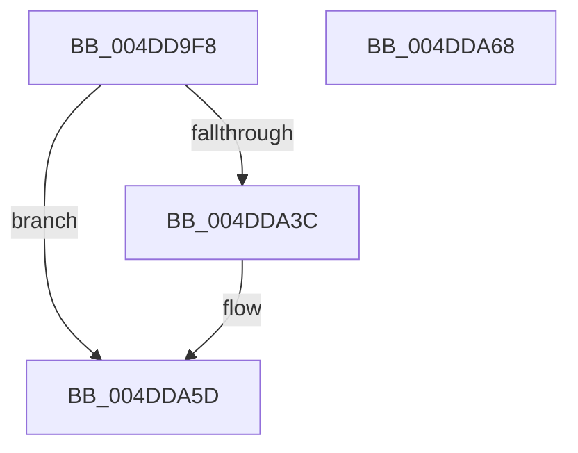

# KiAllocateXStateStack

- RVA: `0x004DD9F8`–`0x004DDA69` (길이 `113` bytes)
- VA: `0x00000001404DD9F8`
- 실행 섹션: `.text`
- PDB 이름 있음: `예`; PDB Function 태그: `아니요`
- unwind 정보 RVA: `0x00089EA4`
- 디코드: `31`개 명령, `113/113` bytes 표시
- 미해석 바이트: `0` (있으면 어셈블리에 `.byte`로 보존)

> 이 문서는 커널 이미지의 기계어와 PDB 기호를 분석해 생성했습니다. 4번과 5번은 함수 원형과 자료형을 바이너리 사용 방식에서 추정한 C 해석이며 원본 소스 복구 결과는 아닙니다.

## 1. Dependencies

- 직접 호출 지점: **2**; 고유 호출 대상: **2**
- 직접 호출자로 확인된 함수: **1**
- RIP 상대 이미지 참조: **1**

### Outgoing calls
- `0x004DDA31` → [MmCreateKernelStack](../33/MmCreateKernelStack_function_00337D20.md) (function, `0x00337D20`)
- `0x004DDA56` → [memset](../6C/memset_function_006C6C40.md) (function, `0x006C6C40`)

### Direct callers
- [KeInitThread](../../pagelk/B7/KeInitThread_function_00B78450.md) at `0x00B78909`

### Static image references
- `0x004DDA3C` → RVA `0x00FC6C54` (`ALMOSTRO`; read)

## 2. Other-region calls and transfers

- 다른 실행 섹션으로 향하는 call: **0**
- 별도 외부 분기/꼬리 이동을 확인하지 못했습니다.

## 3. Assembly (complete function range)

```asm
004DD9F8  48 8B C4                        mov rax, rsp
004DD9FB  48 89 58 08                     mov qword ptr [rax + 8], rbx
004DD9FF  57                              push rdi
004DDA00  48 83 EC 50                     sub rsp, 0x50
004DDA04  83 60 D4 00                     and dword ptr [rax - 0x2c], 0
004DDA08  48 8B F9                        mov rdi, rcx
004DDA0B  48 83 60 E0 00                  and qword ptr [rax - 0x20], 0
004DDA10  0F 57 C0                        xorps xmm0, xmm0
004DDA13  48 89 48 D8                     mov qword ptr [rax - 0x28], rcx
004DDA17  48 8D 48 C8                     lea rcx, [rax - 0x38]
004DDA1B  F3 0F 7F 40 E8                  movdqu xmmword ptr [rax - 0x18], xmm0
004DDA20  C7 40 C8 20 00 00 00            mov dword ptr [rax - 0x38], 0x20
004DDA27  C7 40 CC 05 00 00 00            mov dword ptr [rax - 0x34], 5
004DDA2E  89 50 D0                        mov dword ptr [rax - 0x30], edx
004DDA31  E8 EA A2 E5 FF                  call 0x140337d20
004DDA36  8B D8                           mov ebx, eax
004DDA38  85 C0                           test eax, eax
004DDA3A  78 21                           js 0x1404dda5d
004DDA3C  44 8B 05 11 92 AE 00            mov r8d, dword ptr [rip + 0xae9211]
004DDA43  33 D2                           xor edx, edx
004DDA45  48 8B 4C 24 38                  mov rcx, qword ptr [rsp + 0x38]
004DDA4A  0F BA 6F 74 17                  bts dword ptr [rdi + 0x74], 0x17
004DDA4F  49 2B C8                        sub rcx, r8
004DDA52  48 89 4F 60                     mov qword ptr [rdi + 0x60], rcx
004DDA56  E8 E5 91 1E 00                  call 0x1406c6c40
004DDA5B  8B C3                           mov eax, ebx
004DDA5D  48 8B 5C 24 60                  mov rbx, qword ptr [rsp + 0x60]
004DDA62  48 83 C4 50                     add rsp, 0x50
004DDA66  5F                              pop rdi
004DDA67  C3                              ret
004DDA68  CC                              int3
```

## 4. C-style interpretation (structured pseudocode)

```c
__int64 __fastcall KiAllocateXStateStack(__int64 a1, int a2)
{
    __int64 result;
    __int64 v_rsp;
    unsigned __int64 v_stack_m20;
    unsigned __int64 v_stack_p8;

    *(unsigned __int64 *)(v_rsp + 8) = v_rbx;
    v_rsp = (v_rsp) - (80);
    *(unsigned __int64 *)(v_rsp - 40) = a1;
    *(unsigned __int64 *)(v_rsp - 24) = v_xmm0;
    *(unsigned int *)(v_rsp - 56) = 32;
    *(unsigned int *)(v_rsp - 52) = 5;
    *(unsigned int *)(v_rsp - 48) = a2;
    result = MmCreateKernelStack(v_rsp - 56, a2, a3, a4);
    if (!(sign_flag)) {
        a3 = *(unsigned int *)(v_rip + 11440657);
        a2 = 0;
        a1 = v_stack_m20;
        a1 = (a1) - (a3);
        *(unsigned __int64 *)(a1 + 96) = a1;
        result = memset(a1, a2, a3, a4);
        result = (unsigned int)((unsigned int)((unsigned int)(result)));
    }
    v_rsp = (v_rsp) + (80);
    return result;
}
```

## 5. (Beta) C Style

```c
int64_t KiAllocateXStateStack(void *Arg1, int32_t Arg2)
{
    uint8_t *arg1 = (uint8_t *)Arg1;

    int64_t result;
    int64_t local_rsp;
    uint64_t v_stack_m20;
    uint64_t v_stack_p8;

    *(uint64_t *)(local_rsp + 0x8) = local_rbx;
    local_rsp = (local_rsp) - (80);
    *(void **)(local_rsp - 0x28) = Arg1;
    *(uint64_t *)(local_rsp - 0x18) = v_xmm0;
    *(uint32_t *)(local_rsp - 0x38) = 32;
    *(uint32_t *)(local_rsp - 0x34) = 5;
    *(uint32_t *)(local_rsp - 0x30) = Arg2;
    result = MmCreateKernelStack(local_rsp - 56, Arg2, a3, a4);
    if (!(sign_flag)) {
        a3 = *(uint32_t *)(v_rip + 0xAE9211);
        Arg2 = 0;
        Arg1 = v_stack_m20;
        Arg1 = (Arg1) - (a3);
        *(void **)(arg1 + 0x60) = Arg1;
        result = memset(Arg1, Arg2, a3, a4);
        result = (uint32_t)((uint32_t)((uint32_t)(result)));
    }
    local_rsp = (local_rsp) + (80);
    return result;
}
```

### 관측된 메모리 오프셋

구조체 형식이 확인되지 않은 접근은 인자 기준의 오프셋으로만 기록했습니다.

| 기준 인자 | 오프셋 표현 | 폭 (bit) | 접근 |
|---|---:|---:|---|
| `Arg1` | `+ 0x60` | `64` | `W` |
| `Arg1` | `+ 0x74` | `32` | `R/W` |

## 6. Execution-region graph

[열기: 2D/3D 그래프와 함수 탐색 컨트롤 패널](../../../control-panel.html?section=text&rva=0x004DD9F8&view=graph)

- 2D 그래프는 위에서 아래로 흐르고, 3D 그래프는 빈 공간을 드래그해 회전합니다. Shift+드래그는 이동, 휠은 확대·축소, 함수 노드 선택은 대상 보고서 이동입니다.

### Static fallback


