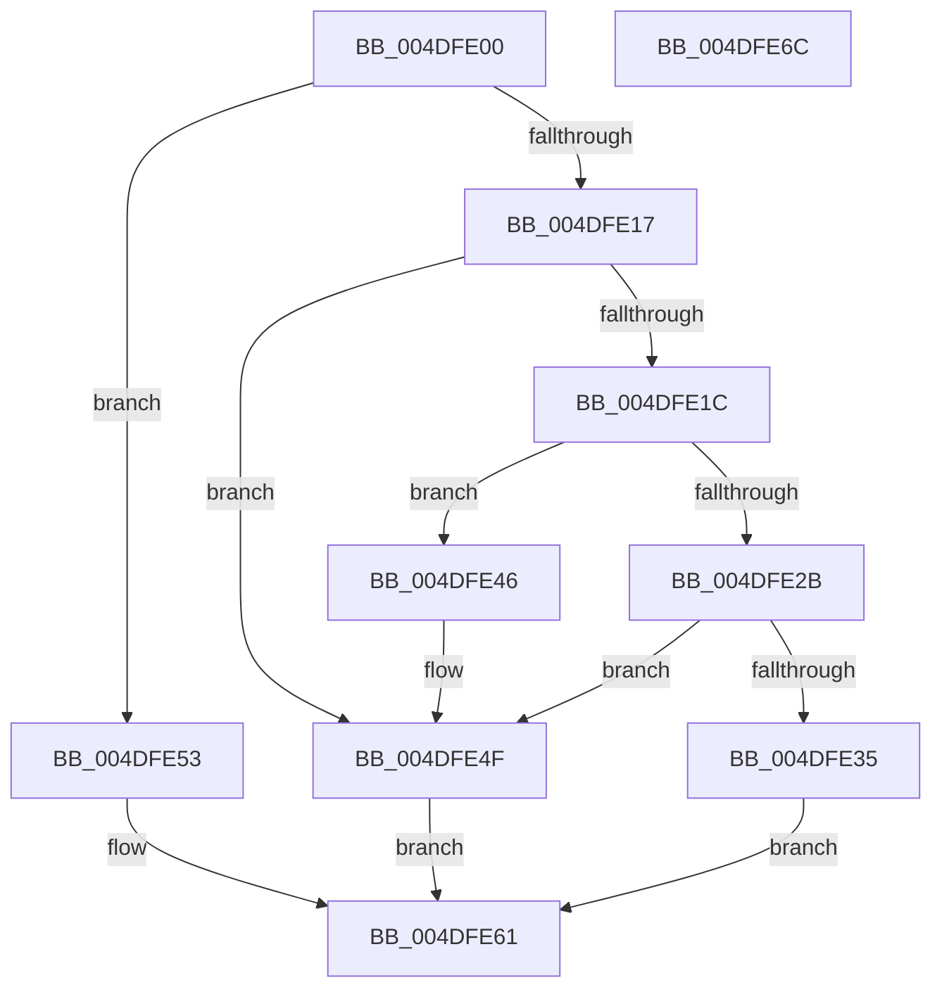

# KiEnumerateCallback

- RVA: `0x004DFE00`–`0x004DFE6D` (길이 `109` bytes)
- VA: `0x00000001404DFE00`
- 실행 섹션: `.text`
- PDB 이름 있음: `예`; PDB Function 태그: `아니요`
- unwind 정보 RVA: `0x0005CAAC`
- 디코드: `35`개 명령, `109/109` bytes 표시
- 미해석 바이트: `0` (있으면 어셈블리에 `.byte`로 보존)

> 이 문서는 커널 이미지의 기계어와 PDB 기호를 분석해 생성했습니다. 4번과 5번은 함수 원형과 자료형을 바이너리 사용 방식에서 추정한 C 해석이며 원본 소스 복구 결과는 아닙니다.

## 1. Dependencies

- 직접 호출 지점: **3**; 고유 호출 대상: **3**
- 직접 호출자로 확인된 함수: **0**
- RIP 상대 이미지 참조: **1**

### Outgoing calls
- `0x004DFE2B` → [ExReferenceCallBackBlock](../2F/ExReferenceCallBackBlock_function_002F0040.md) (function, `0x002F0040`)
- `0x004DFE46` → [ExDereferenceCallBackBlock](../44/ExDereferenceCallBackBlock_function_0044D730.md) (function, `0x0044D730`)
- `0x004DFE5C` → [KiEnumerateNmiSxCallback](../5B/KiEnumerateNmiSxCallback_function_005B1E48.md) (function, `0x005B1E48`)

### Direct callers
- 이 함수 시작 RVA로 연결되는 직접 call은 확인되지 않았습니다. 간접 호출은 완전히 역산할 수 없습니다.

### Static image references
- `0x004DFE1F` → RVA `0x00F475B8` (`.data`; read)

## 2. Other-region calls and transfers

- 다른 실행 섹션으로 향하는 call: **0**
- 별도 외부 분기/꼬리 이동을 확인하지 못했습니다.

## 3. Assembly (complete function range)

```asm
004DFE00  48 89 5C 24 08                  mov qword ptr [rsp + 8], rbx
004DFE05  57                              push rdi
004DFE06  48 83 EC 20                     sub rsp, 0x20
004DFE0A  49 8B F9                        mov rdi, r9
004DFE0D  4D 8B C8                        mov r9, r8
004DFE10  48 8B DA                        mov rbx, rdx
004DFE13  85 C9                           test ecx, ecx
004DFE15  74 3C                           je 0x1404dfe53
004DFE17  83 F9 01                        cmp ecx, 1
004DFE1A  75 33                           jne 0x1404dfe4f
004DFE1C  48 8B 12                        mov rdx, qword ptr [rdx]
004DFE1F  48 8D 0D 92 77 A6 00            lea rcx, [rip + 0xa67792]
004DFE26  48 85 D2                        test rdx, rdx
004DFE29  75 1B                           jne 0x1404dfe46
004DFE2B  E8 10 02 E1 FF                  call 0x1402f0040
004DFE30  48 85 C0                        test rax, rax
004DFE33  74 1A                           je 0x1404dfe4f
004DFE35  48 89 03                        mov qword ptr [rbx], rax
004DFE38  48 8B 40 08                     mov rax, qword ptr [rax + 8]
004DFE3C  48 89 07                        mov qword ptr [rdi], rax
004DFE3F  B8 01 00 00 00                  mov eax, 1
004DFE44  EB 1B                           jmp 0x1404dfe61
004DFE46  E8 E5 D8 F6 FF                  call 0x14044d730
004DFE4B  48 83 23 00                     and qword ptr [rbx], 0
004DFE4F  33 C0                           xor eax, eax
004DFE51  EB 0E                           jmp 0x1404dfe61
004DFE53  4C 8B C7                        mov r8, rdi
004DFE56  49 8B D1                        mov rdx, r9
004DFE59  48 8B CB                        mov rcx, rbx
004DFE5C  E8 E7 1F 0D 00                  call 0x1405b1e48
004DFE61  48 8B 5C 24 30                  mov rbx, qword ptr [rsp + 0x30]
004DFE66  48 83 C4 20                     add rsp, 0x20
004DFE6A  5F                              pop rdi
004DFE6B  C3                              ret
004DFE6C  CC                              int3
```

## 4. C-style interpretation (structured pseudocode)

```c
__int64 __fastcall KiEnumerateCallback(int a1, __int64 a2, __int64 a3, __int64 a4)
{
    __int64 result;
    __int64 v_rsp;
    unsigned __int64 v_stack_p8;

    v_stack_p8 = v_rbx;
    v_rsp = (v_rsp) - (32);
    if (a1 == 0) goto loc_004DFE53;
    if (a1 != 1) goto loc_004DFE4F;
    if (*(unsigned __int64 *)(a2) != 0) goto loc_004DFE46;
    result = ExReferenceCallBackBlock(v_rip + 10909586, *(unsigned __int64 *)(a2), a3, a3);
    if (result == 0) goto loc_004DFE4F;
    *(unsigned __int64 *)(a2) = result;
    *(unsigned __int64 *)(a4) = *(unsigned __int64 *)(result + 8);
    goto loc_004DFE61;
loc_004DFE46:
    result = ExDereferenceCallBackBlock(v_rip + 10909586, *(unsigned __int64 *)(a2), a3, a3);
loc_004DFE4F:
    result = 0;
    goto loc_004DFE61;
loc_004DFE53:
    result = KiEnumerateNmiSxCallback(a2, a3, a4, a3);
loc_004DFE61:
    v_rsp = (v_rsp) + (32);
    return result;
}
```

## 5. (Beta) C Style

```c
int64_t KiEnumerateCallback(int32_t Arg1, void *Arg2, int64_t Arg3, void *Arg4)
{
    uint8_t *arg2 = (uint8_t *)Arg2;
    uint8_t *arg4 = (uint8_t *)Arg4;

    int64_t result;
    int64_t local_rsp;
    uint64_t v_stack_p8;

    v_stack_p8 = local_rbx;
    local_rsp = (local_rsp) - (32);
    if (Arg1 == 0) goto loc_004DFE53;
    if (Arg1 != 1) goto loc_004DFE4F;
    if (*(uint64_t *)(arg2) != 0) goto loc_004DFE46;
    result = ExReferenceCallBackBlock(v_rip + 10909586, *(uint64_t *)(arg2), Arg3, Arg3);
    if (result == 0) goto loc_004DFE4F;
    *(uint64_t *)(arg2) = result;
    *(uint64_t *)(arg4) = *(uint64_t *)(result + 0x8);
    goto loc_004DFE61;
loc_004DFE46:
    result = ExDereferenceCallBackBlock(v_rip + 10909586, *(uint64_t *)(arg2), Arg3, Arg3);
loc_004DFE4F:
    result = 0;
    goto loc_004DFE61;
loc_004DFE53:
    result = KiEnumerateNmiSxCallback(Arg2, Arg3, Arg4, Arg3);
loc_004DFE61:
    local_rsp = (local_rsp) + (32);
    return result;
}
```

### 관측된 메모리 오프셋

구조체 형식이 확인되지 않은 접근은 인자 기준의 오프셋으로만 기록했습니다.

| 기준 인자 | 오프셋 표현 | 폭 (bit) | 접근 |
|---|---:|---:|---|
| `Arg2` | `+ 0x0` | `64` | `R` |
| `Arg2` | `+ 0x0` | `64` | `R/W` |
| `Arg2` | `+ 0x0` | `64` | `W` |
| `Arg4` | `+ 0x0` | `64` | `W` |

## 6. Execution-region graph

[열기: 2D/3D 그래프와 함수 탐색 컨트롤 패널](../../../control-panel.html?section=text&rva=0x004DFE00&view=graph)

- 2D 그래프는 위에서 아래로 흐르고, 3D 그래프는 빈 공간을 드래그해 회전합니다. Shift+드래그는 이동, 휠은 확대·축소, 함수 노드 선택은 대상 보고서 이동입니다.

### Static fallback


