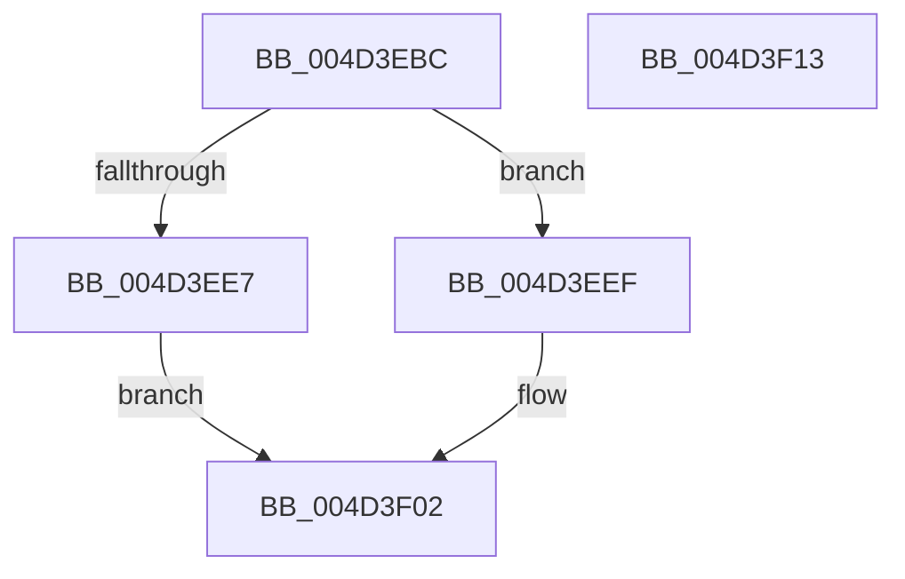

# KiIntRedirectAllocateObject

- RVA: `0x004D3EBC`–`0x004D3F14` (길이 `88` bytes)
- VA: `0x00000001404D3EBC`
- 실행 섹션: `.text`
- PDB 이름 있음: `예`; PDB Function 태그: `아니요`
- unwind 정보 RVA: `0x0005CAAC`
- 디코드: `26`개 명령, `88/88` bytes 표시
- 미해석 바이트: `0` (있으면 어셈블리에 `.byte`로 보존)

> 이 문서는 커널 이미지의 기계어와 PDB 기호를 분석해 생성했습니다. 4번과 5번은 함수 원형과 자료형을 바이너리 사용 방식에서 추정한 C 해석이며 원본 소스 복구 결과는 아닙니다.

## 1. Dependencies

- 직접 호출 지점: **1**; 고유 호출 대상: **1**
- 직접 호출자로 확인된 함수: **1**
- RIP 상대 이미지 참조: **0**

### Outgoing calls
- `0x004D3EDA` → [ExAllocatePool2](../../poolcode/B8/ExAllocatePool2_function_00B820F0.md) (function, `0x00B820F0`)

### Direct callers
- [KiIntRedirectConnnect](KiIntRedirectConnnect_function_004D3E64.md) at `0x004D3E81`

### Static image references
- 디코드된 RIP-relative 메모리 참조가 없습니다.

## 2. Other-region calls and transfers

- 다른 실행 섹션으로 향하는 call: **1**
  - `0x004D3EDA` → [ExAllocatePool2](../../poolcode/B8/ExAllocatePool2_function_00B820F0.md) (`.text` → `POOLCODE`)
- 별도 외부 분기/꼬리 이동을 확인하지 못했습니다.

## 3. Assembly (complete function range)

```asm
004D3EBC  48 89 5C 24 08                  mov qword ptr [rsp + 8], rbx
004D3EC1  57                              push rdi
004D3EC2  48 83 EC 20                     sub rsp, 0x20
004D3EC6  48 8B FA                        mov rdi, rdx
004D3EC9  48 8B D9                        mov rbx, rcx
004D3ECC  BA 18 00 00 00                  mov edx, 0x18
004D3ED1  41 B8 4B 65 49 52               mov r8d, 0x5249654b
004D3ED7  8D 4A 28                        lea ecx, [rdx + 0x28]
004D3EDA  E8 11 E2 6A 00                  call 0x140b820f0
004D3EDF  45 33 C0                        xor r8d, r8d
004D3EE2  48 85 C0                        test rax, rax
004D3EE5  75 08                           jne 0x1404d3eef
004D3EE7  41 B8 9A 00 00 C0               mov r8d, 0xc000009a
004D3EED  EB 13                           jmp 0x1404d3f02
004D3EEF  0F B7 4B 20                     movzx ecx, word ptr [rbx + 0x20]
004D3EF3  66 89 48 08                     mov word ptr [rax + 8], cx
004D3EF7  48 8B 4B 18                     mov rcx, qword ptr [rbx + 0x18]
004D3EFB  48 89 08                        mov qword ptr [rax], rcx
004D3EFE  44 88 40 10                     mov byte ptr [rax + 0x10], r8b
004D3F02  48 8B 5C 24 30                  mov rbx, qword ptr [rsp + 0x30]
004D3F07  48 89 07                        mov qword ptr [rdi], rax
004D3F0A  41 8B C0                        mov eax, r8d
004D3F0D  48 83 C4 20                     add rsp, 0x20
004D3F11  5F                              pop rdi
004D3F12  C3                              ret
004D3F13  CC                              int3
```

## 4. C-style interpretation (structured pseudocode)

```c
__int64 __fastcall KiIntRedirectAllocateObject(__int64 a1, __int64 a2)
{
    __int64 result;
    __int64 v_rsp;
    unsigned __int64 v_stack_p8;

    v_stack_p8 = v_rbx;
    v_rsp = (v_rsp) - (32);
    result = ExAllocatePool2(24 + 40, 24, (unsigned int)(0x5249654BULL), a4);
    a3 = 0;
    if (result != 0) goto loc_004D3EEF;
    goto loc_004D3F02;
loc_004D3EEF:
    *(unsigned __int16 *)(result + 8) = (unsigned __int16)(*(unsigned __int16 *)(a1 + 32));
    *(unsigned __int64 *)(result) = *(unsigned __int64 *)(a1 + 24);
    *(unsigned __int8 *)(result + 16) = (unsigned __int8)((unsigned int)(0xC000009AULL));
loc_004D3F02:
    *(unsigned __int64 *)(a2) = result;
    v_rsp = (v_rsp) + (32);
    return (unsigned int)((unsigned int)((unsigned int)(0xC000009AULL)));
}
```

## 5. (Beta) C Style

```c
int64_t KiIntRedirectAllocateObject(void *Arg1, void *Arg2)
{
    uint8_t *arg1 = (uint8_t *)Arg1;
    uint8_t *arg2 = (uint8_t *)Arg2;

    int64_t result;
    int64_t local_rsp;
    uint64_t v_stack_p8;

    v_stack_p8 = local_rbx;
    local_rsp = (local_rsp) - (32);
    result = ExAllocatePool2(24 + 40, 24, (uint32_t)(0x5249654BULL), a4);
    a3 = 0;
    if (result != 0) goto loc_004D3EEF;
    goto loc_004D3F02;
loc_004D3EEF:
    *(uint16_t *)(result + 0x8) = (uint16_t)(*(uint16_t *)(arg1 + 0x20));
    *(uint64_t *)(result) = *(uint64_t *)(arg1 + 0x18);
    *(uint8_t *)(result + 0x10) = (uint8_t)((uint32_t)(0xC000009AULL));
loc_004D3F02:
    *(uint64_t *)(arg2) = result;
    local_rsp = (local_rsp) + (32);
    return (uint32_t)((uint32_t)((uint32_t)(0xC000009AULL)));
}
```

### 관측된 메모리 오프셋

구조체 형식이 확인되지 않은 접근은 인자 기준의 오프셋으로만 기록했습니다.

| 기준 인자 | 오프셋 표현 | 폭 (bit) | 접근 |
|---|---:|---:|---|
| `Arg1` | `+ 0x18` | `64` | `R` |
| `Arg1` | `+ 0x20` | `16` | `R` |
| `Arg2` | `+ 0x0` | `64` | `W` |

## 6. Execution-region graph

[열기: 2D/3D 그래프와 함수 탐색 컨트롤 패널](../../../control-panel.html?section=text&rva=0x004D3EBC&view=graph)

- 2D 그래프는 위에서 아래로 흐르고, 3D 그래프는 빈 공간을 드래그해 회전합니다. Shift+드래그는 이동, 휠은 확대·축소, 함수 노드 선택은 대상 보고서 이동입니다.

### Static fallback


