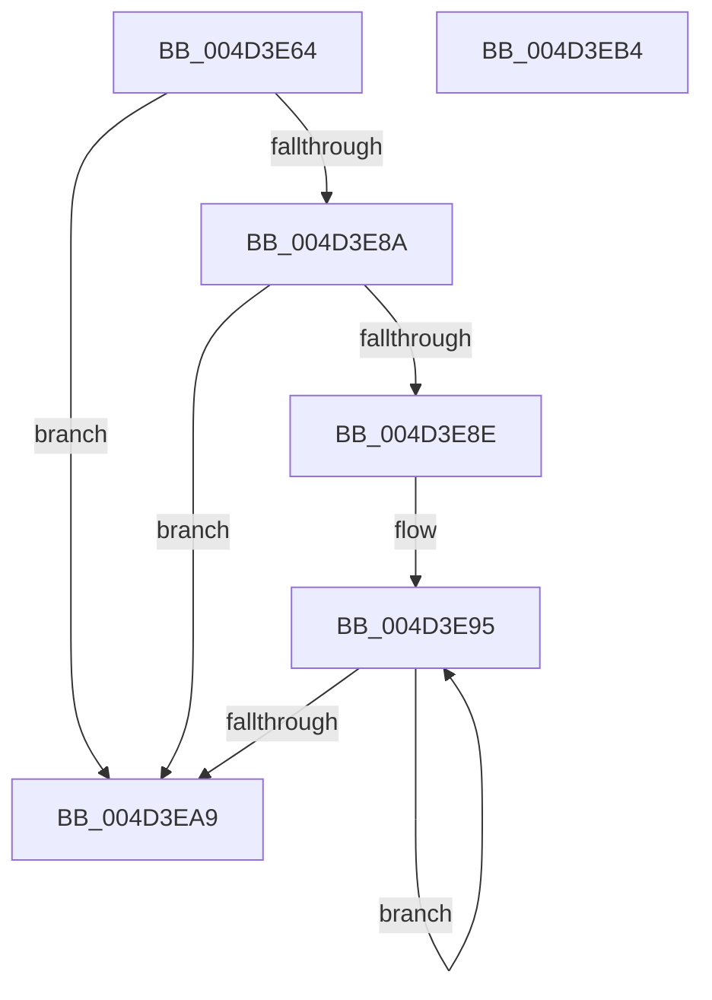

# KiIntRedirectConnnect

- RVA: `0x004D3E64`–`0x004D3EB5` (길이 `81` bytes)
- VA: `0x00000001404D3E64`
- 실행 섹션: `.text`
- PDB 이름 있음: `예`; PDB Function 태그: `아니요`
- unwind 정보 RVA: `0x0005CAAC`
- 디코드: `25`개 명령, `81/81` bytes 표시
- 미해석 바이트: `0` (있으면 어셈블리에 `.byte`로 보존)

> 이 문서는 커널 이미지의 기계어와 PDB 기호를 분석해 생성했습니다. 4번과 5번은 함수 원형과 자료형을 바이너리 사용 방식에서 추정한 C 해석이며 원본 소스 복구 결과는 아닙니다.

## 1. Dependencies

- 직접 호출 지점: **1**; 고유 호출 대상: **1**
- 직접 호출자로 확인된 함수: **1**
- RIP 상대 이미지 참조: **0**

### Outgoing calls
- `0x004D3E81` → [KiIntRedirectAllocateObject](KiIntRedirectAllocateObject_function_004D3EBC.md) (function, `0x004D3EBC`)

### Direct callers
- [KiIntSteerChooseInitialTargetProcessors](../2D/KiIntSteerChooseInitialTargetProcessors_function_002D4B98.md) at `0x002D4C7A`

### Static image references
- 디코드된 RIP-relative 메모리 참조가 없습니다.

## 2. Other-region calls and transfers

- 다른 실행 섹션으로 향하는 call: **0**
- 별도 외부 분기/꼬리 이동을 확인하지 못했습니다.

## 3. Assembly (complete function range)

```asm
004D3E64  48 89 5C 24 08                  mov qword ptr [rsp + 8], rbx
004D3E69  57                              push rdi
004D3E6A  48 83 EC 20                     sub rsp, 0x20
004D3E6E  48 83 64 24 48 00               and qword ptr [rsp + 0x48], 0
004D3E74  48 8B D9                        mov rbx, rcx
004D3E77  8B FA                           mov edi, edx
004D3E79  49 8B C8                        mov rcx, r8
004D3E7C  48 8D 54 24 48                  lea rdx, [rsp + 0x48]
004D3E81  E8 36 00 00 00                  call 0x1404d3ebc
004D3E86  85 C0                           test eax, eax
004D3E88  78 1F                           js 0x1404d3ea9
004D3E8A  85 FF                           test edi, edi
004D3E8C  74 1B                           je 0x1404d3ea9
004D3E8E  4C 8B 44 24 48                  mov r8, qword ptr [rsp + 0x48]
004D3E93  8B D7                           mov edx, edi
004D3E95  48 8B 0B                        mov rcx, qword ptr [rbx]
004D3E98  48 8D 5B 08                     lea rbx, [rbx + 8]
004D3E9C  4C 89 81 10 01 00 00            mov qword ptr [rcx + 0x110], r8
004D3EA3  48 83 EA 01                     sub rdx, 1
004D3EA7  75 EC                           jne 0x1404d3e95
004D3EA9  48 8B 5C 24 30                  mov rbx, qword ptr [rsp + 0x30]
004D3EAE  48 83 C4 20                     add rsp, 0x20
004D3EB2  5F                              pop rdi
004D3EB3  C3                              ret
004D3EB4  CC                              int3
```

## 4. C-style interpretation (structured pseudocode)

```c
__int64 __fastcall KiIntRedirectConnnect(__int64 a1, int a2, __int64 a3)
{
    __int64 result;
    __int64 v_rsp;
    unsigned __int64 v_stack_p20;
    unsigned __int64 v_stack_p8;

    v_stack_p8 = v_rbx;
    v_rsp = (v_rsp) - (32);
    result = KiIntRedirectAllocateObject(a3, v_stack_p20, a3, a4);
    if (sign_flag) goto loc_004D3EA9;
    if ((unsigned int)((unsigned int)(a2)) == 0) goto loc_004D3EA9;
loc_004D3E95:
    *(unsigned __int64 *)(*(unsigned __int64 *)(a1) + 272) = v_stack_p20;
    a2 = ((unsigned int)((unsigned int)((unsigned int)(a2)))) - (1);
    if (condition_is_not_equal) goto loc_004D3E95;
loc_004D3EA9:
    v_rsp = (v_rsp) + (32);
    return result;
}
```

## 5. (Beta) C Style

```c
int64_t KiIntRedirectConnnect(void *Arg1, int32_t Arg2, int64_t Arg3)
{
    uint8_t *arg1 = (uint8_t *)Arg1;

    int64_t result;
    int64_t local_rsp;
    uint64_t v_stack_p20;
    uint64_t v_stack_p8;

    v_stack_p8 = local_rbx;
    local_rsp = (local_rsp) - (32);
    result = KiIntRedirectAllocateObject(Arg3, v_stack_p20, Arg3, a4);
    if (sign_flag) goto loc_004D3EA9;
    if ((uint32_t)((uint32_t)(Arg2)) == 0) goto loc_004D3EA9;
loc_004D3E95:
    *(uint64_t *)(*(uint64_t *)(arg1) + 0x110) = v_stack_p20;
    Arg2 = ((uint32_t)((uint32_t)((uint32_t)(Arg2)))) - (1);
    if (condition_is_not_equal) goto loc_004D3E95;
loc_004D3EA9:
    local_rsp = (local_rsp) + (32);
    return result;
}
```

### 관측된 메모리 오프셋

구조체 형식이 확인되지 않은 접근은 인자 기준의 오프셋으로만 기록했습니다.

| 기준 인자 | 오프셋 표현 | 폭 (bit) | 접근 |
|---|---:|---:|---|
| `Arg1` | `+ 0x0` | `64` | `R` |
| `Arg1` | `+ 0x8` | `64` | `R` |

## 6. Execution-region graph

[열기: 2D/3D 그래프와 함수 탐색 컨트롤 패널](../../../control-panel.html?section=text&rva=0x004D3E64&view=graph)

- 2D 그래프는 위에서 아래로 흐르고, 3D 그래프는 빈 공간을 드래그해 회전합니다. Shift+드래그는 이동, 휠은 확대·축소, 함수 노드 선택은 대상 보고서 이동입니다.

### Static fallback


