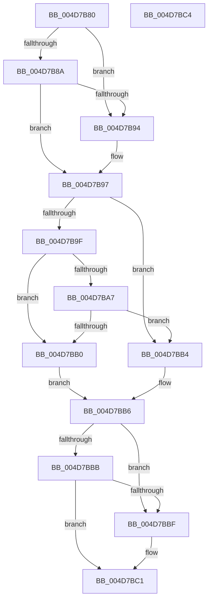

# KiIsThreadExemptFromForcePark

- RVA: `0x004D7B80`–`0x004D7BC5` (길이 `69` bytes)
- VA: `0x00000001404D7B80`
- 실행 섹션: `.text`
- PDB 이름 있음: `예`; PDB Function 태그: `아니요`
- unwind 정보 RVA: `0x000DB714`
- 디코드: `25`개 명령, `69/69` bytes 표시
- 미해석 바이트: `0` (있으면 어셈블리에 `.byte`로 보존)

> 이 문서는 커널 이미지의 기계어와 PDB 기호를 분석해 생성했습니다. 4번과 5번은 함수 원형과 자료형을 바이너리 사용 방식에서 추정한 C 해석이며 원본 소스 복구 결과는 아닙니다.

## 1. Dependencies

- 직접 호출 지점: **0**; 고유 호출 대상: **0**
- 직접 호출자로 확인된 함수: **7**
- RIP 상대 이미지 참조: **2**

### Outgoing calls
- 직접 디코드된 call 명령이 없습니다.

### Direct callers
- [sub_00218B2B](../21/Unknown_function_00218B2B.md) at `0x00218DB6`
- [sub_00218B2B](../21/Unknown_function_00218B2B.md) at `0x00218DF5`
- [KiQueueReadyThread](../21/KiQueueReadyThread_function_0021C7B0.md) at `0x0021CFE9`
- [sub_002546EC](../25/Unknown_function_002546EC.md) at `0x002547EA`
- [sub_002546EC](../25/Unknown_function_002546EC.md) at `0x00254A49`
- [sub_00257DDC](../25/Unknown_function_00257DDC.md) at `0x00257E35`
- [KiSearchForNewThreadsForRescheduleContext](../25/KiSearchForNewThreadsForRescheduleContext_function_00258620.md) at `0x002590B2`
- [KiAttemptToScheduleThreadToBusyIsolationUnit](../25/KiAttemptToScheduleThreadToBusyIsolationUnit_function_00259B00.md) at `0x0025ACC8`
- [KiUpdateLocalReadyQueueStatisticsOnInsertion](../4A/KiUpdateLocalReadyQueueStatisticsOnInsertion_function_004A9290.md) at `0x004A930B`

### Static image references
- `0x004D7B82` → RVA `0x00FC52E4` (`ALMOSTRO`; read)
- `0x004D7B97` → RVA `0x00FC52E8` (`ALMOSTRO`; read)

## 2. Other-region calls and transfers

- 다른 실행 섹션으로 향하는 call: **0**
- 별도 외부 분기/꼬리 이동을 확인하지 못했습니다.

## 3. Assembly (complete function range)

```asm
004D7B80  33 D2                           xor edx, edx
004D7B82  39 15 5C D7 AE 00               cmp dword ptr [rip + 0xaed75c], edx
004D7B88  74 0A                           je 0x1404d7b94
004D7B8A  8B 41 74                        mov eax, dword ptr [rcx + 0x74]
004D7B8D  41 B0 01                        mov r8b, 1
004D7B90  A8 08                           test al, 8
004D7B92  75 03                           jne 0x1404d7b97
004D7B94  44 8A C2                        mov r8b, dl
004D7B97  39 15 4B D7 AE 00               cmp dword ptr [rip + 0xaed74b], edx
004D7B9D  74 15                           je 0x1404d7bb4
004D7B9F  39 91 E4 01 00 00               cmp dword ptr [rcx + 0x1e4], edx
004D7BA5  75 09                           jne 0x1404d7bb0
004D7BA7  80 B9 86 01 00 00 01            cmp byte ptr [rcx + 0x186], 1
004D7BAE  75 04                           jne 0x1404d7bb4
004D7BB0  B0 01                           mov al, 1
004D7BB2  EB 02                           jmp 0x1404d7bb6
004D7BB4  8A C2                           mov al, dl
004D7BB6  45 84 C0                        test r8b, r8b
004D7BB9  75 04                           jne 0x1404d7bbf
004D7BBB  84 C0                           test al, al
004D7BBD  74 02                           je 0x1404d7bc1
004D7BBF  B2 01                           mov dl, 1
004D7BC1  8A C2                           mov al, dl
004D7BC3  C3                              ret
004D7BC4  CC                              int3
```

## 4. C-style interpretation (structured pseudocode)

```c
__int64 __fastcall KiIsThreadExemptFromForcePark(__int64 a1, int a2)
{
    a2 = 0;
    if ((*(unsigned int *)(v_rip + 11458396)) == 0) goto loc_004D7B94;
    if ((((unsigned __int8)((unsigned int)(*(unsigned int *)(a1 + 116)))) & (8)) == 0) {
        a3 = 0;
    }
    if ((*(unsigned int *)(v_rip + 11458379)) == 0) goto loc_004D7BB4;
    if ((*(unsigned int *)(a1 + 484)) != 0) goto loc_004D7BB0;
    if ((*(unsigned __int8 *)(a1 + 390)) != 1) goto loc_004D7BB4;
loc_004D7BB0:
    goto loc_004D7BB6;
loc_004D7BB4:
loc_004D7BB6:
    if ((unsigned __int8)(a3) != 0) goto loc_004D7BBF;
    if (0 != 0) {
        a2 = 1;
    }
    return (unsigned __int8)(a2);
}
```

## 5. (Beta) C Style

```c
int64_t KiIsThreadExemptFromForcePark(void *Arg1, int32_t Arg2)
{
    uint8_t *arg1 = (uint8_t *)Arg1;

    Arg2 = 0;
    if ((*(uint32_t *)(v_rip + 0xAED75C)) == 0) goto loc_004D7B94;
    if ((((uint8_t)((uint32_t)(*(uint32_t *)(arg1 + 0x74)))) & (8)) == 0) {
        a3 = 0;
    }
    if ((*(uint32_t *)(v_rip + 0xAED74B)) == 0) goto loc_004D7BB4;
    if ((*(uint32_t *)(arg1 + 0x1E4)) != 0) goto loc_004D7BB0;
    if ((*(uint8_t *)(arg1 + 0x186)) != 1) goto loc_004D7BB4;
loc_004D7BB0:
    goto loc_004D7BB6;
loc_004D7BB4:
loc_004D7BB6:
    if ((uint8_t)(a3) != 0) goto loc_004D7BBF;
    if (0 != 0) {
        Arg2 = 1;
    }
    return (uint8_t)(Arg2);
}
```

### 관측된 메모리 오프셋

구조체 형식이 확인되지 않은 접근은 인자 기준의 오프셋으로만 기록했습니다.

| 기준 인자 | 오프셋 표현 | 폭 (bit) | 접근 |
|---|---:|---:|---|
| `Arg1` | `+ 0x74` | `32` | `R` |
| `Arg1` | `+ 0x186` | `8` | `R` |
| `Arg1` | `+ 0x1E4` | `32` | `R` |

## 6. Execution-region graph

[열기: 2D/3D 그래프와 함수 탐색 컨트롤 패널](../../../control-panel.html?section=text&rva=0x004D7B80&view=graph)

- 2D 그래프는 위에서 아래로 흐르고, 3D 그래프는 빈 공간을 드래그해 회전합니다. Shift+드래그는 이동, 휠은 확대·축소, 함수 노드 선택은 대상 보고서 이동입니다.

### Static fallback


