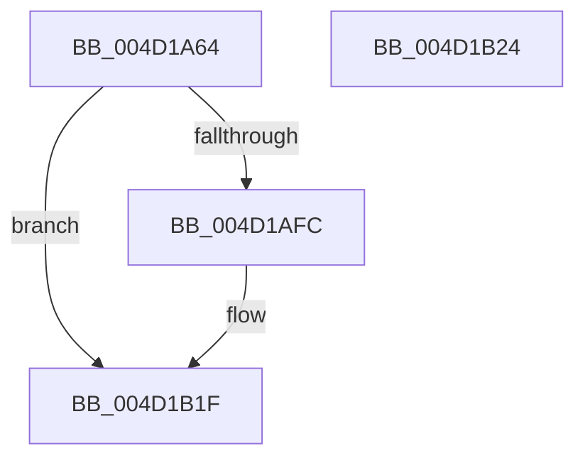

# KiProcessDeferredDpcWatchdogViolation

- RVA: `0x004D1A64`–`0x004D1B25` (길이 `193` bytes)
- VA: `0x00000001404D1A64`
- 실행 섹션: `.text`
- PDB 이름 있음: `예`; PDB Function 태그: `아니요`
- unwind 정보 RVA: `0x0005D2F4`
- 디코드: `34`개 명령, `193/193` bytes 표시
- 미해석 바이트: `0` (있으면 어셈블리에 `.byte`로 보존)

> 이 문서는 커널 이미지의 기계어와 PDB 기호를 분석해 생성했습니다. 4번과 5번은 함수 원형과 자료형을 바이너리 사용 방식에서 추정한 C 해석이며 원본 소스 복구 결과는 아닙니다.

## 1. Dependencies

- 직접 호출 지점: **1**; 고유 호출 대상: **1**
- 직접 호출자로 확인된 함수: **1**
- RIP 상대 이미지 참조: **12**

### Outgoing calls
- `0x004D1B1A` → [VslKernelShadowStackAssist](../3D/VslKernelShadowStackAssist_function_003D5BA0.md) (function, `0x003D5BA0`)

### Direct callers
- [sub_00208C68](../20/Unknown_function_00208C68.md) at `0x00208C8A`

### Static image references
- `0x004D1A68` → RVA `0x00F10850` (`.data`; write)
- `0x004D1A76` → RVA `0x00F10860` (`.data`; read)
- `0x004D1A7D` → RVA `0x00F10870` (`.data`; read)
- `0x004D1A84` → RVA `0x00F10880` (`.data`; read)
- `0x004D1A92` → RVA `0x00F10880` (`.data`; write)
- `0x004D1AA0` → RVA `0x00F10878` (`.data`; write)
- `0x004D1AAD` → RVA `0x00F10870` (`.data`; write)
- `0x004D1ABA` → RVA `0x00F10868` (`.data`; write)
- `0x004D1AC8` → RVA `0x00F10860` (`.data`; write)
- `0x004D1AD3` → RVA `0x00F10888` (`.data`; write)
- `0x004D1AE5` → RVA `0x006B2100` (`KiDeferredDpcWatchdogViolation`; read)
- `0x004D1AF3` → RVA `0x01201841` (`CFGRO`; read)

## 2. Other-region calls and transfers

- 다른 실행 섹션으로 향하는 call: **0**
- 별도 외부 분기/꼬리 이동을 확인하지 못했습니다.

## 3. Assembly (complete function range)

```asm
004D1A64  48 83 EC 38                     sub rsp, 0x38
004D1A68  48 C7 05 DD ED A3 00 01 00 00 00  mov qword ptr [rip + 0xa3eddd], 1
004D1A73  0F 57 C0                        xorps xmm0, xmm0
004D1A76  0F 11 05 E3 ED A3 00            movups xmmword ptr [rip + 0xa3ede3], xmm0
004D1A7D  0F 11 05 EC ED A3 00            movups xmmword ptr [rip + 0xa3edec], xmm0
004D1A84  0F 11 05 F5 ED A3 00            movups xmmword ptr [rip + 0xa3edf5], xmm0
004D1A8B  0F B7 81 88 01 00 00            movzx eax, word ptr [rcx + 0x188]
004D1A92  66 89 05 E7 ED A3 00            mov word ptr [rip + 0xa3ede7], ax
004D1A99  48 8B 81 80 01 00 00            mov rax, qword ptr [rcx + 0x180]
004D1AA0  48 89 05 D1 ED A3 00            mov qword ptr [rip + 0xa3edd1], rax
004D1AA7  8B 81 78 01 00 00               mov eax, dword ptr [rcx + 0x178]
004D1AAD  89 05 BD ED A3 00               mov dword ptr [rip + 0xa3edbd], eax
004D1AB3  0F B7 81 70 01 00 00            movzx eax, word ptr [rcx + 0x170]
004D1ABA  66 89 05 A7 ED A3 00            mov word ptr [rip + 0xa3eda7], ax
004D1AC1  48 8B 81 68 01 00 00            mov rax, qword ptr [rcx + 0x168]
004D1AC8  48 89 05 91 ED A3 00            mov qword ptr [rip + 0xa3ed91], rax
004D1ACF  48 8B 41 38                     mov rax, qword ptr [rcx + 0x38]
004D1AD3  48 89 05 AE ED A3 00            mov qword ptr [rip + 0xa3edae], rax
004D1ADA  48 8D 05 7F ED A3 00            lea rax, [rip + 0xa3ed7f]
004D1AE1  48 89 41 38                     mov qword ptr [rcx + 0x38], rax
004D1AE5  48 8D 05 14 06 1E 00            lea rax, [rip + 0x1e0614]
004D1AEC  48 89 81 68 01 00 00            mov qword ptr [rcx + 0x168], rax
004D1AF3  80 3D 47 FD D2 00 00            cmp byte ptr [rip + 0xd2fd47], 0
004D1AFA  74 23                           je 0x1404d1b1f
004D1AFC  48 8B 91 D8 00 00 00            mov rdx, qword ptr [rcx + 0xd8]
004D1B03  45 33 C9                        xor r9d, r9d
004D1B06  C7 44 24 28 04 00 00 00         mov dword ptr [rsp + 0x28], 4
004D1B0E  45 33 C0                        xor r8d, r8d
004D1B11  48 89 44 24 20                  mov qword ptr [rsp + 0x20], rax
004D1B16  41 8D 49 03                     lea ecx, [r9 + 3]
004D1B1A  E8 81 40 F0 FF                  call 0x1403d5ba0
004D1B1F  48 83 C4 38                     add rsp, 0x38
004D1B23  C3                              ret
004D1B24  CC                              int3
```

## 4. C-style interpretation (structured pseudocode)

```c
__int64 __fastcall KiProcessDeferredDpcWatchdogViolation(__int64 a1, __int64 a2, int a3, int a4)
{
    __int64 result;
    __int64 v_rsp;
    unsigned int v_stack_m10;
    unsigned __int64 v_stack_m18;

    v_rsp = (v_rsp) - (56);
    *(unsigned __int64 *)(v_rip + 10743261) = 1;
    *(unsigned __int64 *)(v_rip + 10743267) = v_xmm0;
    *(unsigned __int64 *)(v_rip + 10743276) = v_xmm0;
    *(unsigned __int64 *)(v_rip + 10743285) = v_xmm0;
    *(unsigned __int16 *)(v_rip + 10743271) = (unsigned __int16)(*(unsigned __int16 *)(a1 + 392));
    *(unsigned __int64 *)(v_rip + 10743249) = *(unsigned __int64 *)(a1 + 384);
    *(unsigned int *)(v_rip + 10743229) = (unsigned int)((unsigned int)(*(unsigned int *)(a1 + 376)));
    *(unsigned __int16 *)(v_rip + 10743207) = (unsigned __int16)(*(unsigned __int16 *)(a1 + 368));
    *(unsigned __int64 *)(v_rip + 10743185) = *(unsigned __int64 *)(a1 + 360);
    *(unsigned __int64 *)(v_rip + 10743214) = *(unsigned __int64 *)(a1 + 56);
    *(unsigned __int64 *)(a1 + 56) = v_rip + 10743167;
    *(unsigned __int64 *)(a1 + 360) = v_rip + 1967636;
    result = v_rip + 1967636;
    if ((*(unsigned __int8 *)(v_rip + 13827399)) != 0) {
        a2 = *(unsigned __int64 *)(a1 + 216);
        a4 = 0;
        v_stack_m10 = 4;
        a3 = 0;
        v_stack_m18 = v_rip + 1967636;
        a1 = a4 + 3;
        result = VslKernelShadowStackAssist(a1, a2, a3, a4);
    }
    v_rsp = (v_rsp) + (56);
    return result;
}
```

## 5. (Beta) C Style

```c
int64_t KiProcessDeferredDpcWatchdogViolation(void *Arg1, int64_t Arg2, int32_t Arg3, int32_t Arg4)
{
    uint8_t *arg1 = (uint8_t *)Arg1;

    int64_t result;
    int64_t local_rsp;
    uint32_t v_stack_m10;
    uint64_t v_stack_m18;

    local_rsp = (local_rsp) - (56);
    *(uint64_t *)(v_rip + 0xA3EDDD) = 1;
    *(uint64_t *)(v_rip + 0xA3EDE3) = v_xmm0;
    *(uint64_t *)(v_rip + 0xA3EDEC) = v_xmm0;
    *(uint64_t *)(v_rip + 0xA3EDF5) = v_xmm0;
    *(uint16_t *)(v_rip + 0xA3EDE7) = (uint16_t)(*(uint16_t *)(arg1 + 0x188));
    *(uint64_t *)(v_rip + 0xA3EDD1) = *(uint64_t *)(arg1 + 0x180);
    *(uint32_t *)(v_rip + 0xA3EDBD) = (uint32_t)((uint32_t)(*(uint32_t *)(arg1 + 0x178)));
    *(uint16_t *)(v_rip + 0xA3EDA7) = (uint16_t)(*(uint16_t *)(arg1 + 0x170));
    *(uint64_t *)(v_rip + 0xA3ED91) = *(uint64_t *)(arg1 + 0x168);
    *(uint64_t *)(v_rip + 0xA3EDAE) = *(uint64_t *)(arg1 + 0x38);
    *(uint64_t *)(arg1 + 0x38) = v_rip + 10743167;
    *(uint64_t *)(arg1 + 0x168) = v_rip + 1967636;
    result = v_rip + 1967636;
    if ((*(uint8_t *)(v_rip + 0xD2FD47)) != 0) {
        Arg2 = *(uint64_t *)(arg1 + 0xD8);
        Arg4 = 0;
        v_stack_m10 = 4;
        Arg3 = 0;
        v_stack_m18 = v_rip + 1967636;
        Arg1 = Arg4 + 3;
        result = VslKernelShadowStackAssist(Arg1, Arg2, Arg3, Arg4);
    }
    local_rsp = (local_rsp) + (56);
    return result;
}
```

### 관측된 메모리 오프셋

구조체 형식이 확인되지 않은 접근은 인자 기준의 오프셋으로만 기록했습니다.

| 기준 인자 | 오프셋 표현 | 폭 (bit) | 접근 |
|---|---:|---:|---|
| `Arg1` | `+ 0x38` | `64` | `R` |
| `Arg1` | `+ 0x38` | `64` | `W` |
| `Arg1` | `+ 0xD8` | `64` | `R` |
| `Arg1` | `+ 0x168` | `64` | `R` |
| `Arg1` | `+ 0x168` | `64` | `W` |
| `Arg1` | `+ 0x170` | `16` | `R` |
| `Arg1` | `+ 0x178` | `32` | `R` |
| `Arg1` | `+ 0x180` | `64` | `R` |
| `Arg1` | `+ 0x188` | `16` | `R` |

## 6. Execution-region graph

[열기: 2D/3D 그래프와 함수 탐색 컨트롤 패널](../../../control-panel.html?section=text&rva=0x004D1A64&view=graph)

- 2D 그래프는 위에서 아래로 흐르고, 3D 그래프는 빈 공간을 드래그해 회전합니다. Shift+드래그는 이동, 휠은 확대·축소, 함수 노드 선택은 대상 보고서 이동입니다.

### Static fallback


