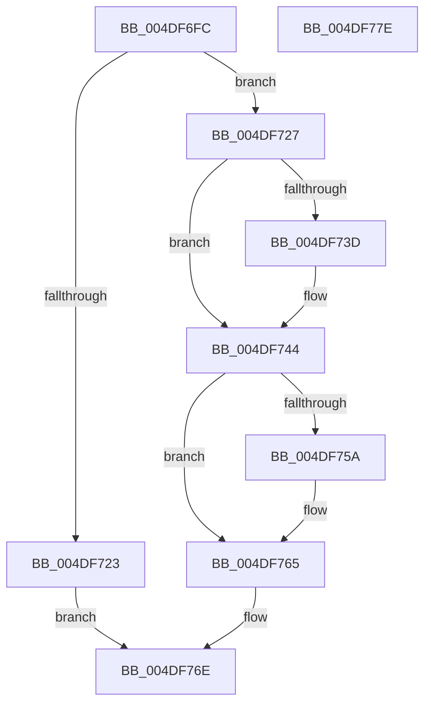

# KiRcuCheckQuiescentForIdle

- RVA: `0x004DF6FC`–`0x004DF77F` (길이 `131` bytes)
- VA: `0x00000001404DF6FC`
- 실행 섹션: `.text`
- PDB 이름 있음: `예`; PDB Function 태그: `아니요`
- unwind 정보 RVA: `0x00060BC4`
- 디코드: `37`개 명령, `131/131` bytes 표시
- 미해석 바이트: `0` (있으면 어셈블리에 `.byte`로 보존)

> 이 문서는 커널 이미지의 기계어와 PDB 기호를 분석해 생성했습니다. 4번과 5번은 함수 원형과 자료형을 바이너리 사용 방식에서 추정한 C 해석이며 원본 소스 복구 결과는 아닙니다.

## 1. Dependencies

- 직접 호출 지점: **3**; 고유 호출 대상: **3**
- 직접 호출자로 확인된 함수: **1**
- RIP 상대 이미지 참조: **2**

### Outgoing calls
- `0x004DF73F` → [KiRaiseIrqlProcessIrqlFlags](../4F/KiRaiseIrqlProcessIrqlFlags_function_004F56FC.md) (function, `0x004F56FC`)
- `0x004DF74A` → [KiRcuReportQuiescentState](../20/KiRcuReportQuiescentState_function_0020AB8C.md) (function, `0x0020AB8C`)
- `0x004DF760` → [KiLowerIrqlProcessIrqlFlags](../4F/KiLowerIrqlProcessIrqlFlags_function_004F5698.md) (function, `0x004F5698`)

### Direct callers
- [KiRcuStartGracePeriodEnumCallback](KiRcuStartGracePeriodEnumCallback_function_004D0C48.md) at `0x004D0C67`

### Static image references
- `0x004DF712` → RVA `0x00F210E8` (`.data`; read)
- `0x004DF734` → RVA `0x00FC6D20` (`ALMOSTRO`; read)

## 2. Other-region calls and transfers

- 다른 실행 섹션으로 향하는 call: **0**
- 별도 외부 분기/꼬리 이동을 확인하지 못했습니다.

## 3. Assembly (complete function range)

```asm
004DF6FC  48 89 5C 24 08                  mov qword ptr [rsp + 8], rbx
004DF701  48 89 74 24 10                  mov qword ptr [rsp + 0x10], rsi
004DF706  57                              push rdi
004DF707  48 83 EC 20                     sub rsp, 0x20
004DF70B  48 8B 41 10                     mov rax, qword ptr [rcx + 0x10]
004DF70F  48 8B F9                        mov rdi, rcx
004DF712  48 8B 35 CF 19 A4 00            mov rsi, qword ptr [rip + 0xa419cf]
004DF719  8A 80 E7 38 00 00               mov al, byte ptr [rax + 0x38e7]
004DF71F  84 C0                           test al, al
004DF721  7F 04                           jg 0x1404df727
004DF723  33 C0                           xor eax, eax
004DF725  EB 47                           jmp 0x1404df76e
004DF727  44 0F 20 C3                     mov rbx, cr8
004DF72B  BA 02 00 00 00                  mov edx, 2
004DF730  44 0F 22 C2                     mov cr8, rdx
004DF734  83 3D E5 75 AE 00 00            cmp dword ptr [rip + 0xae75e5], 0
004DF73B  74 07                           je 0x1404df744
004DF73D  8A CB                           mov cl, bl
004DF73F  E8 B8 5F 01 00                  call 0x1404f56fc
004DF744  48 8B D6                        mov rdx, rsi
004DF747  48 8B CF                        mov rcx, rdi
004DF74A  E8 3D B4 D2 FF                  call 0x14020ab8c
004DF74F  83 3D CA 75 AE 00 00            cmp dword ptr [rip + 0xae75ca], 0
004DF756  8B F8                           mov edi, eax
004DF758  74 0B                           je 0x1404df765
004DF75A  44 0F 20 C1                     mov rcx, cr8
004DF75E  8A D3                           mov dl, bl
004DF760  E8 33 5F 01 00                  call 0x1404f5698
004DF765  0F B6 CB                        movzx ecx, bl
004DF768  44 0F 22 C1                     mov cr8, rcx
004DF76C  8B C7                           mov eax, edi
004DF76E  48 8B 5C 24 30                  mov rbx, qword ptr [rsp + 0x30]
004DF773  48 8B 74 24 38                  mov rsi, qword ptr [rsp + 0x38]
004DF778  48 83 C4 20                     add rsp, 0x20
004DF77C  5F                              pop rdi
004DF77D  C3                              ret
004DF77E  CC                              int3
```

## 4. C-style interpretation (structured pseudocode)

```c
__int64 __fastcall KiRcuCheckQuiescentForIdle(__int64 a1)
{
    __int64 result;
    __int64 v_rsp;
    unsigned __int64 v_stack_p10;
    unsigned __int64 v_stack_p8;

    v_stack_p8 = v_rbx;
    v_stack_p10 = v_rsi;
    v_rsp = (v_rsp) - (32);
    if (condition_is_greater) goto loc_004DF727;
    result = 0;
    goto loc_004DF76E;
loc_004DF727:
    if ((*(unsigned int *)(v_rip + 11433445)) != 0) {
        a1 = (unsigned __int8)(v_cr8);
        result = KiRaiseIrqlProcessIrqlFlags(a1, 2, a3, a4);
    }
    result = KiRcuReportQuiescentState(a1, *(unsigned __int64 *)(v_rip + 10754511), a3, a4);
    if ((*(unsigned int *)(v_rip + 11433418)) != 0) {
        a1 = 2;
        a2 = (unsigned __int8)(v_cr8);
        result = KiLowerIrqlProcessIrqlFlags(a1, a2, a3, a4);
    }
loc_004DF76E:
    v_rsp = (v_rsp) + (32);
    return (unsigned int)((unsigned int)((unsigned int)((unsigned int)(result))));
}
```

## 5. (Beta) C Style

```c
int64_t KiRcuCheckQuiescentForIdle(void *Arg1)
{
    uint8_t *arg1 = (uint8_t *)Arg1;

    int64_t result;
    int64_t local_rsp;
    uint64_t v_stack_p10;
    uint64_t v_stack_p8;

    v_stack_p8 = local_rbx;
    v_stack_p10 = local_rsi;
    local_rsp = (local_rsp) - (32);
    if (condition_is_greater) goto loc_004DF727;
    result = 0;
    goto loc_004DF76E;
loc_004DF727:
    if ((*(uint32_t *)(v_rip + 0xAE75E5)) != 0) {
        Arg1 = (uint8_t)(v_cr8);
        result = KiRaiseIrqlProcessIrqlFlags(Arg1, 2, a3, a4);
    }
    result = KiRcuReportQuiescentState(Arg1, *(uint64_t *)(v_rip + 0xA419CF), a3, a4);
    if ((*(uint32_t *)(v_rip + 0xAE75CA)) != 0) {
        Arg1 = 2;
        a2 = (uint8_t)(v_cr8);
        result = KiLowerIrqlProcessIrqlFlags(Arg1, a2, a3, a4);
    }
loc_004DF76E:
    local_rsp = (local_rsp) + (32);
    return (uint32_t)((uint32_t)((uint32_t)((uint32_t)(result))));
}
```

### 관측된 메모리 오프셋

구조체 형식이 확인되지 않은 접근은 인자 기준의 오프셋으로만 기록했습니다.

| 기준 인자 | 오프셋 표현 | 폭 (bit) | 접근 |
|---|---:|---:|---|
| `Arg1` | `+ 0x10` | `64` | `R` |

## 6. Execution-region graph

[열기: 2D/3D 그래프와 함수 탐색 컨트롤 패널](../../../control-panel.html?section=text&rva=0x004DF6FC&view=graph)

- 2D 그래프는 위에서 아래로 흐르고, 3D 그래프는 빈 공간을 드래그해 회전합니다. Shift+드래그는 이동, 휠은 확대·축소, 함수 노드 선택은 대상 보고서 이동입니다.

### Static fallback


