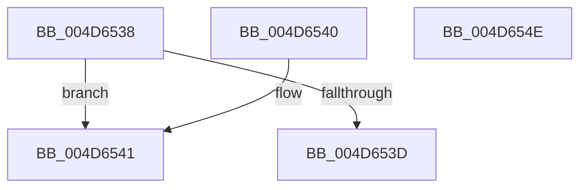

# KiRcuCompareGraceSequence

- RVA: `0x004D6538`–`0x004D654F` (길이 `23` bytes)
- VA: `0x00000001404D6538`
- 실행 섹션: `.text`
- PDB 이름 있음: `예`; PDB Function 태그: `아니요`
- unwind 정보 RVA: `0x000DB714`
- 디코드: `11`개 명령, `23/23` bytes 표시
- 미해석 바이트: `0` (있으면 어셈블리에 `.byte`로 보존)

> 이 문서는 커널 이미지의 기계어와 PDB 기호를 분석해 생성했습니다. 4번과 5번은 함수 원형과 자료형을 바이너리 사용 방식에서 추정한 C 해석이며 원본 소스 복구 결과는 아닙니다.

## 1. Dependencies

- 직접 호출 지점: **0**; 고유 호출 대상: **0**
- 직접 호출자로 확인된 함수: **4**
- RIP 상대 이미지 참조: **0**

### Outgoing calls
- 직접 디코드된 call 명령이 없습니다.

### Direct callers
- [KiRcuReportQuiescentState](../20/KiRcuReportQuiescentState_function_0020AB8C.md) at `0x0020ABFF`
- [KiRcuReportQuiescentState](../20/KiRcuReportQuiescentState_function_0020AB8C.md) at `0x0020ACF4`
- [KiRcuFlushCompleted](../20/KiRcuFlushCompleted_function_0020AD38.md) at `0x0020ADD8`
- [KiSrcuFlushCompleted](../5C/KiSrcuFlushCompleted_function_005C22B4.md) at `0x005C2344`
- [KiSrcuReportQuiescent](../5C/KiSrcuReportQuiescent_function_005C2C08.md) at `0x005C2CA1`
- [KiSrcuReportQuiescent](../5C/KiSrcuReportQuiescent_function_005C2C08.md) at `0x005C2DFF`

### Static image references
- 디코드된 RIP-relative 메모리 참조가 없습니다.

## 2. Other-region calls and transfers

- 다른 실행 섹션으로 향하는 call: **0**
- 별도 외부 분기/꼬리 이동을 확인하지 못했습니다.

## 3. Assembly (complete function range)

```asm
004D6538  48 2B CA                        sub rcx, rdx
004D653B  75 04                           jne 0x1404d6541
004D653D  33 C0                           xor eax, eax
004D653F  C3                              ret
004D6540  CC                              int3
004D6541  83 C8 FF                        or eax, 0xffffffff
004D6544  48 85 C9                        test rcx, rcx
004D6547  8D 50 02                        lea edx, [rax + 2]
004D654A  0F 4F C2                        cmovg eax, edx
004D654D  C3                              ret
004D654E  CC                              int3
```

## 4. C-style interpretation (structured pseudocode)

```c
__int64 __fastcall KiRcuCompareGraceSequence(__int64 a1, __int64 a2)
{
    __int64 result;

    a1 = (a1) - (a2);
    if (condition_is_not_equal) goto loc_004D6541;
    result = 0;
    return result;
loc_004D6541:
    result = (unsigned int)((result) | (0xFFFFFFFFULL));
    if (condition_is_greater) { result = (unsigned int)(result + 2); }
    return result;
}
```

## 5. (Beta) C Style

```c
int64_t KiRcuCompareGraceSequence(int64_t Arg1, int64_t Arg2)
{
    int64_t result;

    Arg1 = (Arg1) - (Arg2);
    if (condition_is_not_equal) goto loc_004D6541;
    result = 0;
    return result;
loc_004D6541:
    result = (uint32_t)((result) | (0xFFFFFFFFULL));
    if (condition_is_greater) { result = (uint32_t)(result + 2); }
    return result;
}
```

## 6. Execution-region graph

[열기: 2D/3D 그래프와 함수 탐색 컨트롤 패널](../../../control-panel.html?section=text&rva=0x004D6538&view=graph)

- 2D 그래프는 위에서 아래로 흐르고, 3D 그래프는 빈 공간을 드래그해 회전합니다. Shift+드래그는 이동, 휠은 확대·축소, 함수 노드 선택은 대상 보고서 이동입니다.

### Static fallback


