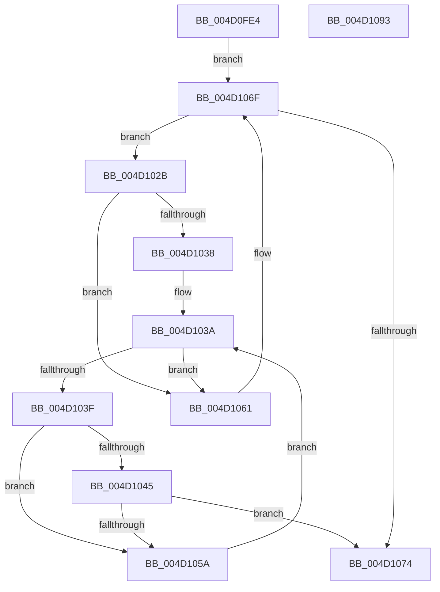

# KiRcuForEachParticipatingCpu

- RVA: `0x004D0FE4`–`0x004D1094` (길이 `176` bytes)
- VA: `0x00000001404D0FE4`
- 실행 섹션: `.text`
- PDB 이름 있음: `예`; PDB Function 태그: `아니요`
- unwind 정보 RVA: `0x0005FEF8`
- 디코드: `52`개 명령, `176/176` bytes 표시
- 미해석 바이트: `0` (있으면 어셈블리에 `.byte`로 보존)

> 이 문서는 커널 이미지의 기계어와 PDB 기호를 분석해 생성했습니다. 4번과 5번은 함수 원형과 자료형을 바이너리 사용 방식에서 추정한 C 해석이며 원본 소스 복구 결과는 아닙니다.

## 1. Dependencies

- 직접 호출 지점: **1**; 고유 호출 대상: **1**
- 직접 호출자로 확인된 함수: **1**
- RIP 상대 이미지 참조: **4**

### Outgoing calls
- `0x004D1051` → [KiRcuStartGracePeriodEnumCallback](KiRcuStartGracePeriodEnumCallback_function_004D0C48.md) (function, `0x004D0C48`)

### Direct callers
- [KiRcuStartGracePeriod](../5B/KiRcuStartGracePeriod_function_005BD2F4.md) at `0x005BD366`

### Static image references
- `0x004D1001` → RVA `0x00F210C3` (`.data`; read)
- `0x004D1008` → RVA `0x00F110C0` (`.data`; read)
- `0x004D100F` → RVA `0x00F210D0` (`.data`; read)
- `0x004D1019` → RVA `0x00F210C1` (`.data`; read)

## 2. Other-region calls and transfers

- 다른 실행 섹션으로 향하는 call: **0**
- 별도 외부 분기/꼬리 이동을 확인하지 못했습니다.

## 3. Assembly (complete function range)

```asm
004D0FE4  48 8B C4                        mov rax, rsp
004D0FE7  48 89 58 08                     mov qword ptr [rax + 8], rbx
004D0FEB  48 89 68 10                     mov qword ptr [rax + 0x10], rbp
004D0FEF  48 89 70 18                     mov qword ptr [rax + 0x18], rsi
004D0FF3  48 89 78 20                     mov qword ptr [rax + 0x20], rdi
004D0FF7  41 54                           push r12
004D0FF9  41 56                           push r14
004D0FFB  41 57                           push r15
004D0FFD  48 83 EC 20                     sub rsp, 0x20
004D1001  0F B6 05 BB 00 A5 00            movzx eax, byte ptr [rip + 0xa500bb]
004D1008  48 8D 2D B1 00 A4 00            lea rbp, [rip + 0xa400b1]
004D100F  48 8B 1D BA 00 A5 00            mov rbx, qword ptr [rip + 0xa500ba]
004D1016  4C 8B E2                        mov r12, rdx
004D1019  44 0F B6 35 A0 00 A5 00         movzx r14d, byte ptr [rip + 0xa500a0]
004D1021  48 8D 0C C0                     lea rcx, [rax + rax*8]
004D1025  4C 8D 3C CB                     lea r15, [rbx + rcx*8]
004D1029  EB 44                           jmp 0x1404d106f
004D102B  48 8B 7B 18                     mov rdi, qword ptr [rbx + 0x18]
004D102F  48 F7 D7                        not rdi
004D1032  48 23 7B 10                     and rdi, qword ptr [rbx + 0x10]
004D1036  74 29                           je 0x1404d1061
004D1038  33 F6                           xor esi, esi
004D103A  41 3B F6                        cmp esi, r14d
004D103D  73 22                           jae 0x1404d1061
004D103F  40 F6 C7 01                     test dil, 1
004D1043  74 15                           je 0x1404d105a
004D1045  8B CE                           mov ecx, esi
004D1047  49 8B D4                        mov rdx, r12
004D104A  48 C1 E1 05                     shl rcx, 5
004D104E  48 03 CD                        add rcx, rbp
004D1051  E8 F2 FB FF FF                  call 0x1404d0c48
004D1056  85 C0                           test eax, eax
004D1058  74 1A                           je 0x1404d1074
004D105A  48 D1 EF                        shr rdi, 1
004D105D  FF C6                           inc esi
004D105F  EB D9                           jmp 0x1404d103a
004D1061  49 8B C6                        mov rax, r14
004D1064  48 83 C3 48                     add rbx, 0x48
004D1068  48 C1 E0 05                     shl rax, 5
004D106C  48 03 E8                        add rbp, rax
004D106F  49 3B DF                        cmp rbx, r15
004D1072  75 B7                           jne 0x1404d102b
004D1074  48 8B 5C 24 40                  mov rbx, qword ptr [rsp + 0x40]
004D1079  48 8B 6C 24 48                  mov rbp, qword ptr [rsp + 0x48]
004D107E  48 8B 74 24 50                  mov rsi, qword ptr [rsp + 0x50]
004D1083  48 8B 7C 24 58                  mov rdi, qword ptr [rsp + 0x58]
004D1088  48 83 C4 20                     add rsp, 0x20
004D108C  41 5F                           pop r15
004D108E  41 5E                           pop r14
004D1090  41 5C                           pop r12
004D1092  C3                              ret
004D1093  CC                              int3
```

## 4. C-style interpretation (structured pseudocode)

```c
__int64 __fastcall KiRcuForEachParticipatingCpu(__int64 a1, __int64 a2)
{
    __int64 result;
    __int64 v_rbp;
    __int64 v_rbx;
    __int64 v_rdi;
    __int64 v_rsi;
    __int64 v_rsp;
    unsigned __int64 v_stack_p10;
    unsigned __int64 v_stack_p18;
    unsigned __int64 v_stack_p20;
    unsigned __int64 v_stack_p8;

    *(unsigned __int64 *)(v_rsp + 8) = v_rbx;
    *(unsigned __int64 *)(v_rsp + 16) = v_rbp;
    *(unsigned __int64 *)(v_rsp + 24) = v_rsi;
    *(unsigned __int64 *)(v_rsp + 32) = v_rdi;
    v_rsp = (v_rsp) - (32);
    goto loc_004D106F;
loc_004D102B:
    v_rdi = ~(*(unsigned __int64 *)(*(unsigned __int64 *)(v_rip + 10813626) + 24));
    v_rdi = (v_rdi) & (*(unsigned __int64 *)(*(unsigned __int64 *)(v_rip + 10813626) + 16));
    if (condition_is_equal) goto loc_004D1061;
    v_rsi = 0;
loc_004D103A:
    if (0 >= ((unsigned int)(*(unsigned __int8 *)(v_rip + 10813600)))) goto loc_004D1061;
    if ((((unsigned __int8)(v_rdi)) & (1)) == 0) goto loc_004D105A;
    a1 = (0) << (5);
    a1 = (a1) + (v_rip + 10748081);
    result = KiRcuStartGracePeriodEnumCallback(a1, a2, a3, a4);
    if ((unsigned int)(result) == 0) goto loc_004D1074;
loc_004D105A:
    v_rdi = (v_rdi) >> (1);
    v_rsi = (unsigned int)((v_rsi) + 1);
    goto loc_004D103A;
loc_004D1061:
    v_rbx = (*(unsigned __int64 *)(v_rip + 10813626)) + (72);
    result = (*(unsigned __int8 *)(v_rip + 10813600)) << (5);
    v_rbp = (v_rip + 10748081) + (result);
loc_004D106F:
    if (v_rbx != (*(unsigned __int64 *)(v_rip + 10813626) + *(unsigned __int8 *)(v_rip + 10813627) + *(unsigned __int8 *)(v_rip + 10813627) * 8 * 8)) goto loc_004D102B;
loc_004D1074:
    v_rsp = (v_rsp) + (32);
    return result;
}
```

## 5. (Beta) C Style

```c
int64_t KiRcuForEachParticipatingCpu(int64_t Arg1, int64_t Arg2)
{
    int64_t result;
    int64_t local_rbp;
    int64_t local_rbx;
    int64_t local_rdi;
    int64_t local_rsi;
    int64_t local_rsp;
    uint64_t v_stack_p10;
    uint64_t v_stack_p18;
    uint64_t v_stack_p20;
    uint64_t v_stack_p8;

    *(uint64_t *)(local_rsp + 0x8) = local_rbx;
    *(uint64_t *)(local_rsp + 0x10) = local_rbp;
    *(uint64_t *)(local_rsp + 0x18) = local_rsi;
    *(uint64_t *)(local_rsp + 0x20) = local_rdi;
    local_rsp = (local_rsp) - (32);
    goto loc_004D106F;
loc_004D102B:
    local_rdi = ~(*(uint64_t *)(*(uint64_t *)(v_rip + 0xA500BA) + 0x18));
    local_rdi = (local_rdi) & (*(uint64_t *)(*(uint64_t *)(v_rip + 0xA500BA) + 0x10));
    if (condition_is_equal) goto loc_004D1061;
    local_rsi = 0;
loc_004D103A:
    if (0 >= ((uint32_t)(*(uint8_t *)(v_rip + 0xA500A0)))) goto loc_004D1061;
    if ((((uint8_t)(local_rdi)) & (1)) == 0) goto loc_004D105A;
    Arg1 = (0) << (5);
    Arg1 = (Arg1) + (v_rip + 10748081);
    result = KiRcuStartGracePeriodEnumCallback(Arg1, Arg2, a3, a4);
    if ((uint32_t)(result) == 0) goto loc_004D1074;
loc_004D105A:
    local_rdi = (local_rdi) >> (1);
    local_rsi = (uint32_t)((local_rsi) + 1);
    goto loc_004D103A;
loc_004D1061:
    local_rbx = (*(uint64_t *)(v_rip + 0xA500BA)) + (72);
    result = (*(uint8_t *)(v_rip + 0xA500A0)) << (5);
    local_rbp = (v_rip + 10748081) + (result);
loc_004D106F:
    if (local_rbx != (*(uint64_t *)(v_rip + 0xA500BA) + *(uint8_t *)(v_rip + 0xA500BB) + *(uint8_t *)(v_rip + 0xA500BB) * 8 * 8)) goto loc_004D102B;
loc_004D1074:
    local_rsp = (local_rsp) + (32);
    return result;
}
```

## 6. Execution-region graph

[열기: 2D/3D 그래프와 함수 탐색 컨트롤 패널](../../../control-panel.html?section=text&rva=0x004D0FE4&view=graph)

- 2D 그래프는 위에서 아래로 흐르고, 3D 그래프는 빈 공간을 드래그해 회전합니다. Shift+드래그는 이동, 휠은 확대·축소, 함수 노드 선택은 대상 보고서 이동입니다.

### Static fallback


