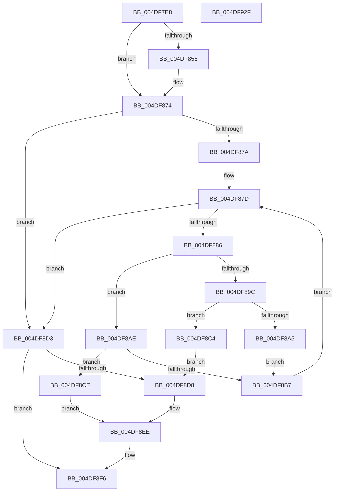

# KiRcuProcessorInitialize

- RVA: `0x004DF7E8`–`0x004DF930` (길이 `328` bytes)
- VA: `0x00000001404DF7E8`
- 실행 섹션: `.text`
- PDB 이름 있음: `예`; PDB Function 태그: `아니요`
- unwind 정보 RVA: `0x00075C18`
- 디코드: `99`개 명령, `328/328` bytes 표시
- 미해석 바이트: `0` (있으면 어셈블리에 `.byte`로 보존)

> 이 문서는 커널 이미지의 기계어와 PDB 기호를 분석해 생성했습니다. 4번과 5번은 함수 원형과 자료형을 바이너리 사용 방식에서 추정한 C 해석이며 원본 소스 복구 결과는 아닙니다.

## 1. Dependencies

- 직접 호출 지점: **8**; 고유 호출 대상: **3**
- 직접 호출자로 확인된 함수: **2**
- RIP 상대 이미지 참조: **3**

### Outgoing calls
- `0x004DF85A` → [KeAcquireSpinLockRaiseToDpc](../20/KeAcquireSpinLockRaiseToDpc_function_00208470.md) (function, `0x00208470`)
- `0x004DF86F` → [KeReleaseSpinLock](../39/KeReleaseSpinLock_function_00392BA0.md) (function, `0x00392BA0`)
- `0x004DF88D` → [KeAcquireSpinLockRaiseToDpc](../20/KeAcquireSpinLockRaiseToDpc_function_00208470.md) (function, `0x00208470`)
- `0x004DF8BA` → [KeReleaseSpinLock](../39/KeReleaseSpinLock_function_00392BA0.md) (function, `0x00392BA0`)
- `0x004DF8C7` → [KeReleaseSpinLock](../39/KeReleaseSpinLock_function_00392BA0.md) (function, `0x00392BA0`)
- `0x004DF8DC` → [KeAcquireSpinLockRaiseToDpc](../20/KeAcquireSpinLockRaiseToDpc_function_00208470.md) (function, `0x00208470`)
- `0x004DF8EE` → [KeReleaseSpinLock](../39/KeReleaseSpinLock_function_00392BA0.md) (function, `0x00392BA0`)
- `0x004DF90D` → [KiSrcuProcessorInitialize](../4F/KiSrcuProcessorInitialize_function_004FA6C4.md) (function, `0x004FA6C4`)

### Direct callers
- [KiStartDynamicProcessor](../../page/74/KiStartDynamicProcessor_function_007456C8.md) at `0x00745ACD`
- [KiStartDynamicProcessor](../../page/74/KiStartDynamicProcessor_function_007456C8.md) at `0x00745C53`
- [KeStartAllProcessors](../../init/C3/KeStartAllProcessors_function_00C36F78.md) at `0x00C37279`
- [KeStartAllProcessors](../../init/C3/KeStartAllProcessors_function_00C36F78.md) at `0x00C3742E`

### Static image references
- `0x004DF80A` → RVA `0x00F210C1` (`.data`; read)
- `0x004DF823` → RVA `0x00F110C0` (`.data`; read)
- `0x004DF833` → RVA `0x00F210D0` (`.data`; read)

## 2. Other-region calls and transfers

- 다른 실행 섹션으로 향하는 call: **0**
- 별도 외부 분기/꼬리 이동을 확인하지 못했습니다.

## 3. Assembly (complete function range)

```asm
004DF7E8  48 89 5C 24 08                  mov qword ptr [rsp + 8], rbx
004DF7ED  48 89 6C 24 10                  mov qword ptr [rsp + 0x10], rbp
004DF7F2  48 89 74 24 18                  mov qword ptr [rsp + 0x18], rsi
004DF7F7  57                              push rdi
004DF7F8  41 54                           push r12
004DF7FA  41 55                           push r13
004DF7FC  41 56                           push r14
004DF7FE  41 57                           push r15
004DF800  48 83 EC 20                     sub rsp, 0x20
004DF804  8B 41 24                        mov eax, dword ptr [rcx + 0x24]
004DF807  44 8B E2                        mov r12d, edx
004DF80A  44 0F B6 05 AF 18 A4 00         movzx r8d, byte ptr [rip + 0xa418af]
004DF812  44 8B F0                        mov r14d, eax
004DF815  33 D2                           xor edx, edx
004DF817  49 C1 E6 05                     shl r14, 5
004DF81B  41 F7 F0                        div r8d
004DF81E  4C 8B E9                        mov r13, rcx
004DF821  33 FF                           xor edi, edi
004DF823  48 8D 0D 96 18 A3 00            lea rcx, [rip + 0xa31896]
004DF82A  4C 03 F1                        add r14, rcx
004DF82D  8B CA                           mov ecx, edx
004DF82F  4C 8D 04 C0                     lea r8, [rax + rax*8]
004DF833  48 8B 05 96 18 A4 00            mov rax, qword ptr [rip + 0xa41896]
004DF83A  4D 89 6E 10                     mov qword ptr [r14 + 0x10], r13
004DF83E  4E 8D 3C C0                     lea r15, [rax + r8*8]
004DF842  B8 01 00 00 00                  mov eax, 1
004DF847  48 D3 E0                        shl rax, cl
004DF84A  4D 89 7E 08                     mov qword ptr [r14 + 8], r15
004DF84E  49 89 06                        mov qword ptr [r14], rax
004DF851  45 85 E4                        test r12d, r12d
004DF854  75 1E                           jne 0x1404df874
004DF856  49 8D 4F 20                     lea rcx, [r15 + 0x20]
004DF85A  E8 11 8C D2 FF                  call 0x140208470
004DF85F  49 8B 16                        mov rdx, qword ptr [r14]
004DF862  49 8D 4F 20                     lea rcx, [r15 + 0x20]
004DF866  48 F7 D2                        not rdx
004DF869  49 21 57 10                     and qword ptr [r15 + 0x10], rdx
004DF86D  8A D0                           mov dl, al
004DF86F  E8 2C 33 EB FF                  call 0x140392ba0
004DF874  49 39 7F 10                     cmp qword ptr [r15 + 0x10], rdi
004DF878  75 59                           jne 0x1404df8d3
004DF87A  49 8B F7                        mov rsi, r15
004DF87D  48 8B 5E 08                     mov rbx, qword ptr [rsi + 8]
004DF881  48 85 DB                        test rbx, rbx
004DF884  74 4D                           je 0x1404df8d3
004DF886  48 8D 6B 20                     lea rbp, [rbx + 0x20]
004DF88A  48 8B CD                        mov rcx, rbp
004DF88D  E8 DE 8B D2 FF                  call 0x140208470
004DF892  8A D0                           mov dl, al
004DF894  48 8B 06                        mov rax, qword ptr [rsi]
004DF897  45 85 E4                        test r12d, r12d
004DF89A  74 12                           je 0x1404df8ae
004DF89C  48 8B 4B 10                     mov rcx, qword ptr [rbx + 0x10]
004DF8A0  48 85 C8                        test rax, rcx
004DF8A3  75 1F                           jne 0x1404df8c4
004DF8A5  48 0B C8                        or rcx, rax
004DF8A8  48 89 4B 10                     mov qword ptr [rbx + 0x10], rcx
004DF8AC  EB 09                           jmp 0x1404df8b7
004DF8AE  48 F7 D0                        not rax
004DF8B1  48 21 43 10                     and qword ptr [rbx + 0x10], rax
004DF8B5  75 17                           jne 0x1404df8ce
004DF8B7  48 8B CD                        mov rcx, rbp
004DF8BA  E8 E1 32 EB FF                  call 0x140392ba0
004DF8BF  48 8B F3                        mov rsi, rbx
004DF8C2  EB B9                           jmp 0x1404df87d
004DF8C4  48 8B CD                        mov rcx, rbp
004DF8C7  E8 D4 32 EB FF                  call 0x140392ba0
004DF8CC  EB 0A                           jmp 0x1404df8d8
004DF8CE  48 8B CD                        mov rcx, rbp
004DF8D1  EB 1B                           jmp 0x1404df8ee
004DF8D3  45 85 E4                        test r12d, r12d
004DF8D6  74 1E                           je 0x1404df8f6
004DF8D8  49 8D 4F 20                     lea rcx, [r15 + 0x20]
004DF8DC  E8 8F 8B D2 FF                  call 0x140208470
004DF8E1  49 8B 16                        mov rdx, qword ptr [r14]
004DF8E4  49 8D 4F 20                     lea rcx, [r15 + 0x20]
004DF8E8  49 09 57 10                     or qword ptr [r15 + 0x10], rdx
004DF8EC  8A D0                           mov dl, al
004DF8EE  E8 AD 32 EB FF                  call 0x140392ba0
004DF8F3  45 85 E4                        test r12d, r12d
004DF8F6  41 8B 46 18                     mov eax, dword ptr [r14 + 0x18]
004DF8FA  40 0F 95 C7                     setne dil
004DF8FE  83 E0 FE                        and eax, 0xfffffffe
004DF901  41 8B D4                        mov edx, r12d
004DF904  0B F8                           or edi, eax
004DF906  49 8B CD                        mov rcx, r13
004DF909  41 89 7E 18                     mov dword ptr [r14 + 0x18], edi
004DF90D  E8 B2 AD 01 00                  call 0x1404fa6c4
004DF912  48 8B 5C 24 50                  mov rbx, qword ptr [rsp + 0x50]
004DF917  48 8B 6C 24 58                  mov rbp, qword ptr [rsp + 0x58]
004DF91C  48 8B 74 24 60                  mov rsi, qword ptr [rsp + 0x60]
004DF921  48 83 C4 20                     add rsp, 0x20
004DF925  41 5F                           pop r15
004DF927  41 5E                           pop r14
004DF929  41 5D                           pop r13
004DF92B  41 5C                           pop r12
004DF92D  5F                              pop rdi
004DF92E  C3                              ret
004DF92F  CC                              int3
```

## 4. C-style interpretation (structured pseudocode)

```c
__int64 __fastcall KiRcuProcessorInitialize(__int64 a1, int a2)
{
    __int64 result;
    __int64 v_r14;
    __int64 v_rdi;
    __int64 v_rsp;
    unsigned __int64 v_stack_p10;
    unsigned __int64 v_stack_p18;
    unsigned __int64 v_stack_p8;

    v_stack_p8 = v_rbx;
    v_stack_p10 = v_rbp;
    v_stack_p18 = v_rsi;
    v_rsp = (v_rsp) - (32);
    a2 = 0;
    v_r14 = ((unsigned int)((unsigned int)((unsigned int)(*(unsigned int *)(a1 + 36))))) << (5);
    v_rdi = 0;
    v_r14 = (v_r14) + (v_rip + 10688662);
    *(unsigned __int64 *)(v_r14 + 16) = a1;
    result = (1) << (0);
    *(unsigned __int64 *)(v_r14 + 8) = *(unsigned __int64 *)(v_rip + 10754198) + (unsigned int)(*(unsigned int *)(a1 + 36)) + (unsigned int)(*(unsigned int *)(a1 + 36)) * 8 * 8;
    *(unsigned __int64 *)(v_r14) = result;
    if ((unsigned int)((unsigned int)(a2)) == 0) {
        a1 = *(unsigned __int64 *)(v_rip + 10754198) + (unsigned int)(*(unsigned int *)(a1 + 36)) + (unsigned int)(*(unsigned int *)(a1 + 36)) * 8 * 8 + 32;
        result = KeAcquireSpinLockRaiseToDpc(a1, a2, (unsigned int)(*(unsigned int *)(a1 + 36)) + (unsigned int)(*(unsigned int *)(a1 + 36)) * 8, a4);
        a2 = *(unsigned __int64 *)(v_r14);
        a1 = *(unsigned __int64 *)(v_rip + 10754198) + (unsigned int)(*(unsigned int *)(a1 + 36)) + (unsigned int)(*(unsigned int *)(a1 + 36)) * 8 * 8 + 32;
        a2 = ~(a2);
        a2 = (unsigned __int8)(result);
        result = KeReleaseSpinLock(a1, a2, (unsigned int)(*(unsigned int *)(a1 + 36)) + (unsigned int)(*(unsigned int *)(a1 + 36)) * 8, a4);
    }
    if ((*(unsigned __int64 *)(*(unsigned __int64 *)(v_rip + 10754198) + (unsigned int)(*(unsigned int *)(a1 + 36)) + (unsigned int)(*(unsigned int *)(a1 + 36)) * 8 * 8 + 16)) != 0) goto loc_004DF8D3;
loc_004DF87D:
    if (*(unsigned __int64 *)(*(unsigned __int64 *)(v_rip + 10754198) + (unsigned int)(*(unsigned int *)(a1 + 36)) + (unsigned int)(*(unsigned int *)(a1 + 36)) * 8 * 8 + 8) == 0) goto loc_004DF8D3;
    result = KeAcquireSpinLockRaiseToDpc(*(unsigned __int64 *)(*(unsigned __int64 *)(v_rip + 10754198) + (unsigned int)(*(unsigned int *)(a1 + 36)) + (unsigned int)(*(unsigned int *)(a1 + 36)) * 8 * 8 + 8) + 32, a2, (unsigned int)(*(unsigned int *)(a1 + 36)) + (unsigned int)(*(unsigned int *)(a1 + 36)) * 8, a4);
    if ((unsigned int)((unsigned int)(a2)) == 0) goto loc_004DF8AE;
    if (((*(unsigned __int64 *)(*(unsigned __int64 *)(v_rip + 10754198) + (unsigned int)(*(unsigned int *)(a1 + 36)) + (unsigned int)(*(unsigned int *)(a1 + 36)) * 8 * 8)) & (*(unsigned __int64 *)(*(unsigned __int64 *)(*(unsigned __int64 *)(v_rip + 10754198) + (unsigned int)(*(unsigned int *)(a1 + 36)) + (unsigned int)(*(unsigned int *)(a1 + 36)) * 8 * 8 + 8) + 16))) != 0) goto loc_004DF8C4;
    a1 = (*(unsigned __int64 *)(*(unsigned __int64 *)(*(unsigned __int64 *)(v_rip + 10754198) + (unsigned int)(*(unsigned int *)(a1 + 36)) + (unsigned int)(*(unsigned int *)(a1 + 36)) * 8 * 8 + 8) + 16)) | (*(unsigned __int64 *)(*(unsigned __int64 *)(v_rip + 10754198) + (unsigned int)(*(unsigned int *)(a1 + 36)) + (unsigned int)(*(unsigned int *)(a1 + 36)) * 8 * 8));
    *(unsigned __int64 *)(*(unsigned __int64 *)(*(unsigned __int64 *)(v_rip + 10754198) + (unsigned int)(*(unsigned int *)(a1 + 36)) + (unsigned int)(*(unsigned int *)(a1 + 36)) * 8 * 8 + 8) + 16) = a1;
    goto loc_004DF8B7;
loc_004DF8AE:
    result = ~(*(unsigned __int64 *)(*(unsigned __int64 *)(v_rip + 10754198) + (unsigned int)(*(unsigned int *)(a1 + 36)) + (unsigned int)(*(unsigned int *)(a1 + 36)) * 8 * 8));
    if (condition_is_not_equal) goto loc_004DF8CE;
loc_004DF8B7:
    result = KeReleaseSpinLock(*(unsigned __int64 *)(*(unsigned __int64 *)(v_rip + 10754198) + (unsigned int)(*(unsigned int *)(a1 + 36)) + (unsigned int)(*(unsigned int *)(a1 + 36)) * 8 * 8 + 8) + 32, (unsigned __int8)(result), (unsigned int)(*(unsigned int *)(a1 + 36)) + (unsigned int)(*(unsigned int *)(a1 + 36)) * 8, a4);
    goto loc_004DF87D;
loc_004DF8C4:
    result = KeReleaseSpinLock(*(unsigned __int64 *)(*(unsigned __int64 *)(v_rip + 10754198) + (unsigned int)(*(unsigned int *)(a1 + 36)) + (unsigned int)(*(unsigned int *)(a1 + 36)) * 8 * 8 + 8) + 32, (unsigned __int8)(result), (unsigned int)(*(unsigned int *)(a1 + 36)) + (unsigned int)(*(unsigned int *)(a1 + 36)) * 8, a4);
    goto loc_004DF8D8;
loc_004DF8CE:
    goto loc_004DF8EE;
loc_004DF8D3:
    if ((unsigned int)((unsigned int)(a2)) == 0) goto loc_004DF8F6;
loc_004DF8D8:
    result = KeAcquireSpinLockRaiseToDpc(*(unsigned __int64 *)(v_rip + 10754198) + (unsigned int)(*(unsigned int *)(a1 + 36)) + (unsigned int)(*(unsigned int *)(a1 + 36)) * 8 * 8 + 32, (unsigned __int8)(result), (unsigned int)(*(unsigned int *)(a1 + 36)) + (unsigned int)(*(unsigned int *)(a1 + 36)) * 8, a4);
loc_004DF8EE:
    result = KeReleaseSpinLock(*(unsigned __int64 *)(v_rip + 10754198) + (unsigned int)(*(unsigned int *)(a1 + 36)) + (unsigned int)(*(unsigned int *)(a1 + 36)) * 8 * 8 + 32, (unsigned __int8)(result), (unsigned int)(*(unsigned int *)(a1 + 36)) + (unsigned int)(*(unsigned int *)(a1 + 36)) * 8, a4);
loc_004DF8F6:
    v_rdi = ((unsigned int)((unsigned int)(a2)) != 0) ? 1 : 0;
    result = (unsigned int)(((unsigned int)(*(unsigned int *)(v_r14 + 24))) & (0xFFFFFFFEULL));
    v_rdi = (unsigned int)((v_rdi) | ((unsigned int)(result)));
    *(unsigned int *)(v_r14 + 24) = (unsigned int)(v_rdi);
    result = KiSrcuProcessorInitialize(a1, (unsigned int)((unsigned int)((unsigned int)(a2))), (unsigned int)(*(unsigned int *)(a1 + 36)) + (unsigned int)(*(unsigned int *)(a1 + 36)) * 8, a4);
    v_rsp = (v_rsp) + (32);
    return result;
}
```

## 5. (Beta) C Style

```c
int64_t KiRcuProcessorInitialize(void *Arg1, int32_t Arg2)
{
    uint8_t *arg1 = (uint8_t *)Arg1;

    int64_t result;
    int64_t local_r14;
    int64_t local_rdi;
    int64_t local_rsp;
    uint64_t v_stack_p10;
    uint64_t v_stack_p18;
    uint64_t v_stack_p8;

    v_stack_p8 = local_rbx;
    v_stack_p10 = local_rbp;
    v_stack_p18 = local_rsi;
    local_rsp = (local_rsp) - (32);
    Arg2 = 0;
    local_r14 = ((uint32_t)((uint32_t)((uint32_t)(*(uint32_t *)(arg1 + 0x24))))) << (5);
    local_rdi = 0;
    local_r14 = (local_r14) + (v_rip + 10688662);
    *(void **)(local_r14 + 0x10) = Arg1;
    result = (1) << (0);
    *(uint64_t *)(local_r14 + 0x8) = *(uint64_t *)(v_rip + 0xA41896) + (uint32_t)(*(uint32_t *)(arg1 + 0x24)) + (uint32_t)(*(uint32_t *)(arg1 + 0x24)) * 8 * 8;
    *(uint64_t *)(local_r14) = result;
    if ((uint32_t)((uint32_t)(Arg2)) == 0) {
        Arg1 = *(uint64_t *)(v_rip + 0xA41896) + (uint32_t)(*(uint32_t *)(arg1 + 0x24)) + (uint32_t)(*(uint32_t *)(arg1 + 0x24)) * 8 * 8 + 32;
        result = KeAcquireSpinLockRaiseToDpc(Arg1, Arg2, (uint32_t)(*(uint32_t *)(arg1 + 0x24)) + (uint32_t)(*(uint32_t *)(arg1 + 0x24)) * 8, a4);
        Arg2 = *(uint64_t *)(local_r14);
        Arg1 = *(uint64_t *)(v_rip + 0xA41896) + (uint32_t)(*(uint32_t *)(arg1 + 0x24)) + (uint32_t)(*(uint32_t *)(arg1 + 0x24)) * 8 * 8 + 32;
        Arg2 = ~(Arg2);
        Arg2 = (uint8_t)(result);
        result = KeReleaseSpinLock(Arg1, Arg2, (uint32_t)(*(uint32_t *)(arg1 + 0x24)) + (uint32_t)(*(uint32_t *)(arg1 + 0x24)) * 8, a4);
    }
    if ((*(uint64_t *)(*(uint64_t *)(v_rip + 0xA41896) + (uint32_t)(*(uint32_t *)(arg1 + 0x24)) + (uint32_t)(*(uint32_t *)(arg1 + 0x24)) * 8 * 8 + 0x10)) != 0) goto loc_004DF8D3;
loc_004DF87D:
    if (*(uint64_t *)(*(uint64_t *)(v_rip + 0xA41896) + (uint32_t)(*(uint32_t *)(arg1 + 0x24)) + (uint32_t)(*(uint32_t *)(arg1 + 0x24)) * 8 * 8 + 0x8) == 0) goto loc_004DF8D3;
    result = KeAcquireSpinLockRaiseToDpc(*(uint64_t *)(*(uint64_t *)(v_rip + 0xA41896) + (uint32_t)(*(uint32_t *)(arg1 + 0x24)) + (uint32_t)(*(uint32_t *)(arg1 + 0x24)) * 8 * 8 + 0x8) + 32, Arg2, (uint32_t)(*(uint32_t *)(arg1 + 0x24)) + (uint32_t)(*(uint32_t *)(arg1 + 0x24)) * 8, a4);
    if ((uint32_t)((uint32_t)(Arg2)) == 0) goto loc_004DF8AE;
    if (((*(uint64_t *)(*(uint64_t *)(v_rip + 0xA41896) + (uint32_t)(*(uint32_t *)(arg1 + 0x24)) + (uint32_t)(*(uint32_t *)(arg1 + 0x24)) * 8 * 8)) & (*(uint64_t *)(*(uint64_t *)(*(uint64_t *)(v_rip + 0xA41896) + (uint32_t)(*(uint32_t *)(arg1 + 0x24)) + (uint32_t)(*(uint32_t *)(arg1 + 0x24)) * 8 * 8 + 0x8) + 0x10))) != 0) goto loc_004DF8C4;
    Arg1 = (*(uint64_t *)(*(uint64_t *)(*(uint64_t *)(v_rip + 0xA41896) + (uint32_t)(*(uint32_t *)(arg1 + 0x24)) + (uint32_t)(*(uint32_t *)(arg1 + 0x24)) * 8 * 8 + 0x8) + 0x10)) | (*(uint64_t *)(*(uint64_t *)(v_rip + 0xA41896) + (uint32_t)(*(uint32_t *)(arg1 + 0x24)) + (uint32_t)(*(uint32_t *)(arg1 + 0x24)) * 8 * 8));
    *(void **)(*(uint64_t *)(*(uint64_t *)(v_rip + 0xA41896) + (uint32_t)(*(uint32_t *)(arg1 + 0x24)) + (uint32_t)(*(uint32_t *)(arg1 + 0x24)) * 8 * 8 + 0x8) + 0x10) = Arg1;
    goto loc_004DF8B7;
loc_004DF8AE:
    result = ~(*(uint64_t *)(*(uint64_t *)(v_rip + 0xA41896) + (uint32_t)(*(uint32_t *)(arg1 + 0x24)) + (uint32_t)(*(uint32_t *)(arg1 + 0x24)) * 8 * 8));
    if (condition_is_not_equal) goto loc_004DF8CE;
loc_004DF8B7:
    result = KeReleaseSpinLock(*(uint64_t *)(*(uint64_t *)(v_rip + 0xA41896) + (uint32_t)(*(uint32_t *)(arg1 + 0x24)) + (uint32_t)(*(uint32_t *)(arg1 + 0x24)) * 8 * 8 + 0x8) + 32, (uint8_t)(result), (uint32_t)(*(uint32_t *)(arg1 + 0x24)) + (uint32_t)(*(uint32_t *)(arg1 + 0x24)) * 8, a4);
    goto loc_004DF87D;
loc_004DF8C4:
    result = KeReleaseSpinLock(*(uint64_t *)(*(uint64_t *)(v_rip + 0xA41896) + (uint32_t)(*(uint32_t *)(arg1 + 0x24)) + (uint32_t)(*(uint32_t *)(arg1 + 0x24)) * 8 * 8 + 0x8) + 32, (uint8_t)(result), (uint32_t)(*(uint32_t *)(arg1 + 0x24)) + (uint32_t)(*(uint32_t *)(arg1 + 0x24)) * 8, a4);
    goto loc_004DF8D8;
loc_004DF8CE:
    goto loc_004DF8EE;
loc_004DF8D3:
    if ((uint32_t)((uint32_t)(Arg2)) == 0) goto loc_004DF8F6;
loc_004DF8D8:
    result = KeAcquireSpinLockRaiseToDpc(*(uint64_t *)(v_rip + 0xA41896) + (uint32_t)(*(uint32_t *)(arg1 + 0x24)) + (uint32_t)(*(uint32_t *)(arg1 + 0x24)) * 8 * 8 + 32, (uint8_t)(result), (uint32_t)(*(uint32_t *)(arg1 + 0x24)) + (uint32_t)(*(uint32_t *)(arg1 + 0x24)) * 8, a4);
loc_004DF8EE:
    result = KeReleaseSpinLock(*(uint64_t *)(v_rip + 0xA41896) + (uint32_t)(*(uint32_t *)(arg1 + 0x24)) + (uint32_t)(*(uint32_t *)(arg1 + 0x24)) * 8 * 8 + 32, (uint8_t)(result), (uint32_t)(*(uint32_t *)(arg1 + 0x24)) + (uint32_t)(*(uint32_t *)(arg1 + 0x24)) * 8, a4);
loc_004DF8F6:
    local_rdi = ((uint32_t)((uint32_t)(Arg2)) != 0) ? 1 : 0;
    result = (uint32_t)(((uint32_t)(*(uint32_t *)(local_r14 + 0x18))) & (0xFFFFFFFEULL));
    local_rdi = (uint32_t)((local_rdi) | ((uint32_t)(result)));
    *(uint32_t *)(local_r14 + 0x18) = (uint32_t)(local_rdi);
    result = KiSrcuProcessorInitialize(Arg1, (uint32_t)((uint32_t)((uint32_t)(Arg2))), (uint32_t)(*(uint32_t *)(arg1 + 0x24)) + (uint32_t)(*(uint32_t *)(arg1 + 0x24)) * 8, a4);
    local_rsp = (local_rsp) + (32);
    return result;
}
```

### 관측된 메모리 오프셋

구조체 형식이 확인되지 않은 접근은 인자 기준의 오프셋으로만 기록했습니다.

| 기준 인자 | 오프셋 표현 | 폭 (bit) | 접근 |
|---|---:|---:|---|
| `Arg1` | `+ 0x24` | `32` | `R` |

## 6. Execution-region graph

[열기: 2D/3D 그래프와 함수 탐색 컨트롤 패널](../../../control-panel.html?section=text&rva=0x004DF7E8&view=graph)

- 2D 그래프는 위에서 아래로 흐르고, 3D 그래프는 빈 공간을 드래그해 회전합니다. Shift+드래그는 이동, 휠은 확대·축소, 함수 노드 선택은 대상 보고서 이동입니다.

### Static fallback


