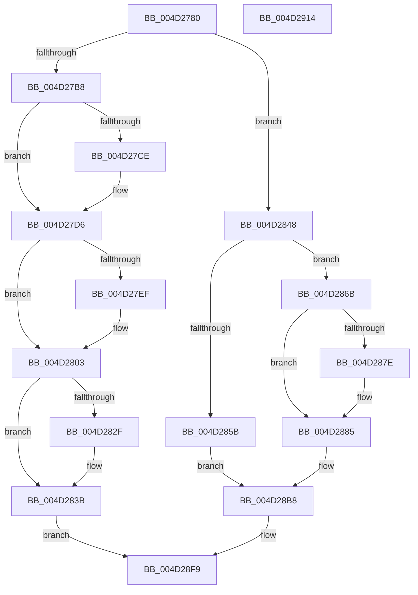

# KiRestoreClockTickRate

- RVA: `0x004D2780`–`0x004D2915` (길이 `405` bytes)
- VA: `0x00000001404D2780`
- 실행 섹션: `.text`
- PDB 이름 있음: `예`; PDB Function 태그: `아니요`
- unwind 정보 RVA: `0x000BDE90`
- 디코드: `95`개 명령, `405/405` bytes 표시
- 미해석 바이트: `0` (있으면 어셈블리에 `.byte`로 보존)

> 이 문서는 커널 이미지의 기계어와 PDB 기호를 분석해 생성했습니다. 4번과 5번은 함수 원형과 자료형을 바이너리 사용 방식에서 추정한 C 해석이며 원본 소스 복구 결과는 아닙니다.

## 1. Dependencies

- 직접 호출 지점: **9**; 고유 호출 대상: **8**
- 직접 호출자로 확인된 함수: **3**
- RIP 상대 이미지 참조: **9**

### Outgoing calls
- `0x004D27D1` → [KiRaiseIrqlProcessIrqlFlags](../4F/KiRaiseIrqlProcessIrqlFlags_function_004F56FC.md) (function, `0x004F56FC`)
- `0x004D27E6` → [KiShouldRearmClockTimer](../39/KiShouldRearmClockTimer_function_0039E134.md) (function, `0x0039E134`)
- `0x004D27FE` → [KiSetNextClockTickDueTime](../23/KiSetNextClockTickDueTime_function_002363F0.md) (function, `0x002363F0`)
- `0x004D2836` → [KiLowerIrqlProcessIrqlFlags](../4F/KiLowerIrqlProcessIrqlFlags_function_004F5698.md) (function, `0x004F5698`)
- `0x004D2864` → [guard_dispatch_icall](../6B/guard_dispatch_icall_function_006BAAD0.md) (function, `0x006BAAD0`)
- `0x004D2888` → [KiGetClockIntervalOneShot](../44/KiGetClockIntervalOneShot_function_00449990.md) (function, `0x00449990`)
- `0x004D28A1` → [guard_dispatch_icall](../6B/guard_dispatch_icall_function_006BAAD0.md) (function, `0x006BAAD0`)
- `0x004D28ED` → [KiLogClockIncrementUpdate](../46/KiLogClockIncrementUpdate_function_00466C98.md) (function, `0x00466C98`)
- `0x004D28F4` → [KiSetPendingTick](../44/KiSetPendingTick_function_004400F4.md) (function, `0x004400F4`)

### Direct callers
- [KeClockInterruptNotify](../39/KeClockInterruptNotify_function_0039A970.md) at `0x0039B2C3`
- [KiResumeClockTimer](../4F/KiResumeClockTimer_function_004F6420.md) at `0x004F6555`
- [KeResumeClockTimerFromIdle](../5B/KeResumeClockTimerFromIdle_function_005BACC4.md) at `0x005BB0E6`
- [KeResumeClockTimerFromIdle](../5B/KeResumeClockTimerFromIdle_function_005BACC4.md) at `0x005BB270`

### Static image references
- `0x004D27A5` → RVA `0x00FC6A85` (`ALMOSTRO`; read)
- `0x004D27C5` → RVA `0x00FC6D20` (`ALMOSTRO`; read)
- `0x004D2848` → RVA `0x00F21FA8` (`.data`; read)
- `0x004D284E` → RVA `0x00F21FC0` (`.data`; read)
- `0x004D285B` → RVA `0x00E00AF0` (`.data`; read)
- `0x004D286B` → RVA `0x00F21F90` (`.data`; read)
- `0x004D2872` → RVA `0x00F21FA0` (`.data`; read)
- `0x004D28A9` → RVA `0x00F21FC0` (`.data`; write)
- `0x004D28B2` → RVA `0x00FC6B7C` (`ALMOSTRO`; write)

## 2. Other-region calls and transfers

- 다른 실행 섹션으로 향하는 call: **0**
- 별도 외부 분기/꼬리 이동을 확인하지 못했습니다.

## 3. Assembly (complete function range)

```asm
004D2780  48 8B C4                        mov rax, rsp
004D2783  48 89 58 08                     mov qword ptr [rax + 8], rbx
004D2787  48 89 70 10                     mov qword ptr [rax + 0x10], rsi
004D278B  48 89 78 18                     mov qword ptr [rax + 0x18], rdi
004D278F  4C 89 70 20                     mov qword ptr [rax + 0x20], r14
004D2793  41 57                           push r15
004D2795  48 83 EC 30                     sub rsp, 0x30
004D2799  65 48 8B 1C 25 20 00 00 00      mov rbx, qword ptr gs:[0x20]
004D27A2  4D 8B F0                        mov r14, r8
004D27A5  80 3D D9 42 AF 00 00            cmp byte ptr [rip + 0xaf42d9], 0
004D27AC  4C 8B FA                        mov r15, rdx
004D27AF  48 8B F1                        mov rsi, rcx
004D27B2  0F 84 90 00 00 00               je 0x1404d2848
004D27B8  44 0F 20 C7                     mov rdi, cr8
004D27BC  BA 0F 00 00 00                  mov edx, 0xf
004D27C1  44 0F 22 C2                     mov cr8, rdx
004D27C5  83 3D 54 45 AF 00 00            cmp dword ptr [rip + 0xaf4554], 0
004D27CC  74 08                           je 0x1404d27d6
004D27CE  40 8A CF                        mov cl, dil
004D27D1  E8 26 2F 02 00                  call 0x1404f56fc
004D27D6  41 B0 01                        mov r8b, 1
004D27D9  C6 83 09 96 00 00 00            mov byte ptr [rbx + 0x9609], 0
004D27E0  48 8B D6                        mov rdx, rsi
004D27E3  48 8B CB                        mov rcx, rbx
004D27E6  E8 49 B9 EC FF                  call 0x14039e134
004D27EB  84 C0                           test al, al
004D27ED  74 14                           je 0x1404d2803
004D27EF  B2 01                           mov dl, 1
004D27F1  C7 83 90 95 00 00 02 00 00 00   mov dword ptr [rbx + 0x9590], 2
004D27FB  48 8B CE                        mov rcx, rsi
004D27FE  E8 ED 3B D6 FF                  call 0x1402363f0
004D2803  8B 83 88 95 00 00               mov eax, dword ptr [rbx + 0x9588]
004D2809  49 89 06                        mov qword ptr [r14], rax
004D280C  8B 83 8C 95 00 00               mov eax, dword ptr [rbx + 0x958c]
004D2812  C7 83 A0 83 00 00 01 00 00 00   mov dword ptr [rbx + 0x83a0], 1
004D281C  C6 83 08 96 00 00 01            mov byte ptr [rbx + 0x9608], 1
004D2823  83 3D F6 44 AF 00 00            cmp dword ptr [rip + 0xaf44f6], 0
004D282A  49 89 07                        mov qword ptr [r15], rax
004D282D  74 0C                           je 0x1404d283b
004D282F  44 0F 20 C1                     mov rcx, cr8
004D2833  40 8A D7                        mov dl, dil
004D2836  E8 5D 2E 02 00                  call 0x1404f5698
004D283B  40 0F B6 C7                     movzx eax, dil
004D283F  44 0F 22 C0                     mov cr8, rax
004D2843  E9 B1 00 00 00                  jmp 0x1404d28f9
004D2848  8B 3D 5A F7 A4 00               mov edi, dword ptr [rip + 0xa4f75a]
004D284E  8B 15 6C F7 A4 00               mov edx, dword ptr [rip + 0xa4f76c]
004D2854  49 89 17                        mov qword ptr [r15], rdx
004D2857  85 FF                           test edi, edi
004D2859  75 10                           jne 0x1404d286b
004D285B  48 8B 05 8E E2 92 00            mov rax, qword ptr [rip + 0x92e28e]
004D2862  33 C9                           xor ecx, ecx
004D2864  E8 67 82 1E 00                  call 0x1406baad0
004D2869  EB 4D                           jmp 0x1404d28b8
004D286B  48 8B 0D 1E F7 A4 00            mov rcx, qword ptr [rip + 0xa4f71e]
004D2872  48 8B 05 27 F7 A4 00            mov rax, qword ptr [rip + 0xa4f727]
004D2879  48 3B C6                        cmp rax, rsi
004D287C  72 07                           jb 0x1404d2885
004D287E  48 3B C1                        cmp rax, rcx
004D2881  48 0F 42 C8                     cmovb rcx, rax
004D2885  48 8B D6                        mov rdx, rsi
004D2888  E8 03 71 F7 FF                  call 0x140449990
004D288D  8B D0                           mov edx, eax
004D288F  4D 8B C6                        mov r8, r14
004D2892  48 8B 05 57 E2 92 00            mov rax, qword ptr [rip + 0x92e257]
004D2899  B9 01 00 00 00                  mov ecx, 1
004D289E  49 89 17                        mov qword ptr [r15], rdx
004D28A1  E8 2A 82 1E 00                  call 0x1406baad0
004D28A6  41 8B 07                        mov eax, dword ptr [r15]
004D28A9  89 05 11 F7 A4 00               mov dword ptr [rip + 0xa4f711], eax
004D28AF  41 8B 06                        mov eax, dword ptr [r14]
004D28B2  89 05 C4 42 AF 00               mov dword ptr [rip + 0xaf42c4], eax
004D28B8  45 8B 07                        mov r8d, dword ptr [r15]
004D28BB  83 FF 01                        cmp edi, 1
004D28BE  44 89 83 8C 95 00 00            mov dword ptr [rbx + 0x958c], r8d
004D28C5  48 8B D6                        mov rdx, rsi
004D28C8  89 BB 90 95 00 00               mov dword ptr [rbx + 0x9590], edi
004D28CE  48 8B CB                        mov rcx, rbx
004D28D1  41 8B 06                        mov eax, dword ptr [r14]
004D28D4  89 83 88 95 00 00               mov dword ptr [rbx + 0x9588], eax
004D28DA  0F 94 C0                        sete al
004D28DD  66 C7 83 08 96 00 00 01 00      mov word ptr [rbx + 0x9608], 1
004D28E6  45 8B 0E                        mov r9d, dword ptr [r14]
004D28E9  88 44 24 20                     mov byte ptr [rsp + 0x20], al
004D28ED  E8 A6 43 F9 FF                  call 0x140466c98
004D28F2  B1 01                           mov cl, 1
004D28F4  E8 FB D7 F6 FF                  call 0x1404400f4
004D28F9  48 8B 5C 24 40                  mov rbx, qword ptr [rsp + 0x40]
004D28FE  48 8B 74 24 48                  mov rsi, qword ptr [rsp + 0x48]
004D2903  48 8B 7C 24 50                  mov rdi, qword ptr [rsp + 0x50]
004D2908  4C 8B 74 24 58                  mov r14, qword ptr [rsp + 0x58]
004D290D  48 83 C4 30                     add rsp, 0x30
004D2911  41 5F                           pop r15
004D2913  C3                              ret
004D2914  CC                              int3
```

## 4. C-style interpretation (structured pseudocode)

```c
__int64 __fastcall KiRestoreClockTickRate(__int64 a1, __int64 a2, __int64 a3)
{
    __int64 result;
    __int64 v_rsp;
    unsigned __int8 v_stack_m18;
    unsigned __int64 v_stack_p10;
    unsigned __int64 v_stack_p18;
    unsigned __int64 v_stack_p20;
    unsigned __int64 v_stack_p8;

    *(unsigned __int64 *)(v_rsp + 8) = v_rbx;
    *(unsigned __int64 *)(v_rsp + 16) = v_rsi;
    *(unsigned __int64 *)(v_rsp + 24) = v_rdi;
    *(unsigned __int64 *)(v_rsp + 32) = v_r14;
    v_rsp = (v_rsp) - (48);
    if ((*(unsigned __int8 *)(v_rip + 11485913)) == 0) goto loc_004D2848;
    result = v_rsp;
    if ((*(unsigned int *)(v_rip + 11486548)) != 0) {
        a1 = (unsigned __int8)(v_cr8);
        result = KiRaiseIrqlProcessIrqlFlags(a1, 15, a3, a4);
    }
    *(unsigned __int8 *)(*(unsigned __int64 *)(gs_base + (0 + 32)) + 38409) = 0;
    result = KiShouldRearmClockTimer(*(unsigned __int64 *)(gs_base + (0 + 32)), a1, 1, a4);
    if ((unsigned __int8)(result) != 0) {
        a2 = 1;
        *(unsigned int *)(*(unsigned __int64 *)(gs_base + (0 + 32)) + 38288) = 2;
        a1 = a1;
        result = KiSetNextClockTickDueTime(a1, a2, 1, a4);
    }
    *(unsigned __int64 *)(a3) = (unsigned int)(*(unsigned int *)(*(unsigned __int64 *)(gs_base + (0 + 32)) + 38280));
    *(unsigned int *)(*(unsigned __int64 *)(gs_base + (0 + 32)) + 33696) = 1;
    *(unsigned __int8 *)(*(unsigned __int64 *)(gs_base + (0 + 32)) + 38408) = 1;
    *(unsigned __int64 *)(a2) = (unsigned int)(*(unsigned int *)(*(unsigned __int64 *)(gs_base + (0 + 32)) + 38284));
    result = (unsigned int)(*(unsigned int *)(*(unsigned __int64 *)(gs_base + (0 + 32)) + 38284));
    if ((*(unsigned int *)(v_rip + 11486454)) != 0) {
        a1 = 15;
        a2 = (unsigned __int8)(v_cr8);
        result = KiLowerIrqlProcessIrqlFlags(a1, a2, 1, a4);
    }
    goto loc_004D28F9;
loc_004D2848:
    *(unsigned __int64 *)(a2) = (unsigned int)(*(unsigned int *)(v_rip + 10811244));
    if ((unsigned int)((unsigned int)(*(unsigned int *)(v_rip + 10811226))) != 0) goto loc_004D286B;
    a1 = 0;
    result = guard_dispatch_icall(a1, (unsigned int)(*(unsigned int *)(v_rip + 10811244)), 1, a4);
    goto loc_004D28B8;
loc_004D286B:
    if ((*(unsigned __int64 *)(v_rip + 10811175)) >= 0) {
        a1 = *(unsigned __int64 *)(v_rip + 10811166);
        if ((*(unsigned __int64 *)(v_rip + 10811175)) < (*(unsigned __int64 *)(v_rip + 10811166))) { a1 = *(unsigned __int64 *)(v_rip + 10811175); }
    }
    result = KiGetClockIntervalOneShot(a1, a1, 1, a4);
    *(unsigned __int64 *)(a2) = (unsigned int)((unsigned int)(result));
    result = guard_dispatch_icall(1, (unsigned int)((unsigned int)(result)), a3, a4);
    *(unsigned int *)(v_rip + 10811153) = (unsigned int)((unsigned int)(*(unsigned int *)(a2)));
    *(unsigned int *)(v_rip + 11485892) = (unsigned int)((unsigned int)(*(unsigned int *)(a3)));
loc_004D28B8:
    *(unsigned int *)(*(unsigned __int64 *)(gs_base + (0 + 32)) + 38284) = (unsigned int)((unsigned int)(*(unsigned int *)(a2)));
    *(unsigned int *)(*(unsigned __int64 *)(gs_base + (0 + 32)) + 38288) = (unsigned int)((unsigned int)(*(unsigned int *)(v_rip + 10811226)));
    *(unsigned int *)(*(unsigned __int64 *)(gs_base + (0 + 32)) + 38280) = (unsigned int)((unsigned int)(*(unsigned int *)(a3)));
    result = (((unsigned int)((unsigned int)(*(unsigned int *)(v_rip + 10811226)))) == 1) ? 1 : 0;
    *(unsigned __int16 *)(*(unsigned __int64 *)(gs_base + (0 + 32)) + 38408) = 1;
    v_stack_m18 = (unsigned __int8)(result);
    result = KiLogClockIncrementUpdate(*(unsigned __int64 *)(gs_base + (0 + 32)), a1, (unsigned int)(*(unsigned int *)(a2)), (unsigned int)(*(unsigned int *)(a3)));
    result = KiSetPendingTick(1, a1, (unsigned int)(*(unsigned int *)(a2)), (unsigned int)(*(unsigned int *)(a3)));
loc_004D28F9:
    v_rsp = (v_rsp) + (48);
    return result;
}
```

## 5. (Beta) C Style

```c
int64_t KiRestoreClockTickRate(int64_t Arg1, void *Arg2, void *Arg3)
{
    uint8_t *arg2 = (uint8_t *)Arg2;
    uint8_t *arg3 = (uint8_t *)Arg3;

    int64_t result;
    int64_t local_rsp;
    uint8_t v_stack_m18;
    uint64_t v_stack_p10;
    uint64_t v_stack_p18;
    uint64_t v_stack_p20;
    uint64_t v_stack_p8;

    *(uint64_t *)(local_rsp + 0x8) = local_rbx;
    *(uint64_t *)(local_rsp + 0x10) = local_rsi;
    *(uint64_t *)(local_rsp + 0x18) = local_rdi;
    *(uint64_t *)(local_rsp + 0x20) = local_r14;
    local_rsp = (local_rsp) - (48);
    if ((*(uint8_t *)(v_rip + 0xAF42D9)) == 0) goto loc_004D2848;
    result = local_rsp;
    if ((*(uint32_t *)(v_rip + 0xAF4554)) != 0) {
        Arg1 = (uint8_t)(v_cr8);
        result = KiRaiseIrqlProcessIrqlFlags(Arg1, 15, Arg3, a4);
    }
    *(uint8_t *)(*(uint64_t *)(gs_base + (0 + 0x20)) + 0x9609) = 0;
    result = KiShouldRearmClockTimer(*(uint64_t *)(gs_base + (0 + 0x20)), Arg1, 1, a4);
    if ((uint8_t)(result) != 0) {
        Arg2 = 1;
        *(uint32_t *)(*(uint64_t *)(gs_base + (0 + 0x20)) + 0x9590) = 2;
        Arg1 = Arg1;
        result = KiSetNextClockTickDueTime(Arg1, Arg2, 1, a4);
    }
    *(uint64_t *)(arg3) = (uint32_t)(*(uint32_t *)(*(uint64_t *)(gs_base + (0 + 0x20)) + 0x9588));
    *(uint32_t *)(*(uint64_t *)(gs_base + (0 + 0x20)) + 0x83A0) = 1;
    *(uint8_t *)(*(uint64_t *)(gs_base + (0 + 0x20)) + 0x9608) = 1;
    *(uint64_t *)(arg2) = (uint32_t)(*(uint32_t *)(*(uint64_t *)(gs_base + (0 + 0x20)) + 0x958C));
    result = (uint32_t)(*(uint32_t *)(*(uint64_t *)(gs_base + (0 + 0x20)) + 0x958C));
    if ((*(uint32_t *)(v_rip + 0xAF44F6)) != 0) {
        Arg1 = 15;
        Arg2 = (uint8_t)(v_cr8);
        result = KiLowerIrqlProcessIrqlFlags(Arg1, Arg2, 1, a4);
    }
    goto loc_004D28F9;
loc_004D2848:
    *(uint64_t *)(arg2) = (uint32_t)(*(uint32_t *)(v_rip + 0xA4F76C));
    if ((uint32_t)((uint32_t)(*(uint32_t *)(v_rip + 0xA4F75A))) != 0) goto loc_004D286B;
    Arg1 = 0;
    result = guard_dispatch_icall(Arg1, (uint32_t)(*(uint32_t *)(v_rip + 0xA4F76C)), 1, a4);
    goto loc_004D28B8;
loc_004D286B:
    if ((*(uint64_t *)(v_rip + 0xA4F727)) >= 0) {
        Arg1 = *(uint64_t *)(v_rip + 0xA4F71E);
        if ((*(uint64_t *)(v_rip + 0xA4F727)) < (*(uint64_t *)(v_rip + 0xA4F71E))) { Arg1 = *(uint64_t *)(v_rip + 0xA4F727); }
    }
    result = KiGetClockIntervalOneShot(Arg1, Arg1, 1, a4);
    *(uint64_t *)(arg2) = (uint32_t)((uint32_t)(result));
    result = guard_dispatch_icall(1, (uint32_t)((uint32_t)(result)), Arg3, a4);
    *(uint32_t *)(v_rip + 0xA4F711) = (uint32_t)((uint32_t)(*(uint32_t *)(arg2)));
    *(uint32_t *)(v_rip + 0xAF42C4) = (uint32_t)((uint32_t)(*(uint32_t *)(arg3)));
loc_004D28B8:
    *(uint32_t *)(*(uint64_t *)(gs_base + (0 + 0x20)) + 0x958C) = (uint32_t)((uint32_t)(*(uint32_t *)(arg2)));
    *(uint32_t *)(*(uint64_t *)(gs_base + (0 + 0x20)) + 0x9590) = (uint32_t)((uint32_t)(*(uint32_t *)(v_rip + 0xA4F75A)));
    *(uint32_t *)(*(uint64_t *)(gs_base + (0 + 0x20)) + 0x9588) = (uint32_t)((uint32_t)(*(uint32_t *)(arg3)));
    result = (((uint32_t)((uint32_t)(*(uint32_t *)(v_rip + 0xA4F75A)))) == 1) ? 1 : 0;
    *(uint16_t *)(*(uint64_t *)(gs_base + (0 + 0x20)) + 0x9608) = 1;
    v_stack_m18 = (uint8_t)(result);
    result = KiLogClockIncrementUpdate(*(uint64_t *)(gs_base + (0 + 0x20)), Arg1, (uint32_t)(*(uint32_t *)(arg2)), (uint32_t)(*(uint32_t *)(arg3)));
    result = KiSetPendingTick(1, Arg1, (uint32_t)(*(uint32_t *)(arg2)), (uint32_t)(*(uint32_t *)(arg3)));
loc_004D28F9:
    local_rsp = (local_rsp) + (48);
    return result;
}
```

### 관측된 메모리 오프셋

구조체 형식이 확인되지 않은 접근은 인자 기준의 오프셋으로만 기록했습니다.

| 기준 인자 | 오프셋 표현 | 폭 (bit) | 접근 |
|---|---:|---:|---|
| `Arg2` | `+ 0x0` | `32` | `R` |
| `Arg2` | `+ 0x0` | `64` | `W` |
| `Arg3` | `+ 0x0` | `32` | `R` |
| `Arg3` | `+ 0x0` | `64` | `W` |

## 6. Execution-region graph

[열기: 2D/3D 그래프와 함수 탐색 컨트롤 패널](../../../control-panel.html?section=text&rva=0x004D2780&view=graph)

- 2D 그래프는 위에서 아래로 흐르고, 3D 그래프는 빈 공간을 드래그해 회전합니다. Shift+드래그는 이동, 휠은 확대·축소, 함수 노드 선택은 대상 보고서 이동입니다.

### Static fallback


