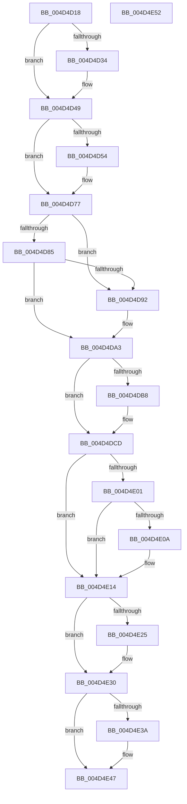

# KiRestoreFeatureBits

- RVA: `0x004D4D18`–`0x004D4E53` (길이 `315` bytes)
- VA: `0x00000001404D4D18`
- 실행 섹션: `.text`
- PDB 이름 있음: `예`; PDB Function 태그: `아니요`
- unwind 정보 RVA: `0x0005CAAC`
- 디코드: `79`개 명령, `315/315` bytes 표시
- 미해석 바이트: `0` (있으면 어셈블리에 `.byte`로 보존)

> 이 문서는 커널 이미지의 기계어와 PDB 기호를 분석해 생성했습니다. 4번과 5번은 함수 원형과 자료형을 바이너리 사용 방식에서 추정한 C 해석이며 원본 소스 복구 결과는 아닙니다.

## 1. Dependencies

- 직접 호출 지점: **5**; 고유 호출 대상: **5**
- 직접 호출자로 확인된 함수: **1**
- RIP 상대 이미지 참조: **6**

### Outgoing calls
- `0x004D4DA6` → [KiSetVirtualMitigationControl](../4F/KiSetVirtualMitigationControl_function_004FD38C.md) (function, `0x004FD38C`)
- `0x004D4DCD` → [KiSetMicrocodeUpdateOptions](../4F/KiSetMicrocodeUpdateOptions_function_004FADE4.md) (function, `0x004FADE4`)
- `0x004D4DD2` → [KeInitializeCatRegisters](../4F/KeInitializeCatRegisters_function_004FAE74.md) (function, `0x004FAE74`)
- `0x004D4DF3` → [KiApplyProcessorErrata](../5C/KiApplyProcessorErrata_function_005C1704.md) (function, `0x005C1704`)
- `0x004D4E17` → [KiCheckMicrocode](../../pagelk/B7/KiCheckMicrocode_function_00B7E648.md) (function, `0x00B7E648`)

### Direct callers
- [KeRestoreProcessorSpecificFeatures](KeRestoreProcessorSpecificFeatures_function_004D4C90.md) at `0x004D4CF2`

### Static image references
- `0x004D4D34` → RVA `0x00FC7300` (`ALMOSTRO`; read)
- `0x004D4D85` → RVA `0x00FC6B60` (`ALMOSTRO`; read)
- `0x004D4DF8` → RVA `0x00FC6A87` (`ALMOSTRO`; read)
- `0x004D4E01` → RVA `0x00FC6A84` (`ALMOSTRO`; read)
- `0x004D4E1C` → RVA `0x00FC5064` (`ALMOSTRO`; read)
- `0x004D4E30` → RVA `0x00FC6CE8` (`ALMOSTRO`; read)

## 2. Other-region calls and transfers

- 다른 실행 섹션으로 향하는 call: **1**
  - `0x004D4E17` → [KiCheckMicrocode](../../pagelk/B7/KiCheckMicrocode_function_00B7E648.md) (`.text` → `PAGELK`)
- 별도 외부 분기/꼬리 이동을 확인하지 못했습니다.

## 3. Assembly (complete function range)

```asm
004D4D18  48 89 5C 24 08                  mov qword ptr [rsp + 8], rbx
004D4D1D  57                              push rdi
004D4D1E  48 83 EC 20                     sub rsp, 0x20
004D4D22  65 48 8B 1C 25 20 00 00 00      mov rbx, qword ptr gs:[0x20]
004D4D2B  80 BB 8D 00 00 00 02            cmp byte ptr [rbx + 0x8d], 2
004D4D32  75 15                           jne 0x1404d4d49
004D4D34  48 8B 15 C5 25 AF 00            mov rdx, qword ptr [rip + 0xaf25c5]
004D4D3B  B9 A0 01 00 00                  mov ecx, 0x1a0
004D4D40  48 8B C2                        mov rax, rdx
004D4D43  48 C1 EA 20                     shr rdx, 0x20
004D4D47  0F 30                           wrmsr
004D4D49  48 0F BA A3 A0 8F 00 00 22      bt qword ptr [rbx + 0x8fa0], 0x22
004D4D52  73 23                           jae 0x1404d4d77
004D4D54  0F B6 83 D1 00 00 00            movzx eax, byte ptr [rbx + 0xd1]
004D4D5B  B9 03 01 00 C0                  mov ecx, 0xc0000103
004D4D60  0F B6 93 D0 00 00 00            movzx edx, byte ptr [rbx + 0xd0]
004D4D67  48 C1 E2 08                     shl rdx, 8
004D4D6B  48 0B D0                        or rdx, rax
004D4D6E  48 8B C2                        mov rax, rdx
004D4D71  48 C1 EA 20                     shr rdx, 0x20
004D4D75  0F 30                           wrmsr
004D4D77  0F B7 8B E6 06 00 00            movzx ecx, word ptr [rbx + 0x6e6]
004D4D7E  33 FF                           xor edi, edi
004D4D80  66 85 C9                        test cx, cx
004D4D83  75 0D                           jne 0x1404d4d92
004D4D85  48 F7 05 D0 1D AF 00 00 06 00 00  test qword ptr [rip + 0xaf1dd0], 0x600
004D4D90  74 11                           je 0x1404d4da3
004D4D92  48 8B D1                        mov rdx, rcx
004D4D95  48 8B C1                        mov rax, rcx
004D4D98  48 C1 EA 20                     shr rdx, 0x20
004D4D9C  B9 48 00 00 00                  mov ecx, 0x48
004D4DA1  0F 30                           wrmsr
004D4DA3  48 8B CB                        mov rcx, rbx
004D4DA6  E8 E1 85 02 00                  call 0x1404fd38c
004D4DAB  48 F7 05 AA 1D AF 00 00 80 00 00  test qword ptr [rip + 0xaf1daa], 0x8000
004D4DB6  74 15                           je 0x1404d4dcd
004D4DB8  48 8B 93 00 2D 00 00            mov rdx, qword ptr [rbx + 0x2d00]
004D4DBF  B9 22 01 00 00                  mov ecx, 0x122
004D4DC4  48 8B C2                        mov rax, rdx
004D4DC7  48 C1 EA 20                     shr rdx, 0x20
004D4DCB  0F 30                           wrmsr
004D4DCD  E8 12 60 02 00                  call 0x1404fade4
004D4DD2  E8 9D 60 02 00                  call 0x1404fae74
004D4DD7  33 C0                           xor eax, eax
004D4DD9  B9 74 01 00 00                  mov ecx, 0x174
004D4DDE  33 D2                           xor edx, edx
004D4DE0  0F 30                           wrmsr
004D4DE2  B9 76 01 00 00                  mov ecx, 0x176
004D4DE7  0F 30                           wrmsr
004D4DE9  B9 75 01 00 00                  mov ecx, 0x175
004D4DEE  0F 30                           wrmsr
004D4DF0  48 8B CB                        mov rcx, rbx
004D4DF3  E8 0C C9 0E 00                  call 0x1405c1704
004D4DF8  40 38 3D 88 1C AF 00            cmp byte ptr [rip + 0xaf1c88], dil
004D4DFF  74 13                           je 0x1404d4e14
004D4E01  40 38 3D 7C 1C AF 00            cmp byte ptr [rip + 0xaf1c7c], dil
004D4E08  75 0A                           jne 0x1404d4e14
004D4E0A  0F 20 D8                        mov rax, cr3
004D4E0D  48 83 C8 02                     or rax, 2
004D4E11  0F 22 D8                        mov cr3, rax
004D4E14  48 8B CB                        mov rcx, rbx
004D4E17  E8 2C 98 6A 00                  call 0x140b7e648
004D4E1C  40 38 3D 41 02 AF 00            cmp byte ptr [rip + 0xaf0241], dil
004D4E23  74 0B                           je 0x1404d4e30
004D4E25  0F 20 E0                        mov rax, cr4
004D4E28  48 0F BA E8 17                  bts rax, 0x17
004D4E2D  0F 22 E0                        mov cr4, rax
004D4E30  8B 05 B2 1E AF 00               mov eax, dword ptr [rip + 0xaf1eb2]
004D4E36  85 C0                           test eax, eax
004D4E38  74 0D                           je 0x1404d4e47
004D4E3A  8B D0                           mov edx, eax
004D4E3C  B9 DA 17 00 00                  mov ecx, 0x17da
004D4E41  48 C1 EA 20                     shr rdx, 0x20
004D4E45  0F 30                           wrmsr
004D4E47  48 8B 5C 24 30                  mov rbx, qword ptr [rsp + 0x30]
004D4E4C  48 83 C4 20                     add rsp, 0x20
004D4E50  5F                              pop rdi
004D4E51  C3                              ret
004D4E52  CC                              int3
```

## 4. C-style interpretation (structured pseudocode)

```c
__int64 __fastcall KiRestoreFeatureBits(void)
{
    __int64 result;
    __int64 v_cr3;
    __int64 v_cr4;
    __int64 v_rdi;
    __int64 v_rsp;
    unsigned __int64 v_stack_p8;

    v_stack_p8 = v_rbx;
    v_rsp = (v_rsp) - (32);
    if ((*(unsigned __int8 *)(*(unsigned __int64 *)(gs_base + (0 + 32)) + 141)) == 2) {
        a2 = *(unsigned __int64 *)(v_rip + 11478469);
        a1 = 416;
        result = a2;
        a2 = (a2) >> (32);
    }
    if (!(condition_is_above_or_equal)) {
        result = *(unsigned __int8 *)(*(unsigned __int64 *)(gs_base + (0 + 32)) + 209);
        a1 = 0xC0000103ULL;
        a2 = *(unsigned __int8 *)(*(unsigned __int64 *)(gs_base + (0 + 32)) + 208);
        a2 = (a2) << (8);
        a2 = (a2) | (result);
        result = a2;
        a2 = (a2) >> (32);
    }
    v_rdi = 0;
    if ((unsigned __int16)(*(unsigned __int16 *)(*(unsigned __int64 *)(gs_base + (0 + 32)) + 1766)) != 0) goto loc_004D4D92;
    if (((*(unsigned __int64 *)(v_rip + 11476432)) & (0x600ULL)) != 0) {
        a2 = *(unsigned __int16 *)(*(unsigned __int64 *)(gs_base + (0 + 32)) + 1766);
        result = *(unsigned __int16 *)(*(unsigned __int64 *)(gs_base + (0 + 32)) + 1766);
        a2 = (a2) >> (32);
        a1 = 72;
    }
    result = KiSetVirtualMitigationControl(*(unsigned __int64 *)(gs_base + (0 + 32)), a2, a3, a4);
    if (((*(unsigned __int64 *)(v_rip + 11476394)) & (0x8000ULL)) != 0) {
        a2 = *(unsigned __int64 *)(*(unsigned __int64 *)(gs_base + (0 + 32)) + 11520);
        a1 = 290;
        result = a2;
        a2 = (a2) >> (32);
    }
    result = KiSetMicrocodeUpdateOptions(a1, a2, a3, a4);
    result = KeInitializeCatRegisters(a1, a2, a3, a4);
    result = 0;
    a2 = 0;
    result = KiApplyProcessorErrata(*(unsigned __int64 *)(gs_base + (0 + 32)), a2, a3, a4);
    if ((*(unsigned __int8 *)(v_rip + 11476104)) == 0) goto loc_004D4E14;
    if ((*(unsigned __int8 *)(v_rip + 11476092)) == 0) {
        result = v_cr3;
        result = (result) | (2);
        v_cr3 = result;
    }
    result = KiCheckMicrocode(*(unsigned __int64 *)(gs_base + (0 + 32)), a2, a3, a4);
    if ((*(unsigned __int8 *)(v_rip + 11469377)) != 0) {
        result = v_cr4;
        v_cr4 = result;
    }
    if ((unsigned int)((unsigned int)(*(unsigned int *)(v_rip + 11476658))) != 0) {
        a2 = (unsigned int)((unsigned int)(*(unsigned int *)(v_rip + 11476658)));
        a1 = 0x17DAULL;
        a2 = (a2) >> (32);
    }
    v_rsp = (v_rsp) + (32);
    return (unsigned int)(*(unsigned int *)(v_rip + 11476658));
}
```

## 5. (Beta) C Style

```c
void KiRestoreFeatureBits(void)
{
    int64_t result;
    int64_t v_cr3;
    int64_t v_cr4;
    int64_t local_rdi;
    int64_t local_rsp;
    uint64_t v_stack_p8;

    v_stack_p8 = local_rbx;
    local_rsp = (local_rsp) - (32);
    if ((*(uint8_t *)(*(uint64_t *)(gs_base + (0 + 0x20)) + 0x8D)) == 2) {
        a2 = *(uint64_t *)(v_rip + 0xAF25C5);
        a1 = 416;
        result = a2;
        a2 = (a2) >> (32);
    }
    if (!(condition_is_above_or_equal)) {
        result = *(uint8_t *)(*(uint64_t *)(gs_base + (0 + 0x20)) + 0xD1);
        a1 = 0xC0000103ULL;
        a2 = *(uint8_t *)(*(uint64_t *)(gs_base + (0 + 0x20)) + 0xD0);
        a2 = (a2) << (8);
        a2 = (a2) | (result);
        result = a2;
        a2 = (a2) >> (32);
    }
    local_rdi = 0;
    if ((uint16_t)(*(uint16_t *)(*(uint64_t *)(gs_base + (0 + 0x20)) + 0x6E6)) != 0) goto loc_004D4D92;
    if (((*(uint64_t *)(v_rip + 0xAF1DD0)) & (0x600ULL)) != 0) {
        a2 = *(uint16_t *)(*(uint64_t *)(gs_base + (0 + 0x20)) + 0x6E6);
        result = *(uint16_t *)(*(uint64_t *)(gs_base + (0 + 0x20)) + 0x6E6);
        a2 = (a2) >> (32);
        a1 = 72;
    }
    result = KiSetVirtualMitigationControl(*(uint64_t *)(gs_base + (0 + 0x20)), a2, a3, a4);
    if (((*(uint64_t *)(v_rip + 0xAF1DAA)) & (0x8000ULL)) != 0) {
        a2 = *(uint64_t *)(*(uint64_t *)(gs_base + (0 + 0x20)) + 0x2D00);
        a1 = 290;
        result = a2;
        a2 = (a2) >> (32);
    }
    result = KiSetMicrocodeUpdateOptions(a1, a2, a3, a4);
    result = KeInitializeCatRegisters(a1, a2, a3, a4);
    result = 0;
    a2 = 0;
    result = KiApplyProcessorErrata(*(uint64_t *)(gs_base + (0 + 0x20)), a2, a3, a4);
    if ((*(uint8_t *)(v_rip + 0xAF1C88)) == 0) goto loc_004D4E14;
    if ((*(uint8_t *)(v_rip + 0xAF1C7C)) == 0) {
        result = v_cr3;
        result = (result) | (2);
        v_cr3 = result;
    }
    result = KiCheckMicrocode(*(uint64_t *)(gs_base + (0 + 0x20)), a2, a3, a4);
    if ((*(uint8_t *)(v_rip + 0xAF0241)) != 0) {
        result = v_cr4;
        v_cr4 = result;
    }
    if ((uint32_t)((uint32_t)(*(uint32_t *)(v_rip + 0xAF1EB2))) != 0) {
        a2 = (uint32_t)((uint32_t)(*(uint32_t *)(v_rip + 0xAF1EB2)));
        a1 = 0x17DAULL;
        a2 = (a2) >> (32);
    }
    local_rsp = (local_rsp) + (32);
    return (uint32_t)(*(uint32_t *)(v_rip + 0xAF1EB2));
}
```

## 6. Execution-region graph

[열기: 2D/3D 그래프와 함수 탐색 컨트롤 패널](../../../control-panel.html?section=text&rva=0x004D4D18&view=graph)

- 2D 그래프는 위에서 아래로 흐르고, 3D 그래프는 빈 공간을 드래그해 회전합니다. Shift+드래그는 이동, 휠은 확대·축소, 함수 노드 선택은 대상 보고서 이동입니다.

### Static fallback


