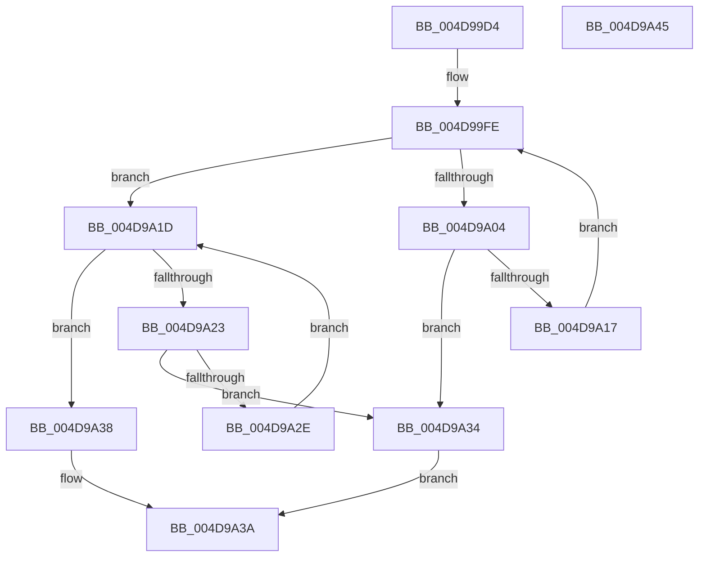

# KiSubtractAffinityExNoResult

- RVA: `0x004D99D4`–`0x004D9A46` (길이 `114` bytes)
- VA: `0x00000001404D99D4`
- 실행 섹션: `.text`
- PDB 이름 있음: `예`; PDB Function 태그: `아니요`
- unwind 정보 RVA: `0x000950EC`
- 디코드: `34`개 명령, `114/114` bytes 표시
- 미해석 바이트: `0` (있으면 어셈블리에 `.byte`로 보존)

> 이 문서는 커널 이미지의 기계어와 PDB 기호를 분석해 생성했습니다. 4번과 5번은 함수 원형과 자료형을 바이너리 사용 방식에서 추정한 C 해석이며 원본 소스 복구 결과는 아닙니다.

## 1. Dependencies

- 직접 호출 지점: **0**; 고유 호출 대상: **0**
- 직접 호출자로 확인된 함수: **2**
- RIP 상대 이미지 참조: **0**

### Outgoing calls
- 직접 디코드된 call 명령이 없습니다.

### Direct callers
- [KeSubtractAffinityEx2](../2D/KeSubtractAffinityEx2_function_002D5BA0.md) at `0x002D5BB9`
- [KeSubtractAffinityEx](../5B/KeSubtractAffinityEx_function_005B9630.md) at `0x005B9639`

### Static image references
- 디코드된 RIP-relative 메모리 참조가 없습니다.

## 2. Other-region calls and transfers

- 다른 실행 섹션으로 향하는 call: **0**
- 별도 외부 분기/꼬리 이동을 확인하지 못했습니다.

## 3. Assembly (complete function range)

```asm
004D99D4  48 89 5C 24 08                  mov qword ptr [rsp + 8], rbx
004D99D9  48 89 7C 24 10                  mov qword ptr [rsp + 0x10], rdi
004D99DE  44 0F B7 19                     movzx r11d, word ptr [rcx]
004D99E2  4C 8B C9                        mov r9, rcx
004D99E5  0F B7 02                        movzx eax, word ptr [rdx]
004D99E8  45 0F B7 D3                     movzx r10d, r11w
004D99EC  66 44 3B D8                     cmp r11w, ax
004D99F0  66 44 0F 43 D0                  cmovae r10w, ax
004D99F5  33 FF                           xor edi, edi
004D99F7  44 0F B7 C7                     movzx r8d, di
004D99FB  8D 5F 01                        lea ebx, [rdi + 1]
004D99FE  66 45 3B C2                     cmp r8w, r10w
004D9A02  73 19                           jae 0x1404d9a1d
004D9A04  41 0F B7 C8                     movzx ecx, r8w
004D9A08  48 8B 44 CA 08                  mov rax, qword ptr [rdx + rcx*8 + 8]
004D9A0D  48 F7 D0                        not rax
004D9A10  49 85 44 C9 08                  test qword ptr [r9 + rcx*8 + 8], rax
004D9A15  75 1D                           jne 0x1404d9a34
004D9A17  66 44 03 C3                     add r8w, bx
004D9A1B  EB E1                           jmp 0x1404d99fe
004D9A1D  66 45 3B C3                     cmp r8w, r11w
004D9A21  73 15                           jae 0x1404d9a38
004D9A23  41 0F B7 C0                     movzx eax, r8w
004D9A27  49 39 7C C1 08                  cmp qword ptr [r9 + rax*8 + 8], rdi
004D9A2C  75 06                           jne 0x1404d9a34
004D9A2E  66 44 03 C3                     add r8w, bx
004D9A32  EB E9                           jmp 0x1404d9a1d
004D9A34  8B C3                           mov eax, ebx
004D9A36  EB 02                           jmp 0x1404d9a3a
004D9A38  33 C0                           xor eax, eax
004D9A3A  48 8B 5C 24 08                  mov rbx, qword ptr [rsp + 8]
004D9A3F  48 8B 7C 24 10                  mov rdi, qword ptr [rsp + 0x10]
004D9A44  C3                              ret
004D9A45  CC                              int3
```

## 4. C-style interpretation (structured pseudocode)

```c
__int64 __fastcall KiSubtractAffinityExNoResult(__int64 a1, __int64 a2)
{
    __int64 result;
    __int64 v_r10;
    __int64 v_rdi;
    unsigned __int64 v_stack_p10;
    unsigned __int64 v_stack_p8;

    v_stack_p8 = v_rbx;
    v_stack_p10 = v_rdi;
    v_r10 = (unsigned __int16)(*(unsigned __int16 *)(a1));
    if (((unsigned __int16)(*(unsigned __int16 *)(a1))) >= ((unsigned __int16)(*(unsigned __int16 *)(a2)))) { v_r10 = (unsigned __int16)(*(unsigned __int16 *)(a2)); }
    v_rdi = 0;
loc_004D99FE:
    if (0 >= ((unsigned __int16)(v_r10))) goto loc_004D9A1D;
    result = ~(*(unsigned __int64 *)(a2 + 0 * 8 + 8));
    if (((*(unsigned __int64 *)(a1 + 0 * 8 + 8)) & (result)) != 0) goto loc_004D9A34;
    a3 = (unsigned __int16)((0) + ((unsigned __int16)(v_rdi + 1)));
    goto loc_004D99FE;
loc_004D9A1D:
    if (((unsigned __int16)(a3)) >= ((unsigned __int16)(*(unsigned __int16 *)(a1)))) goto loc_004D9A38;
    if ((*(unsigned __int64 *)(a1 + (unsigned __int16)(a3) * 8 + 8)) != 0) goto loc_004D9A34;
    a3 = (unsigned __int16)((a3) + ((unsigned __int16)(v_rdi + 1)));
    goto loc_004D9A1D;
loc_004D9A34:
    goto loc_004D9A3A;
loc_004D9A38:
    result = 0;
loc_004D9A3A:
    return result;
}
```

## 5. (Beta) C Style

```c
int64_t KiSubtractAffinityExNoResult(void *Arg1, void *Arg2)
{
    uint8_t *arg1 = (uint8_t *)Arg1;
    uint8_t *arg2 = (uint8_t *)Arg2;

    int64_t result;
    int64_t local_r10;
    int64_t local_rdi;
    uint64_t v_stack_p10;
    uint64_t v_stack_p8;

    v_stack_p8 = local_rbx;
    v_stack_p10 = local_rdi;
    local_r10 = (uint16_t)(*(uint16_t *)(arg1));
    if (((uint16_t)(*(uint16_t *)(arg1))) >= ((uint16_t)(*(uint16_t *)(arg2)))) { local_r10 = (uint16_t)(*(uint16_t *)(arg2)); }
    local_rdi = 0;
loc_004D99FE:
    if (0 >= ((uint16_t)(local_r10))) goto loc_004D9A1D;
    result = ~(*(uint64_t *)(arg2 + 0x0 * 8 + 0x8));
    if (((*(uint64_t *)(arg1 + 0x0 * 8 + 0x8)) & (result)) != 0) goto loc_004D9A34;
    a3 = (uint16_t)((0) + ((uint16_t)(local_rdi + 1)));
    goto loc_004D99FE;
loc_004D9A1D:
    if (((uint16_t)(a3)) >= ((uint16_t)(*(uint16_t *)(arg1)))) goto loc_004D9A38;
    if ((*(uint64_t *)(arg1 + (uint16_t)(a3) * 8 + 0x8)) != 0) goto loc_004D9A34;
    a3 = (uint16_t)((a3) + ((uint16_t)(local_rdi + 1)));
    goto loc_004D9A1D;
loc_004D9A34:
    goto loc_004D9A3A;
loc_004D9A38:
    result = 0;
loc_004D9A3A:
    return result;
}
```

### 관측된 메모리 오프셋

구조체 형식이 확인되지 않은 접근은 인자 기준의 오프셋으로만 기록했습니다.

| 기준 인자 | 오프셋 표현 | 폭 (bit) | 접근 |
|---|---:|---:|---|
| `Arg1` | `+ 0x0` | `16` | `R` |
| `Arg1` | `+ 0x8 + rax*8` | `64` | `R` |
| `Arg1` | `+ 0x8 + rcx*8` | `64` | `R` |
| `Arg2` | `+ 0x0` | `16` | `R` |
| `Arg2` | `+ 0x8 + rcx*8` | `64` | `R` |

## 6. Execution-region graph

[열기: 2D/3D 그래프와 함수 탐색 컨트롤 패널](../../../control-panel.html?section=text&rva=0x004D99D4&view=graph)

- 2D 그래프는 위에서 아래로 흐르고, 3D 그래프는 빈 공간을 드래그해 회전합니다. Shift+드래그는 이동, 휠은 확대·축소, 함수 노드 선택은 대상 보고서 이동입니다.

### Static fallback


