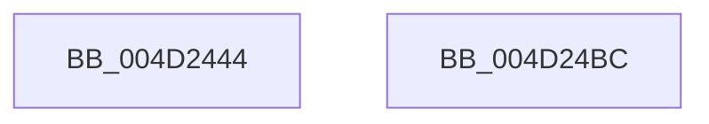

# KiSynchronizePassiveInterruptExecution

- RVA: `0x004D2444`–`0x004D24BD` (길이 `121` bytes)
- VA: `0x00000001404D2444`
- 실행 섹션: `.text`
- PDB 이름 있음: `예`; PDB Function 태그: `아니요`
- unwind 정보 RVA: `0x000794E0`
- 디코드: `32`개 명령, `121/121` bytes 표시
- 미해석 바이트: `0` (있으면 어셈블리에 `.byte`로 보존)

> 이 문서는 커널 이미지의 기계어와 PDB 기호를 분석해 생성했습니다. 4번과 5번은 함수 원형과 자료형을 바이너리 사용 방식에서 추정한 C 해석이며 원본 소스 복구 결과는 아닙니다.

## 1. Dependencies

- 직접 호출 지점: **4**; 고유 호출 대상: **4**
- 직접 호출자로 확인된 함수: **1**
- RIP 상대 이미지 참조: **0**

### Outgoing calls
- `0x004D2482` → [KeWaitForSingleObject](../20/KeWaitForSingleObject_function_0020E6B0.md) (function, `0x0020E6B0`)
- `0x004D248D` → [guard_dispatch_icall](../6B/guard_dispatch_icall_function_006BAAD0.md) (function, `0x006BAAD0`)
- `0x004D24A0` → [KeSetEvent](../33/KeSetEvent_function_0033F310.md) (function, `0x0033F310`)
- `0x004D24A5` → [KeLeaveCriticalRegion](../25/KeLeaveCriticalRegion_function_0025D8B0.md) (function, `0x0025D8B0`)

### Direct callers
- [sub_002074B2](../20/Unknown_function_002074B2.md) at `0x002074B5`

### Static image references
- 디코드된 RIP-relative 메모리 참조가 없습니다.

## 2. Other-region calls and transfers

- 다른 실행 섹션으로 향하는 call: **0**
- 별도 외부 분기/꼬리 이동을 확인하지 못했습니다.

## 3. Assembly (complete function range)

```asm
004D2444  48 89 5C 24 08                  mov qword ptr [rsp + 8], rbx
004D2449  48 89 74 24 10                  mov qword ptr [rsp + 0x10], rsi
004D244E  57                              push rdi
004D244F  48 83 EC 30                     sub rsp, 0x30
004D2453  65 48 8B 04 25 88 01 00 00      mov rax, qword ptr gs:[0x188]
004D245C  49 8B D8                        mov rbx, r8
004D245F  48 83 64 24 20 00               and qword ptr [rsp + 0x20], 0
004D2465  48 8B FA                        mov rdi, rdx
004D2468  48 8B F1                        mov rsi, rcx
004D246B  45 33 C9                        xor r9d, r9d
004D246E  45 33 C0                        xor r8d, r8d
004D2471  33 D2                           xor edx, edx
004D2473  66 FF 88 E4 01 00 00            dec word ptr [rax + 0x1e4]
004D247A  90                              nop
004D247B  48 8B 89 80 00 00 00            mov rcx, qword ptr [rcx + 0x80]
004D2482  E8 29 C2 D3 FF                  call 0x14020e6b0
004D2487  48 8B CB                        mov rcx, rbx
004D248A  48 8B C7                        mov rax, rdi
004D248D  E8 3E 86 1E 00                  call 0x1406baad0
004D2492  48 8B 8E 80 00 00 00            mov rcx, qword ptr [rsi + 0x80]
004D2499  45 33 C0                        xor r8d, r8d
004D249C  33 D2                           xor edx, edx
004D249E  8A D8                           mov bl, al
004D24A0  E8 6B CE E6 FF                  call 0x14033f310
004D24A5  E8 06 B4 D8 FF                  call 0x14025d8b0
004D24AA  48 8B 74 24 48                  mov rsi, qword ptr [rsp + 0x48]
004D24AF  8A C3                           mov al, bl
004D24B1  48 8B 5C 24 40                  mov rbx, qword ptr [rsp + 0x40]
004D24B6  48 83 C4 30                     add rsp, 0x30
004D24BA  5F                              pop rdi
004D24BB  C3                              ret
004D24BC  CC                              int3
```

## 4. C-style interpretation (structured pseudocode)

```c
__int64 __fastcall KiSynchronizePassiveInterruptExecution(__int64 a1, __int64 a2, __int64 a3, int a4)
{
    __int64 result;
    __int64 v_rsp;
    unsigned __int64 v_stack_m18;
    unsigned __int64 v_stack_p10;
    unsigned __int64 v_stack_p8;

    v_stack_p8 = v_rbx;
    v_stack_p10 = v_rsi;
    v_rsp = (v_rsp) - (48);
    a4 = 0;
    a3 = 0;
    a2 = 0;
    result = KeWaitForSingleObject(*(unsigned __int64 *)(a1 + 128), a2, a3, a4);
    result = guard_dispatch_icall(0, a2, a3, a4);
    a3 = 0;
    a2 = 0;
    result = KeSetEvent(*(unsigned __int64 *)(a1 + 128), a2, a3, a4);
    result = KeLeaveCriticalRegion(*(unsigned __int64 *)(a1 + 128), a2, a3, a4);
    v_rsp = (v_rsp) + (48);
    return (unsigned __int8)((unsigned __int8)(result));
}
```

## 5. (Beta) C Style

```c
int64_t KiSynchronizePassiveInterruptExecution(void *Arg1, int64_t Arg2, int64_t Arg3, int32_t Arg4)
{
    uint8_t *arg1 = (uint8_t *)Arg1;

    int64_t result;
    int64_t local_rsp;
    uint64_t v_stack_m18;
    uint64_t v_stack_p10;
    uint64_t v_stack_p8;

    v_stack_p8 = local_rbx;
    v_stack_p10 = local_rsi;
    local_rsp = (local_rsp) - (48);
    Arg4 = 0;
    Arg3 = 0;
    Arg2 = 0;
    result = KeWaitForSingleObject(*(uint64_t *)(arg1 + 0x80), Arg2, Arg3, Arg4);
    result = guard_dispatch_icall(0, Arg2, Arg3, Arg4);
    Arg3 = 0;
    Arg2 = 0;
    result = KeSetEvent(*(uint64_t *)(arg1 + 0x80), Arg2, Arg3, Arg4);
    result = KeLeaveCriticalRegion(*(uint64_t *)(arg1 + 0x80), Arg2, Arg3, Arg4);
    local_rsp = (local_rsp) + (48);
    return (uint8_t)((uint8_t)(result));
}
```

### 관측된 메모리 오프셋

구조체 형식이 확인되지 않은 접근은 인자 기준의 오프셋으로만 기록했습니다.

| 기준 인자 | 오프셋 표현 | 폭 (bit) | 접근 |
|---|---:|---:|---|
| `Arg1` | `+ 0x80` | `64` | `R` |

## 6. Execution-region graph

[열기: 2D/3D 그래프와 함수 탐색 컨트롤 패널](../../../control-panel.html?section=text&rva=0x004D2444&view=graph)

- 2D 그래프는 위에서 아래로 흐르고, 3D 그래프는 빈 공간을 드래그해 회전합니다. Shift+드래그는 이동, 휠은 확대·축소, 함수 노드 선택은 대상 보고서 이동입니다.

### Static fallback


