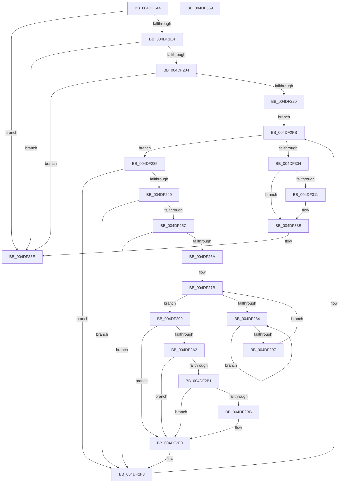

# KiVpBackingThreadYieldExecution

- RVA: `0x004DF1A4`–`0x004DF35A` (길이 `438` bytes)
- VA: `0x00000001404DF1A4`
- 실행 섹션: `.text`
- PDB 이름 있음: `예`; PDB Function 태그: `아니요`
- unwind 정보 RVA: `0x000BEDC8`
- 디코드: `101`개 명령, `438/438` bytes 표시
- 미해석 바이트: `0` (있으면 어셈블리에 `.byte`로 보존)

> 이 문서는 커널 이미지의 기계어와 PDB 기호를 분석해 생성했습니다. 4번과 5번은 함수 원형과 자료형을 바이너리 사용 방식에서 추정한 C 해석이며 원본 소스 복구 결과는 아닙니다.

## 1. Dependencies

- 직접 호출 지점: **6**; 고유 호출 대상: **6**
- 직접 호출자로 확인된 함수: **1**
- RIP 상대 이미지 참조: **6**

### Outgoing calls
- `0x004DF1EC` → [KeQueryPerformanceCounter](../37/KeQueryPerformanceCounter_function_0037E7E0.md) (function, `0x0037E7E0`)
- `0x004DF224` → [ExAcquireSpinLockSharedAtDpcLevel](../24/ExAcquireSpinLockSharedAtDpcLevel_function_00248E30.md) (function, `0x00248E30`)
- `0x004DF289` → [KeYieldProcessorEx](../3F/KeYieldProcessorEx_function_003FBD00.md) (function, `0x003FBD00`)
- `0x004DF2DE` → [KiSetPriorityBoost](../39/KiSetPriorityBoost_function_00398A40.md) (function, `0x00398A40`)
- `0x004DF308` → [ExReleaseSpinLockSharedFromDpcLevel](../24/ExReleaseSpinLockSharedFromDpcLevel_function_0024A590.md) (function, `0x0024A590`)
- `0x004DF322` → [KiProcessDeferredReadyList](../25/KiProcessDeferredReadyList_function_00250800.md) (function, `0x00250800`)

### Direct callers
- [KeYieldExecution](../20/KeYieldExecution_function_00209FA0.md) at `0x0020A358`

### Static image references
- `0x004DF1CF` → RVA `0x00FC6FE0` (`ALMOSTRO`; read)
- `0x004DF204` → RVA `0x00FC7308` (`ALMOSTRO`; read)
- `0x004DF250` → RVA `0x00FC504C` (`ALMOSTRO`; read)
- `0x004DF2BB` → RVA `0x00FC6C4C` (`ALMOSTRO`; read)
- `0x004DF32D` → RVA `0x00FC7310` (`ALMOSTRO`; read/write)
- `0x004DF334` → RVA `0x00FC7314` (`ALMOSTRO`; read/write)

## 2. Other-region calls and transfers

- 다른 실행 섹션으로 향하는 call: **0**
- 별도 외부 분기/꼬리 이동을 확인하지 못했습니다.

## 3. Assembly (complete function range)

```asm
004DF1A4  48 89 5C 24 20                  mov qword ptr [rsp + 0x20], rbx
004DF1A9  55                              push rbp
004DF1AA  56                              push rsi
004DF1AB  57                              push rdi
004DF1AC  41 54                           push r12
004DF1AE  41 55                           push r13
004DF1B0  41 56                           push r14
004DF1B2  41 57                           push r15
004DF1B4  48 83 EC 30                     sub rsp, 0x30
004DF1B8  48 83 64 24 78 00               and qword ptr [rsp + 0x78], 0
004DF1BE  33 ED                           xor ebp, ebp
004DF1C0  8B 81 88 04 00 00               mov eax, dword ptr [rcx + 0x488]
004DF1C6  48 8B B9 20 02 00 00            mov rdi, qword ptr [rcx + 0x220]
004DF1CD  FF C0                           inc eax
004DF1CF  3B 05 0B 7E AE 00               cmp eax, dword ptr [rip + 0xae7e0b]
004DF1D5  8D 75 01                        lea esi, [rbp + 1]
004DF1D8  89 81 88 04 00 00               mov dword ptr [rcx + 0x488], eax
004DF1DE  0F 82 5A 01 00 00               jb 0x1404df33e
004DF1E4  21 A9 88 04 00 00               and dword ptr [rcx + 0x488], ebp
004DF1EA  33 C9                           xor ecx, ecx
004DF1EC  E8 EF F5 E9 FF                  call 0x14037e7e0
004DF1F1  48 8B 97 F8 00 00 00            mov rdx, qword ptr [rdi + 0xf8]
004DF1F8  4C 8B E8                        mov r13, rax
004DF1FB  48 3B C2                        cmp rax, rdx
004DF1FE  0F 8C 3A 01 00 00               jl 0x1404df33e
004DF204  48 8B 0D FD 80 AE 00            mov rcx, qword ptr [rip + 0xae80fd]
004DF20B  48 03 C8                        add rcx, rax
004DF20E  48 8B C2                        mov rax, rdx
004DF211  F0 48 0F B1 8F F8 00 00 00      lock cmpxchg qword ptr [rdi + 0xf8], rcx
004DF21A  0F 85 1E 01 00 00               jne 0x1404df33e
004DF220  48 8D 4F 40                     lea rcx, [rdi + 0x40]
004DF224  E8 07 9C D6 FF                  call 0x140248e30
004DF229  4C 8D 7F 30                     lea r15, [rdi + 0x30]
004DF22D  4D 8B 37                        mov r14, qword ptr [r15]
004DF230  E9 C6 00 00 00                  jmp 0x1404df2fb
004DF235  49 8D 9E 08 FD FF FF            lea rbx, [r14 - 0x2f8]
004DF23C  F7 43 78 00 00 40 00            test dword ptr [rbx + 0x78], 0x400000
004DF243  0F 84 AF 00 00 00               je 0x1404df2f8
004DF249  0F BE 83 C3 00 00 00            movsx eax, byte ptr [rbx + 0xc3]
004DF250  3B 05 F6 5D AE 00               cmp eax, dword ptr [rip + 0xae5df6]
004DF256  0F 8D 9C 00 00 00               jge 0x1404df2f8
004DF25C  8A 83 84 01 00 00               mov al, byte ptr [rbx + 0x184]
004DF262  3C 05                           cmp al, 5
004DF264  0F 84 8E 00 00 00               je 0x1404df2f8
004DF26A  48 8B 4B 48                     mov rcx, qword ptr [rbx + 0x48]
004DF26E  83 64 24 70 00                  and dword ptr [rsp + 0x70], 0
004DF273  48 89 8C 24 80 00 00 00         mov qword ptr [rsp + 0x80], rcx
004DF27B  F0 48 0F BA 6B 40 00            lock bts qword ptr [rbx + 0x40], 0
004DF282  73 15                           jae 0x1404df299
004DF284  48 8D 4C 24 70                  lea rcx, [rsp + 0x70]
004DF289  E8 72 CA F1 FF                  call 0x1403fbd00
004DF28E  48 8B 43 40                     mov rax, qword ptr [rbx + 0x40]
004DF292  48 85 C0                        test rax, rax
004DF295  75 ED                           jne 0x1404df284
004DF297  EB E2                           jmp 0x1404df27b
004DF299  F7 43 78 00 00 40 00            test dword ptr [rbx + 0x78], 0x400000
004DF2A0  74 4E                           je 0x1404df2f0
004DF2A2  0F BE 83 C3 00 00 00            movsx eax, byte ptr [rbx + 0xc3]
004DF2A9  3B 05 9D 5D AE 00               cmp eax, dword ptr [rip + 0xae5d9d]
004DF2AF  7D 3F                           jge 0x1404df2f0
004DF2B1  8A 83 84 01 00 00               mov al, byte ptr [rbx + 0x184]
004DF2B7  3C 05                           cmp al, 5
004DF2B9  74 35                           je 0x1404df2f0
004DF2BB  8B 05 8B 79 AE 00               mov eax, dword ptr [rip + 0xae798b]
004DF2C1  48 8D 4C 24 78                  lea rcx, [rsp + 0x78]
004DF2C6  4C 8B 8C 24 80 00 00 00         mov r9, qword ptr [rsp + 0x80]
004DF2CE  48 8B D3                        mov rdx, rbx
004DF2D1  44 8B 05 74 5D AE 00            mov r8d, dword ptr [rip + 0xae5d74]
004DF2D8  03 EE                           add ebp, esi
004DF2DA  89 44 24 20                     mov dword ptr [rsp + 0x20], eax
004DF2DE  E8 5D 97 EB FF                  call 0x140398a40
004DF2E3  01 B3 8C 04 00 00               add dword ptr [rbx + 0x48c], esi
004DF2E9  4C 89 AB 90 04 00 00            mov qword ptr [rbx + 0x490], r13
004DF2F0  48 C7 43 40 00 00 00 00         mov qword ptr [rbx + 0x40], 0
004DF2F8  4D 8B 36                        mov r14, qword ptr [r14]
004DF2FB  4D 3B F7                        cmp r14, r15
004DF2FE  0F 85 31 FF FF FF               jne 0x1404df235
004DF304  48 8D 4F 40                     lea rcx, [rdi + 0x40]
004DF308  E8 83 B2 D6 FF                  call 0x14024a590
004DF30D  85 ED                           test ebp, ebp
004DF30F  74 2A                           je 0x1404df33b
004DF311  65 48 8B 0C 25 20 00 00 00      mov rcx, qword ptr gs:[0x20]
004DF31A  48 8D 54 24 78                  lea rdx, [rsp + 0x78]
004DF31F  41 B0 02                        mov r8b, 2
004DF322  E8 D9 14 D7 FF                  call 0x140250800
004DF327  01 B7 F4 00 00 00               add dword ptr [rdi + 0xf4], esi
004DF32D  F0 01 35 DC 7F AE 00            lock add dword ptr [rip + 0xae7fdc], esi
004DF334  F0 01 2D D9 7F AE 00            lock add dword ptr [rip + 0xae7fd9], ebp
004DF33B  40 32 F6                        xor sil, sil
004DF33E  48 8B 9C 24 88 00 00 00         mov rbx, qword ptr [rsp + 0x88]
004DF346  40 8A C6                        mov al, sil
004DF349  48 83 C4 30                     add rsp, 0x30
004DF34D  41 5F                           pop r15
004DF34F  41 5E                           pop r14
004DF351  41 5D                           pop r13
004DF353  41 5C                           pop r12
004DF355  5F                              pop rdi
004DF356  5E                              pop rsi
004DF357  5D                              pop rbp
004DF358  C3                              ret
004DF359  CC                              int3
```

## 4. C-style interpretation (structured pseudocode)

```c
__int64 __fastcall KiVpBackingThreadYieldExecution(__int64 a1)
{
    __int64 result;
    __int64 v_rbp;
    __int64 v_rsi;
    __int64 v_rsp;
    unsigned int v_stack_m48;
    unsigned __int64 v_stack_p10;
    unsigned __int64 v_stack_p18;
    unsigned __int64 v_stack_p20;
    unsigned int v_stack_p8;

    v_stack_p20 = v_rbx;
    v_rsp = (v_rsp) - (48);
    v_rbp = 0;
    result = (unsigned int)(((unsigned int)(*(unsigned int *)(a1 + 1160))) + 1);
    *(unsigned int *)(a1 + 1160) = (unsigned int)(result);
    if (((unsigned int)(result)) < (*(unsigned int *)(v_rip + 11435531))) goto loc_004DF33E;
    a1 = 0;
    result = KeQueryPerformanceCounter(a1, a2, a3, a4);
    if (result < (*(unsigned __int64 *)(*(unsigned __int64 *)(a1 + 544) + 248))) goto loc_004DF33E;
    a1 = (*(unsigned __int64 *)(v_rip + 11436285)) + (result);
    if (condition_is_not_equal) goto loc_004DF33E;
    result = ExAcquireSpinLockSharedAtDpcLevel(*(unsigned __int64 *)(a1 + 544) + 64, *(unsigned __int64 *)(*(unsigned __int64 *)(a1 + 544) + 248), a3, a4);
    goto loc_004DF2FB;
loc_004DF235:
    if (((*(unsigned int *)(*(unsigned __int64 *)(*(unsigned __int64 *)(a1 + 544) + 48) - 760 + 120)) & (0x400000ULL)) == 0) goto loc_004DF2F8;
    if (((unsigned int)((__int8)(*(unsigned __int8 *)(*(unsigned __int64 *)(*(unsigned __int64 *)(a1 + 544) + 48) - 760 + 195)))) >= (*(unsigned int *)(v_rip + 11427318))) goto loc_004DF2F8;
    if (((unsigned __int8)(*(unsigned __int8 *)(*(unsigned __int64 *)(*(unsigned __int64 *)(a1 + 544) + 48) - 760 + 388))) == 5) goto loc_004DF2F8;
    v_stack_p18 = *(unsigned __int64 *)(*(unsigned __int64 *)(*(unsigned __int64 *)(a1 + 544) + 48) - 760 + 72);
loc_004DF27B:
    if (((unsigned __int8)(*(unsigned __int8 *)(*(unsigned __int64 *)(*(unsigned __int64 *)(a1 + 544) + 48) - 760 + 388))) >= 5) goto loc_004DF299;
loc_004DF284:
    result = KeYieldProcessorEx(v_stack_p8, *(unsigned __int64 *)(*(unsigned __int64 *)(a1 + 544) + 248), a3, a4);
    if (*(unsigned __int64 *)(*(unsigned __int64 *)(*(unsigned __int64 *)(a1 + 544) + 48) - 760 + 64) != 0) goto loc_004DF284;
    goto loc_004DF27B;
loc_004DF299:
    if (((*(unsigned int *)(*(unsigned __int64 *)(*(unsigned __int64 *)(a1 + 544) + 48) - 760 + 120)) & (0x400000ULL)) == 0) goto loc_004DF2F0;
    if (((unsigned int)((__int8)(*(unsigned __int8 *)(*(unsigned __int64 *)(*(unsigned __int64 *)(a1 + 544) + 48) - 760 + 195)))) >= (*(unsigned int *)(v_rip + 11427229))) goto loc_004DF2F0;
    result = *(unsigned __int8 *)(*(unsigned __int64 *)(*(unsigned __int64 *)(a1 + 544) + 48) - 760 + 388);
    if (((unsigned __int8)(*(unsigned __int8 *)(*(unsigned __int64 *)(*(unsigned __int64 *)(a1 + 544) + 48) - 760 + 388))) != 5) {
        result = *(unsigned int *)(v_rip + 11434379);
        a1 = v_stack_p10;
        a4 = v_stack_p18;
        a2 = *(unsigned __int64 *)(*(unsigned __int64 *)(a1 + 544) + 48) - 760;
        a3 = *(unsigned int *)(v_rip + 11427188);
        v_rbp = (unsigned int)((v_rbp) + ((unsigned int)(v_rbp + 1)));
        v_stack_m48 = (unsigned int)(result);
        result = KiSetPriorityBoost(a1, a2, a3, a4);
        *(unsigned __int64 *)(*(unsigned __int64 *)(*(unsigned __int64 *)(a1 + 544) + 48) - 760 + 1168) = result;
    }
    *(unsigned __int64 *)(*(unsigned __int64 *)(*(unsigned __int64 *)(a1 + 544) + 48) - 760 + 64) = 0;
loc_004DF2F8:
loc_004DF2FB:
    if ((*(unsigned __int64 *)(*(unsigned __int64 *)(*(unsigned __int64 *)(a1 + 544) + 48))) != (*(unsigned __int64 *)(a1 + 544) + 48)) goto loc_004DF235;
    result = ExReleaseSpinLockSharedFromDpcLevel(*(unsigned __int64 *)(a1 + 544) + 64, a2, a3, a4);
    if ((unsigned int)(v_rbp) != 0) {
        a1 = *(unsigned __int64 *)(gs_base + (0 + 32));
        a2 = v_stack_p10;
        a3 = 2;
        result = KiProcessDeferredReadyList(a1, a2, a3, a4);
    }
    v_rsi = 0;
loc_004DF33E:
    v_rsp = (v_rsp) + (48);
    return 0;
}
```

## 5. (Beta) C Style

```c
int64_t KiVpBackingThreadYieldExecution(void *Arg1)
{
    uint8_t *arg1 = (uint8_t *)Arg1;

    int64_t result;
    int64_t local_rbp;
    int64_t local_rsi;
    int64_t local_rsp;
    uint32_t v_stack_m48;
    uint64_t v_stack_p10;
    uint64_t v_stack_p18;
    uint64_t v_stack_p20;
    uint32_t v_stack_p8;

    v_stack_p20 = local_rbx;
    local_rsp = (local_rsp) - (48);
    local_rbp = 0;
    result = (uint32_t)(((uint32_t)(*(uint32_t *)(arg1 + 0x488))) + 1);
    *(uint32_t *)(arg1 + 0x488) = (uint32_t)(result);
    if (((uint32_t)(result)) < (*(uint32_t *)(v_rip + 0xAE7E0B))) goto loc_004DF33E;
    Arg1 = 0;
    result = KeQueryPerformanceCounter(Arg1, a2, a3, a4);
    if (result < (*(uint64_t *)(*(uint64_t *)(arg1 + 0x220) + 0xF8))) goto loc_004DF33E;
    Arg1 = (*(uint64_t *)(v_rip + 0xAE80FD)) + (result);
    if (condition_is_not_equal) goto loc_004DF33E;
    result = ExAcquireSpinLockSharedAtDpcLevel(*(uint64_t *)(arg1 + 0x220) + 64, *(uint64_t *)(*(uint64_t *)(arg1 + 0x220) + 0xF8), a3, a4);
    goto loc_004DF2FB;
loc_004DF235:
    if (((*(uint32_t *)(*(uint64_t *)(*(uint64_t *)(arg1 + 0x220) + 0x30) - 0x2F8 + 0x78)) & (0x400000ULL)) == 0) goto loc_004DF2F8;
    if (((uint32_t)((int8_t)(*(uint8_t *)(*(uint64_t *)(*(uint64_t *)(arg1 + 0x220) + 0x30) - 0x2F8 + 0xC3)))) >= (*(uint32_t *)(v_rip + 0xAE5DF6))) goto loc_004DF2F8;
    if (((uint8_t)(*(uint8_t *)(*(uint64_t *)(*(uint64_t *)(arg1 + 0x220) + 0x30) - 0x2F8 + 0x184))) == 5) goto loc_004DF2F8;
    v_stack_p18 = *(uint64_t *)(*(uint64_t *)(*(uint64_t *)(arg1 + 0x220) + 0x30) - 0x2F8 + 0x48);
loc_004DF27B:
    if (((uint8_t)(*(uint8_t *)(*(uint64_t *)(*(uint64_t *)(arg1 + 0x220) + 0x30) - 0x2F8 + 0x184))) >= 5) goto loc_004DF299;
loc_004DF284:
    result = KeYieldProcessorEx(v_stack_p8, *(uint64_t *)(*(uint64_t *)(arg1 + 0x220) + 0xF8), a3, a4);
    if (*(uint64_t *)(*(uint64_t *)(*(uint64_t *)(arg1 + 0x220) + 0x30) - 0x2F8 + 0x40) != 0) goto loc_004DF284;
    goto loc_004DF27B;
loc_004DF299:
    if (((*(uint32_t *)(*(uint64_t *)(*(uint64_t *)(arg1 + 0x220) + 0x30) - 0x2F8 + 0x78)) & (0x400000ULL)) == 0) goto loc_004DF2F0;
    if (((uint32_t)((int8_t)(*(uint8_t *)(*(uint64_t *)(*(uint64_t *)(arg1 + 0x220) + 0x30) - 0x2F8 + 0xC3)))) >= (*(uint32_t *)(v_rip + 0xAE5D9D))) goto loc_004DF2F0;
    result = *(uint8_t *)(*(uint64_t *)(*(uint64_t *)(arg1 + 0x220) + 0x30) - 0x2F8 + 0x184);
    if (((uint8_t)(*(uint8_t *)(*(uint64_t *)(*(uint64_t *)(arg1 + 0x220) + 0x30) - 0x2F8 + 0x184))) != 5) {
        result = *(uint32_t *)(v_rip + 0xAE798B);
        Arg1 = v_stack_p10;
        a4 = v_stack_p18;
        a2 = *(uint64_t *)(*(uint64_t *)(arg1 + 0x220) + 0x30) - 760;
        a3 = *(uint32_t *)(v_rip + 0xAE5D74);
        local_rbp = (uint32_t)((local_rbp) + ((uint32_t)(local_rbp + 1)));
        v_stack_m48 = (uint32_t)(result);
        result = KiSetPriorityBoost(Arg1, a2, a3, a4);
        *(uint64_t *)(*(uint64_t *)(*(uint64_t *)(arg1 + 0x220) + 0x30) - 0x2F8 + 0x490) = result;
    }
    *(uint64_t *)(*(uint64_t *)(*(uint64_t *)(arg1 + 0x220) + 0x30) - 0x2F8 + 0x40) = 0;
loc_004DF2F8:
loc_004DF2FB:
    if ((*(uint64_t *)(*(uint64_t *)(*(uint64_t *)(arg1 + 0x220) + 0x30))) != (*(uint64_t *)(arg1 + 0x220) + 48)) goto loc_004DF235;
    result = ExReleaseSpinLockSharedFromDpcLevel(*(uint64_t *)(arg1 + 0x220) + 64, a2, a3, a4);
    if ((uint32_t)(local_rbp) != 0) {
        Arg1 = *(uint64_t *)(gs_base + (0 + 0x20));
        a2 = v_stack_p10;
        a3 = 2;
        result = KiProcessDeferredReadyList(Arg1, a2, a3, a4);
    }
    local_rsi = 0;
loc_004DF33E:
    local_rsp = (local_rsp) + (48);
    return 0;
}
```

### 관측된 메모리 오프셋

구조체 형식이 확인되지 않은 접근은 인자 기준의 오프셋으로만 기록했습니다.

| 기준 인자 | 오프셋 표현 | 폭 (bit) | 접근 |
|---|---:|---:|---|
| `Arg1` | `+ 0x220` | `64` | `R` |
| `Arg1` | `+ 0x488` | `32` | `R` |
| `Arg1` | `+ 0x488` | `32` | `R/W` |
| `Arg1` | `+ 0x488` | `32` | `W` |

## 6. Execution-region graph

[열기: 2D/3D 그래프와 함수 탐색 컨트롤 패널](../../../control-panel.html?section=text&rva=0x004DF1A4&view=graph)

- 2D 그래프는 위에서 아래로 흐르고, 3D 그래프는 빈 공간을 드래그해 회전합니다. Shift+드래그는 이동, 휠은 확대·축소, 함수 노드 선택은 대상 보고서 이동입니다.

### Static fallback


