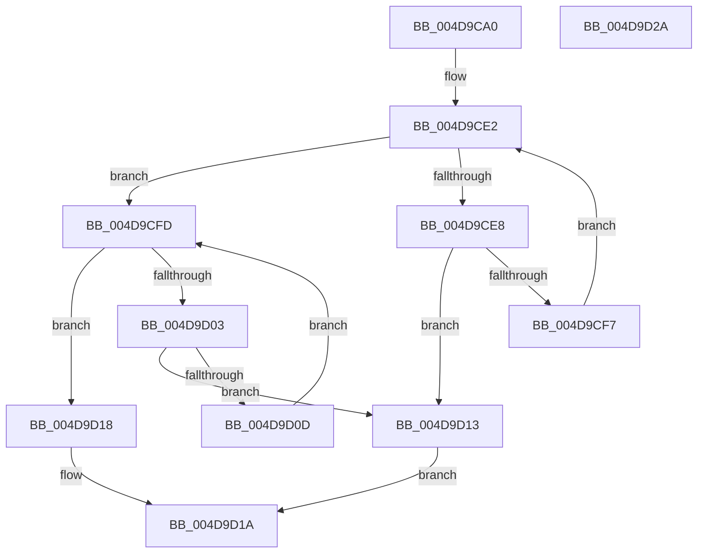

# KiXorAffinityExNoResult

- RVA: `0x004D9CA0`–`0x004D9D2B` (길이 `139` bytes)
- VA: `0x00000001404D9CA0`
- 실행 섹션: `.text`
- PDB 이름 있음: `예`; PDB Function 태그: `아니요`
- unwind 정보 RVA: `0x00069588`
- 디코드: `40`개 명령, `139/139` bytes 표시
- 미해석 바이트: `0` (있으면 어셈블리에 `.byte`로 보존)

> 이 문서는 커널 이미지의 기계어와 PDB 기호를 분석해 생성했습니다. 4번과 5번은 함수 원형과 자료형을 바이너리 사용 방식에서 추정한 C 해석이며 원본 소스 복구 결과는 아닙니다.

## 1. Dependencies

- 직접 호출 지점: **0**; 고유 호출 대상: **0**
- 직접 호출자로 확인된 함수: **1**
- RIP 상대 이미지 참조: **0**

### Outgoing calls
- 직접 디코드된 call 명령이 없습니다.

### Direct callers
- [KeXorAffinityEx2](../2D/KeXorAffinityEx2_function_002D5B70.md) at `0x002D5B89`

### Static image references
- 디코드된 RIP-relative 메모리 참조가 없습니다.

## 2. Other-region calls and transfers

- 다른 실행 섹션으로 향하는 call: **0**
- 별도 외부 분기/꼬리 이동을 확인하지 못했습니다.

## 3. Assembly (complete function range)

```asm
004D9CA0  48 89 5C 24 08                  mov qword ptr [rsp + 8], rbx
004D9CA5  48 89 74 24 10                  mov qword ptr [rsp + 0x10], rsi
004D9CAA  48 89 7C 24 18                  mov qword ptr [rsp + 0x18], rdi
004D9CAF  44 0F B7 01                     movzx r8d, word ptr [rcx]
004D9CB3  4C 8B DA                        mov r11, rdx
004D9CB6  0F B7 02                        movzx eax, word ptr [rdx]
004D9CB9  45 0F B7 C8                     movzx r9d, r8w
004D9CBD  66 44 3B C0                     cmp r8w, ax
004D9CC1  44 0F B7 D0                     movzx r10d, ax
004D9CC5  48 8B DA                        mov rbx, rdx
004D9CC8  48 8B F9                        mov rdi, rcx
004D9CCB  66 45 0F 43 D0                  cmovae r10w, r8w
004D9CD0  66 44 0F 43 C8                  cmovae r9w, ax
004D9CD5  4C 0F 43 D9                     cmovae r11, rcx
004D9CD9  33 F6                           xor esi, esi
004D9CDB  0F B7 D6                        movzx edx, si
004D9CDE  44 8D 46 01                     lea r8d, [rsi + 1]
004D9CE2  66 41 3B D1                     cmp dx, r9w
004D9CE6  73 15                           jae 0x1404d9cfd
004D9CE8  0F B7 CA                        movzx ecx, dx
004D9CEB  48 8B 44 CB 08                  mov rax, qword ptr [rbx + rcx*8 + 8]
004D9CF0  48 39 44 CF 08                  cmp qword ptr [rdi + rcx*8 + 8], rax
004D9CF5  75 1C                           jne 0x1404d9d13
004D9CF7  66 41 03 D0                     add dx, r8w
004D9CFB  EB E5                           jmp 0x1404d9ce2
004D9CFD  66 41 3B D2                     cmp dx, r10w
004D9D01  73 15                           jae 0x1404d9d18
004D9D03  0F B7 C2                        movzx eax, dx
004D9D06  49 39 74 C3 08                  cmp qword ptr [r11 + rax*8 + 8], rsi
004D9D0B  75 06                           jne 0x1404d9d13
004D9D0D  66 41 03 D0                     add dx, r8w
004D9D11  EB EA                           jmp 0x1404d9cfd
004D9D13  41 8B C0                        mov eax, r8d
004D9D16  EB 02                           jmp 0x1404d9d1a
004D9D18  33 C0                           xor eax, eax
004D9D1A  48 8B 5C 24 08                  mov rbx, qword ptr [rsp + 8]
004D9D1F  48 8B 74 24 10                  mov rsi, qword ptr [rsp + 0x10]
004D9D24  48 8B 7C 24 18                  mov rdi, qword ptr [rsp + 0x18]
004D9D29  C3                              ret
004D9D2A  CC                              int3
```

## 4. C-style interpretation (structured pseudocode)

```c
__int64 __fastcall KiXorAffinityExNoResult(__int64 a1, __int64 a2)
{
    __int64 result;
    __int64 v_r10;
    __int64 v_rsi;
    unsigned __int64 v_stack_p10;
    unsigned __int64 v_stack_p18;
    unsigned __int64 v_stack_p8;

    v_stack_p8 = v_rbx;
    v_stack_p10 = v_rsi;
    v_stack_p18 = v_rdi;
    v_r10 = (unsigned __int16)(*(unsigned __int16 *)(a2));
    if (((unsigned __int16)(*(unsigned __int16 *)(a1))) >= ((unsigned __int16)(*(unsigned __int16 *)(a2)))) { v_r10 = (unsigned __int16)(*(unsigned __int16 *)(a1)); }
    a4 = (unsigned __int16)(*(unsigned __int16 *)(a1));
    if (((unsigned __int16)(*(unsigned __int16 *)(a1))) >= ((unsigned __int16)(*(unsigned __int16 *)(a2)))) {
        a4 = (unsigned __int16)(*(unsigned __int16 *)(a2));
        a2 = a1;
    }
    v_rsi = 0;
loc_004D9CE2:
    if (0 >= ((unsigned __int16)(a4))) goto loc_004D9CFD;
    if ((*(unsigned __int64 *)(a1 + 0 * 8 + 8)) != (*(unsigned __int64 *)(a2 + 0 * 8 + 8))) goto loc_004D9D13;
    a2 = (unsigned __int16)((0) + ((unsigned __int16)(v_rsi + 1)));
    goto loc_004D9CE2;
loc_004D9CFD:
    if (((unsigned __int16)(a2)) >= ((unsigned __int16)(v_r10))) goto loc_004D9D18;
    if ((*(unsigned __int64 *)(a2 + (unsigned __int16)(a2) * 8 + 8)) != 0) goto loc_004D9D13;
    a2 = (unsigned __int16)((a2) + ((unsigned __int16)(v_rsi + 1)));
    goto loc_004D9CFD;
loc_004D9D13:
    goto loc_004D9D1A;
loc_004D9D18:
    result = 0;
loc_004D9D1A:
    return result;
}
```

## 5. (Beta) C Style

```c
int64_t KiXorAffinityExNoResult(void *Arg1, void *Arg2)
{
    uint8_t *arg1 = (uint8_t *)Arg1;
    uint8_t *arg2 = (uint8_t *)Arg2;

    int64_t result;
    int64_t local_r10;
    int64_t local_rsi;
    uint64_t v_stack_p10;
    uint64_t v_stack_p18;
    uint64_t v_stack_p8;

    v_stack_p8 = local_rbx;
    v_stack_p10 = local_rsi;
    v_stack_p18 = local_rdi;
    local_r10 = (uint16_t)(*(uint16_t *)(arg2));
    if (((uint16_t)(*(uint16_t *)(arg1))) >= ((uint16_t)(*(uint16_t *)(arg2)))) { local_r10 = (uint16_t)(*(uint16_t *)(arg1)); }
    a4 = (uint16_t)(*(uint16_t *)(arg1));
    if (((uint16_t)(*(uint16_t *)(arg1))) >= ((uint16_t)(*(uint16_t *)(arg2)))) {
        a4 = (uint16_t)(*(uint16_t *)(arg2));
        Arg2 = Arg1;
    }
    local_rsi = 0;
loc_004D9CE2:
    if (0 >= ((uint16_t)(a4))) goto loc_004D9CFD;
    if ((*(uint64_t *)(arg1 + 0x0 * 8 + 0x8)) != (*(uint64_t *)(arg2 + 0x0 * 8 + 0x8))) goto loc_004D9D13;
    Arg2 = (uint16_t)((0) + ((uint16_t)(local_rsi + 1)));
    goto loc_004D9CE2;
loc_004D9CFD:
    if (((uint16_t)(Arg2)) >= ((uint16_t)(local_r10))) goto loc_004D9D18;
    if ((*(uint64_t *)(arg2 + (uint16_t)(arg2) * 8 + 0x8)) != 0) goto loc_004D9D13;
    Arg2 = (uint16_t)((Arg2) + ((uint16_t)(local_rsi + 1)));
    goto loc_004D9CFD;
loc_004D9D13:
    goto loc_004D9D1A;
loc_004D9D18:
    result = 0;
loc_004D9D1A:
    return result;
}
```

### 관측된 메모리 오프셋

구조체 형식이 확인되지 않은 접근은 인자 기준의 오프셋으로만 기록했습니다.

| 기준 인자 | 오프셋 표현 | 폭 (bit) | 접근 |
|---|---:|---:|---|
| `Arg1` | `+ 0x0` | `16` | `R` |
| `Arg1` | `+ 0x8 + rcx*8` | `64` | `R` |
| `Arg2` | `+ 0x0` | `16` | `R` |
| `Arg2` | `+ 0x8 + rcx*8` | `64` | `R` |

## 6. Execution-region graph

[열기: 2D/3D 그래프와 함수 탐색 컨트롤 패널](../../../control-panel.html?section=text&rva=0x004D9CA0&view=graph)

- 2D 그래프는 위에서 아래로 흐르고, 3D 그래프는 빈 공간을 드래그해 회전합니다. Shift+드래그는 이동, 휠은 확대·축소, 함수 노드 선택은 대상 보고서 이동입니다.

### Static fallback


