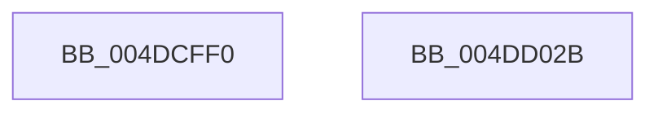

# KsepDebugPrint

- RVA: `0x004DCFF0`–`0x004DD02C` (길이 `60` bytes)
- VA: `0x00000001404DCFF0`
- 실행 섹션: `.text`
- PDB 이름 있음: `예`; PDB Function 태그: `아니요`
- unwind 정보 RVA: `0x000B29D0`
- 디코드: `16`개 명령, `60/60` bytes 표시
- 미해석 바이트: `0` (있으면 어셈블리에 `.byte`로 보존)

> 이 문서는 커널 이미지의 기계어와 PDB 기호를 분석해 생성했습니다. 4번과 5번은 함수 원형과 자료형을 바이너리 사용 방식에서 추정한 C 해석이며 원본 소스 복구 결과는 아닙니다.

## 1. Dependencies

- 직접 호출 지점: **1**; 고유 호출 대상: **1**
- 직접 호출자로 확인된 함수: **25**
- RIP 상대 이미지 참조: **1**

### Outgoing calls
- `0x004DD021` → [vDbgPrintExWithPrefixInternal](../35/vDbgPrintExWithPrefixInternal_function_00359314.md) (function, `0x00359314`)

### Direct callers
- [KseKPSOHookDriverTargeted](../5C/KseKPSOHookDriverTargeted_function_005CD540.md) at `0x005CD5B6`
- [KseRegisterShimEx](../../page/74/KseRegisterShimEx_function_007494D0.md) at `0x0074959A`
- [KseRegisterShimEx](../../page/74/KseRegisterShimEx_function_007494D0.md) at `0x007496C6`
- [KseRegisterShimEx](../../page/74/KseRegisterShimEx_function_007494D0.md) at `0x007497AD`
- [KseUnregisterShim](../../page/74/KseUnregisterShim_function_00749800.md) at `0x00749923`
- [KseUnregisterShim](../../page/74/KseUnregisterShim_function_00749800.md) at `0x007499AF`
- [KseUnregisterShim](../../page/74/KseUnregisterShim_function_00749800.md) at `0x00749A29`
- [KsepApplyShimsToDriver](../../page/74/KsepApplyShimsToDriver_function_00749C84.md) at `0x00749DC9`
- [KsepApplyShimsToDriver](../../page/74/KsepApplyShimsToDriver_function_00749C84.md) at `0x00749E55`
- [KsepApplyShimsToDriver](../../page/74/KsepApplyShimsToDriver_function_00749C84.md) at `0x00749EC0`
- [KsepApplyShimsToDriver](../../page/74/KsepApplyShimsToDriver_function_00749C84.md) at `0x00749F1A`
- [KsepResolveApplicableShimsForDriver](../../page/74/KsepResolveApplicableShimsForDriver_function_0074A168.md) at `0x0074A2EC`
- [KsepResolveApplicableShimsForDriver](../../page/74/KsepResolveApplicableShimsForDriver_function_0074A168.md) at `0x0074A400`
- [KsepResolveApplicableShimsForDriver](../../page/74/KsepResolveApplicableShimsForDriver_function_0074A168.md) at `0x0074A563`
- [KsepResolveApplicableShimsForDriver](../../page/74/KsepResolveApplicableShimsForDriver_function_0074A168.md) at `0x0074A5EE`
- [KsepDeletePatchSdb](../../page/74/KsepDeletePatchSdb_function_0074A738.md) at `0x0074A7CA`
- [KsepSdbBootInitialize](../../page/74/KsepSdbBootInitialize_function_0074A7EC.md) at `0x0074A85D`
- [KsepSdbBootInitialize](../../page/74/KsepSdbBootInitialize_function_0074A7EC.md) at `0x0074A8D2`
- [KseDriverLoadImage](../../page/95/KseDriverLoadImage_function_009588C0.md) at `0x00958A68`
- [KsepGetShimsForDriver](../../page/95/KsepGetShimsForDriver_function_00958A78.md) at `0x00958BEA`
- [KseShimDriverIoCallbacks](../../page/95/KseShimDriverIoCallbacks_function_00958BFC.md) at `0x00958D66`
- [KseAddHardwareId](../../page/95/KseAddHardwareId_function_00959254.md) at `0x00959340`
- [KseQueryDeviceData](../../page/95/KseQueryDeviceData_function_0095AFB0.md) at `0x0095B15B`
- [KsepSdbMapToMemory](../../page/95/KsepSdbMapToMemory_function_0095B81C.md) at `0x0095BA2E`
- [KsepSdbMapToMemory](../../page/95/KsepSdbMapToMemory_function_0095B81C.md) at `0x0095BA7D`
- [KsepSdbMapToMemory](../../page/95/KsepSdbMapToMemory_function_0095B81C.md) at `0x0095BAC9`
- [KsepSdbMapToMemory](../../page/95/KsepSdbMapToMemory_function_0095B81C.md) at `0x0095BB5A`
- [KsepSdbMapToMemory](../../page/95/KsepSdbMapToMemory_function_0095B81C.md) at `0x0095BBB9`
- [KsepShimDatabaseTime](../../page/A7/KsepShimDatabaseTime_function_00A79684.md) at `0x00A797D9`
- [KsepShimDatabaseTime](../../page/A7/KsepShimDatabaseTime_function_00A79684.md) at `0x00A7981B`
- [sub_00B26BF6](../../page/B2/Unknown_function_00B26BF6.md) at `0x00B26DF2`
- [sub_00B26BF6](../../page/B2/Unknown_function_00B26BF6.md) at `0x00B26E66`
- [sub_00B26E86](../../page/B2/Unknown_function_00B26E86.md) at `0x00B26ECF`
- [sub_00B26FE8](../../page/B2/Unknown_function_00B26FE8.md) at `0x00B270E1`
- [sub_00B27116](../../page/B2/Unknown_function_00B27116.md) at `0x00B27276`
- [sub_00B27116](../../page/B2/Unknown_function_00B27116.md) at `0x00B27377`
- [sub_00B27116](../../page/B2/Unknown_function_00B27116.md) at `0x00B27447`
- [sub_00B27464](../../page/B2/Unknown_function_00B27464.md) at `0x00B274ED`
- [KseInitialize](../../init/C3/KseInitialize_function_00C3B5AC.md) at `0x00C3B6CB`
- [KseInitialize](../../init/C3/KseInitialize_function_00C3B5AC.md) at `0x00C3B7B7`
- [KseInitialize](../../init/C3/KseInitialize_function_00C3B5AC.md) at `0x00C3B815`
- [KseInitialize](../../init/C3/KseInitialize_function_00C3B5AC.md) at `0x00C3B873`
- [KseInitialize](../../init/C3/KseInitialize_function_00C3B5AC.md) at `0x00C3B8D1`
- [KseInitialize](../../init/C3/KseInitialize_function_00C3B5AC.md) at `0x00C3B92F`
- [KseInitialize](../../init/C3/KseInitialize_function_00C3B5AC.md) at `0x00C3B98D`
- [KseInitialize](../../init/C3/KseInitialize_function_00C3B5AC.md) at `0x00C3B9EB`
- [KseInitialize](../../init/C3/KseInitialize_function_00C3B5AC.md) at `0x00C3BA47`
- [KseInitialize](../../init/C3/KseInitialize_function_00C3B5AC.md) at `0x00C3BAE8`
- [KseInitialize](../../init/C3/KseInitialize_function_00C3B5AC.md) at `0x00C3BB27`
- [KsepMatchInitBiosInfo](../../init/C3/KsepMatchInitBiosInfo_function_00C3BCB0.md) at `0x00C3BDA5`
- [KsepMatchInitBiosInfo](../../init/C3/KsepMatchInitBiosInfo_function_00C3BCB0.md) at `0x00C3BE43`
- [KsepMatchInitMachineInfo](../../init/C3/KsepMatchInitMachineInfo_function_00C3BFBC.md) at `0x00C3C011`
- [KsepMatchInitMachineInfo](../../init/C3/KsepMatchInitMachineInfo_function_00C3BFBC.md) at `0x00C3C065`
- [KsepMatchInitMachineInfo](../../init/C3/KsepMatchInitMachineInfo_function_00C3BFBC.md) at `0x00C3C0B9`
- [KseShimDatabaseBootInitialize](../../init/C3/KseShimDatabaseBootInitialize_function_00C3C124.md) at `0x00C3C2BD`
- [KsepEngineReadFlags](../../init/C3/KsepEngineReadFlags_function_00C3C310.md) at `0x00C3C437`
- [KsepEngineReadFlags](../../init/C3/KsepEngineReadFlags_function_00C3C310.md) at `0x00C3C4CD`
- [KsepEngineReadFlags](../../init/C3/KsepEngineReadFlags_function_00C3C310.md) at `0x00C3C54B`
- [KsepEngineReadFlags](../../init/C3/KsepEngineReadFlags_function_00C3C310.md) at `0x00C3C5C1`
- [KsepEngineReadFlags](../../init/C3/KsepEngineReadFlags_function_00C3C310.md) at `0x00C3C616`
- [KseVersionLieInitialize](../../init/C3/KseVersionLieInitialize_function_00C3C64C.md) at `0x00C3C6A5`
- [KseVersionLieInitialize](../../init/C3/KseVersionLieInitialize_function_00C3C64C.md) at `0x00C3C6FD`
- [KseVersionLieInitialize](../../init/C3/KseVersionLieInitialize_function_00C3C64C.md) at `0x00C3C755`

### Static image references
- `0x004DD012` → RVA `0x006C7800` (` ?? ::FNODOBFM::`string'`; read)

## 2. Other-region calls and transfers

- 다른 실행 섹션으로 향하는 call: **0**
- 별도 외부 분기/꼬리 이동을 확인하지 못했습니다.

## 3. Assembly (complete function range)

```asm
004DCFF0  4C 8B DC                        mov r11, rsp
004DCFF3  49 89 53 10                     mov qword ptr [r11 + 0x10], rdx
004DCFF7  4D 89 43 18                     mov qword ptr [r11 + 0x18], r8
004DCFFB  4D 89 4B 20                     mov qword ptr [r11 + 0x20], r9
004DCFFF  48 83 EC 48                     sub rsp, 0x48
004DD003  45 33 C0                        xor r8d, r8d
004DD006  C6 44 24 28 01                  mov byte ptr [rsp + 0x28], 1
004DD00B  49 8D 43 18                     lea rax, [r11 + 0x18]
004DD00F  4C 8B CA                        mov r9, rdx
004DD012  48 8D 0D E7 A7 1E 00            lea rcx, [rip + 0x1ea7e7]
004DD019  49 89 43 D8                     mov qword ptr [r11 - 0x28], rax
004DD01D  41 8D 50 65                     lea edx, [r8 + 0x65]
004DD021  E8 EE C2 E7 FF                  call 0x140359314
004DD026  48 83 C4 48                     add rsp, 0x48
004DD02A  C3                              ret
004DD02B  CC                              int3
```

## 4. C-style interpretation (structured pseudocode)

```c
__int64 __fastcall KsepDebugPrint(__int64 a1, __int64 a2, __int64 a3, __int64 a4)
{
    __int64 result;
    __int64 v_rsp;
    unsigned __int8 v_stack_m20;

    *(unsigned __int64 *)(v_rsp + 16) = a2;
    *(unsigned __int64 *)(v_rsp + 24) = a3;
    *(unsigned __int64 *)(v_rsp + 32) = a4;
    v_rsp = (v_rsp) - (72);
    a3 = 0;
    v_stack_m20 = 1;
    *(unsigned __int64 *)(v_rsp - 40) = v_rsp + 24;
    result = vDbgPrintExWithPrefixInternal(v_rip + 2009063, a3 + 101, a3, a2);
    v_rsp = (v_rsp) + (72);
    return result;
}
```

## 5. (Beta) C Style

```c
int64_t KsepDebugPrint(int64_t Arg1, int64_t Arg2, int64_t Arg3, int64_t Arg4)
{
    int64_t result;
    int64_t local_rsp;
    uint8_t v_stack_m20;

    *(uint64_t *)(local_rsp + 0x10) = Arg2;
    *(uint64_t *)(local_rsp + 0x18) = Arg3;
    *(uint64_t *)(local_rsp + 0x20) = Arg4;
    local_rsp = (local_rsp) - (72);
    Arg3 = 0;
    v_stack_m20 = 1;
    *(uint64_t *)(local_rsp - 0x28) = local_rsp + 24;
    result = vDbgPrintExWithPrefixInternal(v_rip + 2009063, Arg3 + 101, Arg3, Arg2);
    local_rsp = (local_rsp) + (72);
    return result;
}
```

## 6. Execution-region graph

[열기: 2D/3D 그래프와 함수 탐색 컨트롤 패널](../../../control-panel.html?section=text&rva=0x004DCFF0&view=graph)

- 2D 그래프는 위에서 아래로 흐르고, 3D 그래프는 빈 공간을 드래그해 회전합니다. Shift+드래그는 이동, 휠은 확대·축소, 함수 노드 선택은 대상 보고서 이동입니다.

### Static fallback


