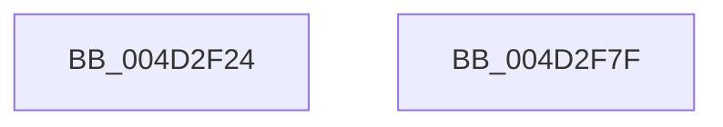

# McTemplateK0p_EtwWriteTransfer

- RVA: `0x004D2F24`–`0x004D2F80` (길이 `92` bytes)
- VA: `0x00000001404D2F24`
- 실행 섹션: `.text`
- PDB 이름 있음: `예`; PDB Function 태그: `아니요`
- unwind 정보 RVA: `0x0008E000`
- 디코드: `21`개 명령, `92/92` bytes 표시
- 미해석 바이트: `0` (있으면 어셈블리에 `.byte`로 보존)

> 이 문서는 커널 이미지의 기계어와 PDB 기호를 분석해 생성했습니다. 4번과 5번은 함수 원형과 자료형을 바이너리 사용 방식에서 추정한 C 해석이며 원본 소스 복구 결과는 아닙니다.

## 1. Dependencies

- 직접 호출 지점: **2**; 고유 호출 대상: **2**
- 직접 호출자로 확인된 함수: **3**
- RIP 상대 이미지 참조: **2**

### Outgoing calls
- `0x004D2F68` → [McGenEventWrite_EtwWriteTransfer](../42/McGenEventWrite_EtwWriteTransfer_function_00424FC8.md) (function, `0x00424FC8`)
- `0x004D2F75` → [_security_check_cookie](../6A/_security_check_cookie_function_006AC640.md) (function, `0x006AC640`)

### Direct callers
- [PiDqObjectManagerServiceActionQueue](../../page/8D/PiDqObjectManagerServiceActionQueue_function_008DD640.md) at `0x008DD9B8`
- [PiDqObjectManagerServiceActionQueue](../../page/8D/PiDqObjectManagerServiceActionQueue_function_008DD640.md) at `0x008DD9D0`
- [PiDqQueryRelease](../../page/8D/PiDqQueryRelease_function_008DE800.md) at `0x008DE889`
- [PiProcessNewDeviceNode](../../page/A2/PiProcessNewDeviceNode_function_00A28F20.md) at `0x00A28FCA`
- [PiProcessNewDeviceNode](../../page/A2/PiProcessNewDeviceNode_function_00A28F20.md) at `0x00A2A41F`

### Static image references
- `0x004D2F2F` → RVA `0x00E0A740` (`.data`; read)
- `0x004D2F4C` → RVA `0x00E06DA0` (`.data`; read)

## 2. Other-region calls and transfers

- 다른 실행 섹션으로 향하는 call: **0**
- 별도 외부 분기/꼬리 이동을 확인하지 못했습니다.

## 3. Assembly (complete function range)

```asm
004D2F24  4C 8B DC                        mov r11, rsp
004D2F27  4D 89 4B 20                     mov qword ptr [r11 + 0x20], r9
004D2F2B  48 83 EC 68                     sub rsp, 0x68
004D2F2F  48 8B 05 0A 78 93 00            mov rax, qword ptr [rip + 0x93780a]
004D2F36  48 33 C4                        xor rax, rsp
004D2F39  48 89 44 24 50                  mov qword ptr [rsp + 0x50], rax
004D2F3E  49 8D 43 20                     lea rax, [r11 + 0x20]
004D2F42  41 B9 02 00 00 00               mov r9d, 2
004D2F48  49 89 43 D8                     mov qword ptr [r11 - 0x28], rax
004D2F4C  48 8D 0D 4D 3E 93 00            lea rcx, [rip + 0x933e4d]
004D2F53  83 64 24 4C 00                  and dword ptr [rsp + 0x4c], 0
004D2F58  49 8D 43 C8                     lea rax, [r11 - 0x38]
004D2F5C  49 89 43 B8                     mov qword ptr [r11 - 0x48], rax
004D2F60  C7 44 24 48 08 00 00 00         mov dword ptr [rsp + 0x48], 8
004D2F68  E8 5B 20 F5 FF                  call 0x140424fc8
004D2F6D  48 8B 4C 24 50                  mov rcx, qword ptr [rsp + 0x50]
004D2F72  48 33 CC                        xor rcx, rsp
004D2F75  E8 C6 96 1D 00                  call 0x1406ac640
004D2F7A  48 83 C4 68                     add rsp, 0x68
004D2F7E  C3                              ret
004D2F7F  CC                              int3
```

## 4. C-style interpretation (structured pseudocode)

```c
__int64 __fastcall McTemplateK0p_EtwWriteTransfer(__int64 a1, __int64 a2, __int64 a3, __int64 a4)
{
    __int64 result;
    __int64 v_rsp;
    unsigned __int64 v_stack_m18;
    unsigned int v_stack_m1C;
    unsigned int v_stack_m20;

    *(unsigned __int64 *)(v_rsp + 32) = a4;
    v_rsp = (v_rsp) - (104);
    result = (*(unsigned __int64 *)(v_rip + 9664522)) ^ (v_rsp);
    v_stack_m18 = result;
    *(unsigned __int64 *)(v_rsp - 40) = v_rsp + 32;
    *(unsigned __int64 *)(v_rsp - 72) = v_rsp - 56;
    v_stack_m20 = 8;
    result = McGenEventWrite_EtwWriteTransfer(v_rip + 9649741, a2, a3, 2);
    a1 = (v_stack_m18) ^ (v_rsp);
    result = _security_check_cookie(a1, a2, a3, 2);
    v_rsp = (v_rsp) + (104);
    return result;
}
```

## 5. (Beta) C Style

```c
int64_t McTemplateK0p_EtwWriteTransfer(int64_t Arg1, int64_t Arg2, int64_t Arg3, int64_t Arg4)
{
    int64_t result;
    int64_t local_rsp;
    uint64_t v_stack_m18;
    uint32_t v_stack_m1C;
    uint32_t v_stack_m20;

    *(uint64_t *)(local_rsp + 0x20) = Arg4;
    local_rsp = (local_rsp) - (104);
    result = (*(uint64_t *)(v_rip + 0x93780A)) ^ (local_rsp);
    v_stack_m18 = result;
    *(uint64_t *)(local_rsp - 0x28) = local_rsp + 32;
    *(uint64_t *)(local_rsp - 0x48) = local_rsp - 56;
    v_stack_m20 = 8;
    result = McGenEventWrite_EtwWriteTransfer(v_rip + 9649741, Arg2, Arg3, 2);
    Arg1 = (v_stack_m18) ^ (local_rsp);
    result = _security_check_cookie(Arg1, Arg2, Arg3, 2);
    local_rsp = (local_rsp) + (104);
    return result;
}
```

## 6. Execution-region graph

[열기: 2D/3D 그래프와 함수 탐색 컨트롤 패널](../../../control-panel.html?section=text&rva=0x004D2F24&view=graph)

- 2D 그래프는 위에서 아래로 흐르고, 3D 그래프는 빈 공간을 드래그해 회전합니다. Shift+드래그는 이동, 휠은 확대·축소, 함수 노드 선택은 대상 보고서 이동입니다.

### Static fallback


