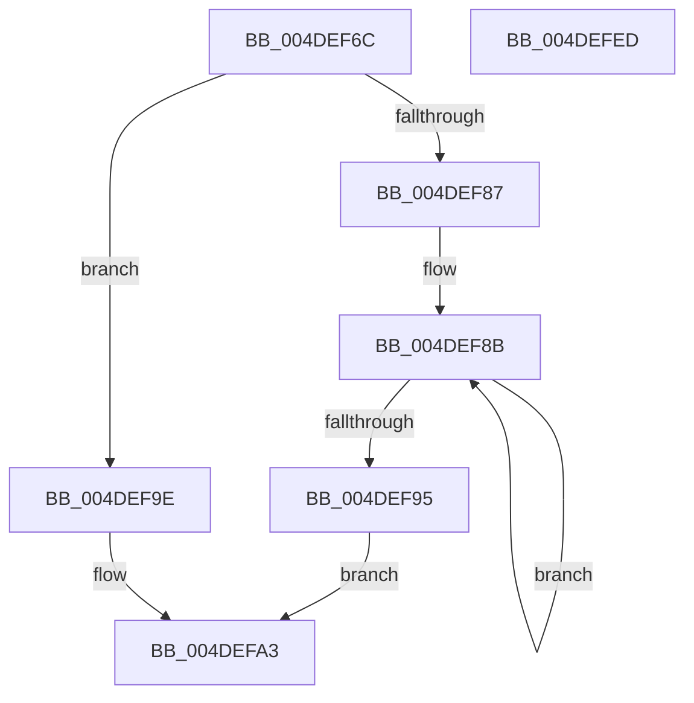

# McTemplateK0z_EtwWriteTransfer

- RVA: `0x004DEF6C`–`0x004DEFEE` (길이 `130` bytes)
- VA: `0x00000001404DEF6C`
- 실행 섹션: `.text`
- PDB 이름 있음: `예`; PDB Function 태그: `아니요`
- unwind 정보 RVA: `0x0006F9F8`
- 디코드: `31`개 명령, `130/130` bytes 표시
- 미해석 바이트: `0` (있으면 어셈블리에 `.byte`로 보존)

> 이 문서는 커널 이미지의 기계어와 PDB 기호를 분석해 생성했습니다. 4번과 5번은 함수 원형과 자료형을 바이너리 사용 방식에서 추정한 C 해석이며 원본 소스 복구 결과는 아닙니다.

## 1. Dependencies

- 직접 호출 지점: **2**; 고유 호출 대상: **2**
- 직접 호출자로 확인된 함수: **8**
- RIP 상대 이미지 참조: **3**

### Outgoing calls
- `0x004DEFD6` → [McGenEventWrite_EtwWriteTransfer](../42/McGenEventWrite_EtwWriteTransfer_function_00424FC8.md) (function, `0x00424FC8`)
- `0x004DEFE3` → [_security_check_cookie](../6A/_security_check_cookie_function_006AC640.md) (function, `0x006AC640`)

### Direct callers
- [sub_006F4704](../6F/Unknown_function_006F4704.md) at `0x006F474D`
- [PipProcessDevNodeTree](../../page/8F/PipProcessDevNodeTree_function_008F9068.md) at `0x008F97C8`
- [PipProcessDevNodeTree](../../page/8F/PipProcessDevNodeTree_function_008F9068.md) at `0x008F97DD`
- [PiUEventNotifyUserMode](../../page/95/PiUEventNotifyUserMode_function_00954CB4.md) at `0x00954D68`
- [PnpProcessTargetDeviceEvent](../../page/A0/PnpProcessTargetDeviceEvent_function_00A046BC.md) at `0x00A047B9`
- [PnpProcessTargetDeviceEvent](../../page/A0/PnpProcessTargetDeviceEvent_function_00A046BC.md) at `0x00A047E5`
- [PnpDeleteLockedDeviceNodes](../../page/A0/PnpDeleteLockedDeviceNodes_function_00A09B30.md) at `0x00A09C88`
- [PiSwCloseDescendants](../../page/A9/PiSwCloseDescendants_function_00A9E564.md) at `0x00A9E5B5`
- [PiCMQueryRemove](../../page/AD/PiCMQueryRemove_function_00AD43F4.md) at `0x00AD4800`
- [sub_00B1F5B6](../../page/B1/Unknown_function_00B1F5B6.md) at `0x00B1F5C6`

### Static image references
- `0x004DEF70` → RVA `0x00E0A740` (`.data`; read)
- `0x004DEFAA` → RVA `0x006CB080` (` ?? ::FNODOBFM::`string'`; read)
- `0x004DEFC4` → RVA `0x00E06DA0` (`.data`; read)

## 2. Other-region calls and transfers

- 다른 실행 섹션으로 향하는 call: **0**
- 별도 외부 분기/꼬리 이동을 확인하지 못했습니다.

## 3. Assembly (complete function range)

```asm
004DEF6C  48 83 EC 68                     sub rsp, 0x68
004DEF70  48 8B 05 C9 B7 92 00            mov rax, qword ptr [rip + 0x92b7c9]
004DEF77  48 33 C4                        xor rax, rsp
004DEF7A  48 89 44 24 50                  mov qword ptr [rsp + 0x50], rax
004DEF7F  45 33 C0                        xor r8d, r8d
004DEF82  4D 85 C9                        test r9, r9
004DEF85  74 17                           je 0x1404def9e
004DEF87  48 83 C8 FF                     or rax, 0xffffffffffffffff
004DEF8B  48 FF C0                        inc rax
004DEF8E  66 45 39 04 41                  cmp word ptr [r9 + rax*2], r8w
004DEF93  75 F6                           jne 0x1404def8b
004DEF95  8D 04 45 02 00 00 00            lea eax, [rax*2 + 2]
004DEF9C  EB 05                           jmp 0x1404defa3
004DEF9E  B8 0A 00 00 00                  mov eax, 0xa
004DEFA3  4D 85 C9                        test r9, r9
004DEFA6  89 44 24 48                     mov dword ptr [rsp + 0x48], eax
004DEFAA  48 8D 0D CF C0 1E 00            lea rcx, [rip + 0x1ec0cf]
004DEFB1  44 89 44 24 4C                  mov dword ptr [rsp + 0x4c], r8d
004DEFB6  4C 0F 44 C9                     cmove r9, rcx
004DEFBA  48 8D 44 24 30                  lea rax, [rsp + 0x30]
004DEFBF  4C 89 4C 24 40                  mov qword ptr [rsp + 0x40], r9
004DEFC4  48 8D 0D D5 7D 92 00            lea rcx, [rip + 0x927dd5]
004DEFCB  41 B9 02 00 00 00               mov r9d, 2
004DEFD1  48 89 44 24 20                  mov qword ptr [rsp + 0x20], rax
004DEFD6  E8 ED 5F F4 FF                  call 0x140424fc8
004DEFDB  48 8B 4C 24 50                  mov rcx, qword ptr [rsp + 0x50]
004DEFE0  48 33 CC                        xor rcx, rsp
004DEFE3  E8 58 D6 1C 00                  call 0x1406ac640
004DEFE8  48 83 C4 68                     add rsp, 0x68
004DEFEC  C3                              ret
004DEFED  CC                              int3
```

## 4. C-style interpretation (structured pseudocode)

```c
__int64 __fastcall McTemplateK0z_EtwWriteTransfer(__int64 a1, __int64 a2, int a3, __int64 a4)
{
    __int64 result;
    __int64 v_rsp;
    unsigned __int64 v_stack_m18;
    unsigned int v_stack_m1C;
    unsigned int v_stack_m20;
    unsigned __int64 v_stack_m28;
    unsigned __int64 v_stack_m38;
    unsigned __int64 v_stack_m48;

    v_rsp = (v_rsp) - (104);
    result = (*(unsigned __int64 *)(v_rip + 9615305)) ^ (v_rsp);
    v_stack_m18 = result;
    a3 = 0;
    if (a4 == 0) goto loc_004DEF9E;
    result = (result) | (-1);
loc_004DEF8B:
    result = (result) + 1;
    if ((*(unsigned __int16 *)(a4 + result * 2)) != 0) goto loc_004DEF8B;
    goto loc_004DEFA3;
loc_004DEF9E:
loc_004DEFA3:
    v_stack_m20 = 10;
    v_stack_m1C = 0;
    if (a4 == 0) { a4 = v_rip + 2015439; }
    v_stack_m28 = a4;
    v_stack_m48 = v_stack_m38;
    result = McGenEventWrite_EtwWriteTransfer(v_rip + 9600469, a2, a3, 2);
    a1 = (v_stack_m18) ^ (v_rsp);
    result = _security_check_cookie(a1, a2, a3, 2);
    v_rsp = (v_rsp) + (104);
    return result;
}
```

## 5. (Beta) C Style

```c
int64_t McTemplateK0z_EtwWriteTransfer(int64_t Arg1, int64_t Arg2, int32_t Arg3, int64_t Arg4)
{
    int64_t result;
    int64_t local_rsp;
    uint64_t v_stack_m18;
    uint32_t v_stack_m1C;
    uint32_t v_stack_m20;
    uint64_t v_stack_m28;
    uint64_t v_stack_m38;
    uint64_t v_stack_m48;

    local_rsp = (local_rsp) - (104);
    result = (*(uint64_t *)(v_rip + 0x92B7C9)) ^ (local_rsp);
    v_stack_m18 = result;
    Arg3 = 0;
    if (Arg4 == 0) goto loc_004DEF9E;
    result = (result) | (-1);
loc_004DEF8B:
    result = (result) + 1;
    if ((*(uint16_t *)(Arg4 + result * 2)) != 0) goto loc_004DEF8B;
    goto loc_004DEFA3;
loc_004DEF9E:
loc_004DEFA3:
    v_stack_m20 = 10;
    v_stack_m1C = 0;
    if (Arg4 == 0) { Arg4 = v_rip + 2015439; }
    v_stack_m28 = Arg4;
    v_stack_m48 = v_stack_m38;
    result = McGenEventWrite_EtwWriteTransfer(v_rip + 9600469, Arg2, Arg3, 2);
    Arg1 = (v_stack_m18) ^ (local_rsp);
    result = _security_check_cookie(Arg1, Arg2, Arg3, 2);
    local_rsp = (local_rsp) + (104);
    return result;
}
```

## 6. Execution-region graph

[열기: 2D/3D 그래프와 함수 탐색 컨트롤 패널](../../../control-panel.html?section=text&rva=0x004DEF6C&view=graph)

- 2D 그래프는 위에서 아래로 흐르고, 3D 그래프는 빈 공간을 드래그해 회전합니다. Shift+드래그는 이동, 휠은 확대·축소, 함수 노드 선택은 대상 보고서 이동입니다.

### Static fallback


