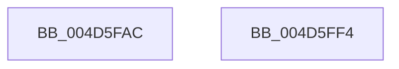

# MiAccumulateTimeBoundTime

- RVA: `0x004D5FAC`–`0x004D5FF5` (길이 `73` bytes)
- VA: `0x00000001404D5FAC`
- 실행 섹션: `.text`
- PDB 이름 있음: `예`; PDB Function 태그: `아니요`
- unwind 정보 RVA: `0x00068D5C`
- 디코드: `23`개 명령, `73/73` bytes 표시
- 미해석 바이트: `0` (있으면 어셈블리에 `.byte`로 보존)

> 이 문서는 커널 이미지의 기계어와 PDB 기호를 분석해 생성했습니다. 4번과 5번은 함수 원형과 자료형을 바이너리 사용 방식에서 추정한 C 해석이며 원본 소스 복구 결과는 아닙니다.

## 1. Dependencies

- 직접 호출 지점: **1**; 고유 호출 대상: **1**
- 직접 호출자로 확인된 함수: **3**
- RIP 상대 이미지 참조: **0**

### Outgoing calls
- `0x004D5FC0` → [KeQueryUnbiasedInterruptTimePrecise](../37/KeQueryUnbiasedInterruptTimePrecise_function_0037AC20.md) (function, `0x0037AC20`)

### Direct callers
- [MiPerformOnDemandLargePageCoalesce](../37/MiPerformOnDemandLargePageCoalesce_function_00379678.md) at `0x00379830`
- [MiProcessLargeCoalesceCandidates](../37/MiProcessLargeCoalesceCandidates_function_00379DF4.md) at `0x0037A237`
- [sub_006E4446](../6E/Unknown_function_006E4446.md) at `0x006E4528`

### Static image references
- 디코드된 RIP-relative 메모리 참조가 없습니다.

## 2. Other-region calls and transfers

- 다른 실행 섹션으로 향하는 call: **0**
- 별도 외부 분기/꼬리 이동을 확인하지 못했습니다.

## 3. Assembly (complete function range)

```asm
004D5FAC  48 89 5C 24 10                  mov qword ptr [rsp + 0x10], rbx
004D5FB1  57                              push rdi
004D5FB2  48 83 EC 20                     sub rsp, 0x20
004D5FB6  48 8B F9                        mov rdi, rcx
004D5FB9  8B DA                           mov ebx, edx
004D5FBB  48 8D 4C 24 30                  lea rcx, [rsp + 0x30]
004D5FC0  E8 5B 4C EA FF                  call 0x14037ac20
004D5FC5  4C 8B 4F 08                     mov r9, qword ptr [rdi + 8]
004D5FC9  4C 8B D0                        mov r10, rax
004D5FCC  4C 2B 4F 10                     sub r9, qword ptr [rdi + 0x10]
004D5FD0  4C 03 C8                        add r9, rax
004D5FD3  33 C0                           xor eax, eax
004D5FD5  85 DB                           test ebx, ebx
004D5FD7  4C 89 4F 08                     mov qword ptr [rdi + 8], r9
004D5FDB  48 8B 5C 24 38                  mov rbx, qword ptr [rsp + 0x38]
004D5FE0  4C 0F 45 D0                     cmovne r10, rax
004D5FE4  4C 3B 0F                        cmp r9, qword ptr [rdi]
004D5FE7  4C 89 57 10                     mov qword ptr [rdi + 0x10], r10
004D5FEB  0F 93 C0                        setae al
004D5FEE  48 83 C4 20                     add rsp, 0x20
004D5FF2  5F                              pop rdi
004D5FF3  C3                              ret
004D5FF4  CC                              int3
```

## 4. C-style interpretation (structured pseudocode)

```c
__int64 __fastcall MiAccumulateTimeBoundTime(__int64 a1, int a2)
{
    __int64 result;
    __int64 v_r10;
    __int64 v_rsp;
    unsigned __int64 v_stack_p10;
    unsigned __int64 v_stack_p8;

    v_stack_p10 = v_rbx;
    v_rsp = (v_rsp) - (32);
    result = KeQueryUnbiasedInterruptTimePrecise(v_stack_p8, a2, a3, a4);
    a4 = (*(unsigned __int64 *)(a1 + 8)) - (*(unsigned __int64 *)(a1 + 16));
    a4 = (a4) + (result);
    result = 0;
    *(unsigned __int64 *)(a1 + 8) = a4;
    v_r10 = result;
    if ((unsigned int)((unsigned int)(a2)) != 0) { v_r10 = 0; }
    *(unsigned __int64 *)(a1 + 16) = v_r10;
    result = (a4 >= (*(unsigned __int64 *)(a1))) ? 1 : 0;
    v_rsp = (v_rsp) + (32);
    return result;
}
```

## 5. (Beta) C Style

```c
int64_t MiAccumulateTimeBoundTime(void *Arg1, int32_t Arg2)
{
    uint8_t *arg1 = (uint8_t *)Arg1;

    int64_t result;
    int64_t local_r10;
    int64_t local_rsp;
    uint64_t v_stack_p10;
    uint64_t v_stack_p8;

    v_stack_p10 = local_rbx;
    local_rsp = (local_rsp) - (32);
    result = KeQueryUnbiasedInterruptTimePrecise(v_stack_p8, Arg2, a3, a4);
    a4 = (*(uint64_t *)(arg1 + 0x8)) - (*(uint64_t *)(arg1 + 0x10));
    a4 = (a4) + (result);
    result = 0;
    *(uint64_t *)(arg1 + 0x8) = a4;
    local_r10 = result;
    if ((uint32_t)((uint32_t)(Arg2)) != 0) { local_r10 = 0; }
    *(uint64_t *)(arg1 + 0x10) = local_r10;
    result = (a4 >= (*(uint64_t *)(arg1))) ? 1 : 0;
    local_rsp = (local_rsp) + (32);
    return result;
}
```

### 관측된 메모리 오프셋

구조체 형식이 확인되지 않은 접근은 인자 기준의 오프셋으로만 기록했습니다.

| 기준 인자 | 오프셋 표현 | 폭 (bit) | 접근 |
|---|---:|---:|---|
| `Arg1` | `+ 0x0` | `64` | `R` |
| `Arg1` | `+ 0x8` | `64` | `R` |
| `Arg1` | `+ 0x8` | `64` | `W` |
| `Arg1` | `+ 0x10` | `64` | `R` |
| `Arg1` | `+ 0x10` | `64` | `W` |

## 6. Execution-region graph

[열기: 2D/3D 그래프와 함수 탐색 컨트롤 패널](../../../control-panel.html?section=text&rva=0x004D5FAC&view=graph)

- 2D 그래프는 위에서 아래로 흐르고, 3D 그래프는 빈 공간을 드래그해 회전합니다. Shift+드래그는 이동, 휠은 확대·축소, 함수 노드 선택은 대상 보고서 이동입니다.

### Static fallback


