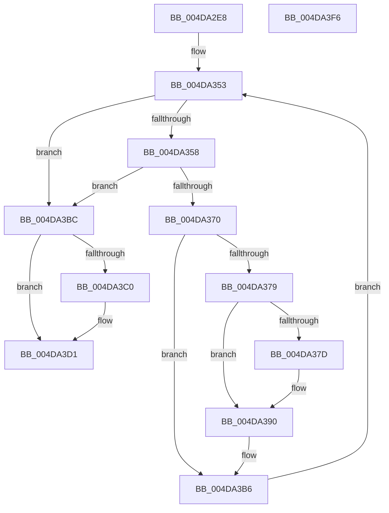

# MiAddMappedPtesPadding

- RVA: `0x004DA2E8`–`0x004DA3F7` (길이 `271` bytes)
- VA: `0x00000001404DA2E8`
- 실행 섹션: `.text`
- PDB 이름 있음: `예`; PDB Function 태그: `아니요`
- unwind 정보 RVA: `0x000BE948`
- 디코드: `76`개 명령, `271/271` bytes 표시
- 미해석 바이트: `0` (있으면 어셈블리에 `.byte`로 보존)

> 이 문서는 커널 이미지의 기계어와 PDB 기호를 분석해 생성했습니다. 4번과 5번은 함수 원형과 자료형을 바이너리 사용 방식에서 추정한 C 해석이며 원본 소스 복구 결과는 아닙니다.

## 1. Dependencies

- 직접 호출 지점: **6**; 고유 호출 대상: **4**
- 직접 호출자로 확인된 함수: **1**
- RIP 상대 이미지 참조: **0**

### Outgoing calls
- `0x004DA35B` → [MiMakePrototypePteDirect](../29/MiMakePrototypePteDirect_function_00294DE0.md) (function, `0x00294DE0`)
- `0x004DA389` → [MiIncreaseUsedPtes](../24/MiIncreaseUsedPtes_function_00243630.md) (function, `0x00243630`)
- `0x004DA399` → [MiUnlockWorkingSetOptimal](../23/MiUnlockWorkingSetOptimal_function_00238DFC.md) (function, `0x00238DFC`)
- `0x004DA3A9` → [MiLockWorkingSetOptimal](../23/MiLockWorkingSetOptimal_function_00238FC0.md) (function, `0x00238FC0`)
- `0x004DA3CC` → [MiIncreaseUsedPtes](../24/MiIncreaseUsedPtes_function_00243630.md) (function, `0x00243630`)
- `0x004DA3DA` → [MiUnlockWorkingSetOptimal](../23/MiUnlockWorkingSetOptimal_function_00238DFC.md) (function, `0x00238DFC`)

### Direct callers
- [sub_00349353](../34/Unknown_function_00349353.md) at `0x003493A0`

### Static image references
- 디코드된 RIP-relative 메모리 참조가 없습니다.

## 2. Other-region calls and transfers

- 다른 실행 섹션으로 향하는 call: **0**
- 별도 외부 분기/꼬리 이동을 확인하지 못했습니다.

## 3. Assembly (complete function range)

```asm
004DA2E8  48 89 5C 24 08                  mov qword ptr [rsp + 8], rbx
004DA2ED  48 89 6C 24 10                  mov qword ptr [rsp + 0x10], rbp
004DA2F2  44 88 44 24 18                  mov byte ptr [rsp + 0x18], r8b
004DA2F7  56                              push rsi
004DA2F8  57                              push rdi
004DA2F9  41 54                           push r12
004DA2FB  41 56                           push r14
004DA2FD  41 57                           push r15
004DA2FF  48 83 EC 20                     sub rsp, 0x20
004DA303  49 8B F9                        mov rdi, r9
004DA306  48 B8 F8 FF FF FF 7F 00 00 00   movabs rax, 0x7ffffffff8
004DA310  48 C1 EF 09                     shr rdi, 9
004DA314  49 8B F1                        mov rsi, r9
004DA317  48 23 F8                        and rdi, rax
004DA31A  45 8A F0                        mov r14b, r8b
004DA31D  4C 8B FA                        mov r15, rdx
004DA320  48 B8 00 00 00 00 80 F6 FF FF   movabs rax, 0xfffff68000000000
004DA32A  44 8B 49 2C                     mov r9d, dword ptr [rcx + 0x2c]
004DA32E  48 03 F8                        add rdi, rax
004DA331  48 8B 41 08                     mov rax, qword ptr [rcx + 8]
004DA335  8B 9C 24 80 00 00 00            mov ebx, dword ptr [rsp + 0x80]
004DA33C  4A 8D 2C C8                     lea rbp, [rax + r9*8]
004DA340  48 8B 01                        mov rax, qword ptr [rcx]
004DA343  48 8B 88 88 00 00 00            mov rcx, qword ptr [rax + 0x88]
004DA34A  48 8B 44 24 78                  mov rax, qword ptr [rsp + 0x78]
004DA34F  4C 8D 24 C1                     lea r12, [rcx + rax*8]
004DA353  49 3B EC                        cmp rbp, r12
004DA356  73 64                           jae 0x1404da3bc
004DA358  48 8B CD                        mov rcx, rbp
004DA35B  E8 80 AA DB FF                  call 0x140294de0
004DA360  48 89 06                        mov qword ptr [rsi], rax
004DA363  FF C3                           inc ebx
004DA365  48 83 C6 08                     add rsi, 8
004DA369  48 3B 74 24 70                  cmp rsi, qword ptr [rsp + 0x70]
004DA36E  73 4C                           jae 0x1404da3bc
004DA370  48 F7 C6 FF 0F 00 00            test rsi, 0xfff
004DA377  75 3D                           jne 0x1404da3b6
004DA379  85 DB                           test ebx, ebx
004DA37B  74 13                           je 0x1404da390
004DA37D  41 B9 02 00 00 00               mov r9d, 2
004DA383  44 8B C3                        mov r8d, ebx
004DA386  48 8B D7                        mov rdx, rdi
004DA389  E8 A2 92 D6 FF                  call 0x140243630
004DA38E  33 DB                           xor ebx, ebx
004DA390  45 8A C6                        mov r8b, r14b
004DA393  48 8B D7                        mov rdx, rdi
004DA396  49 8B CF                        mov rcx, r15
004DA399  E8 5E EA D5 FF                  call 0x140238dfc
004DA39E  4C 8D 44 24 60                  lea r8, [rsp + 0x60]
004DA3A3  48 8B D6                        mov rdx, rsi
004DA3A6  49 8B CF                        mov rcx, r15
004DA3A9  E8 12 EC D5 FF                  call 0x140238fc0
004DA3AE  44 8A 74 24 60                  mov r14b, byte ptr [rsp + 0x60]
004DA3B3  48 8B F8                        mov rdi, rax
004DA3B6  48 83 C5 08                     add rbp, 8
004DA3BA  EB 97                           jmp 0x1404da353
004DA3BC  85 DB                           test ebx, ebx
004DA3BE  74 11                           je 0x1404da3d1
004DA3C0  41 B9 02 00 00 00               mov r9d, 2
004DA3C6  44 8B C3                        mov r8d, ebx
004DA3C9  48 8B D7                        mov rdx, rdi
004DA3CC  E8 5F 92 D6 FF                  call 0x140243630
004DA3D1  45 8A C6                        mov r8b, r14b
004DA3D4  48 8B D7                        mov rdx, rdi
004DA3D7  49 8B CF                        mov rcx, r15
004DA3DA  E8 1D EA D5 FF                  call 0x140238dfc
004DA3DF  48 8B 5C 24 50                  mov rbx, qword ptr [rsp + 0x50]
004DA3E4  48 8B 6C 24 58                  mov rbp, qword ptr [rsp + 0x58]
004DA3E9  48 83 C4 20                     add rsp, 0x20
004DA3ED  41 5F                           pop r15
004DA3EF  41 5E                           pop r14
004DA3F1  41 5C                           pop r12
004DA3F3  5F                              pop rdi
004DA3F4  5E                              pop rsi
004DA3F5  C3                              ret
004DA3F6  CC                              int3
```

## 4. C-style interpretation (structured pseudocode)

```c
__int64 __fastcall MiAddMappedPtesPadding(__int64 a1, __int64 a2, unsigned __int8 a3, __int64 a4, __int64 a5, __int64 a6, unsigned int a7)
{
    __int64 result;
    __int64 v_rbp;
    __int64 v_rbx;
    __int64 v_rdi;
    __int64 v_rsi;
    __int64 v_rsp;
    unsigned __int64 v_stack_p10;
    unsigned __int8 v_stack_p18;
    unsigned __int64 v_stack_p8;

    v_stack_p8 = v_rbx;
    v_stack_p10 = v_rbp;
    v_stack_p18 = a3;
    v_rsp = (v_rsp) - (32);
    v_rdi = (a4) >> (9);
    v_rdi = (v_rdi) & (result);
    v_rdi = (v_rdi) + (result);
loc_004DA353:
    if ((*(unsigned __int64 *)(a1 + 8) + (unsigned int)(*(unsigned int *)(a1 + 44)) * 8) >= (*(unsigned __int64 *)(*(unsigned __int64 *)(a1) + 136) + a6 * 8)) goto loc_004DA3BC;
    result = MiMakePrototypePteDirect(*(unsigned __int64 *)(a1 + 8) + (unsigned int)(*(unsigned int *)(a1 + 44)) * 8, a2, a3, (unsigned int)(*(unsigned int *)(a1 + 44)));
    *(unsigned __int64 *)(a4) = result;
    v_rbx = (unsigned int)(((unsigned int)(a7)) + 1);
    v_rsi = (a4) + (8);
    if (v_rsi >= a5) goto loc_004DA3BC;
    if (((v_rsi) & (0xFFFULL)) != 0) goto loc_004DA3B6;
    if ((unsigned int)(v_rbx) != 0) {
        a4 = 2;
        a3 = (unsigned int)(v_rbx);
        a2 = v_rdi;
        result = MiIncreaseUsedPtes(*(unsigned __int64 *)(a1 + 8) + (unsigned int)(*(unsigned int *)(a1 + 44)) * 8, a2, a3, a4);
        v_rbx = 0;
    }
    result = MiUnlockWorkingSetOptimal(a2, v_rdi, a3, a4);
    result = MiLockWorkingSetOptimal(a2, v_rsi, v_stack_p18, a4);
loc_004DA3B6:
    v_rbp = (*(unsigned __int64 *)(a1 + 8) + (unsigned int)(*(unsigned int *)(a1 + 44)) * 8) + (8);
    goto loc_004DA353;
loc_004DA3BC:
    if (0 != 0) {
        a4 = 2;
        a3 = 0;
        a2 = result;
        result = MiIncreaseUsedPtes(a2, a2, a3, a4);
    }
    result = MiUnlockWorkingSetOptimal(a2, result, (unsigned __int8)(v_stack_p18), a4);
    v_rsp = (v_rsp) + (32);
    return result;
}
```

## 5. (Beta) C Style

```c
int64_t MiAddMappedPtesPadding(void *Arg1, int64_t Arg2, uint8_t Arg3, int64_t Arg4, int64_t Arg5, int64_t Arg6, uint32_t Arg7)
{
    uint8_t *arg1 = (uint8_t *)Arg1;

    int64_t result;
    int64_t local_rbp;
    int64_t local_rbx;
    int64_t local_rdi;
    int64_t local_rsi;
    int64_t local_rsp;
    uint64_t v_stack_p10;
    uint8_t v_stack_p18;
    uint64_t v_stack_p8;

    v_stack_p8 = local_rbx;
    v_stack_p10 = local_rbp;
    v_stack_p18 = Arg3;
    local_rsp = (local_rsp) - (32);
    local_rdi = (Arg4) >> (9);
    local_rdi = (local_rdi) & (result);
    local_rdi = (local_rdi) + (result);
loc_004DA353:
    if ((*(uint64_t *)(arg1 + 0x8) + (uint32_t)(*(uint32_t *)(arg1 + 0x2C)) * 8) >= (*(uint64_t *)(*(uint64_t *)(arg1) + 0x88) + Arg6 * 8)) goto loc_004DA3BC;
    result = MiMakePrototypePteDirect(*(uint64_t *)(arg1 + 0x8) + (uint32_t)(*(uint32_t *)(arg1 + 0x2C)) * 8, Arg2, Arg3, (uint32_t)(*(uint32_t *)(arg1 + 0x2C)));
    *(uint64_t *)(Arg4) = result;
    local_rbx = (uint32_t)(((uint32_t)(Arg7)) + 1);
    local_rsi = (Arg4) + (8);
    if (local_rsi >= Arg5) goto loc_004DA3BC;
    if (((local_rsi) & (0xFFFULL)) != 0) goto loc_004DA3B6;
    if ((uint32_t)(local_rbx) != 0) {
        Arg4 = 2;
        Arg3 = (uint32_t)(local_rbx);
        Arg2 = local_rdi;
        result = MiIncreaseUsedPtes(*(uint64_t *)(arg1 + 0x8) + (uint32_t)(*(uint32_t *)(arg1 + 0x2C)) * 8, Arg2, Arg3, Arg4);
        local_rbx = 0;
    }
    result = MiUnlockWorkingSetOptimal(Arg2, local_rdi, Arg3, Arg4);
    result = MiLockWorkingSetOptimal(Arg2, local_rsi, v_stack_p18, Arg4);
loc_004DA3B6:
    local_rbp = (*(uint64_t *)(arg1 + 0x8) + (uint32_t)(*(uint32_t *)(arg1 + 0x2C)) * 8) + (8);
    goto loc_004DA353;
loc_004DA3BC:
    if (0 != 0) {
        Arg4 = 2;
        Arg3 = 0;
        Arg2 = result;
        result = MiIncreaseUsedPtes(Arg2, Arg2, Arg3, Arg4);
    }
    result = MiUnlockWorkingSetOptimal(Arg2, result, (uint8_t)(v_stack_p18), Arg4);
    local_rsp = (local_rsp) + (32);
    return result;
}
```

### 관측된 메모리 오프셋

구조체 형식이 확인되지 않은 접근은 인자 기준의 오프셋으로만 기록했습니다.

| 기준 인자 | 오프셋 표현 | 폭 (bit) | 접근 |
|---|---:|---:|---|
| `Arg1` | `+ 0x0` | `64` | `R` |
| `Arg1` | `+ 0x8` | `64` | `R` |
| `Arg1` | `+ 0x2C` | `32` | `R` |

## 6. Execution-region graph

[열기: 2D/3D 그래프와 함수 탐색 컨트롤 패널](../../../control-panel.html?section=text&rva=0x004DA2E8&view=graph)

- 2D 그래프는 위에서 아래로 흐르고, 3D 그래프는 빈 공간을 드래그해 회전합니다. Shift+드래그는 이동, 휠은 확대·축소, 함수 노드 선택은 대상 보고서 이동입니다.

### Static fallback


