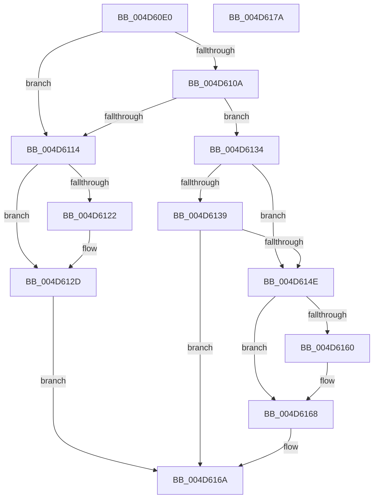

# MiApplyCrossPartitionCharges

- RVA: `0x004D60E0`–`0x004D617B` (길이 `155` bytes)
- VA: `0x00000001404D60E0`
- 실행 섹션: `.text`
- PDB 이름 있음: `예`; PDB Function 태그: `아니요`
- unwind 정보 RVA: `0x00060BC4`
- 디코드: `40`개 명령, `155/155` bytes 표시
- 미해석 바이트: `0` (있으면 어셈블리에 `.byte`로 보존)

> 이 문서는 커널 이미지의 기계어와 PDB 기호를 분석해 생성했습니다. 4번과 5번은 함수 원형과 자료형을 바이너리 사용 방식에서 추정한 C 해석이며 원본 소스 복구 결과는 아닙니다.

## 1. Dependencies

- 직접 호출 지점: **2**; 고유 호출 대상: **2**
- 직접 호출자로 확인된 함수: **2**
- RIP 상대 이미지 참조: **0**

### Outgoing calls
- `0x004D613B` → [MiConvertCrossPartitionChargeTypeToAggregate](MiConvertCrossPartitionChargeTypeToAggregate_function_004D8EA4.md) (function, `0x004D8EA4`)
- `0x004D6145` → [MiApplyCrossPartitionCharges](MiApplyCrossPartitionCharges_function_004D60E0.md) (function, `0x004D60E0`)

### Direct callers
- [MiGetCrossPartitionCharges](../32/MiGetCrossPartitionCharges_function_00325BFC.md) at `0x00325C83`
- [MiGetCrossPartitionCharges](../32/MiGetCrossPartitionCharges_function_00325BFC.md) at `0x00325C9A`
- [MiApplyCrossPartitionCharges](MiApplyCrossPartitionCharges_function_004D60E0.md) at `0x004D6145`

### Static image references
- 디코드된 RIP-relative 메모리 참조가 없습니다.

## 2. Other-region calls and transfers

- 다른 실행 섹션으로 향하는 call: **0**
- 별도 외부 분기/꼬리 이동을 확인하지 못했습니다.

## 3. Assembly (complete function range)

```asm
004D60E0  48 89 5C 24 08                  mov qword ptr [rsp + 8], rbx
004D60E5  48 89 74 24 10                  mov qword ptr [rsp + 0x10], rsi
004D60EA  57                              push rdi
004D60EB  48 83 EC 20                     sub rsp, 0x20
004D60EF  48 63 DA                        movsxd rbx, edx
004D60F2  48 8B F9                        mov rdi, rcx
004D60F5  48 C1 E3 05                     shl rbx, 5
004D60F9  48 8B 84 0B B8 09 00 00         mov rax, qword ptr [rbx + rcx + 0x9b8]
004D6101  4A 8D 34 00                     lea rsi, [rax + r8]
004D6105  48 3B F0                        cmp rsi, rax
004D6108  76 0A                           jbe 0x1404d6114
004D610A  48 3B B4 0B D0 09 00 00         cmp rsi, qword ptr [rbx + rcx + 0x9d0]
004D6112  76 20                           jbe 0x1404d6134
004D6114  48 8B 84 0B C0 09 00 00         mov rax, qword ptr [rbx + rcx + 0x9c0]
004D611C  48 83 F8 FF                     cmp rax, -1
004D6120  74 0B                           je 0x1404d612d
004D6122  48 FF C0                        inc rax
004D6125  48 89 84 0B C0 09 00 00         mov qword ptr [rbx + rcx + 0x9c0], rax
004D612D  B8 2D 01 00 C0                  mov eax, 0xc000012d
004D6132  EB 36                           jmp 0x1404d616a
004D6134  83 FA 07                        cmp edx, 7
004D6137  7D 15                           jge 0x1404d614e
004D6139  8B CA                           mov ecx, edx
004D613B  E8 64 2D 00 00                  call 0x1404d8ea4
004D6140  8B D0                           mov edx, eax
004D6142  48 8B CF                        mov rcx, rdi
004D6145  E8 96 FF FF FF                  call 0x1404d60e0
004D614A  85 C0                           test eax, eax
004D614C  78 1C                           js 0x1404d616a
004D614E  48 89 B4 3B B8 09 00 00         mov qword ptr [rbx + rdi + 0x9b8], rsi
004D6156  48 3B B4 3B C8 09 00 00         cmp rsi, qword ptr [rbx + rdi + 0x9c8]
004D615E  76 08                           jbe 0x1404d6168
004D6160  48 89 B4 3B C8 09 00 00         mov qword ptr [rbx + rdi + 0x9c8], rsi
004D6168  33 C0                           xor eax, eax
004D616A  48 8B 5C 24 30                  mov rbx, qword ptr [rsp + 0x30]
004D616F  48 8B 74 24 38                  mov rsi, qword ptr [rsp + 0x38]
004D6174  48 83 C4 20                     add rsp, 0x20
004D6178  5F                              pop rdi
004D6179  C3                              ret
004D617A  CC                              int3
```

## 4. C-style interpretation (structured pseudocode)

```c
__int64 __fastcall MiApplyCrossPartitionCharges(__int64 a1, int a2, __int64 a3)
{
    __int64 result;
    __int64 v_rbx;
    __int64 v_rsp;
    unsigned __int64 v_stack_p10;
    unsigned __int64 v_stack_p8;

    v_stack_p8 = v_rbx;
    v_stack_p10 = v_rsi;
    v_rsp = (v_rsp) - (32);
    v_rbx = ((int)(a2)) << (5);
    if ((*(unsigned __int64 *)(v_rbx + a1 * 1 + 2488) + a3 * 1) <= (*(unsigned __int64 *)(v_rbx + a1 * 1 + 2488))) goto loc_004D6114;
    if ((*(unsigned __int64 *)(v_rbx + a1 * 1 + 2488) + a3 * 1) <= (*(unsigned __int64 *)(v_rbx + a1 * 1 + 2512))) goto loc_004D6134;
loc_004D6114:
    result = *(unsigned __int64 *)(v_rbx + a1 * 1 + 2496);
    if ((*(unsigned __int64 *)(v_rbx + a1 * 1 + 2496)) != -1) {
        result = (*(unsigned __int64 *)(v_rbx + a1 * 1 + 2496)) + 1;
        *(unsigned __int64 *)(v_rbx + a1 * 1 + 2496) = result;
    }
    goto loc_004D616A;
loc_004D6134:
    if (a2 >= 7) goto loc_004D614E;
    result = MiConvertCrossPartitionChargeTypeToAggregate((unsigned int)(a2), a2, a3, a4);
    result = MiApplyCrossPartitionCharges(a1, (unsigned int)((unsigned int)(result)), a3, a4);
    if (sign_flag) goto loc_004D616A;
loc_004D614E:
    *(unsigned __int64 *)(v_rbx + a1 * 1 + 2488) = *(unsigned __int64 *)(v_rbx + a1 * 1 + 2488) + a3 * 1;
    if ((*(unsigned __int64 *)(v_rbx + a1 * 1 + 2488) + a3 * 1) >= = (*(unsigned __int64 *)(v_rbx + a1 * 1 + 2504))) {
        *(unsigned __int64 *)(v_rbx + a1 * 1 + 2504) = *(unsigned __int64 *)(v_rbx + a1 * 1 + 2488) + a3 * 1;
    }
    result = 0;
loc_004D616A:
    v_rsp = (v_rsp) + (32);
    return result;
}
```

## 5. (Beta) C Style

```c
int64_t MiApplyCrossPartitionCharges(int64_t Arg1, int32_t Arg2, int64_t Arg3)
{
    int64_t result;
    int64_t local_rbx;
    int64_t local_rsp;
    uint64_t v_stack_p10;
    uint64_t v_stack_p8;

    v_stack_p8 = local_rbx;
    v_stack_p10 = local_rsi;
    local_rsp = (local_rsp) - (32);
    local_rbx = ((int32_t)(Arg2)) << (5);
    if ((*(uint64_t *)(local_rbx + Arg1 * 1 + 0x9B8) + Arg3 * 1) <= (*(uint64_t *)(local_rbx + Arg1 * 1 + 0x9B8))) goto loc_004D6114;
    if ((*(uint64_t *)(local_rbx + Arg1 * 1 + 0x9B8) + Arg3 * 1) <= (*(uint64_t *)(local_rbx + Arg1 * 1 + 0x9D0))) goto loc_004D6134;
loc_004D6114:
    result = *(uint64_t *)(local_rbx + Arg1 * 1 + 0x9C0);
    if ((*(uint64_t *)(local_rbx + Arg1 * 1 + 0x9C0)) != -1) {
        result = (*(uint64_t *)(local_rbx + Arg1 * 1 + 0x9C0)) + 1;
        *(uint64_t *)(local_rbx + Arg1 * 1 + 0x9C0) = result;
    }
    goto loc_004D616A;
loc_004D6134:
    if (Arg2 >= 7) goto loc_004D614E;
    result = MiConvertCrossPartitionChargeTypeToAggregate((uint32_t)(Arg2), Arg2, Arg3, a4);
    result = MiApplyCrossPartitionCharges(Arg1, (uint32_t)((uint32_t)(result)), Arg3, a4);
    if (sign_flag) goto loc_004D616A;
loc_004D614E:
    *(uint64_t *)(local_rbx + Arg1 * 1 + 0x9B8) = *(uint64_t *)(local_rbx + Arg1 * 1 + 0x9B8) + Arg3 * 1;
    if ((*(uint64_t *)(local_rbx + Arg1 * 1 + 0x9B8) + Arg3 * 1) >= = (*(uint64_t *)(local_rbx + Arg1 * 1 + 0x9C8))) {
        *(uint64_t *)(local_rbx + Arg1 * 1 + 0x9C8) = *(uint64_t *)(local_rbx + Arg1 * 1 + 0x9B8) + Arg3 * 1;
    }
    result = 0;
loc_004D616A:
    local_rsp = (local_rsp) + (32);
    return result;
}
```

## 6. Execution-region graph

[열기: 2D/3D 그래프와 함수 탐색 컨트롤 패널](../../../control-panel.html?section=text&rva=0x004D60E0&view=graph)

- 2D 그래프는 위에서 아래로 흐르고, 3D 그래프는 빈 공간을 드래그해 회전합니다. Shift+드래그는 이동, 휠은 확대·축소, 함수 노드 선택은 대상 보고서 이동입니다.

### Static fallback


