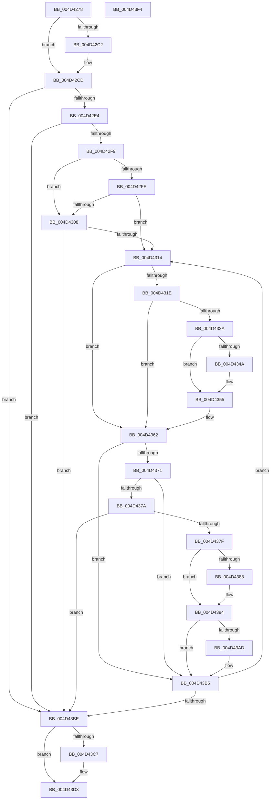

# MiArePageContentsZero

- RVA: `0x004D4278`–`0x004D43F5` (길이 `381` bytes)
- VA: `0x00000001404D4278`
- 실행 섹션: `.text`
- PDB 이름 있음: `예`; PDB Function 태그: `아니요`
- unwind 정보 RVA: `0x000A1FF8`
- 디코드: `103`개 명령, `381/381` bytes 표시
- 미해석 바이트: `0` (있으면 어셈블리에 `.byte`로 보존)

> 이 문서는 커널 이미지의 기계어와 PDB 기호를 분석해 생성했습니다. 4번과 5번은 함수 원형과 자료형을 바이너리 사용 방식에서 추정한 C 해석이며 원본 소스 복구 결과는 아닙니다.

## 1. Dependencies

- 직접 호출 지점: **10**; 고유 호출 대상: **8**
- 직접 호출자로 확인된 함수: **14**
- RIP 상대 이미지 참조: **1**

### Outgoing calls
- `0x004D42C8` → [KiRaiseIrqlProcessIrqlFlags](../4F/KiRaiseIrqlProcessIrqlFlags_function_004F56FC.md) (function, `0x004F56FC`)
- `0x004D4321` → [MiIsPageOnBadList](../2B/MiIsPageOnBadList_function_002B1018.md) (function, `0x002B1018`)
- `0x004D4335` → [MiMapPageInHyperSpaceWorker](../33/MiMapPageInHyperSpaceWorker_function_00332B10.md) (function, `0x00332B10`)
- `0x004D4340` → [KeCheckForZeroPage](../6B/KeCheckForZeroPage_function_006B9F90.md) (function, `0x006B9F90`)
- `0x004D4350` → [MiPageNotZero](../67/MiPageNotZero_function_00679DAC.md) (function, `0x00679DAC`)
- `0x004D435D` → [MiUnmapPageInHyperSpaceWorker](../43/MiUnmapPageInHyperSpaceWorker_function_00432800.md) (function, `0x00432800`)
- `0x004D4371` → [KeShouldYieldProcessor](../27/KeShouldYieldProcessor_function_002773E0.md) (function, `0x002773E0`)
- `0x004D438F` → [KiLowerIrqlProcessIrqlFlags](../4F/KiLowerIrqlProcessIrqlFlags_function_004F5698.md) (function, `0x004F5698`)
- `0x004D43B0` → [KiRaiseIrqlProcessIrqlFlags](../4F/KiRaiseIrqlProcessIrqlFlags_function_004F56FC.md) (function, `0x004F56FC`)
- `0x004D43CE` → [KiLowerIrqlProcessIrqlFlags](../4F/KiLowerIrqlProcessIrqlFlags_function_004F5698.md) (function, `0x004F5698`)

### Direct callers
- [MiGetPage](../28/MiGetPage_function_002884C0.md) at `0x00289704`
- [MiGetPerfectFreeOrZeroPage](../28/MiGetPerfectFreeOrZeroPage_function_002898E0.md) at `0x00289BC0`
- [MiSlistGetFreePage](../28/MiSlistGetFreePage_function_0028A170.md) at `0x0028A417`
- [MiCreateSharedZeroPages](../2B/MiCreateSharedZeroPages_function_002B6318.md) at `0x002B66D6`
- [MiDeleteUltraMapContext](../2D/MiDeleteUltraMapContext_function_002DC9A4.md) at `0x002DCAD3`
- [MiManageUltraSpacePageTable](../2D/MiManageUltraSpacePageTable_function_002DCAF0.md) at `0x002DCF5A`
- [MiManageUltraSpacePageTable](../2D/MiManageUltraSpacePageTable_function_002DCAF0.md) at `0x002DCF94`
- [MiConvertLargeActivePageToChain](../31/MiConvertLargeActivePageToChain_function_0031D980.md) at `0x0031DCC2`
- [sub_00322E07](../32/Unknown_function_00322E07.md) at `0x00322E54`
- [sub_00322E07](../32/Unknown_function_00322E07.md) at `0x00322E87`
- [sub_00336291](../33/Unknown_function_00336291.md) at `0x003362B1`
- [MiUnlinkFreeOrZeroedPage](../33/MiUnlinkFreeOrZeroedPage_function_00336C40.md) at `0x003374B9`
- [MiCreateSystemPageTable](../45/MiCreateSystemPageTable_function_004518D0.md) at `0x00451B76`
- [MiInitializeSystemPageTable](../45/MiInitializeSystemPageTable_function_00451C88.md) at `0x00451FC1`
- [MiIdealClusterPage](MiIdealClusterPage_function_004DB964.md) at `0x004DBE8F`
- [sub_006E7B34](../6E/Unknown_function_006E7B34.md) at `0x006E7B63`

### Static image references
- `0x004D42B9` → RVA `0x00FC6D20` (`ALMOSTRO`; read)

## 2. Other-region calls and transfers

- 다른 실행 섹션으로 향하는 call: **0**
- 별도 외부 분기/꼬리 이동을 확인하지 못했습니다.

## 3. Assembly (complete function range)

```asm
004D4278  48 89 5C 24 08                  mov qword ptr [rsp + 8], rbx
004D427D  48 89 6C 24 10                  mov qword ptr [rsp + 0x10], rbp
004D4282  48 89 74 24 18                  mov qword ptr [rsp + 0x18], rsi
004D4287  57                              push rdi
004D4288  41 54                           push r12
004D428A  41 56                           push r14
004D428C  48 83 EC 20                     sub rsp, 0x20
004D4290  48 8D 34 49                     lea rsi, [rcx + rcx*2]
004D4294  48 8B EA                        mov rbp, rdx
004D4297  48 C1 E6 04                     shl rsi, 4
004D429B  4C 8B F1                        mov r14, rcx
004D429E  48 B8 00 00 00 00 00 DE FF FF   movabs rax, 0xffffde0000000000
004D42A8  48 03 F0                        add rsi, rax
004D42AB  44 0F 20 C7                     mov rdi, cr8
004D42AF  41 BC 02 00 00 00               mov r12d, 2
004D42B5  45 0F 22 C4                     mov cr8, r12
004D42B9  83 3D 60 2A AF 00 00            cmp dword ptr [rip + 0xaf2a60], 0
004D42C0  74 0B                           je 0x1404d42cd
004D42C2  41 8A D4                        mov dl, r12b
004D42C5  40 8A CF                        mov cl, dil
004D42C8  E8 2F 14 02 00                  call 0x1404f56fc
004D42CD  65 48 8B 04 25 20 00 00 00      mov rax, qword ptr gs:[0x20]
004D42D6  48 83 B8 38 88 00 00 00         cmp qword ptr [rax + 0x8838], 0
004D42DE  0F 84 DA 00 00 00               je 0x1404d43be
004D42E4  8B 46 20                        mov eax, dword ptr [rsi + 0x20]
004D42E7  C1 E8 10                        shr eax, 0x10
004D42EA  0F B6 C8                        movzx ecx, al
004D42ED  C1 E9 06                        shr ecx, 6
004D42F0  83 F9 03                        cmp ecx, 3
004D42F3  0F 84 C5 00 00 00               je 0x1404d43be
004D42F9  83 F9 01                        cmp ecx, 1
004D42FC  74 0A                           je 0x1404d4308
004D42FE  BB 10 00 00 00                  mov ebx, 0x10
004D4303  48 3B EB                        cmp rbp, rbx
004D4306  77 0C                           ja 0x1404d4314
004D4308  48 8B DD                        mov rbx, rbp
004D430B  48 85 ED                        test rbp, rbp
004D430E  0F 84 AA 00 00 00               je 0x1404d43be
004D4314  8B 46 20                        mov eax, dword ptr [rsi + 0x20]
004D4317  C1 E8 18                        shr eax, 0x18
004D431A  A8 40                           test al, 0x40
004D431C  75 44                           jne 0x1404d4362
004D431E  48 8B CE                        mov rcx, rsi
004D4321  E8 F2 CC DD FF                  call 0x1402b1018
004D4326  85 C0                           test eax, eax
004D4328  75 38                           jne 0x1404d4362
004D432A  33 D2                           xor edx, edx
004D432C  41 B8 00 00 00 20               mov r8d, 0x20000000
004D4332  49 8B CE                        mov rcx, r14
004D4335  E8 D6 E7 E5 FF                  call 0x140332b10
004D433A  48 8B C8                        mov rcx, rax
004D433D  48 8B E8                        mov rbp, rax
004D4340  E8 4B 5C 1E 00                  call 0x1406b9f90
004D4345  48 85 C0                        test rax, rax
004D4348  74 0B                           je 0x1404d4355
004D434A  49 8B D6                        mov rdx, r14
004D434D  48 8B CD                        mov rcx, rbp
004D4350  E8 57 5A 1A 00                  call 0x140679dac
004D4355  45 33 C0                        xor r8d, r8d
004D4358  B2 11                           mov dl, 0x11
004D435A  48 8B CD                        mov rcx, rbp
004D435D  E8 9E E4 F5 FF                  call 0x140432800
004D4362  48 83 C6 30                     add rsi, 0x30
004D4366  49 FF C6                        inc r14
004D4369  48 FF CB                        dec rbx
004D436C  F6 C3 3F                        test bl, 0x3f
004D436F  75 44                           jne 0x1404d43b5
004D4371  E8 6A 30 DA FF                  call 0x1402773e0
004D4376  85 C0                           test eax, eax
004D4378  74 3B                           je 0x1404d43b5
004D437A  41 3A FC                        cmp dil, r12b
004D437D  74 3F                           je 0x1404d43be
004D437F  83 3D 9A 29 AF 00 00            cmp dword ptr [rip + 0xaf299a], 0
004D4386  74 0C                           je 0x1404d4394
004D4388  44 0F 20 C1                     mov rcx, cr8
004D438C  40 8A D7                        mov dl, dil
004D438F  E8 04 13 02 00                  call 0x1404f5698
004D4394  40 0F B6 C7                     movzx eax, dil
004D4398  44 0F 22 C0                     mov cr8, rax
004D439C  44 0F 20 C1                     mov rcx, cr8
004D43A0  45 0F 22 C4                     mov cr8, r12
004D43A4  83 3D 75 29 AF 00 00            cmp dword ptr [rip + 0xaf2975], 0
004D43AB  74 08                           je 0x1404d43b5
004D43AD  41 8A D4                        mov dl, r12b
004D43B0  E8 47 13 02 00                  call 0x1404f56fc
004D43B5  48 85 DB                        test rbx, rbx
004D43B8  0F 85 56 FF FF FF               jne 0x1404d4314
004D43BE  83 3D 5B 29 AF 00 00            cmp dword ptr [rip + 0xaf295b], 0
004D43C5  74 0C                           je 0x1404d43d3
004D43C7  44 0F 20 C1                     mov rcx, cr8
004D43CB  40 8A D7                        mov dl, dil
004D43CE  E8 C5 12 02 00                  call 0x1404f5698
004D43D3  40 0F B6 C7                     movzx eax, dil
004D43D7  44 0F 22 C0                     mov cr8, rax
004D43DB  48 8B 5C 24 40                  mov rbx, qword ptr [rsp + 0x40]
004D43E0  48 8B 6C 24 48                  mov rbp, qword ptr [rsp + 0x48]
004D43E5  48 8B 74 24 50                  mov rsi, qword ptr [rsp + 0x50]
004D43EA  48 83 C4 20                     add rsp, 0x20
004D43EE  41 5E                           pop r14
004D43F0  41 5C                           pop r12
004D43F2  5F                              pop rdi
004D43F3  C3                              ret
004D43F4  CC                              int3
```

## 4. C-style interpretation (structured pseudocode)

```c
__int64 __fastcall MiArePageContentsZero(__int64 a1, __int64 a2)
{
    __int64 result;
    __int64 v_r14;
    __int64 v_rbx;
    __int64 v_rsi;
    __int64 v_rsp;
    unsigned __int64 v_stack_p10;
    unsigned __int64 v_stack_p18;
    unsigned __int64 v_stack_p8;

    v_stack_p8 = v_rbx;
    v_stack_p10 = v_rbp;
    v_stack_p18 = v_rsi;
    v_rsp = (v_rsp) - (32);
    v_rsi = (a1 + a1 * 2) << (4);
    v_rsi = (v_rsi) + (result);
    if ((*(unsigned int *)(v_rip + 11479648)) != 0) {
        a2 = 2;
        a1 = (unsigned __int8)(v_cr8);
        result = KiRaiseIrqlProcessIrqlFlags(a1, a2, a3, a4);
    }
    if ((*(unsigned __int64 *)(*(unsigned __int64 *)(gs_base + (0 + 32)) + 34872)) == 0) goto loc_004D43BE;
    result = (unsigned int)(((unsigned int)(*(unsigned int *)(v_rsi + 32))) >> (16));
    a1 = (unsigned int)(((unsigned __int8)(result)) >> (6));
    if (((unsigned int)(a1)) == 3) goto loc_004D43BE;
    if (((unsigned int)(a1)) == 1) goto loc_004D4308;
    if (a2 > 16) goto loc_004D4314;
loc_004D4308:
    if (a2 == 0) goto loc_004D43BE;
loc_004D4314:
    result = (unsigned int)(((unsigned int)(*(unsigned int *)(v_rsi + 32))) >> (24));
    if ((((unsigned __int8)(result)) & (64)) != 0) goto loc_004D4362;
    result = MiIsPageOnBadList(v_rsi, a2, a3, a4);
    if ((unsigned int)(result) != 0) goto loc_004D4362;
    a2 = 0;
    result = MiMapPageInHyperSpaceWorker(a1, a2, (unsigned int)(0x20000000ULL), a4);
    result = KeCheckForZeroPage(result, a2, (unsigned int)(0x20000000ULL), a4);
    if (result != 0) {
        a2 = a1;
        a1 = result;
        result = MiPageNotZero(a1, a2, (unsigned int)(0x20000000ULL), a4);
    }
    a3 = 0;
    result = MiUnmapPageInHyperSpaceWorker(result, 17, a3, a4);
loc_004D4362:
    v_rsi = (v_rsi) + (48);
    v_r14 = (a1) + 1;
    v_rbx = (a2) - 1;
    if ((((unsigned __int8)(v_rbx)) & (63)) != 0) goto loc_004D43B5;
    result = KeShouldYieldProcessor(result, 17, a3, a4);
    if ((unsigned int)(result) == 0) goto loc_004D43B5;
    if (((unsigned __int8)(v_cr8)) == 2) goto loc_004D43BE;
    if ((*(unsigned int *)(v_rip + 11479450)) != 0) {
        a1 = 2;
        a2 = (unsigned __int8)(v_cr8);
        result = KiLowerIrqlProcessIrqlFlags(a1, a2, a3, a4);
    }
    result = (unsigned __int8)(v_cr8);
    if ((*(unsigned int *)(v_rip + 11479413)) != 0) {
        a2 = 2;
        result = KiRaiseIrqlProcessIrqlFlags((unsigned __int8)(v_cr8), a2, a3, a4);
    }
    if (v_rbx != 0) goto loc_004D4314;
loc_004D43BE:
    if ((*(unsigned int *)(v_rip + 11479387)) != 0) {
        a1 = 2;
        a2 = (unsigned __int8)(v_cr8);
        result = KiLowerIrqlProcessIrqlFlags(a1, a2, a3, a4);
    }
    v_rsp = (v_rsp) + (32);
    return (unsigned __int8)(v_cr8);
}
```

## 5. (Beta) C Style

```c
int64_t MiArePageContentsZero(void *Arg1, int64_t Arg2)
{
    uint8_t *arg1 = (uint8_t *)Arg1;

    int64_t result;
    int64_t local_r14;
    int64_t local_rbx;
    int64_t local_rsi;
    int64_t local_rsp;
    uint64_t v_stack_p10;
    uint64_t v_stack_p18;
    uint64_t v_stack_p8;

    v_stack_p8 = local_rbx;
    v_stack_p10 = local_rbp;
    v_stack_p18 = local_rsi;
    local_rsp = (local_rsp) - (32);
    local_rsi = (Arg1 + Arg1 * 2) << (4);
    local_rsi = (local_rsi) + (result);
    if ((*(uint32_t *)(v_rip + 0xAF2A60)) != 0) {
        Arg2 = 2;
        Arg1 = (uint8_t)(v_cr8);
        result = KiRaiseIrqlProcessIrqlFlags(Arg1, Arg2, a3, a4);
    }
    if ((*(uint64_t *)(*(uint64_t *)(gs_base + (0 + 0x20)) + 0x8838)) == 0) goto loc_004D43BE;
    result = (uint32_t)(((uint32_t)(*(uint32_t *)(local_rsi + 0x20))) >> (16));
    Arg1 = (uint32_t)(((uint8_t)(result)) >> (6));
    if (((uint32_t)(Arg1)) == 3) goto loc_004D43BE;
    if (((uint32_t)(Arg1)) == 1) goto loc_004D4308;
    if (Arg2 > 16) goto loc_004D4314;
loc_004D4308:
    if (Arg2 == 0) goto loc_004D43BE;
loc_004D4314:
    result = (uint32_t)(((uint32_t)(*(uint32_t *)(local_rsi + 0x20))) >> (24));
    if ((((uint8_t)(result)) & (64)) != 0) goto loc_004D4362;
    result = MiIsPageOnBadList(local_rsi, Arg2, a3, a4);
    if ((uint32_t)(result) != 0) goto loc_004D4362;
    Arg2 = 0;
    result = MiMapPageInHyperSpaceWorker(Arg1, Arg2, (uint32_t)(0x20000000ULL), a4);
    result = KeCheckForZeroPage(result, Arg2, (uint32_t)(0x20000000ULL), a4);
    if (result != 0) {
        Arg2 = Arg1;
        Arg1 = result;
        result = MiPageNotZero(Arg1, Arg2, (uint32_t)(0x20000000ULL), a4);
    }
    a3 = 0;
    result = MiUnmapPageInHyperSpaceWorker(result, 17, a3, a4);
loc_004D4362:
    local_rsi = (local_rsi) + (48);
    local_r14 = (Arg1) + 1;
    local_rbx = (Arg2) - 1;
    if ((((uint8_t)(local_rbx)) & (63)) != 0) goto loc_004D43B5;
    result = KeShouldYieldProcessor(result, 17, a3, a4);
    if ((uint32_t)(result) == 0) goto loc_004D43B5;
    if (((uint8_t)(v_cr8)) == 2) goto loc_004D43BE;
    if ((*(uint32_t *)(v_rip + 0xAF299A)) != 0) {
        Arg1 = 2;
        Arg2 = (uint8_t)(v_cr8);
        result = KiLowerIrqlProcessIrqlFlags(Arg1, Arg2, a3, a4);
    }
    result = (uint8_t)(v_cr8);
    if ((*(uint32_t *)(v_rip + 0xAF2975)) != 0) {
        Arg2 = 2;
        result = KiRaiseIrqlProcessIrqlFlags((uint8_t)(v_cr8), Arg2, a3, a4);
    }
    if (local_rbx != 0) goto loc_004D4314;
loc_004D43BE:
    if ((*(uint32_t *)(v_rip + 0xAF295B)) != 0) {
        Arg1 = 2;
        Arg2 = (uint8_t)(v_cr8);
        result = KiLowerIrqlProcessIrqlFlags(Arg1, Arg2, a3, a4);
    }
    local_rsp = (local_rsp) + (32);
    return (uint8_t)(v_cr8);
}
```

### 관측된 메모리 오프셋

구조체 형식이 확인되지 않은 접근은 인자 기준의 오프셋으로만 기록했습니다.

| 기준 인자 | 오프셋 표현 | 폭 (bit) | 접근 |
|---|---:|---:|---|
| `Arg1` | `+ 0x0 + rcx*2` | `64` | `R` |

## 6. Execution-region graph

[열기: 2D/3D 그래프와 함수 탐색 컨트롤 패널](../../../control-panel.html?section=text&rva=0x004D4278&view=graph)

- 2D 그래프는 위에서 아래로 흐르고, 3D 그래프는 빈 공간을 드래그해 회전합니다. Shift+드래그는 이동, 휠은 확대·축소, 함수 노드 선택은 대상 보고서 이동입니다.

### Static fallback


