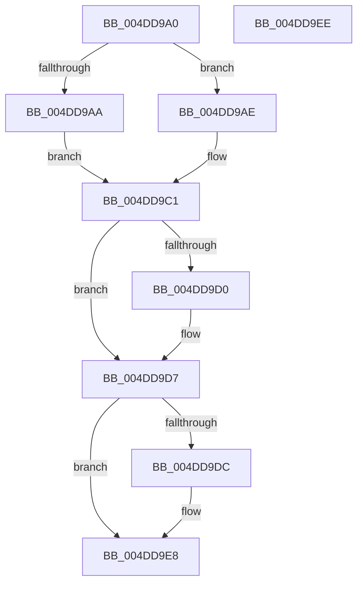

# MiBadPageInserted

- RVA: `0x004DD9A0`–`0x004DD9EF` (길이 `79` bytes)
- VA: `0x00000001404DD9A0`
- 실행 섹션: `.text`
- PDB 이름 있음: `예`; PDB Function 태그: `아니요`
- unwind 정보 RVA: `0x0005CF00`
- 디코드: `21`개 명령, `79/79` bytes 표시
- 미해석 바이트: `0` (있으면 어셈블리에 `.byte`로 보존)

> 이 문서는 커널 이미지의 기계어와 PDB 기호를 분석해 생성했습니다. 4번과 5번은 함수 원형과 자료형을 바이너리 사용 방식에서 추정한 C 해석이며 원본 소스 복구 결과는 아닙니다.

## 1. Dependencies

- 직접 호출 지점: **2**; 고유 호출 대상: **2**
- 직접 호출자로 확인된 함수: **2**
- RIP 상대 이미지 참조: **5**

### Outgoing calls
- `0x004DD9BC` → [ExAcquireSpinLockExclusiveAtDpcLevel](../24/ExAcquireSpinLockExclusiveAtDpcLevel_function_00248E80.md) (function, `0x00248E80`)
- `0x004DD9E3` → [ExReleaseSpinLockExclusiveFromDpcLevel](../24/ExReleaseSpinLockExclusiveFromDpcLevel_function_002497E0.md) (function, `0x002497E0`)

### Direct callers
- [MiInsertPageInList](../2B/MiInsertPageInList_function_002BA000.md) at `0x002BAAE5`
- [sub_006DBBC0](../6D/Unknown_function_006DBBC0.md) at `0x006DBCE9`

### Static image references
- `0x004DD9AE` → RVA `0x00E3A8A0` (`.data`; read)
- `0x004DD9B5` → RVA `0x00E38D00` (`.data`; read)
- `0x004DD9C1` → RVA `0x00E3027C` (`.data`; read/write)
- `0x004DD9C7` → RVA `0x00E30252` (`.data`; read)
- `0x004DD9D0` → RVA `0x00E30252` (`.data`; write)

## 2. Other-region calls and transfers

- 다른 실행 섹션으로 향하는 call: **0**
- 별도 외부 분기/꼬리 이동을 확인하지 못했습니다.

## 3. Assembly (complete function range)

```asm
004DD9A0  40 53                           push rbx
004DD9A2  48 83 EC 20                     sub rsp, 0x20
004DD9A6  85 C9                           test ecx, ecx
004DD9A8  74 04                           je 0x1404dd9ae
004DD9AA  33 DB                           xor ebx, ebx
004DD9AC  EB 13                           jmp 0x1404dd9c1
004DD9AE  48 8D 0D EB CE 95 00            lea rcx, [rip + 0x95ceeb]
004DD9B5  48 8D 1D 44 B3 95 00            lea rbx, [rip + 0x95b344]
004DD9BC  E8 BF B4 D6 FF                  call 0x140248e80
004DD9C1  FF 05 B5 28 95 00               inc dword ptr [rip + 0x9528b5]
004DD9C7  80 3D 84 28 95 00 00            cmp byte ptr [rip + 0x952884], 0
004DD9CE  75 07                           jne 0x1404dd9d7
004DD9D0  C6 05 7B 28 95 00 01            mov byte ptr [rip + 0x95287b], 1
004DD9D7  48 85 DB                        test rbx, rbx
004DD9DA  74 0C                           je 0x1404dd9e8
004DD9DC  48 8D 8B A0 1B 00 00            lea rcx, [rbx + 0x1ba0]
004DD9E3  E8 F8 BD D6 FF                  call 0x1402497e0
004DD9E8  48 83 C4 20                     add rsp, 0x20
004DD9EC  5B                              pop rbx
004DD9ED  C3                              ret
004DD9EE  CC                              int3
```

## 4. C-style interpretation (structured pseudocode)

```c
__int64 __fastcall MiBadPageInserted(int a1)
{
    __int64 result;
    __int64 v_rbx;
    __int64 v_rsp;

    v_rsp = (v_rsp) - (32);
    if (a1 == 0) goto loc_004DD9AE;
    v_rbx = 0;
    goto loc_004DD9C1;
loc_004DD9AE:
    result = ExAcquireSpinLockExclusiveAtDpcLevel(v_rip + 9817835, a2, a3, a4);
loc_004DD9C1:
    if ((*(unsigned __int8 *)(v_rip + 9775236)) == 0) {
        *(unsigned __int8 *)(v_rip + 9775227) = 1;
    }
    if (v_rip + 9810756 != 0) {
        a1 = v_rip + 9810756 + 7072;
        result = ExReleaseSpinLockExclusiveFromDpcLevel(a1, a2, a3, a4);
    }
    v_rsp = (v_rsp) + (32);
    return result;
}
```

## 5. (Beta) C Style

```c
int64_t MiBadPageInserted(int32_t Arg1)
{
    int64_t result;
    int64_t local_rbx;
    int64_t local_rsp;

    local_rsp = (local_rsp) - (32);
    if (Arg1 == 0) goto loc_004DD9AE;
    local_rbx = 0;
    goto loc_004DD9C1;
loc_004DD9AE:
    result = ExAcquireSpinLockExclusiveAtDpcLevel(v_rip + 9817835, a2, a3, a4);
loc_004DD9C1:
    if ((*(uint8_t *)(v_rip + 0x952884)) == 0) {
        *(uint8_t *)(v_rip + 0x95287B) = 1;
    }
    if (v_rip + 9810756 != 0) {
        Arg1 = v_rip + 9810756 + 7072;
        result = ExReleaseSpinLockExclusiveFromDpcLevel(Arg1, a2, a3, a4);
    }
    local_rsp = (local_rsp) + (32);
    return result;
}
```

## 6. Execution-region graph

[열기: 2D/3D 그래프와 함수 탐색 컨트롤 패널](../../../control-panel.html?section=text&rva=0x004DD9A0&view=graph)

- 2D 그래프는 위에서 아래로 흐르고, 3D 그래프는 빈 공간을 드래그해 회전합니다. Shift+드래그는 이동, 휠은 확대·축소, 함수 노드 선택은 대상 보고서 이동입니다.

### Static fallback


