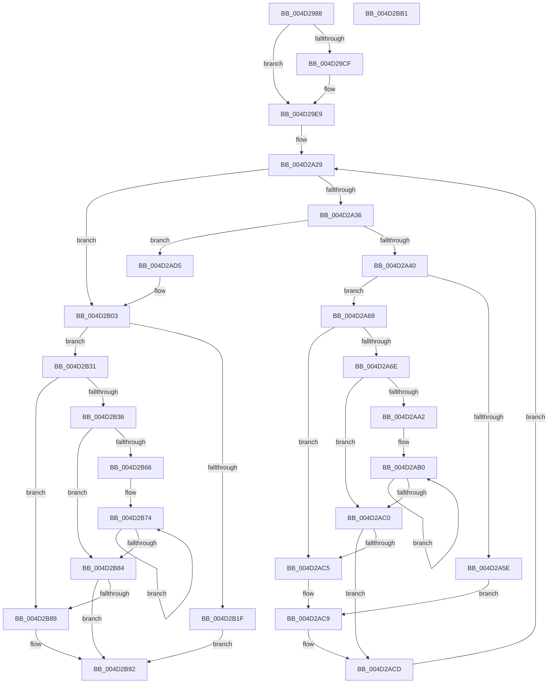

# MiCheckPteReserve

- RVA: `0x004D2988`–`0x004D2BB2` (길이 `554` bytes)
- VA: `0x00000001404D2988`
- 실행 섹션: `.text`
- PDB 이름 있음: `예`; PDB Function 태그: `아니요`
- unwind 정보 RVA: `0x000ACFA4`
- 디코드: `165`개 명령, `554/554` bytes 표시
- 미해석 바이트: `0` (있으면 어셈블리에 `.byte`로 보존)

> 이 문서는 커널 이미지의 기계어와 PDB 기호를 분석해 생성했습니다. 4번과 5번은 함수 원형과 자료형을 바이너리 사용 방식에서 추정한 C 해석이며 원본 소스 복구 결과는 아닙니다.

## 1. Dependencies

- 직접 호출 지점: **2**; 고유 호출 대상: **1**
- 직접 호출자로 확인된 함수: **1**
- RIP 상대 이미지 참조: **0**

### Outgoing calls
- `0x004D29E3` → [KeBugCheckEx](../4F/KeBugCheckEx_function_004FD660.md) (function, `0x004FD660`)
- `0x004D2AFD` → [KeBugCheckEx](../4F/KeBugCheckEx_function_004FD660.md) (function, `0x004FD660`)

### Direct callers
- [MiReservePtes](../31/MiReservePtes_function_00318D20.md) at `0x0031958B`
- [MiReservePtes](../31/MiReservePtes_function_00318D20.md) at `0x0031982A`

### Static image references
- 디코드된 RIP-relative 메모리 참조가 없습니다.

## 2. Other-region calls and transfers

- 다른 실행 섹션으로 향하는 call: **0**
- 별도 외부 분기/꼬리 이동을 확인하지 못했습니다.

## 3. Assembly (complete function range)

```asm
004D2988  4C 8B DC                        mov r11, rsp
004D298B  49 89 5B 08                     mov qword ptr [r11 + 8], rbx
004D298F  49 89 6B 10                     mov qword ptr [r11 + 0x10], rbp
004D2993  49 89 73 18                     mov qword ptr [r11 + 0x18], rsi
004D2997  49 89 7B 20                     mov qword ptr [r11 + 0x20], rdi
004D299B  41 55                           push r13
004D299D  41 56                           push r14
004D299F  41 57                           push r15
004D29A1  48 83 EC 30                     sub rsp, 0x30
004D29A5  4C 8B D2                        mov r10, rdx
004D29A8  49 8B E8                        mov rbp, r8
004D29AB  49 C1 E2 19                     shl r10, 0x19
004D29AF  4C 8B CA                        mov r9, rdx
004D29B2  4C 8B F1                        mov r14, rcx
004D29B5  48 B8 00 00 00 00 80 F6 FF FF   movabs rax, 0xfffff68000000000
004D29BF  48 C1 E0 19                     shl rax, 0x19
004D29C3  4C 2B D0                        sub r10, rax
004D29C6  49 C1 FA 10                     sar r10, 0x10
004D29CA  4D 85 C0                        test r8, r8
004D29CD  75 1A                           jne 0x1404d29e9
004D29CF  4D 21 43 D8                     and qword ptr [r11 - 0x28], r8
004D29D3  45 33 C9                        xor r9d, r9d
004D29D6  4D 8B C2                        mov r8, r10
004D29D9  BA 00 02 00 00                  mov edx, 0x200
004D29DE  B9 DA 00 00 00                  mov ecx, 0xda
004D29E3  E8 78 AC 02 00                  call 0x1404fd660
004D29E8  CC                              int3
004D29E9  8B 41 28                        mov eax, dword ptr [rcx + 0x28]
004D29EC  41 BD 01 00 00 00               mov r13d, 1
004D29F2  4D 2B 4E 20                     sub r9, qword ptr [r14 + 0x20]
004D29F6  41 23 C5                        and eax, r13d
004D29F9  8A C8                           mov cl, al
004D29FB  49 C1 F9 03                     sar r9, 3
004D29FF  C0 E1 02                        shl cl, 2
004D2A02  4C 8B FD                        mov r15, rbp
004D2A05  49 D3 EF                        shr r15, cl
004D2A08  45 8D 5D 01                     lea r11d, [r13 + 1]
004D2A0C  49 FF CF                        dec r15
004D2A0F  41 8B F9                        mov edi, r9d
004D2A12  8D 0C 85 00 00 00 00            lea ecx, [rax*4]
004D2A19  48 D3 EF                        shr rdi, cl
004D2A1C  48 03 FF                        add rdi, rdi
004D2A1F  4C 8B C7                        mov r8, rdi
004D2A22  83 CE FF                        or esi, 0xffffffff
004D2A25  4E 8D 3C 7F                     lea r15, [rdi + r15*2]
004D2A29  49 8B 56 18                     mov rdx, qword ptr [r14 + 0x18]
004D2A2D  4D 3B C7                        cmp r8, r15
004D2A30  0F 83 CD 00 00 00               jae 0x1404d2b03
004D2A36  4C 0F A3 02                     bt qword ptr [rdx], r8
004D2A3A  0F 83 95 00 00 00               jae 0x1404d2ad5
004D2A40  49 8B D8                        mov rbx, r8
004D2A43  49 8B C0                        mov rax, r8
004D2A46  48 C1 E8 05                     shr rax, 5
004D2A4A  83 E3 1F                        and ebx, 0x1f
004D2A4D  49 8B CD                        mov rcx, r13
004D2A50  4C 8D 0C 82                     lea r9, [rdx + rax*4]
004D2A54  48 8D 43 01                     lea rax, [rbx + 1]
004D2A58  48 83 F8 20                     cmp rax, 0x20
004D2A5C  77 0B                           ja 0x1404d2a69
004D2A5E  8B CB                           mov ecx, ebx
004D2A60  41 8B C5                        mov eax, r13d
004D2A63  D3 E0                           shl eax, cl
004D2A65  F7 D0                           not eax
004D2A67  EB 60                           jmp 0x1404d2ac9
004D2A69  48 85 DB                        test rbx, rbx
004D2A6C  74 57                           je 0x1404d2ac5
004D2A6E  41 8B C0                        mov eax, r8d
004D2A71  BA 20 00 00 00                  mov edx, 0x20
004D2A76  83 E0 1F                        and eax, 0x1f
004D2A79  2B D0                           sub edx, eax
004D2A7B  41 8B C5                        mov eax, r13d
004D2A7E  8B CA                           mov ecx, edx
004D2A80  D3 E0                           shl eax, cl
004D2A82  48 8B CB                        mov rcx, rbx
004D2A85  41 2B C5                        sub eax, r13d
004D2A88  D3 E0                           shl eax, cl
004D2A8A  F7 D0                           not eax
004D2A8C  F0 41 21 01                     lock and dword ptr [r9], eax
004D2A90  8B C2                           mov eax, edx
004D2A92  49 8B CD                        mov rcx, r13
004D2A95  48 2B C8                        sub rcx, rax
004D2A98  49 83 C1 04                     add r9, 4
004D2A9C  48 83 F9 20                     cmp rcx, 0x20
004D2AA0  72 1E                           jb 0x1404d2ac0
004D2AA2  48 8B D1                        mov rdx, rcx
004D2AA5  48 C1 EA 05                     shr rdx, 5
004D2AA9  48 6B C2 E0                     imul rax, rdx, -0x20
004D2AAD  48 03 C8                        add rcx, rax
004D2AB0  41 C7 01 00 00 00 00            mov dword ptr [r9], 0
004D2AB7  49 83 C1 04                     add r9, 4
004D2ABB  49 2B D5                        sub rdx, r13
004D2ABE  75 F0                           jne 0x1404d2ab0
004D2AC0  48 85 C9                        test rcx, rcx
004D2AC3  74 08                           je 0x1404d2acd
004D2AC5  8B C6                           mov eax, esi
004D2AC7  D3 E0                           shl eax, cl
004D2AC9  F0 41 21 01                     lock and dword ptr [r9], eax
004D2ACD  4D 03 C3                        add r8, r11
004D2AD0  E9 54 FF FF FF                  jmp 0x1404d2a29
004D2AD5  49 C1 E0 0B                     shl r8, 0xb
004D2AD9  BA 01 02 00 00                  mov edx, 0x201
004D2ADE  48 C1 E7 0B                     shl rdi, 0xb
004D2AE2  B9 DA 00 00 00                  mov ecx, 0xda
004D2AE7  4C 2B C7                        sub r8, rdi
004D2AEA  48 89 6C 24 20                  mov qword ptr [rsp + 0x20], rbp
004D2AEF  49 81 E0 00 F0 FF FF            and r8, 0xfffffffffffff000
004D2AF6  4F 8D 0C 02                     lea r9, [r10 + r8]
004D2AFA  4D 8B C2                        mov r8, r10
004D2AFD  E8 5E AB 02 00                  call 0x1404fd660
004D2B02  CC                              int3
004D2B03  4D 8B D0                        mov r10, r8
004D2B06  49 8B C0                        mov rax, r8
004D2B09  48 C1 E8 05                     shr rax, 5
004D2B0D  41 83 E2 1F                     and r10d, 0x1f
004D2B11  4C 8D 0C 82                     lea r9, [rdx + rax*4]
004D2B15  49 8D 42 02                     lea rax, [r10 + 2]
004D2B19  48 83 F8 20                     cmp rax, 0x20
004D2B1D  77 12                           ja 0x1404d2b31
004D2B1F  41 8B CA                        mov ecx, r10d
004D2B22  B8 03 00 00 00                  mov eax, 3
004D2B27  D3 E0                           shl eax, cl
004D2B29  F7 D0                           not eax
004D2B2B  F0 41 21 01                     lock and dword ptr [r9], eax
004D2B2F  EB 61                           jmp 0x1404d2b92
004D2B31  4D 85 D2                        test r10, r10
004D2B34  74 53                           je 0x1404d2b89
004D2B36  41 83 E0 1F                     and r8d, 0x1f
004D2B3A  BA 20 00 00 00                  mov edx, 0x20
004D2B3F  41 2B D0                        sub edx, r8d
004D2B42  41 8B C5                        mov eax, r13d
004D2B45  8B CA                           mov ecx, edx
004D2B47  D3 E0                           shl eax, cl
004D2B49  49 8B CA                        mov rcx, r10
004D2B4C  41 2B C5                        sub eax, r13d
004D2B4F  D3 E0                           shl eax, cl
004D2B51  F7 D0                           not eax
004D2B53  F0 41 21 01                     lock and dword ptr [r9], eax
004D2B57  8B C2                           mov eax, edx
004D2B59  49 83 C1 04                     add r9, 4
004D2B5D  4C 2B D8                        sub r11, rax
004D2B60  49 83 FB 20                     cmp r11, 0x20
004D2B64  72 1E                           jb 0x1404d2b84
004D2B66  49 8B CB                        mov rcx, r11
004D2B69  48 C1 E9 05                     shr rcx, 5
004D2B6D  48 6B C1 E0                     imul rax, rcx, -0x20
004D2B71  4C 03 D8                        add r11, rax
004D2B74  41 C7 01 00 00 00 00            mov dword ptr [r9], 0
004D2B7B  49 83 C1 04                     add r9, 4
004D2B7F  49 2B CD                        sub rcx, r13
004D2B82  75 F0                           jne 0x1404d2b74
004D2B84  4D 85 DB                        test r11, r11
004D2B87  74 09                           je 0x1404d2b92
004D2B89  49 8B CB                        mov rcx, r11
004D2B8C  D3 E6                           shl esi, cl
004D2B8E  F0 41 21 31                     lock and dword ptr [r9], esi
004D2B92  48 8B 5C 24 50                  mov rbx, qword ptr [rsp + 0x50]
004D2B97  48 8B 6C 24 58                  mov rbp, qword ptr [rsp + 0x58]
004D2B9C  48 8B 74 24 60                  mov rsi, qword ptr [rsp + 0x60]
004D2BA1  48 8B 7C 24 68                  mov rdi, qword ptr [rsp + 0x68]
004D2BA6  48 83 C4 30                     add rsp, 0x30
004D2BAA  41 5F                           pop r15
004D2BAC  41 5E                           pop r14
004D2BAE  41 5D                           pop r13
004D2BB0  C3                              ret
004D2BB1  CC                              int3
```

## 4. C-style interpretation (structured pseudocode)

```c
__int64 __fastcall MiCheckPteReserve(__int64 a1, __int64 a2, __int64 a3)
{
    __int64 result;
    __int64 v_r10;
    __int64 v_r11;
    __int64 v_r15;
    __int64 v_rbx;
    __int64 v_rdi;
    __int64 v_rsi;
    __int64 v_rsp;
    unsigned __int64 v_stack_m28;
    unsigned __int64 v_stack_p10;
    unsigned __int64 v_stack_p18;
    unsigned __int64 v_stack_p20;
    unsigned __int64 v_stack_p8;

    *(unsigned __int64 *)(v_rsp + 8) = v_rbx;
    *(unsigned __int64 *)(v_rsp + 16) = v_rbp;
    *(unsigned __int64 *)(v_rsp + 24) = v_rsi;
    *(unsigned __int64 *)(v_rsp + 32) = v_rdi;
    v_rsp = (v_rsp) - (48);
    v_r10 = (a2) << (25);
    result = (result) << (25);
    v_r10 = (v_r10) - (result);
    v_r10 = (v_r10) >> (16);
    if (a3 == 0) {
        a4 = 0;
        a3 = v_r10;
        a2 = 512;
        a1 = 218;
        result = KeBugCheckEx(a1, a2, a3, a4);
    }
    a4 = (a4) - (*(unsigned __int64 *)(a1 + 32));
    result = (unsigned int)(((unsigned int)(*(unsigned int *)(a1 + 40))) & (1));
    a4 = (a4) >> (3);
    a1 = (unsigned __int8)(((unsigned __int8)(result)) << (2));
    v_r15 = (a3) >> ((unsigned __int8)(a1));
    v_r15 = (v_r15) - 1;
    v_rdi = ((unsigned int)((unsigned int)(a4))) >> ((unsigned __int8)(result * 4));
    v_rdi = (v_rdi) + (v_rdi);
    v_rsi = (unsigned int)((v_rsi) | (0xFFFFFFFFULL));
loc_004D2A29:
    if (v_rdi >= (v_rdi + v_r15 * 2)) goto loc_004D2B03;
    if (v_rdi >= (v_rdi + v_r15 * 2)) goto loc_004D2AD5;
    result = (v_rdi) >> (5);
    v_rbx = (unsigned int)((v_rdi) & (31));
    if ((v_rbx + 1) > 32) goto loc_004D2A69;
    result = (unsigned int)((1) << ((unsigned __int8)((unsigned int)((unsigned int)(v_rbx)))));
    result = (unsigned int)(~(result));
    goto loc_004D2AC9;
loc_004D2A69:
    if (v_rbx == 0) goto loc_004D2AC5;
    result = (unsigned int)(((unsigned int)((unsigned int)(v_rdi))) & (31));
    a2 = (unsigned int)((32) - ((unsigned int)(result)));
    result = (unsigned int)((1) << ((unsigned __int8)((unsigned int)((unsigned int)(a2)))));
    result = (unsigned int)((result) - (1));
    result = (unsigned int)((result) << ((unsigned __int8)(v_rbx)));
    result = (unsigned int)(~(result));
    a1 = (1) - ((unsigned int)((unsigned int)(a2)));
    a4 = (*(unsigned __int64 *)(a1 + 24) + result * 4) + (4);
    if (a1 < 32) goto loc_004D2AC0;
    a2 = (a1) >> (5);
    result = ((unsigned int)((unsigned int)(a2))) * (a2);
    a1 = (a1) + (result);
loc_004D2AB0:
    *(unsigned int *)(a4) = 0;
    a4 = (a4) + (4);
    a2 = (a2) - (1);
    if (condition_is_not_equal) goto loc_004D2AB0;
loc_004D2AC0:
    if (a1 == 0) goto loc_004D2ACD;
loc_004D2AC5:
    result = (unsigned int)(((unsigned int)((unsigned int)(v_rsi))) << ((unsigned __int8)(a1)));
loc_004D2AC9:
loc_004D2ACD:
    a3 = (v_rdi) + (1 + 1);
    goto loc_004D2A29;
loc_004D2AD5:
    a3 = (a3) << (11);
    v_rdi = (v_rdi) << (11);
    a3 = (a3) - (v_rdi);
    v_stack_m28 = a3;
    a3 = (a3) & (0xFFFFFFFFFFFFF000ULL);
    result = KeBugCheckEx(218, 513, v_r10, v_r10 + a3 * 1);
loc_004D2B03:
    result = (v_r10) >> (5);
    v_r10 = (unsigned int)((v_r10) & (31));
    if ((v_r10 + 2) > 32) goto loc_004D2B31;
    result = (unsigned int)((3) << ((unsigned __int8)((unsigned int)((unsigned int)(v_r10)))));
    result = (unsigned int)(~(result));
    goto loc_004D2B92;
loc_004D2B31:
    if (v_r10 == 0) goto loc_004D2B89;
    a3 = (unsigned int)((v_r10) & (31));
    a2 = (unsigned int)((32) - ((unsigned int)(a3)));
    result = (unsigned int)((1) << ((unsigned __int8)((unsigned int)((unsigned int)(a2)))));
    result = (unsigned int)((result) - (1));
    result = (unsigned int)((result) << ((unsigned __int8)(v_r10)));
    result = (unsigned int)(~(result));
    a4 = (513 + result * 4) + (4);
    v_r11 = (1 + 1) - ((unsigned int)((unsigned int)(a2)));
    if (v_r11 < 32) goto loc_004D2B84;
    a1 = (v_r11) >> (5);
    result = ((unsigned int)((unsigned int)(a2))) * (a1);
    v_r11 = (v_r11) + (result);
loc_004D2B74:
    *(unsigned int *)(a4) = 0;
    a4 = (a4) + (4);
    a1 = (a1) - (1);
    if (condition_is_not_equal) goto loc_004D2B74;
loc_004D2B84:
    if (v_r11 != 0) {
        a1 = v_r11;
        v_rsi = (unsigned int)((v_rsi) << ((unsigned __int8)(a1)));
    }
    v_rsp = (v_rsp) + (48);
    return result;
}
```

## 5. (Beta) C Style

```c
int64_t MiCheckPteReserve(void *Arg1, int64_t Arg2, int64_t Arg3)
{
    uint8_t *arg1 = (uint8_t *)Arg1;

    int64_t result;
    int64_t local_r10;
    int64_t local_r11;
    int64_t local_r15;
    int64_t local_rbx;
    int64_t local_rdi;
    int64_t local_rsi;
    int64_t local_rsp;
    uint64_t v_stack_m28;
    uint64_t v_stack_p10;
    uint64_t v_stack_p18;
    uint64_t v_stack_p20;
    uint64_t v_stack_p8;

    *(uint64_t *)(local_rsp + 0x8) = local_rbx;
    *(uint64_t *)(local_rsp + 0x10) = local_rbp;
    *(uint64_t *)(local_rsp + 0x18) = local_rsi;
    *(uint64_t *)(local_rsp + 0x20) = local_rdi;
    local_rsp = (local_rsp) - (48);
    local_r10 = (Arg2) << (25);
    result = (result) << (25);
    local_r10 = (local_r10) - (result);
    local_r10 = (local_r10) >> (16);
    if (Arg3 == 0) {
        a4 = 0;
        Arg3 = local_r10;
        Arg2 = 512;
        Arg1 = 218;
        result = KeBugCheckEx(Arg1, Arg2, Arg3, a4);
    }
    a4 = (a4) - (*(uint64_t *)(arg1 + 0x20));
    result = (uint32_t)(((uint32_t)(*(uint32_t *)(arg1 + 0x28))) & (1));
    a4 = (a4) >> (3);
    Arg1 = (uint8_t)(((uint8_t)(result)) << (2));
    local_r15 = (Arg3) >> ((uint8_t)(Arg1));
    local_r15 = (local_r15) - 1;
    local_rdi = ((uint32_t)((uint32_t)(a4))) >> ((uint8_t)(result * 4));
    local_rdi = (local_rdi) + (local_rdi);
    local_rsi = (uint32_t)((local_rsi) | (0xFFFFFFFFULL));
loc_004D2A29:
    if (local_rdi >= (local_rdi + local_r15 * 2)) goto loc_004D2B03;
    if (local_rdi >= (local_rdi + local_r15 * 2)) goto loc_004D2AD5;
    result = (local_rdi) >> (5);
    local_rbx = (uint32_t)((local_rdi) & (31));
    if ((local_rbx + 1) > 32) goto loc_004D2A69;
    result = (uint32_t)((1) << ((uint8_t)((uint32_t)((uint32_t)(local_rbx)))));
    result = (uint32_t)(~(result));
    goto loc_004D2AC9;
loc_004D2A69:
    if (local_rbx == 0) goto loc_004D2AC5;
    result = (uint32_t)(((uint32_t)((uint32_t)(local_rdi))) & (31));
    Arg2 = (uint32_t)((32) - ((uint32_t)(result)));
    result = (uint32_t)((1) << ((uint8_t)((uint32_t)((uint32_t)(Arg2)))));
    result = (uint32_t)((result) - (1));
    result = (uint32_t)((result) << ((uint8_t)(local_rbx)));
    result = (uint32_t)(~(result));
    Arg1 = (1) - ((uint32_t)((uint32_t)(Arg2)));
    a4 = (*(uint64_t *)(arg1 + 0x18) + result * 4) + (4);
    if (Arg1 < 32) goto loc_004D2AC0;
    Arg2 = (Arg1) >> (5);
    result = ((uint32_t)((uint32_t)(Arg2))) * (Arg2);
    Arg1 = (Arg1) + (result);
loc_004D2AB0:
    *(uint32_t *)(a4) = 0;
    a4 = (a4) + (4);
    Arg2 = (Arg2) - (1);
    if (condition_is_not_equal) goto loc_004D2AB0;
loc_004D2AC0:
    if (Arg1 == NULL) goto loc_004D2ACD;
loc_004D2AC5:
    result = (uint32_t)(((uint32_t)((uint32_t)(local_rsi))) << ((uint8_t)(Arg1)));
loc_004D2AC9:
loc_004D2ACD:
    Arg3 = (local_rdi) + (1 + 1);
    goto loc_004D2A29;
loc_004D2AD5:
    Arg3 = (Arg3) << (11);
    local_rdi = (local_rdi) << (11);
    Arg3 = (Arg3) - (local_rdi);
    v_stack_m28 = Arg3;
    Arg3 = (Arg3) & (0xFFFFFFFFFFFFF000ULL);
    result = KeBugCheckEx(218, 513, local_r10, local_r10 + Arg3 * 1);
loc_004D2B03:
    result = (local_r10) >> (5);
    local_r10 = (uint32_t)((local_r10) & (31));
    if ((local_r10 + 2) > 32) goto loc_004D2B31;
    result = (uint32_t)((3) << ((uint8_t)((uint32_t)((uint32_t)(local_r10)))));
    result = (uint32_t)(~(result));
    goto loc_004D2B92;
loc_004D2B31:
    if (local_r10 == 0) goto loc_004D2B89;
    Arg3 = (uint32_t)((local_r10) & (31));
    Arg2 = (uint32_t)((32) - ((uint32_t)(Arg3)));
    result = (uint32_t)((1) << ((uint8_t)((uint32_t)((uint32_t)(Arg2)))));
    result = (uint32_t)((result) - (1));
    result = (uint32_t)((result) << ((uint8_t)(local_r10)));
    result = (uint32_t)(~(result));
    a4 = (513 + result * 4) + (4);
    local_r11 = (1 + 1) - ((uint32_t)((uint32_t)(Arg2)));
    if (local_r11 < 32) goto loc_004D2B84;
    Arg1 = (local_r11) >> (5);
    result = ((uint32_t)((uint32_t)(Arg2))) * (Arg1);
    local_r11 = (local_r11) + (result);
loc_004D2B74:
    *(uint32_t *)(a4) = 0;
    a4 = (a4) + (4);
    Arg1 = (Arg1) - (1);
    if (condition_is_not_equal) goto loc_004D2B74;
loc_004D2B84:
    if (local_r11 != 0) {
        Arg1 = local_r11;
        local_rsi = (uint32_t)((local_rsi) << ((uint8_t)(Arg1)));
    }
    local_rsp = (local_rsp) + (48);
    return result;
}
```

### 관측된 메모리 오프셋

구조체 형식이 확인되지 않은 접근은 인자 기준의 오프셋으로만 기록했습니다.

| 기준 인자 | 오프셋 표현 | 폭 (bit) | 접근 |
|---|---:|---:|---|
| `Arg1` | `+ 0x18` | `64` | `R` |
| `Arg1` | `+ 0x20` | `64` | `R` |

## 6. Execution-region graph

[열기: 2D/3D 그래프와 함수 탐색 컨트롤 패널](../../../control-panel.html?section=text&rva=0x004D2988&view=graph)

- 2D 그래프는 위에서 아래로 흐르고, 3D 그래프는 빈 공간을 드래그해 회전합니다. Shift+드래그는 이동, 휠은 확대·축소, 함수 노드 선택은 대상 보고서 이동입니다.

### Static fallback


