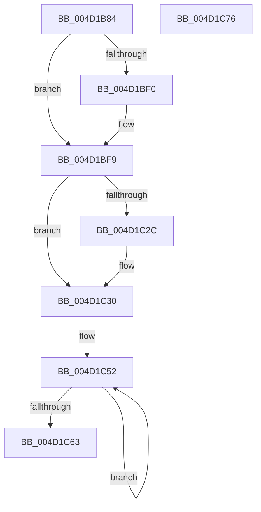

# MiClearFileOnlyPfn

- RVA: `0x004D1B84`–`0x004D1C77` (길이 `243` bytes)
- VA: `0x00000001404D1B84`
- 실행 섹션: `.text`
- PDB 이름 있음: `예`; PDB Function 태그: `아니요`
- unwind 정보 RVA: `0x000BDDB4`
- 디코드: `70`개 명령, `243/243` bytes 표시
- 미해석 바이트: `0` (있으면 어셈블리에 `.byte`로 보존)

> 이 문서는 커널 이미지의 기계어와 PDB 기호를 분석해 생성했습니다. 4번과 5번은 함수 원형과 자료형을 바이너리 사용 방식에서 추정한 C 해석이며 원본 소스 복구 결과는 아닙니다.

## 1. Dependencies

- 직접 호출 지점: **2**; 고유 호출 대상: **2**
- 직접 호출자로 확인된 함수: **1**
- RIP 상대 이미지 참조: **0**

### Outgoing calls
- `0x004D1BF4` → [MiSetPfnIdentity](../2A/MiSetPfnIdentity_function_002A2350.md) (function, `0x002A2350`)
- `0x004D1C66` → [MiQueueExtentPfnDeletion](MiQueueExtentPfnDeletion_function_004D1C80.md) (function, `0x004D1C80`)

### Direct callers
- [sub_00335339](../33/Unknown_function_00335339.md) at `0x00335351`

### Static image references
- 디코드된 RIP-relative 메모리 참조가 없습니다.

## 2. Other-region calls and transfers

- 다른 실행 섹션으로 향하는 call: **0**
- 별도 외부 분기/꼬리 이동을 확인하지 못했습니다.

## 3. Assembly (complete function range)

```asm
004D1B84  48 89 5C 24 10                  mov qword ptr [rsp + 0x10], rbx
004D1B89  55                              push rbp
004D1B8A  48 8B EC                        mov rbp, rsp
004D1B8D  48 83 EC 50                     sub rsp, 0x50
004D1B91  0F 57 C0                        xorps xmm0, xmm0
004D1B94  48 B8 00 00 00 00 00 00 00 80   movabs rax, 0x8000000000000000
004D1B9E  0F 11 45 F0                     movups xmmword ptr [rbp - 0x10], xmm0
004D1BA2  BA 03 00 00 00                  mov edx, 3
004D1BA7  48 8B D9                        mov rbx, rcx
004D1BAA  0F 11 45 D0                     movups xmmword ptr [rbp - 0x30], xmm0
004D1BAE  0F 11 45 E0                     movups xmmword ptr [rbp - 0x20], xmm0
004D1BB2  48 89 45 E8                     mov qword ptr [rbp - 0x18], rax
004D1BB6  8B 45 F0                        mov eax, dword ptr [rbp - 0x10]
004D1BB9  89 45 10                        mov dword ptr [rbp + 0x10], eax
004D1BBC  C1 E8 10                        shr eax, 0x10
004D1BBF  24 3F                           and al, 0x3f
004D1BC1  0C 40                           or al, 0x40
004D1BC3  88 45 12                        mov byte ptr [rbp + 0x12], al
004D1BC6  8B 45 10                        mov eax, dword ptr [rbp + 0x10]
004D1BC9  89 45 F0                        mov dword ptr [rbp - 0x10], eax
004D1BCC  8B 45 F0                        mov eax, dword ptr [rbp - 0x10]
004D1BCF  89 45 10                        mov dword ptr [rbp + 0x10], eax
004D1BD2  C1 E8 10                        shr eax, 0x10
004D1BD5  24 FD                           and al, 0xfd
004D1BD7  0C 05                           or al, 5
004D1BD9  88 45 12                        mov byte ptr [rbp + 0x12], al
004D1BDC  8B 45 10                        mov eax, dword ptr [rbp + 0x10]
004D1BDF  89 45 F0                        mov dword ptr [rbp - 0x10], eax
004D1BE2  48 8B 41 28                     mov rax, qword ptr [rcx + 0x28]
004D1BE6  48 C1 E8 3C                     shr rax, 0x3c
004D1BEA  24 07                           and al, 7
004D1BEC  3A C2                           cmp al, dl
004D1BEE  75 09                           jne 0x1404d1bf9
004D1BF0  48 8D 4D D0                     lea rcx, [rbp - 0x30]
004D1BF4  E8 57 07 DD FF                  call 0x1402a2350
004D1BF9  48 8B 45 F8                     mov rax, qword ptr [rbp - 8]
004D1BFD  48 B9 00 00 00 00 00 00 40 00   movabs rcx, 0x40000000000000
004D1C07  48 0B C1                        or rax, rcx
004D1C0A  48 89 45 F8                     mov qword ptr [rbp - 8], rax
004D1C0E  8B 45 F0                        mov eax, dword ptr [rbp - 0x10]
004D1C11  89 45 10                        mov dword ptr [rbp + 0x10], eax
004D1C14  C1 E8 18                        shr eax, 0x18
004D1C17  0C 10                           or al, 0x10
004D1C19  88 45 13                        mov byte ptr [rbp + 0x13], al
004D1C1C  8B 45 10                        mov eax, dword ptr [rbp + 0x10]
004D1C1F  89 45 F0                        mov dword ptr [rbp - 0x10], eax
004D1C22  8B 43 20                        mov eax, dword ptr [rbx + 0x20]
004D1C25  C1 E8 18                        shr eax, 0x18
004D1C28  A8 40                           test al, 0x40
004D1C2A  74 04                           je 0x1404d1c30
004D1C2C  80 4D F3 40                     or byte ptr [rbp - 0xd], 0x40
004D1C30  48 B8 00 00 00 00 00 00 20 00   movabs rax, 0x20000000000000
004D1C3A  48 8D 4D D0                     lea rcx, [rbp - 0x30]
004D1C3E  48 09 45 F8                     or qword ptr [rbp - 8], rax
004D1C42  48 8B D3                        mov rdx, rbx
004D1C45  48 8D 45 D0                     lea rax, [rbp - 0x30]
004D1C49  41 B8 06 00 00 00               mov r8d, 6
004D1C4F  48 2B D0                        sub rdx, rax
004D1C52  48 8B 01                        mov rax, qword ptr [rcx]
004D1C55  48 89 04 0A                     mov qword ptr [rdx + rcx], rax
004D1C59  48 8D 49 08                     lea rcx, [rcx + 8]
004D1C5D  49 83 E8 01                     sub r8, 1
004D1C61  75 EF                           jne 0x1404d1c52
004D1C63  48 8B CB                        mov rcx, rbx
004D1C66  E8 15 00 00 00                  call 0x1404d1c80
004D1C6B  48 8B 5C 24 68                  mov rbx, qword ptr [rsp + 0x68]
004D1C70  48 83 C4 50                     add rsp, 0x50
004D1C74  5D                              pop rbp
004D1C75  C3                              ret
004D1C76  CC                              int3
```

## 4. C-style interpretation (structured pseudocode)

```c
__int64 __fastcall MiClearFileOnlyPfn(__int64 a1)
{
    __int64 result;
    __int64 v_rsp;
    unsigned __int64 v_stack_m10;
    unsigned __int8 v_stack_m15;
    unsigned __int64 v_stack_m18;
    unsigned __int64 v_stack_m20;
    unsigned __int64 v_stack_m28;
    unsigned __int64 v_stack_m38;
    unsigned __int64 v_stack_p10;
    unsigned int v_stack_p8;
    unsigned __int8 v_stack_pA;
    unsigned __int8 v_stack_pB;

    v_stack_p10 = v_rbx;
    v_rsp = (v_rsp) - (80);
    v_stack_m18 = v_xmm0;
    v_stack_m38 = v_xmm0;
    v_stack_m28 = v_xmm0;
    v_stack_m20 = result;
    v_stack_p8 = (unsigned int)((unsigned int)(v_stack_m18));
    result = (unsigned int)(((unsigned int)(v_stack_m18)) >> (16));
    result = (unsigned __int8)((result) & (63));
    result = (unsigned __int8)((result) | (64));
    v_stack_pA = (unsigned __int8)(result);
    v_stack_m18 = (unsigned int)((unsigned int)(v_stack_p8));
    v_stack_p8 = (unsigned int)((unsigned int)(v_stack_m18));
    result = (unsigned int)(((unsigned int)(v_stack_m18)) >> (16));
    result = (unsigned __int8)((result) & (253));
    result = (unsigned __int8)((result) | (5));
    v_stack_pA = (unsigned __int8)(result);
    v_stack_m18 = (unsigned int)((unsigned int)(v_stack_p8));
    result = (*(unsigned __int64 *)(a1 + 40)) >> (60);
    result = (unsigned __int8)((result) & (7));
    if (((unsigned __int8)(result)) == 3) {
        a1 = v_stack_m38;
        result = MiSetPfnIdentity(a1, 3, a3, a4);
    }
    result = (v_stack_m10) | (a1);
    v_stack_m10 = result;
    v_stack_p8 = (unsigned int)((unsigned int)(v_stack_m18));
    result = (unsigned int)(((unsigned int)(v_stack_m18)) >> (24));
    result = (unsigned __int8)((result) | (16));
    v_stack_pB = (unsigned __int8)(result);
    v_stack_m18 = (unsigned int)((unsigned int)(v_stack_p8));
    result = (unsigned int)(((unsigned int)(*(unsigned int *)(a1 + 32))) >> (24));
    if ((((unsigned __int8)(result)) & (64)) != 0) {
    }
    a2 = (a1) - (v_stack_m38);
loc_004D1C52:
    *(unsigned __int64 *)(a2 + v_stack_m38 * 1) = *(unsigned __int64 *)(v_stack_m38);
    a3 = (6) - (1);
    if (condition_is_not_equal) goto loc_004D1C52;
    result = MiQueueExtentPfnDeletion(a1, a2, a3, a4);
    v_rsp = (v_rsp) + (80);
    return result;
}
```

## 5. (Beta) C Style

```c
int64_t MiClearFileOnlyPfn(void *Arg1)
{
    uint8_t *arg1 = (uint8_t *)Arg1;

    int64_t result;
    int64_t local_rsp;
    uint64_t v_stack_m10;
    uint8_t v_stack_m15;
    uint64_t v_stack_m18;
    uint64_t v_stack_m20;
    uint64_t v_stack_m28;
    uint64_t v_stack_m38;
    uint64_t v_stack_p10;
    uint32_t v_stack_p8;
    uint8_t v_stack_pA;
    uint8_t v_stack_pB;

    v_stack_p10 = local_rbx;
    local_rsp = (local_rsp) - (80);
    v_stack_m18 = v_xmm0;
    v_stack_m38 = v_xmm0;
    v_stack_m28 = v_xmm0;
    v_stack_m20 = result;
    v_stack_p8 = (uint32_t)((uint32_t)(v_stack_m18));
    result = (uint32_t)(((uint32_t)(v_stack_m18)) >> (16));
    result = (uint8_t)((result) & (63));
    result = (uint8_t)((result) | (64));
    v_stack_pA = (uint8_t)(result);
    v_stack_m18 = (uint32_t)((uint32_t)(v_stack_p8));
    v_stack_p8 = (uint32_t)((uint32_t)(v_stack_m18));
    result = (uint32_t)(((uint32_t)(v_stack_m18)) >> (16));
    result = (uint8_t)((result) & (253));
    result = (uint8_t)((result) | (5));
    v_stack_pA = (uint8_t)(result);
    v_stack_m18 = (uint32_t)((uint32_t)(v_stack_p8));
    result = (*(uint64_t *)(arg1 + 0x28)) >> (60);
    result = (uint8_t)((result) & (7));
    if (((uint8_t)(result)) == 3) {
        Arg1 = v_stack_m38;
        result = MiSetPfnIdentity(Arg1, 3, a3, a4);
    }
    result = (v_stack_m10) | (Arg1);
    v_stack_m10 = result;
    v_stack_p8 = (uint32_t)((uint32_t)(v_stack_m18));
    result = (uint32_t)(((uint32_t)(v_stack_m18)) >> (24));
    result = (uint8_t)((result) | (16));
    v_stack_pB = (uint8_t)(result);
    v_stack_m18 = (uint32_t)((uint32_t)(v_stack_p8));
    result = (uint32_t)(((uint32_t)(*(uint32_t *)(arg1 + 0x20))) >> (24));
    if ((((uint8_t)(result)) & (64)) != 0) {
    }
    a2 = (Arg1) - (v_stack_m38);
loc_004D1C52:
    *(uint64_t *)(a2 + v_stack_m38 * 1) = *(uint64_t *)(v_stack_m38);
    a3 = (6) - (1);
    if (condition_is_not_equal) goto loc_004D1C52;
    result = MiQueueExtentPfnDeletion(Arg1, a2, a3, a4);
    local_rsp = (local_rsp) + (80);
    return result;
}
```

### 관측된 메모리 오프셋

구조체 형식이 확인되지 않은 접근은 인자 기준의 오프셋으로만 기록했습니다.

| 기준 인자 | 오프셋 표현 | 폭 (bit) | 접근 |
|---|---:|---:|---|
| `Arg1` | `+ 0x0 + rcx*1` | `64` | `W` |
| `Arg1` | `+ 0x20` | `32` | `R` |
| `Arg1` | `+ 0x28` | `64` | `R` |

## 6. Execution-region graph

[열기: 2D/3D 그래프와 함수 탐색 컨트롤 패널](../../../control-panel.html?section=text&rva=0x004D1B84&view=graph)

- 2D 그래프는 위에서 아래로 흐르고, 3D 그래프는 빈 공간을 드래그해 회전합니다. Shift+드래그는 이동, 휠은 확대·축소, 함수 노드 선택은 대상 보고서 이동입니다.

### Static fallback


