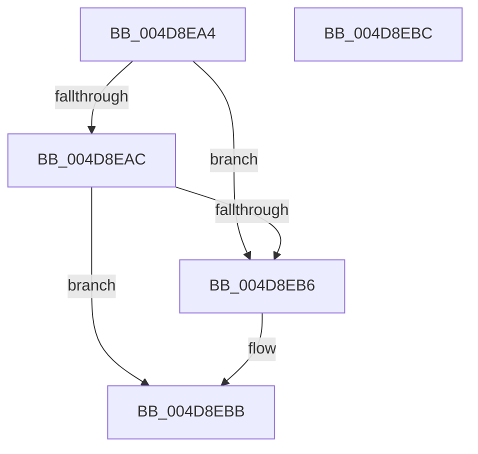

# MiConvertCrossPartitionChargeTypeToAggregate

- RVA: `0x004D8EA4`–`0x004D8EBD` (길이 `25` bytes)
- VA: `0x00000001404D8EA4`
- 실행 섹션: `.text`
- PDB 이름 있음: `예`; PDB Function 태그: `아니요`
- unwind 정보 RVA: `0x000DB714`
- 디코드: `8`개 명령, `25/25` bytes 표시
- 미해석 바이트: `0` (있으면 어셈블리에 `.byte`로 보존)

> 이 문서는 커널 이미지의 기계어와 PDB 기호를 분석해 생성했습니다. 4번과 5번은 함수 원형과 자료형을 바이너리 사용 방식에서 추정한 C 해석이며 원본 소스 복구 결과는 아닙니다.

## 1. Dependencies

- 직접 호출 지점: **0**; 고유 호출 대상: **0**
- 직접 호출자로 확인된 함수: **2**
- RIP 상대 이미지 참조: **0**

### Outgoing calls
- 직접 디코드된 call 명령이 없습니다.

### Direct callers
- [MiApplyCrossPartitionCharges](MiApplyCrossPartitionCharges_function_004D60E0.md) at `0x004D613B`
- [MiReturnCrossPartitionCharge](MiReturnCrossPartitionCharge_function_004D8E24.md) at `0x004D8E52`

### Static image references
- 디코드된 RIP-relative 메모리 참조가 없습니다.

## 2. Other-region calls and transfers

- 다른 실행 섹션으로 향하는 call: **0**
- 별도 외부 분기/꼬리 이동을 확인하지 못했습니다.

## 3. Assembly (complete function range)

```asm
004D8EA4  F7 C1 F9 FF FF FF               test ecx, 0xfffffff9
004D8EAA  75 0A                           jne 0x1404d8eb6
004D8EAC  B8 07 00 00 00                  mov eax, 7
004D8EB1  83 F9 04                        cmp ecx, 4
004D8EB4  75 05                           jne 0x1404d8ebb
004D8EB6  B8 08 00 00 00                  mov eax, 8
004D8EBB  C3                              ret
004D8EBC  CC                              int3
```

## 4. C-style interpretation (structured pseudocode)

```c
__int64 __fastcall MiConvertCrossPartitionChargeTypeToAggregate(int a1)
{
    __int64 result;

    if (((a1) & (0xFFFFFFF9ULL)) != 0) goto loc_004D8EB6;
    result = 7;
    if (a1 == 4) {
        result = 8;
    }
    return result;
}
```

## 5. (Beta) C Style

```c
int64_t MiConvertCrossPartitionChargeTypeToAggregate(int32_t Arg1)
{
    int64_t result;

    if (((Arg1) & (0xFFFFFFF9ULL)) != 0) goto loc_004D8EB6;
    result = 7;
    if (Arg1 == 4) {
        result = 8;
    }
    return result;
}
```

## 6. Execution-region graph

[열기: 2D/3D 그래프와 함수 탐색 컨트롤 패널](../../../control-panel.html?section=text&rva=0x004D8EA4&view=graph)

- 2D 그래프는 위에서 아래로 흐르고, 3D 그래프는 빈 공간을 드래그해 회전합니다. Shift+드래그는 이동, 휠은 확대·축소, 함수 노드 선택은 대상 보고서 이동입니다.

### Static fallback


