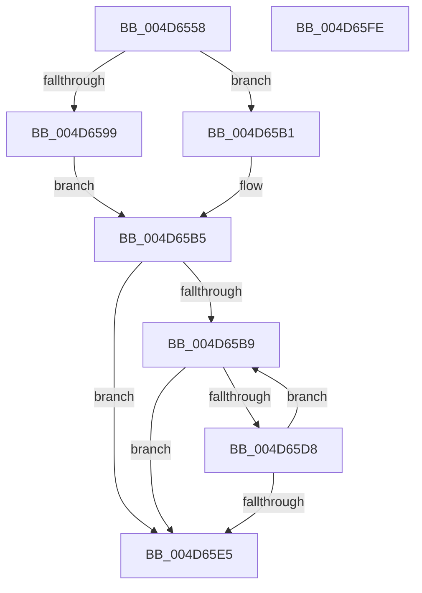

# MiCopyImageExtentContents

- RVA: `0x004D6558`–`0x004D65FF` (길이 `167` bytes)
- VA: `0x00000001404D6558`
- 실행 섹션: `.text`
- PDB 이름 있음: `예`; PDB Function 태그: `아니요`
- unwind 정보 RVA: `0x00060300`
- 디코드: `49`개 명령, `167/167` bytes 표시
- 미해석 바이트: `0` (있으면 어셈블리에 `.byte`로 보존)

> 이 문서는 커널 이미지의 기계어와 PDB 기호를 분석해 생성했습니다. 4번과 5번은 함수 원형과 자료형을 바이너리 사용 방식에서 추정한 C 해석이며 원본 소스 복구 결과는 아닙니다.

## 1. Dependencies

- 직접 호출 지점: **1**; 고유 호출 대상: **1**
- 직접 호출자로 확인된 함수: **1**
- RIP 상대 이미지 참조: **0**

### Outgoing calls
- `0x004D65CE` → [MiFillPageWithImageExtentContents](../68/MiFillPageWithImageExtentContents_function_00680E44.md) (function, `0x00680E44`)

### Direct callers
- [MiIssueHardFaultIo](../38/MiIssueHardFaultIo_function_003812EC.md) at `0x0038152C`

### Static image references
- 디코드된 RIP-relative 메모리 참조가 없습니다.

## 2. Other-region calls and transfers

- 다른 실행 섹션으로 향하는 call: **0**
- 별도 외부 분기/꼬리 이동을 확인하지 못했습니다.

## 3. Assembly (complete function range)

```asm
004D6558  48 89 5C 24 08                  mov qword ptr [rsp + 8], rbx
004D655D  48 89 6C 24 10                  mov qword ptr [rsp + 0x10], rbp
004D6562  48 89 74 24 18                  mov qword ptr [rsp + 0x18], rsi
004D6567  57                              push rdi
004D6568  41 56                           push r14
004D656A  41 57                           push r15
004D656C  48 83 EC 20                     sub rsp, 0x20
004D6570  48 8B 81 D0 00 00 00            mov rax, qword ptr [rcx + 0xd0]
004D6577  4C 8D 72 30                     lea r14, [rdx + 0x30]
004D657B  8B 7A 28                        mov edi, dword ptr [rdx + 0x28]
004D657E  41 BF 00 10 00 00               mov r15d, 0x1000
004D6584  4C 8B 00                        mov r8, qword ptr [rax]
004D6587  49 8B 40 60                     mov rax, qword ptr [r8 + 0x60]
004D658B  48 83 E0 F8                     and rax, 0xfffffffffffffff8
004D658F  48 8B 68 30                     mov rbp, qword ptr [rax + 0x30]
004D6593  44 85 78 38                     test dword ptr [rax + 0x38], r15d
004D6597  74 18                           je 0x1404d65b1
004D6599  48 8B 99 F0 00 00 00            mov rbx, qword ptr [rcx + 0xf0]
004D65A0  49 2B 98 88 00 00 00            sub rbx, qword ptr [r8 + 0x88]
004D65A7  48 C1 FB 03                     sar rbx, 3
004D65AB  48 C1 E3 0C                     shl rbx, 0xc
004D65AF  EB 04                           jmp 0x1404d65b5
004D65B1  48 8B 59 60                     mov rbx, qword ptr [rcx + 0x60]
004D65B5  85 FF                           test edi, edi
004D65B7  74 2C                           je 0x1404d65e5
004D65B9  49 8B 16                        mov rdx, qword ptr [r14]
004D65BC  41 3B FF                        cmp edi, r15d
004D65BF  41 8B F7                        mov esi, r15d
004D65C2  4C 8B C3                        mov r8, rbx
004D65C5  0F 46 F7                        cmovbe esi, edi
004D65C8  48 8B CD                        mov rcx, rbp
004D65CB  44 8B CE                        mov r9d, esi
004D65CE  E8 71 A8 1A 00                  call 0x140680e44
004D65D3  41 3B FF                        cmp edi, r15d
004D65D6  76 0D                           jbe 0x1404d65e5
004D65D8  8B C6                           mov eax, esi
004D65DA  49 83 C6 08                     add r14, 8
004D65DE  48 03 D8                        add rbx, rax
004D65E1  2B FE                           sub edi, esi
004D65E3  75 D4                           jne 0x1404d65b9
004D65E5  48 8B 5C 24 40                  mov rbx, qword ptr [rsp + 0x40]
004D65EA  48 8B 6C 24 48                  mov rbp, qword ptr [rsp + 0x48]
004D65EF  48 8B 74 24 50                  mov rsi, qword ptr [rsp + 0x50]
004D65F4  48 83 C4 20                     add rsp, 0x20
004D65F8  41 5F                           pop r15
004D65FA  41 5E                           pop r14
004D65FC  5F                              pop rdi
004D65FD  C3                              ret
004D65FE  CC                              int3
```

## 4. C-style interpretation (structured pseudocode)

```c
__int64 __fastcall MiCopyImageExtentContents(__int64 a1, __int64 a2)
{
    __int64 result;
    __int64 v_r14;
    __int64 v_rbx;
    __int64 v_rdi;
    __int64 v_rsi;
    __int64 v_rsp;
    unsigned __int64 v_stack_p10;
    unsigned __int64 v_stack_p18;
    unsigned __int64 v_stack_p8;

    v_stack_p8 = v_rbx;
    v_stack_p10 = v_rbp;
    v_stack_p18 = v_rsi;
    v_rsp = (v_rsp) - (32);
    result = (*(unsigned __int64 *)(*(unsigned __int64 *)(*(unsigned __int64 *)(a1 + 208)) + 96)) & (-8);
    if (((*(unsigned int *)(result + 56)) & ((unsigned int)((unsigned int)(0x1000ULL)))) == 0) goto loc_004D65B1;
    v_rbx = (*(unsigned __int64 *)(a1 + 240)) - (*(unsigned __int64 *)(*(unsigned __int64 *)(*(unsigned __int64 *)(a1 + 208)) + 136));
    v_rbx = (v_rbx) >> (3);
    v_rbx = (v_rbx) << (12);
    goto loc_004D65B5;
loc_004D65B1:
loc_004D65B5:
    if ((unsigned int)((unsigned int)(*(unsigned int *)(a2 + 40))) == 0) goto loc_004D65E5;
loc_004D65B9:
    v_rsi = (unsigned int)((unsigned int)((unsigned int)(0x1000ULL)));
    if (((unsigned int)((unsigned int)(*(unsigned int *)(a2 + 40)))) <= ((unsigned int)((unsigned int)(0x1000ULL)))) { v_rsi = (unsigned int)((unsigned int)(*(unsigned int *)(a2 + 40))); }
    result = MiFillPageWithImageExtentContents(*(unsigned __int64 *)(result + 48), *(unsigned __int64 *)(a2 + 48), *(unsigned __int64 *)(a1 + 96), (unsigned int)((unsigned int)(v_rsi)));
    if (((unsigned int)((unsigned int)(*(unsigned int *)(a2 + 40)))) <= ((unsigned int)((unsigned int)(0x1000ULL)))) goto loc_004D65E5;
    v_r14 = (a2 + 48) + (8);
    v_rbx = (*(unsigned __int64 *)(a1 + 96)) + ((unsigned int)((unsigned int)(v_rsi)));
    v_rdi = (unsigned int)(((unsigned int)(*(unsigned int *)(a2 + 40))) - ((unsigned int)(v_rsi)));
    if (condition_is_not_equal) goto loc_004D65B9;
loc_004D65E5:
    v_rsp = (v_rsp) + (32);
    return (unsigned int)((unsigned int)(v_rsi));
}
```

## 5. (Beta) C Style

```c
int64_t MiCopyImageExtentContents(void *Arg1, void *Arg2)
{
    uint8_t *arg1 = (uint8_t *)Arg1;
    uint8_t *arg2 = (uint8_t *)Arg2;

    int64_t result;
    int64_t local_r14;
    int64_t local_rbx;
    int64_t local_rdi;
    int64_t local_rsi;
    int64_t local_rsp;
    uint64_t v_stack_p10;
    uint64_t v_stack_p18;
    uint64_t v_stack_p8;

    v_stack_p8 = local_rbx;
    v_stack_p10 = local_rbp;
    v_stack_p18 = local_rsi;
    local_rsp = (local_rsp) - (32);
    result = (*(uint64_t *)(*(uint64_t *)(*(uint64_t *)(arg1 + 0xD0)) + 0x60)) & (-8);
    if (((*(uint32_t *)(result + 0x38)) & ((uint32_t)((uint32_t)(0x1000ULL)))) == 0) goto loc_004D65B1;
    local_rbx = (*(uint64_t *)(arg1 + 0xF0)) - (*(uint64_t *)(*(uint64_t *)(*(uint64_t *)(arg1 + 0xD0)) + 0x88));
    local_rbx = (local_rbx) >> (3);
    local_rbx = (local_rbx) << (12);
    goto loc_004D65B5;
loc_004D65B1:
loc_004D65B5:
    if ((uint32_t)((uint32_t)(*(uint32_t *)(arg2 + 0x28))) == 0) goto loc_004D65E5;
loc_004D65B9:
    local_rsi = (uint32_t)((uint32_t)((uint32_t)(0x1000ULL)));
    if (((uint32_t)((uint32_t)(*(uint32_t *)(arg2 + 0x28)))) <= ((uint32_t)((uint32_t)(0x1000ULL)))) { local_rsi = (uint32_t)((uint32_t)(*(uint32_t *)(arg2 + 0x28))); }
    result = MiFillPageWithImageExtentContents(*(uint64_t *)(result + 0x30), *(uint64_t *)(arg2 + 0x30), *(uint64_t *)(arg1 + 0x60), (uint32_t)((uint32_t)(local_rsi)));
    if (((uint32_t)((uint32_t)(*(uint32_t *)(arg2 + 0x28)))) <= ((uint32_t)((uint32_t)(0x1000ULL)))) goto loc_004D65E5;
    local_r14 = (Arg2 + 48) + (8);
    local_rbx = (*(uint64_t *)(arg1 + 0x60)) + ((uint32_t)((uint32_t)(local_rsi)));
    local_rdi = (uint32_t)(((uint32_t)(*(uint32_t *)(arg2 + 0x28))) - ((uint32_t)(local_rsi)));
    if (condition_is_not_equal) goto loc_004D65B9;
loc_004D65E5:
    local_rsp = (local_rsp) + (32);
    return (uint32_t)((uint32_t)(local_rsi));
}
```

### 관측된 메모리 오프셋

구조체 형식이 확인되지 않은 접근은 인자 기준의 오프셋으로만 기록했습니다.

| 기준 인자 | 오프셋 표현 | 폭 (bit) | 접근 |
|---|---:|---:|---|
| `Arg1` | `+ 0x60` | `64` | `R` |
| `Arg1` | `+ 0xD0` | `64` | `R` |
| `Arg1` | `+ 0xF0` | `64` | `R` |
| `Arg2` | `+ 0x0` | `64` | `R` |
| `Arg2` | `+ 0x28` | `32` | `R` |
| `Arg2` | `+ 0x30` | `64` | `R` |

## 6. Execution-region graph

[열기: 2D/3D 그래프와 함수 탐색 컨트롤 패널](../../../control-panel.html?section=text&rva=0x004D6558&view=graph)

- 2D 그래프는 위에서 아래로 흐르고, 3D 그래프는 빈 공간을 드래그해 회전합니다. Shift+드래그는 이동, 휠은 확대·축소, 함수 노드 선택은 대상 보고서 이동입니다.

### Static fallback


