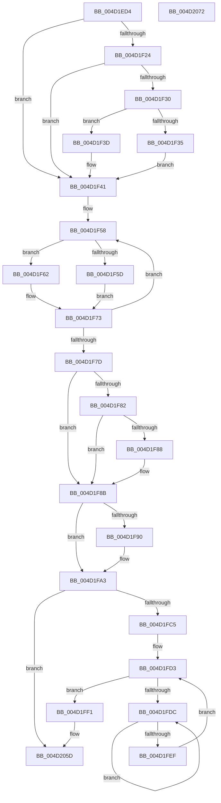

# MiDecommitLargePte

- RVA: `0x004D1ED4`–`0x004D2073` (길이 `415` bytes)
- VA: `0x00000001404D1ED4`
- 실행 섹션: `.text`
- PDB 이름 있음: `예`; PDB Function 태그: `아니요`
- unwind 정보 RVA: `0x0008CF18`
- 디코드: `122`개 명령, `415/415` bytes 표시
- 미해석 바이트: `0` (있으면 어셈블리에 `.byte`로 보존)

> 이 문서는 커널 이미지의 기계어와 PDB 기호를 분석해 생성했습니다. 4번과 5번은 함수 원형과 자료형을 바이너리 사용 방식에서 추정한 C 해석이며 원본 소스 복구 결과는 아닙니다.

## 1. Dependencies

- 직접 호출 지점: **3**; 고유 호출 대상: **3**
- 직접 호출자로 확인된 함수: **4**
- RIP 상대 이미지 참조: **1**

### Outgoing calls
- `0x004D1F6E` → [MiRewritePteWithLockBit](../32/MiRewritePteWithLockBit_function_00322FEC.md) (function, `0x00322FEC`)
- `0x004D1F9E` → [MiDecommitAddTbFlushEntries](../4F/MiDecommitAddTbFlushEntries_function_004FB798.md) (function, `0x004FB798`)
- `0x004D1FE1` → [KeYieldProcessorEx](../3F/KeYieldProcessorEx_function_003FBD00.md) (function, `0x003FBD00`)

### Direct callers
- [sub_00241B6F](../24/Unknown_function_00241B6F.md) at `0x00241B88`
- [sub_00241E90](../24/Unknown_function_00241E90.md) at `0x0024221B`
- [MiDeleteVa](../27/MiDeleteVa_function_002789E0.md) at `0x0027904E`
- [sub_006D7C08](../6D/Unknown_function_006D7C08.md) at `0x006D7C08`

### Static image references
- `0x004D1F24` → RVA `0x00E2DC80` (`.data`; read)

## 2. Other-region calls and transfers

- 다른 실행 섹션으로 향하는 call: **0**
- 별도 외부 분기/꼬리 이동을 확인하지 못했습니다.

## 3. Assembly (complete function range)

```asm
004D1ED4  48 89 5C 24 20                  mov qword ptr [rsp + 0x20], rbx
004D1ED9  55                              push rbp
004D1EDA  56                              push rsi
004D1EDB  57                              push rdi
004D1EDC  41 54                           push r12
004D1EDE  41 55                           push r13
004D1EE0  41 56                           push r14
004D1EE2  41 57                           push r15
004D1EE4  48 83 EC 20                     sub rsp, 0x20
004D1EE8  48 8B F1                        mov rsi, rcx
004D1EEB  48 8B 49 58                     mov rcx, qword ptr [rcx + 0x58]
004D1EEF  48 89 4C 24 68                  mov qword ptr [rsp + 0x68], rcx
004D1EF4  48 8B 46 18                     mov rax, qword ptr [rsi + 0x18]
004D1EF8  44 8B 7E 60                     mov r15d, dword ptr [rsi + 0x60]
004D1EFC  48 8B 19                        mov rbx, qword ptr [rcx]
004D1EFF  48 8B BE B0 00 00 00            mov rdi, qword ptr [rsi + 0xb0]
004D1F06  4C 8B E3                        mov r12, rbx
004D1F09  48 89 44 24 70                  mov qword ptr [rsp + 0x70], rax
004D1F0E  41 8B C7                        mov eax, r15d
004D1F11  F7 D8                           neg eax
004D1F13  48 1B ED                        sbb rbp, rbp
004D1F16  48 83 E5 F1                     and rbp, 0xfffffffffffffff1
004D1F1A  48 83 C5 10                     add rbp, 0x10
004D1F1E  41 83 E4 01                     and r12d, 1
004D1F22  75 1D                           jne 0x1404d1f41
004D1F24  48 8B 05 55 BD 95 00            mov rax, qword ptr [rip + 0x95bd55]
004D1F2B  48 85 C0                        test rax, rax
004D1F2E  74 11                           je 0x1404d1f41
004D1F30  F6 C3 10                        test bl, 0x10
004D1F33  75 08                           jne 0x1404d1f3d
004D1F35  48 F7 D0                        not rax
004D1F38  48 23 D8                        and rbx, rax
004D1F3B  EB 04                           jmp 0x1404d1f41
004D1F3D  48 83 E3 EF                     and rbx, 0xffffffffffffffef
004D1F41  48 C1 EB 0C                     shr rbx, 0xc
004D1F45  48 B8 FF FF FF FF FF 00 00 00   movabs rax, 0xffffffffff
004D1F4F  48 23 D8                        and rbx, rax
004D1F52  4C 8B F1                        mov r14, rcx
004D1F55  4C 8B ED                        mov r13, rbp
004D1F58  45 85 FF                        test r15d, r15d
004D1F5B  75 05                           jne 0x1404d1f62
004D1F5D  49 89 3E                        mov qword ptr [r14], rdi
004D1F60  EB 11                           jmp 0x1404d1f73
004D1F62  48 8B 4E 20                     mov rcx, qword ptr [rsi + 0x20]
004D1F66  4C 8B CF                        mov r9, rdi
004D1F69  4D 8B C6                        mov r8, r14
004D1F6C  33 D2                           xor edx, edx
004D1F6E  E8 79 10 E5 FF                  call 0x140322fec
004D1F73  49 83 C6 08                     add r14, 8
004D1F77  49 83 ED 01                     sub r13, 1
004D1F7B  75 DB                           jne 0x1404d1f58
004D1F7D  48 85 FF                        test rdi, rdi
004D1F80  75 09                           jne 0x1404d1f8b
004D1F82  41 83 FF 03                     cmp r15d, 3
004D1F86  74 03                           je 0x1404d1f8b
004D1F88  01 6E 70                        add dword ptr [rsi + 0x70], ebp
004D1F8B  4D 85 E4                        test r12, r12
004D1F8E  74 13                           je 0x1404d1fa3
004D1F90  48 8B 54 24 68                  mov rdx, qword ptr [rsp + 0x68]
004D1F95  4C 8B CD                        mov r9, rbp
004D1F98  45 8B C7                        mov r8d, r15d
004D1F9B  48 8B CE                        mov rcx, rsi
004D1F9E  E8 F5 97 02 00                  call 0x1404fb798
004D1FA3  48 8D 1C 5B                     lea rbx, [rbx + rbx*2]
004D1FA7  48 C1 E3 04                     shl rbx, 4
004D1FAB  48 B8 00 00 00 00 00 DE FF FF   movabs rax, 0xffffde0000000000
004D1FB5  48 03 D8                        add rbx, rax
004D1FB8  48 8B 43 28                     mov rax, qword ptr [rbx + 0x28]
004D1FBC  48 85 C0                        test rax, rax
004D1FBF  0F 88 98 00 00 00               js 0x1404d205d
004D1FC5  48 8B 74 24 70                  mov rsi, qword ptr [rsp + 0x70]
004D1FCA  83 64 24 60 00                  and dword ptr [rsp + 0x60], 0
004D1FCF  48 8B 7E 30                     mov rdi, qword ptr [rsi + 0x30]
004D1FD3  F0 48 0F BA 6B 18 3F            lock bts qword ptr [rbx + 0x18], 0x3f
004D1FDA  73 15                           jae 0x1404d1ff1
004D1FDC  48 8D 4C 24 60                  lea rcx, [rsp + 0x60]
004D1FE1  E8 1A 9D F2 FF                  call 0x1403fbd00
004D1FE6  48 8B 43 18                     mov rax, qword ptr [rbx + 0x18]
004D1FEA  48 85 C0                        test rax, rax
004D1FED  78 ED                           js 0x1404d1fdc
004D1FEF  EB E2                           jmp 0x1404d1fd3
004D1FF1  8B 43 20                        mov eax, dword ptr [rbx + 0x20]
004D1FF4  8A 53 22                        mov dl, byte ptr [rbx + 0x22]
004D1FF7  89 44 24 60                     mov dword ptr [rsp + 0x60], eax
004D1FFB  C1 E8 10                        shr eax, 0x10
004D1FFE  24 FD                           and al, 0xfd
004D2000  48 C1 EF 03                     shr rdi, 3
004D2004  0C 05                           or al, 5
004D2006  48 8B CF                        mov rcx, rdi
004D2009  88 44 24 62                     mov byte ptr [rsp + 0x62], al
004D200D  8B 44 24 60                     mov eax, dword ptr [rsp + 0x60]
004D2011  89 43 20                        mov dword ptr [rbx + 0x20], eax
004D2014  48 8B 03                        mov rax, qword ptr [rbx]
004D2017  48 33 C8                        xor rcx, rax
004D201A  48 B8 01 00 00 00 00 F0 FF FF   movabs rax, 0xfffff00000000001
004D2024  48 23 C8                        and rcx, rax
004D2027  48 33 CF                        xor rcx, rdi
004D202A  48 89 0B                        mov qword ptr [rbx], rcx
004D202D  48 89 5E 30                     mov qword ptr [rsi + 0x30], rbx
004D2031  8B 4B 20                        mov ecx, dword ptr [rbx + 0x20]
004D2034  89 4C 24 60                     mov dword ptr [rsp + 0x60], ecx
004D2038  C1 E9 10                        shr ecx, 0x10
004D203B  8A C1                           mov al, cl
004D203D  32 C2                           xor al, dl
004D203F  24 07                           and al, 7
004D2041  32 C1                           xor al, cl
004D2043  88 44 24 62                     mov byte ptr [rsp + 0x62], al
004D2047  8B 44 24 60                     mov eax, dword ptr [rsp + 0x60]
004D204B  89 43 20                        mov dword ptr [rbx + 0x20], eax
004D204E  48 B8 FF FF FF FF FF FF FF 7F   movabs rax, 0x7fffffffffffffff
004D2058  F0 48 21 43 18                  lock and qword ptr [rbx + 0x18], rax
004D205D  48 8B 5C 24 78                  mov rbx, qword ptr [rsp + 0x78]
004D2062  48 83 C4 20                     add rsp, 0x20
004D2066  41 5F                           pop r15
004D2068  41 5E                           pop r14
004D206A  41 5D                           pop r13
004D206C  41 5C                           pop r12
004D206E  5F                              pop rdi
004D206F  5E                              pop rsi
004D2070  5D                              pop rbp
004D2071  C3                              ret
004D2072  CC                              int3
```

## 4. C-style interpretation (structured pseudocode)

```c
__int64 __fastcall MiDecommitLargePte(__int64 a1, int a2)
{
    __int64 result;
    __int64 v_r12;
    __int64 v_r13;
    __int64 v_r14;
    __int64 v_rbp;
    __int64 v_rbx;
    __int64 v_rdi;
    __int64 v_rsp;
    unsigned __int64 v_stack_p10;
    unsigned __int64 v_stack_p18;
    unsigned __int64 v_stack_p20;
    unsigned int v_stack_p8;
    unsigned __int8 v_stack_pA;

    v_stack_p20 = v_rbx;
    v_rsp = (v_rsp) - (32);
    v_stack_p10 = *(unsigned __int64 *)(a1 + 88);
    v_stack_p18 = *(unsigned __int64 *)(a1 + 24);
    result = (unsigned int)(-((unsigned int)((unsigned int)((unsigned int)(*(unsigned int *)(a1 + 96))))));
    v_rbp = (v_rbp) & (-15);
    v_rbp = (v_rbp) + (16);
    v_r12 = (unsigned int)((*(unsigned __int64 *)(*(unsigned __int64 *)(a1 + 88))) & (1));
    if (condition_is_not_equal) goto loc_004D1F41;
    if (*(unsigned __int64 *)(v_rip + 9813333) == 0) goto loc_004D1F41;
    if ((((unsigned __int8)(*(unsigned __int64 *)(*(unsigned __int64 *)(a1 + 88)))) & (16)) != 0) goto loc_004D1F3D;
    result = ~(*(unsigned __int64 *)(v_rip + 9813333));
    v_rbx = (*(unsigned __int64 *)(*(unsigned __int64 *)(a1 + 88))) & (result);
    goto loc_004D1F41;
loc_004D1F3D:
    v_rbx = (v_rbx) & (-17);
loc_004D1F41:
    v_rbx = (v_rbx) >> (12);
    v_rbx = (v_rbx) & (result);
loc_004D1F58:
    if ((unsigned int)((unsigned int)(*(unsigned int *)(a1 + 96))) != 0) goto loc_004D1F62;
    *(unsigned __int64 *)(*(unsigned __int64 *)(a1 + 88)) = *(unsigned __int64 *)(a1 + 176);
    goto loc_004D1F73;
loc_004D1F62:
    a2 = 0;
    result = MiRewritePteWithLockBit(*(unsigned __int64 *)(a1 + 32), a2, *(unsigned __int64 *)(a1 + 88), *(unsigned __int64 *)(a1 + 176));
loc_004D1F73:
    v_r14 = (*(unsigned __int64 *)(a1 + 88)) + (8);
    v_r13 = (v_rbp) - (1);
    if (condition_is_not_equal) goto loc_004D1F58;
    if (*(unsigned __int64 *)(a1 + 176) != 0) goto loc_004D1F8B;
    if (((unsigned int)((unsigned int)(*(unsigned int *)(a1 + 96)))) != 3) {
    }
    if (v_r12 != 0) {
        a2 = v_stack_p10;
        a4 = v_rbp;
        a3 = (unsigned int)((unsigned int)(*(unsigned int *)(a1 + 96)));
        a1 = a1;
        result = MiDecommitAddTbFlushEntries(a1, a2, a3, a4);
    }
    v_rbx = (v_rbx + v_rbx * 2) << (4);
    v_rbx = (v_rbx) + (result);
    if (sign_flag) goto loc_004D205D;
loc_004D1FD3:
    if (condition_is_above_or_equal) goto loc_004D1FF1;
loc_004D1FDC:
    result = KeYieldProcessorEx(v_stack_p8, a2, a3, a4);
    if (sign_flag) goto loc_004D1FDC;
    goto loc_004D1FD3;
loc_004D1FF1:
    v_stack_p8 = (unsigned int)((unsigned int)(*(unsigned int *)(v_rbx + 32)));
    result = (unsigned int)(((unsigned int)(*(unsigned int *)(v_rbx + 32))) >> (16));
    result = (unsigned __int8)((result) & (253));
    v_rdi = (*(unsigned __int64 *)(v_stack_p18 + 48)) >> (3);
    result = (unsigned __int8)((result) | (5));
    v_stack_pA = (unsigned __int8)(result);
    *(unsigned int *)(v_rbx + 32) = (unsigned int)((unsigned int)(v_stack_p8));
    a1 = (v_rdi) ^ (*(unsigned __int64 *)(v_rbx));
    a1 = (a1) & (*(unsigned __int64 *)(v_rbx));
    a1 = (a1) ^ (v_rdi);
    *(unsigned __int64 *)(v_rbx) = a1;
    *(unsigned __int64 *)(v_stack_p18 + 48) = v_rbx;
    v_stack_p8 = (unsigned int)((unsigned int)(*(unsigned int *)(v_rbx + 32)));
    a1 = (unsigned int)(((unsigned int)(*(unsigned int *)(v_rbx + 32))) >> (16));
    result = (unsigned __int8)(((unsigned __int8)(a1)) ^ ((unsigned __int8)(*(unsigned __int8 *)(v_rbx + 34))));
    result = (unsigned __int8)((result) & (7));
    result = (unsigned __int8)((result) ^ ((unsigned __int8)(a1)));
    v_stack_pA = (unsigned __int8)(result);
    *(unsigned int *)(v_rbx + 32) = (unsigned int)((unsigned int)(v_stack_p8));
loc_004D205D:
    v_rsp = (v_rsp) + (32);
    return (unsigned int)(v_stack_p8);
}
```

## 5. (Beta) C Style

```c
int64_t MiDecommitLargePte(void *Arg1, int32_t Arg2)
{
    uint8_t *arg1 = (uint8_t *)Arg1;

    int64_t result;
    int64_t local_r12;
    int64_t local_r13;
    int64_t local_r14;
    int64_t local_rbp;
    int64_t local_rbx;
    int64_t local_rdi;
    int64_t local_rsp;
    uint64_t v_stack_p10;
    uint64_t v_stack_p18;
    uint64_t v_stack_p20;
    uint32_t v_stack_p8;
    uint8_t v_stack_pA;

    v_stack_p20 = local_rbx;
    local_rsp = (local_rsp) - (32);
    v_stack_p10 = *(uint64_t *)(arg1 + 0x58);
    v_stack_p18 = *(uint64_t *)(arg1 + 0x18);
    result = (uint32_t)(-((uint32_t)((uint32_t)((uint32_t)(*(uint32_t *)(arg1 + 0x60))))));
    local_rbp = (local_rbp) & (-15);
    local_rbp = (local_rbp) + (16);
    local_r12 = (uint32_t)((*(uint64_t *)(*(uint64_t *)(arg1 + 0x58))) & (1));
    if (condition_is_not_equal) goto loc_004D1F41;
    if (*(uint64_t *)(v_rip + 0x95BD55) == 0) goto loc_004D1F41;
    if ((((uint8_t)(*(uint64_t *)(*(uint64_t *)(arg1 + 0x58)))) & (16)) != 0) goto loc_004D1F3D;
    result = ~(*(uint64_t *)(v_rip + 0x95BD55));
    local_rbx = (*(uint64_t *)(*(uint64_t *)(arg1 + 0x58))) & (result);
    goto loc_004D1F41;
loc_004D1F3D:
    local_rbx = (local_rbx) & (-17);
loc_004D1F41:
    local_rbx = (local_rbx) >> (12);
    local_rbx = (local_rbx) & (result);
loc_004D1F58:
    if ((uint32_t)((uint32_t)(*(uint32_t *)(arg1 + 0x60))) != 0) goto loc_004D1F62;
    *(uint64_t *)(*(uint64_t *)(arg1 + 0x58)) = *(uint64_t *)(arg1 + 0xB0);
    goto loc_004D1F73;
loc_004D1F62:
    Arg2 = 0;
    result = MiRewritePteWithLockBit(*(uint64_t *)(arg1 + 0x20), Arg2, *(uint64_t *)(arg1 + 0x58), *(uint64_t *)(arg1 + 0xB0));
loc_004D1F73:
    local_r14 = (*(uint64_t *)(arg1 + 0x58)) + (8);
    local_r13 = (local_rbp) - (1);
    if (condition_is_not_equal) goto loc_004D1F58;
    if (*(uint64_t *)(arg1 + 0xB0) != 0) goto loc_004D1F8B;
    if (((uint32_t)((uint32_t)(*(uint32_t *)(arg1 + 0x60)))) != 3) {
    }
    if (local_r12 != 0) {
        Arg2 = v_stack_p10;
        a4 = local_rbp;
        a3 = (uint32_t)((uint32_t)(*(uint32_t *)(arg1 + 0x60)));
        Arg1 = Arg1;
        result = MiDecommitAddTbFlushEntries(Arg1, Arg2, a3, a4);
    }
    local_rbx = (local_rbx + local_rbx * 2) << (4);
    local_rbx = (local_rbx) + (result);
    if (sign_flag) goto loc_004D205D;
loc_004D1FD3:
    if (condition_is_above_or_equal) goto loc_004D1FF1;
loc_004D1FDC:
    result = KeYieldProcessorEx(v_stack_p8, Arg2, a3, a4);
    if (sign_flag) goto loc_004D1FDC;
    goto loc_004D1FD3;
loc_004D1FF1:
    v_stack_p8 = (uint32_t)((uint32_t)(*(uint32_t *)(local_rbx + 0x20)));
    result = (uint32_t)(((uint32_t)(*(uint32_t *)(local_rbx + 0x20))) >> (16));
    result = (uint8_t)((result) & (253));
    local_rdi = (*(uint64_t *)(v_stack_p18 + 0x30)) >> (3);
    result = (uint8_t)((result) | (5));
    v_stack_pA = (uint8_t)(result);
    *(uint32_t *)(local_rbx + 0x20) = (uint32_t)((uint32_t)(v_stack_p8));
    Arg1 = (local_rdi) ^ (*(uint64_t *)(local_rbx));
    Arg1 = (Arg1) & (*(uint64_t *)(local_rbx));
    Arg1 = (Arg1) ^ (local_rdi);
    *(void **)(local_rbx) = Arg1;
    *(uint64_t *)(v_stack_p18 + 0x30) = local_rbx;
    v_stack_p8 = (uint32_t)((uint32_t)(*(uint32_t *)(local_rbx + 0x20)));
    Arg1 = (uint32_t)(((uint32_t)(*(uint32_t *)(local_rbx + 0x20))) >> (16));
    result = (uint8_t)(((uint8_t)(Arg1)) ^ ((uint8_t)(*(uint8_t *)(local_rbx + 0x22))));
    result = (uint8_t)((result) & (7));
    result = (uint8_t)((result) ^ ((uint8_t)(Arg1)));
    v_stack_pA = (uint8_t)(result);
    *(uint32_t *)(local_rbx + 0x20) = (uint32_t)((uint32_t)(v_stack_p8));
loc_004D205D:
    local_rsp = (local_rsp) + (32);
    return (uint32_t)(v_stack_p8);
}
```

### 관측된 메모리 오프셋

구조체 형식이 확인되지 않은 접근은 인자 기준의 오프셋으로만 기록했습니다.

| 기준 인자 | 오프셋 표현 | 폭 (bit) | 접근 |
|---|---:|---:|---|
| `Arg1` | `+ 0x18` | `64` | `R` |
| `Arg1` | `+ 0x20` | `64` | `R` |
| `Arg1` | `+ 0x58` | `64` | `R` |
| `Arg1` | `+ 0x60` | `32` | `R` |
| `Arg1` | `+ 0x70` | `32` | `R/W` |
| `Arg1` | `+ 0xB0` | `64` | `R` |

## 6. Execution-region graph

[열기: 2D/3D 그래프와 함수 탐색 컨트롤 패널](../../../control-panel.html?section=text&rva=0x004D1ED4&view=graph)

- 2D 그래프는 위에서 아래로 흐르고, 3D 그래프는 빈 공간을 드래그해 회전합니다. Shift+드래그는 이동, 휠은 확대·축소, 함수 노드 선택은 대상 보고서 이동입니다.

### Static fallback


