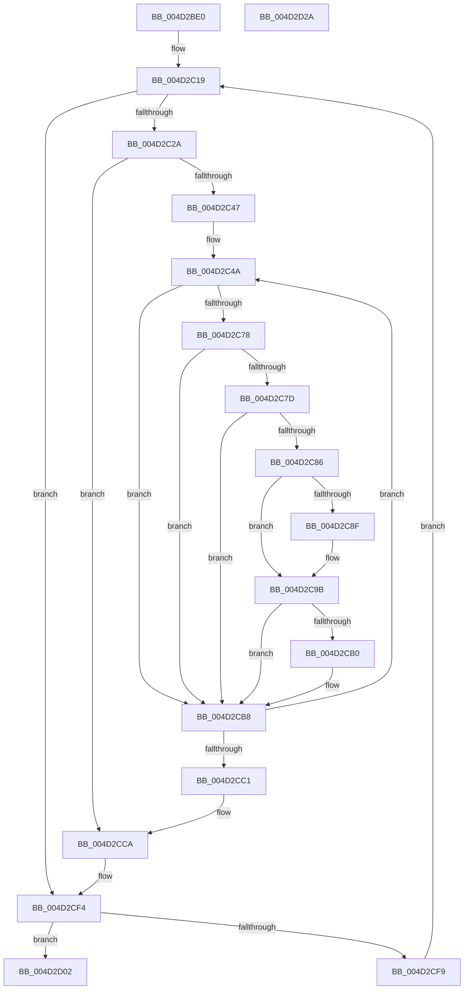

# MiDecrementLargeSubsections

- RVA: `0x004D2BE0`–`0x004D2D2B` (길이 `331` bytes)
- VA: `0x00000001404D2BE0`
- 실행 섹션: `.text`
- PDB 이름 있음: `예`; PDB Function 태그: `아니요`
- unwind 정보 RVA: `0x000BD610`
- 디코드: `95`개 명령, `331/331` bytes 표시
- 미해석 바이트: `0` (있으면 어셈블리에 `.byte`로 보존)

> 이 문서는 커널 이미지의 기계어와 PDB 기호를 분석해 생성했습니다. 4번과 5번은 함수 원형과 자료형을 바이너리 사용 방식에서 추정한 C 해석이며 원본 소스 복구 결과는 아닙니다.

## 1. Dependencies

- 직접 호출 지점: **12**; 고유 호출 대상: **10**
- 직접 호출자로 확인된 함수: **8**
- RIP 상대 이미지 참조: **1**

### Outgoing calls
- `0x004D2C10` → [ExAcquireSpinLockExclusive](../24/ExAcquireSpinLockExclusive_function_00248690.md) (function, `0x00248690`)
- `0x004D2C2F` → [MiReleaseSpinLockExclusive](../24/MiReleaseSpinLockExclusive_function_002482C0.md) (function, `0x002482C0`)
- `0x004D2C4F` → [MiLockLeafPage](../36/MiLockLeafPage_function_003658C0.md) (function, `0x003658C0`)
- `0x004D2C5C` → [MiDecrementShareCountEx](../33/MiDecrementShareCountEx_function_00333F70.md) (function, `0x00333F70`)
- `0x004D2C7D` → [KeShouldYieldProcessor](../27/KeShouldYieldProcessor_function_002773E0.md) (function, `0x002773E0`)
- `0x004D2C96` → [KiLowerIrqlProcessIrqlFlags](../4F/KiLowerIrqlProcessIrqlFlags_function_004F5698.md) (function, `0x004F5698`)
- `0x004D2CB3` → [KiRaiseIrqlProcessIrqlFlags](../4F/KiRaiseIrqlProcessIrqlFlags_function_004F56FC.md) (function, `0x004F56FC`)
- `0x004D2CCF` → [MiChargeLargeProtoSubsection](../../page/80/MiChargeLargeProtoSubsection_function_00800A24.md) (function, `0x00800A24`)
- `0x004D2CD7` → [ExAcquireSpinLockExclusive](../24/ExAcquireSpinLockExclusive_function_00248690.md) (function, `0x00248690`)
- `0x004D2CE7` → [MiBuildWakeList](../44/MiBuildWakeList_function_0044BE90.md) (function, `0x0044BE90`)
- `0x004D2CEF` → [MiReleaseControlAreaWaiters](../28/MiReleaseControlAreaWaiters_function_002865F0.md) (function, `0x002865F0`)
- `0x004D2D08` → [MiReleaseSpinLockExclusive](../24/MiReleaseSpinLockExclusive_function_002482C0.md) (function, `0x002482C0`)

### Direct callers
- [MiRemoveMappedPtes](../29/MiRemoveMappedPtes_function_00296A50.md) at `0x00296C32`
- [MiIncrementLargeSubsections](MiIncrementLargeSubsections_function_004D3410.md) at `0x004D3562`
- [MiDereferenceDataSubsections](../69/MiDereferenceDataSubsections_function_00692530.md) at `0x00692592`
- [sub_006E720A](../6E/Unknown_function_006E720A.md) at `0x006E728C`
- [MiCloneLargeFileOnlyVad](../../page/80/MiCloneLargeFileOnlyVad_function_00800A64.md) at `0x00800AED`
- [MiDeletePartialCloneVads](../../page/81/MiDeletePartialCloneVads_function_008116E4.md) at `0x008117DE`
- [sub_0088535F](../../page/88/Unknown_function_0088535F.md) at `0x008854B2`
- [MiDeleteVad](../../page/88/MiDeleteVad_function_00888C80.md) at `0x00889212`

### Static image references
- `0x004D2C86` → RVA `0x00FC6D20` (`ALMOSTRO`; read)

## 2. Other-region calls and transfers

- 다른 실행 섹션으로 향하는 call: **1**
  - `0x004D2CCF` → [MiChargeLargeProtoSubsection](../../page/80/MiChargeLargeProtoSubsection_function_00800A24.md) (`.text` → `PAGE`)
- 별도 외부 분기/꼬리 이동을 확인하지 못했습니다.

## 3. Assembly (complete function range)

```asm
004D2BE0  48 8B C4                        mov rax, rsp
004D2BE3  48 89 58 08                     mov qword ptr [rax + 8], rbx
004D2BE7  48 89 68 18                     mov qword ptr [rax + 0x18], rbp
004D2BEB  48 89 70 20                     mov qword ptr [rax + 0x20], rsi
004D2BEF  48 89 50 10                     mov qword ptr [rax + 0x10], rdx
004D2BF3  57                              push rdi
004D2BF4  41 54                           push r12
004D2BF6  41 55                           push r13
004D2BF8  41 56                           push r14
004D2BFA  41 57                           push r15
004D2BFC  48 83 EC 20                     sub rsp, 0x20
004D2C00  4C 8B 29                        mov r13, qword ptr [rcx]
004D2C03  48 8B F9                        mov rdi, rcx
004D2C06  48 8B DA                        mov rbx, rdx
004D2C09  49 8D 75 48                     lea rsi, [r13 + 0x48]
004D2C0D  48 8B CE                        mov rcx, rsi
004D2C10  E8 7B 5A D7 FF                  call 0x140248690
004D2C15  44 0F B6 F8                     movzx r15d, al
004D2C19  8B 4F 6C                        mov ecx, dword ptr [rdi + 0x6c]
004D2C1C  FF C9                           dec ecx
004D2C1E  89 4F 6C                        mov dword ptr [rdi + 0x6c], ecx
004D2C21  83 F9 01                        cmp ecx, 1
004D2C24  0F 85 CA 00 00 00               jne 0x1404d2cf4
004D2C2A  B2 11                           mov dl, 0x11
004D2C2C  48 8B CE                        mov rcx, rsi
004D2C2F  E8 8C 56 D7 FF                  call 0x1402482c0
004D2C34  44 8B 77 2C                     mov r14d, dword ptr [rdi + 0x2c]
004D2C38  33 ED                           xor ebp, ebp
004D2C3A  4C 8B 67 08                     mov r12, qword ptr [rdi + 8]
004D2C3E  45 85 F6                        test r14d, r14d
004D2C41  0F 84 83 00 00 00               je 0x1404d2cca
004D2C47  8D 75 02                        lea esi, [rbp + 2]
004D2C4A  33 D2                           xor edx, edx
004D2C4C  49 8B CC                        mov rcx, r12
004D2C4F  E8 6C 2C E9 FF                  call 0x1403658c0
004D2C54  33 D2                           xor edx, edx
004D2C56  48 8B C8                        mov rcx, rax
004D2C59  48 8B D8                        mov rbx, rax
004D2C5C  E8 0F 13 E6 FF                  call 0x140333f70
004D2C61  48 B8 FF FF FF FF FF FF FF 7F   movabs rax, 0x7fffffffffffffff
004D2C6B  F0 48 21 43 18                  lock and qword ptr [rbx + 0x18], rax
004D2C70  FF C5                           inc ebp
004D2C72  40 F6 C5 0F                     test bpl, 0xf
004D2C76  75 40                           jne 0x1404d2cb8
004D2C78  41 3B EE                        cmp ebp, r14d
004D2C7B  74 3B                           je 0x1404d2cb8
004D2C7D  E8 5E 47 DA FF                  call 0x1402773e0
004D2C82  85 C0                           test eax, eax
004D2C84  74 32                           je 0x1404d2cb8
004D2C86  83 3D 93 40 AF 00 00            cmp dword ptr [rip + 0xaf4093], 0
004D2C8D  74 0C                           je 0x1404d2c9b
004D2C8F  44 0F 20 C1                     mov rcx, cr8
004D2C93  41 8A D7                        mov dl, r15b
004D2C96  E8 FD 29 02 00                  call 0x1404f5698
004D2C9B  45 0F 22 C7                     mov cr8, r15
004D2C9F  44 0F 20 C1                     mov rcx, cr8
004D2CA3  44 0F 22 C6                     mov cr8, rsi
004D2CA7  83 3D 72 40 AF 00 00            cmp dword ptr [rip + 0xaf4072], 0
004D2CAE  74 08                           je 0x1404d2cb8
004D2CB0  40 8A D6                        mov dl, sil
004D2CB3  E8 44 2A 02 00                  call 0x1404f56fc
004D2CB8  49 83 C4 08                     add r12, 8
004D2CBC  41 3B EE                        cmp ebp, r14d
004D2CBF  72 89                           jb 0x1404d2c4a
004D2CC1  48 8B 5C 24 58                  mov rbx, qword ptr [rsp + 0x58]
004D2CC6  49 8D 75 48                     lea rsi, [r13 + 0x48]
004D2CCA  33 D2                           xor edx, edx
004D2CCC  48 8B CF                        mov rcx, rdi
004D2CCF  E8 50 DD 32 00                  call 0x140800a24
004D2CD4  48 8B CE                        mov rcx, rsi
004D2CD7  E8 B4 59 D7 FF                  call 0x140248690
004D2CDC  FF 4F 6C                        dec dword ptr [rdi + 0x6c]
004D2CDF  BA 00 02 00 00                  mov edx, 0x200
004D2CE4  49 8B CD                        mov rcx, r13
004D2CE7  E8 A4 91 F7 FF                  call 0x14044be90
004D2CEC  48 8B C8                        mov rcx, rax
004D2CEF  E8 FC 38 DB FF                  call 0x1402865f0
004D2CF4  48 3B FB                        cmp rdi, rbx
004D2CF7  74 09                           je 0x1404d2d02
004D2CF9  48 8B 7F 10                     mov rdi, qword ptr [rdi + 0x10]
004D2CFD  E9 17 FF FF FF                  jmp 0x1404d2c19
004D2D02  41 8A D7                        mov dl, r15b
004D2D05  48 8B CE                        mov rcx, rsi
004D2D08  E8 B3 55 D7 FF                  call 0x1402482c0
004D2D0D  48 8B 5C 24 50                  mov rbx, qword ptr [rsp + 0x50]
004D2D12  48 8B 6C 24 60                  mov rbp, qword ptr [rsp + 0x60]
004D2D17  48 8B 74 24 68                  mov rsi, qword ptr [rsp + 0x68]
004D2D1C  48 83 C4 20                     add rsp, 0x20
004D2D20  41 5F                           pop r15
004D2D22  41 5E                           pop r14
004D2D24  41 5D                           pop r13
004D2D26  41 5C                           pop r12
004D2D28  5F                              pop rdi
004D2D29  C3                              ret
004D2D2A  CC                              int3
```

## 4. C-style interpretation (structured pseudocode)

```c
__int64 __fastcall MiDecrementLargeSubsections(__int64 a1, __int64 a2)
{
    __int64 result;
    __int64 v_r12;
    __int64 v_rbp;
    __int64 v_rsp;
    unsigned __int64 v_stack_p10;
    unsigned __int64 v_stack_p18;
    unsigned __int64 v_stack_p20;
    unsigned __int64 v_stack_p8;

    *(unsigned __int64 *)(v_rsp + 8) = v_rbx;
    *(unsigned __int64 *)(v_rsp + 24) = v_rbp;
    *(unsigned __int64 *)(v_rsp + 32) = v_rsi;
    *(unsigned __int64 *)(v_rsp + 16) = a2;
    v_rsp = (v_rsp) - (32);
    result = ExAcquireSpinLockExclusive(*(unsigned __int64 *)(a1) + 72, a2, a3, a4);
loc_004D2C19:
    a1 = (unsigned int)(((unsigned int)(*(unsigned int *)(a1 + 108))) - 1);
    *(unsigned int *)(a1 + 108) = (unsigned int)(a1);
    if (((unsigned int)(a1)) != 1) goto loc_004D2CF4;
    result = MiReleaseSpinLockExclusive(*(unsigned __int64 *)(a1) + 72, 17, a3, a4);
    v_rbp = 0;
    if ((unsigned int)((unsigned int)(*(unsigned int *)(a1 + 44))) == 0) goto loc_004D2CCA;
loc_004D2C4A:
    a2 = 0;
    result = MiLockLeafPage(*(unsigned __int64 *)(a1 + 8), a2, a3, a4);
    a2 = 0;
    result = MiDecrementShareCountEx(result, a2, a3, a4);
    v_rbp = (unsigned int)((v_rbp) + 1);
    if ((((unsigned __int8)(v_rbp)) & (15)) != 0) goto loc_004D2CB8;
    if (((unsigned int)(v_rbp)) == ((unsigned int)((unsigned int)(*(unsigned int *)(a1 + 44))))) goto loc_004D2CB8;
    result = KeShouldYieldProcessor(result, a2, a3, a4);
    if ((unsigned int)(result) == 0) goto loc_004D2CB8;
    if ((*(unsigned int *)(v_rip + 11485331)) != 0) {
        a1 = v_cr8;
        a2 = (unsigned __int8)((unsigned __int8)(result));
        result = KiLowerIrqlProcessIrqlFlags(a1, a2, a3, a4);
    }
    if ((*(unsigned int *)(v_rip + 11485298)) != 0) {
        a2 = (unsigned __int8)(v_rbp + 2);
        result = KiRaiseIrqlProcessIrqlFlags((unsigned __int8)(result), a2, a3, a4);
    }
    v_r12 = (*(unsigned __int64 *)(a1 + 8)) + (8);
    if (((unsigned int)(v_rbp)) < ((unsigned int)((unsigned int)(*(unsigned int *)(a1 + 44))))) goto loc_004D2C4A;
loc_004D2CCA:
    a2 = 0;
    result = MiChargeLargeProtoSubsection(a1, a2, a3, a4);
    result = ExAcquireSpinLockExclusive(*(unsigned __int64 *)(a1) + 72, a2, a3, a4);
    result = MiBuildWakeList(*(unsigned __int64 *)(a1), 512, a3, a4);
    result = MiReleaseControlAreaWaiters(result, 512, a3, a4);
loc_004D2CF4:
    if (a1 == v_stack_p10) goto loc_004D2D02;
    goto loc_004D2C19;
loc_004D2D02:
    result = MiReleaseSpinLockExclusive(*(unsigned __int64 *)(a1) + 72, (unsigned __int8)((unsigned __int8)(result)), a3, a4);
    v_rsp = (v_rsp) + (32);
    return result;
}
```

## 5. (Beta) C Style

```c
int64_t MiDecrementLargeSubsections(void *Arg1, int64_t Arg2)
{
    uint8_t *arg1 = (uint8_t *)Arg1;

    int64_t result;
    int64_t local_r12;
    int64_t local_rbp;
    int64_t local_rsp;
    uint64_t v_stack_p10;
    uint64_t v_stack_p18;
    uint64_t v_stack_p20;
    uint64_t v_stack_p8;

    *(uint64_t *)(local_rsp + 0x8) = local_rbx;
    *(uint64_t *)(local_rsp + 0x18) = local_rbp;
    *(uint64_t *)(local_rsp + 0x20) = local_rsi;
    *(uint64_t *)(local_rsp + 0x10) = Arg2;
    local_rsp = (local_rsp) - (32);
    result = ExAcquireSpinLockExclusive(*(uint64_t *)(arg1) + 72, Arg2, a3, a4);
loc_004D2C19:
    Arg1 = (uint32_t)(((uint32_t)(*(uint32_t *)(arg1 + 0x6C))) - 1);
    *(uint32_t *)(arg1 + 0x6C) = (uint32_t)(Arg1);
    if (((uint32_t)(Arg1)) != 1) goto loc_004D2CF4;
    result = MiReleaseSpinLockExclusive(*(uint64_t *)(arg1) + 72, 17, a3, a4);
    local_rbp = 0;
    if ((uint32_t)((uint32_t)(*(uint32_t *)(arg1 + 0x2C))) == 0) goto loc_004D2CCA;
loc_004D2C4A:
    Arg2 = 0;
    result = MiLockLeafPage(*(uint64_t *)(arg1 + 0x8), Arg2, a3, a4);
    Arg2 = 0;
    result = MiDecrementShareCountEx(result, Arg2, a3, a4);
    local_rbp = (uint32_t)((local_rbp) + 1);
    if ((((uint8_t)(local_rbp)) & (15)) != 0) goto loc_004D2CB8;
    if (((uint32_t)(local_rbp)) == ((uint32_t)((uint32_t)(*(uint32_t *)(arg1 + 0x2C))))) goto loc_004D2CB8;
    result = KeShouldYieldProcessor(result, Arg2, a3, a4);
    if ((uint32_t)(result) == 0) goto loc_004D2CB8;
    if ((*(uint32_t *)(v_rip + 0xAF4093)) != 0) {
        Arg1 = v_cr8;
        Arg2 = (uint8_t)((uint8_t)(result));
        result = KiLowerIrqlProcessIrqlFlags(Arg1, Arg2, a3, a4);
    }
    if ((*(uint32_t *)(v_rip + 0xAF4072)) != 0) {
        Arg2 = (uint8_t)(local_rbp + 2);
        result = KiRaiseIrqlProcessIrqlFlags((uint8_t)(result), Arg2, a3, a4);
    }
    local_r12 = (*(uint64_t *)(arg1 + 0x8)) + (8);
    if (((uint32_t)(local_rbp)) < ((uint32_t)((uint32_t)(*(uint32_t *)(arg1 + 0x2C))))) goto loc_004D2C4A;
loc_004D2CCA:
    Arg2 = 0;
    result = MiChargeLargeProtoSubsection(Arg1, Arg2, a3, a4);
    result = ExAcquireSpinLockExclusive(*(uint64_t *)(arg1) + 72, Arg2, a3, a4);
    result = MiBuildWakeList(*(uint64_t *)(arg1), 512, a3, a4);
    result = MiReleaseControlAreaWaiters(result, 512, a3, a4);
loc_004D2CF4:
    if (Arg1 == v_stack_p10) goto loc_004D2D02;
    goto loc_004D2C19;
loc_004D2D02:
    result = MiReleaseSpinLockExclusive(*(uint64_t *)(arg1) + 72, (uint8_t)((uint8_t)(result)), a3, a4);
    local_rsp = (local_rsp) + (32);
    return result;
}
```

### 관측된 메모리 오프셋

구조체 형식이 확인되지 않은 접근은 인자 기준의 오프셋으로만 기록했습니다.

| 기준 인자 | 오프셋 표현 | 폭 (bit) | 접근 |
|---|---:|---:|---|
| `Arg1` | `+ 0x0` | `64` | `R` |

## 6. Execution-region graph

[열기: 2D/3D 그래프와 함수 탐색 컨트롤 패널](../../../control-panel.html?section=text&rva=0x004D2BE0&view=graph)

- 2D 그래프는 위에서 아래로 흐르고, 3D 그래프는 빈 공간을 드래그해 회전합니다. Shift+드래그는 이동, 휠은 확대·축소, 함수 노드 선택은 대상 보고서 이동입니다.

### Static fallback


