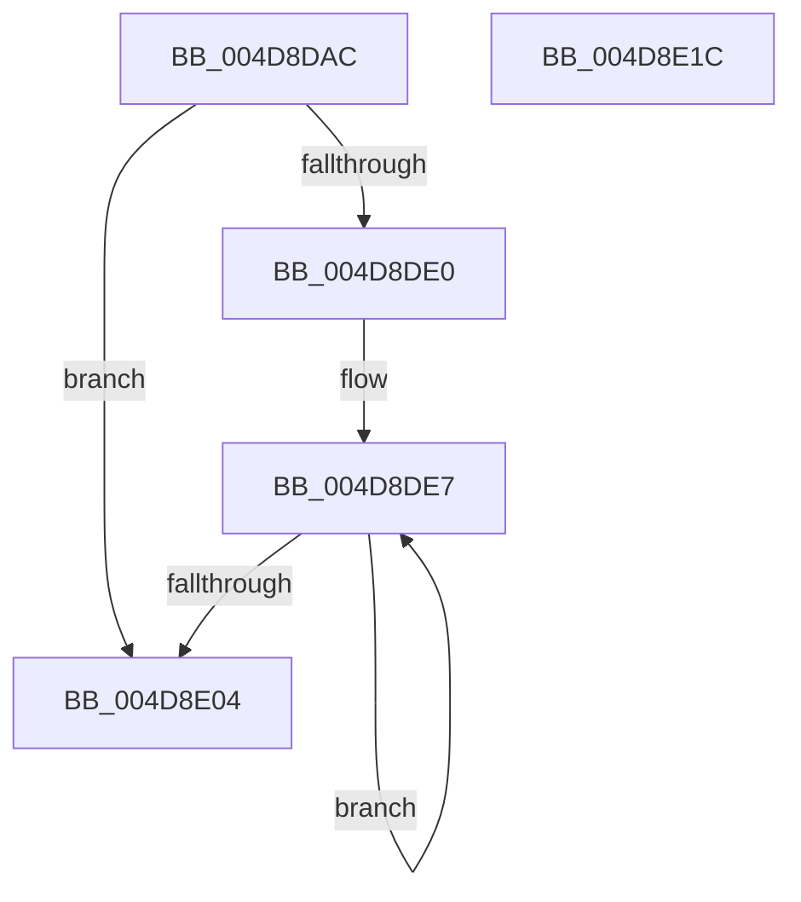

# MiDeleteDeferredCloneDescriptors

- RVA: `0x004D8DAC`–`0x004D8E1D` (길이 `113` bytes)
- VA: `0x00000001404D8DAC`
- 실행 섹션: `.text`
- PDB 이름 있음: `예`; PDB Function 태그: `아니요`
- unwind 정보 RVA: `0x0005C954`
- 디코드: `31`개 명령, `113/113` bytes 표시
- 미해석 바이트: `0` (있으면 어셈블리에 `.byte`로 보존)

> 이 문서는 커널 이미지의 기계어와 PDB 기호를 분석해 생성했습니다. 4번과 5번은 함수 원형과 자료형을 바이너리 사용 방식에서 추정한 C 해석이며 원본 소스 복구 결과는 아닙니다.

## 1. Dependencies

- 직접 호출 지점: **2**; 고유 호출 대상: **2**
- 직접 호출자로 확인된 함수: **1**
- RIP 상대 이미지 참조: **0**

### Outgoing calls
- `0x004D8DD3` → [ExpInterlockedFlushSList](../6B/ExpInterlockedFlushSList_function_006BA5F0.md) (function, `0x006BA5F0`)
- `0x004D8DF4` → [RtlAvlRemoveNode](../29/RtlAvlRemoveNode_function_00296650.md) (function, `0x00296650`)

### Direct callers
- [sub_006F79AC](../6F/Unknown_function_006F79AC.md) at `0x006F79B9`

### Static image references
- 디코드된 RIP-relative 메모리 참조가 없습니다.

## 2. Other-region calls and transfers

- 다른 실행 섹션으로 향하는 call: **0**
- 별도 외부 분기/꼬리 이동을 확인하지 못했습니다.

## 3. Assembly (complete function range)

```asm
004D8DAC  48 89 5C 24 08                  mov qword ptr [rsp + 8], rbx
004D8DB1  48 89 6C 24 10                  mov qword ptr [rsp + 0x10], rbp
004D8DB6  48 89 74 24 18                  mov qword ptr [rsp + 0x18], rsi
004D8DBB  57                              push rdi
004D8DBC  48 83 EC 20                     sub rsp, 0x20
004D8DC0  48 8B D9                        mov rbx, rcx
004D8DC3  33 F6                           xor esi, esi
004D8DC5  48 8B 89 10 04 00 00            mov rcx, qword ptr [rcx + 0x410]
004D8DCC  48 81 C1 30 04 00 00            add rcx, 0x430
004D8DD3  E8 18 18 1E 00                  call 0x1406ba5f0
004D8DD8  48 8B F8                        mov rdi, rax
004D8DDB  48 85 C0                        test rax, rax
004D8DDE  74 24                           je 0x1404d8e04
004D8DE0  48 8D AB 80 02 00 00            lea rbp, [rbx + 0x280]
004D8DE7  48 8D 5F B0                     lea rbx, [rdi - 0x50]
004D8DEB  48 8B CD                        mov rcx, rbp
004D8DEE  48 8B 3F                        mov rdi, qword ptr [rdi]
004D8DF1  48 8B D3                        mov rdx, rbx
004D8DF4  E8 57 D8 DB FF                  call 0x140296650
004D8DF9  48 89 33                        mov qword ptr [rbx], rsi
004D8DFC  48 8B F3                        mov rsi, rbx
004D8DFF  48 85 FF                        test rdi, rdi
004D8E02  75 E3                           jne 0x1404d8de7
004D8E04  48 8B 5C 24 30                  mov rbx, qword ptr [rsp + 0x30]
004D8E09  48 8B C6                        mov rax, rsi
004D8E0C  48 8B 74 24 40                  mov rsi, qword ptr [rsp + 0x40]
004D8E11  48 8B 6C 24 38                  mov rbp, qword ptr [rsp + 0x38]
004D8E16  48 83 C4 20                     add rsp, 0x20
004D8E1A  5F                              pop rdi
004D8E1B  C3                              ret
004D8E1C  CC                              int3
```

## 4. C-style interpretation (structured pseudocode)

```c
__int64 __fastcall MiDeleteDeferredCloneDescriptors(__int64 a1)
{
    __int64 result;
    __int64 v_rsi;
    __int64 v_rsp;
    unsigned __int64 v_stack_p10;
    unsigned __int64 v_stack_p18;
    unsigned __int64 v_stack_p8;

    v_stack_p8 = v_rbx;
    v_stack_p10 = v_rbp;
    v_stack_p18 = v_rsi;
    v_rsp = (v_rsp) - (32);
    v_rsi = 0;
    a1 = (*(unsigned __int64 *)(a1 + 1040)) + (0x430ULL);
    result = ExpInterlockedFlushSList(a1, a2, a3, a4);
    if (result == 0) goto loc_004D8E04;
loc_004D8DE7:
    result = RtlAvlRemoveNode(a1 + 640, result - 80, a3, a4);
    *(unsigned __int64 *)(result - 80) = 0;
    if (*(unsigned __int64 *)(result) != 0) goto loc_004D8DE7;
loc_004D8E04:
    v_rsp = (v_rsp) + (32);
    return result - 80;
}
```

## 5. (Beta) C Style

```c
int64_t MiDeleteDeferredCloneDescriptors(void *Arg1)
{
    uint8_t *arg1 = (uint8_t *)Arg1;

    int64_t result;
    int64_t local_rsi;
    int64_t local_rsp;
    uint64_t v_stack_p10;
    uint64_t v_stack_p18;
    uint64_t v_stack_p8;

    v_stack_p8 = local_rbx;
    v_stack_p10 = local_rbp;
    v_stack_p18 = local_rsi;
    local_rsp = (local_rsp) - (32);
    local_rsi = 0;
    Arg1 = (*(uint64_t *)(arg1 + 0x410)) + (0x430ULL);
    result = ExpInterlockedFlushSList(Arg1, a2, a3, a4);
    if (result == 0) goto loc_004D8E04;
loc_004D8DE7:
    result = RtlAvlRemoveNode(Arg1 + 640, result - 80, a3, a4);
    *(uint64_t *)(result - 0x50) = 0;
    if (*(uint64_t *)(result) != 0) goto loc_004D8DE7;
loc_004D8E04:
    local_rsp = (local_rsp) + (32);
    return result - 80;
}
```

### 관측된 메모리 오프셋

구조체 형식이 확인되지 않은 접근은 인자 기준의 오프셋으로만 기록했습니다.

| 기준 인자 | 오프셋 표현 | 폭 (bit) | 접근 |
|---|---:|---:|---|
| `Arg1` | `+ 0x280` | `64` | `R` |
| `Arg1` | `+ 0x410` | `64` | `R` |

## 6. Execution-region graph

[열기: 2D/3D 그래프와 함수 탐색 컨트롤 패널](../../../control-panel.html?section=text&rva=0x004D8DAC&view=graph)

- 2D 그래프는 위에서 아래로 흐르고, 3D 그래프는 빈 공간을 드래그해 회전합니다. Shift+드래그는 이동, 휠은 확대·축소, 함수 노드 선택은 대상 보고서 이동입니다.

### Static fallback


