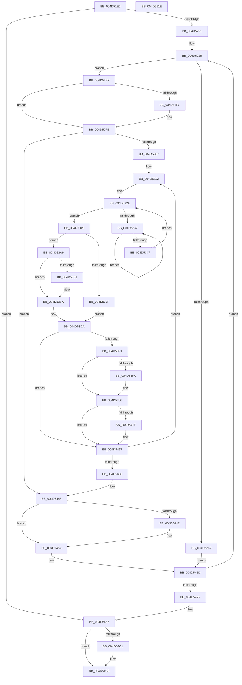

# MiDeleteSubsectionLargePages

- RVA: `0x004D51E0`–`0x004D551F` (길이 `831` bytes)
- VA: `0x00000001404D51E0`
- 실행 섹션: `.text`
- PDB 이름 있음: `예`; PDB Function 태그: `아니요`
- unwind 정보 RVA: `0x000BD64C`
- 디코드: `202`개 명령, `831/831` bytes 표시
- 미해석 바이트: `0` (있으면 어셈블리에 `.byte`로 보존)

> 이 문서는 커널 이미지의 기계어와 PDB 기호를 분석해 생성했습니다. 4번과 5번은 함수 원형과 자료형을 바이너리 사용 방식에서 추정한 C 해석이며 원본 소스 복구 결과는 아닙니다.

## 1. Dependencies

- 직접 호출 지점: **14**; 고유 호출 대상: **12**
- 직접 호출자로 확인된 함수: **1**
- RIP 상대 이미지 참조: **3**

### Outgoing calls
- `0x004D5250` → [MiGetLeafPfnBuddy](../43/MiGetLeafPfnBuddy_function_00438E30.md) (function, `0x00438E30`)
- `0x004D5269` → [MiConvertSmallPageRangeToLarge](../34/MiConvertSmallPageRangeToLarge_function_003484DC.md) (function, `0x003484DC`)
- `0x004D5299` → [MiFreeLargePages](../2A/MiFreeLargePages_function_002A99D0.md) (function, `0x002A99D0`)
- `0x004D52D4` → [MiUpdateLargePageBitMap](../37/MiUpdateLargePageBitMap_function_0037619C.md) (function, `0x0037619C`)
- `0x004D52F9` → [KiRaiseIrqlProcessIrqlFlags](../4F/KiRaiseIrqlProcessIrqlFlags_function_004F56FC.md) (function, `0x004F56FC`)
- `0x004D533A` → [KeYieldProcessorEx](../3F/KeYieldProcessorEx_function_003FBD00.md) (function, `0x003FBD00`)
- `0x004D5394` → [MiSetPfnTbFlushStamp](../2B/MiSetPfnTbFlushStamp_function_002B7A70.md) (function, `0x002B7A70`)
- `0x004D539F` → [MiInsertPageInFreeOrZeroedList](../33/MiInsertPageInFreeOrZeroedList_function_00334D20.md) (function, `0x00334D20`)
- `0x004D5401` → [KiLowerIrqlProcessIrqlFlags](../4F/KiLowerIrqlProcessIrqlFlags_function_004F5698.md) (function, `0x004F5698`)
- `0x004D5422` → [KiRaiseIrqlProcessIrqlFlags](../4F/KiRaiseIrqlProcessIrqlFlags_function_004F56FC.md) (function, `0x004F56FC`)
- `0x004D5455` → [KiLowerIrqlProcessIrqlFlags](../4F/KiLowerIrqlProcessIrqlFlags_function_004F5698.md) (function, `0x004F5698`)
- `0x004D5496` → [MmUnlockPreChargedPagedPool](../../page/AC/MmUnlockPreChargedPagedPool_function_00AC5940.md) (function, `0x00AC5940`)
- `0x004D54A2` → [MmReturnChargesToLockPagedPool](../../page/AD/MmReturnChargesToLockPagedPool_function_00AD3A00.md) (function, `0x00AD3A00`)
- `0x004D54C4` → [MiReleaseNonPagedResources](../32/MiReleaseNonPagedResources_function_0032299C.md) (function, `0x0032299C`)

### Direct callers
- [MiPurgeSubsection](../37/MiPurgeSubsection_function_003712F0.md) at `0x00371B4D`

### Static image references
- `0x004D5277` → RVA `0x00E30088` (`.data`; read)
- `0x004D52ED` → RVA `0x00FC6D20` (`ALMOSTRO`; read)
- `0x004D5384` → RVA `0x00FCF080` (`CACHEALI`; read)

## 2. Other-region calls and transfers

- 다른 실행 섹션으로 향하는 call: **2**
  - `0x004D5496` → [MmUnlockPreChargedPagedPool](../../page/AC/MmUnlockPreChargedPagedPool_function_00AC5940.md) (`.text` → `PAGE`)
  - `0x004D54A2` → [MmReturnChargesToLockPagedPool](../../page/AD/MmReturnChargesToLockPagedPool_function_00AD3A00.md) (`.text` → `PAGE`)
- 별도 외부 분기/꼬리 이동을 확인하지 못했습니다.

## 3. Assembly (complete function range)

```asm
004D51E0  48 8B C4                        mov rax, rsp
004D51E3  4C 89 40 18                     mov qword ptr [rax + 0x18], r8
004D51E7  48 89 48 08                     mov qword ptr [rax + 8], rcx
004D51EB  53                              push rbx
004D51EC  55                              push rbp
004D51ED  56                              push rsi
004D51EE  57                              push rdi
004D51EF  41 54                           push r12
004D51F1  41 55                           push r13
004D51F3  41 56                           push r14
004D51F5  41 57                           push r15
004D51F7  48 83 EC 58                     sub rsp, 0x58
004D51FB  48 83 60 98 00                  and qword ptr [rax - 0x68], 0
004D5200  33 ED                           xor ebp, ebp
004D5202  33 F6                           xor esi, esi
004D5204  48 89 6C 24 38                  mov qword ptr [rsp + 0x38], rbp
004D5209  45 33 F6                        xor r14d, r14d
004D520C  48 8B DA                        mov rbx, rdx
004D520F  4C 8B F9                        mov r15, rcx
004D5212  41 BC FF 03 00 00               mov r12d, 0x3ff
004D5218  48 85 D2                        test rdx, rdx
004D521B  0F 84 66 02 00 00               je 0x1404d5487
004D5221  4C 8B 78 18                     mov r15, qword ptr [rax + 0x18]
004D5225  44 8D 46 02                     lea r8d, [rsi + 2]
004D5229  48 B8 00 00 00 00 00 DE FF FF   movabs rax, 0xffffde0000000000
004D5233  48 8B FB                        mov rdi, rbx
004D5236  33 D2                           xor edx, edx
004D5238  48 2B F8                        sub rdi, rax
004D523B  48 8B CB                        mov rcx, rbx
004D523E  48 B8 AB AA AA AA AA AA AA AA   movabs rax, 0xaaaaaaaaaaaaaaab
004D5248  48 C1 FF 04                     sar rdi, 4
004D524C  48 0F AF F8                     imul rdi, rax
004D5250  E8 DB 3B F6 FF                  call 0x140438e30
004D5255  48 89 44 24 40                  mov qword ptr [rsp + 0x40], rax
004D525A  4C 8B E8                        mov r13, rax
004D525D  4D 85 FF                        test r15, r15
004D5260  75 50                           jne 0x1404d52b2
004D5262  41 8D 57 01                     lea edx, [r15 + 1]
004D5266  48 8B CF                        mov rcx, rdi
004D5269  E8 6E 32 E7 FF                  call 0x1403484dc
004D526E  48 8B 43 28                     mov rax, qword ptr [rbx + 0x28]
004D5272  4C 8D 4C 24 30                  lea r9, [rsp + 0x30]
004D5277  48 8B 0D 0A AE 95 00            mov rcx, qword ptr [rip + 0x95ae0a]
004D527E  4C 8D 44 24 30                  lea r8, [rsp + 0x30]
004D5283  48 C1 E8 2B                     shr rax, 0x2b
004D5287  48 8B D3                        mov rdx, rbx
004D528A  49 23 C4                        and rax, r12
004D528D  C7 44 24 20 03 00 00 00         mov dword ptr [rsp + 0x20], 3
004D5295  48 8B 0C C1                     mov rcx, qword ptr [rcx + rax*8]
004D5299  E8 32 47 DD FF                  call 0x1402a99d0
004D529E  48 03 E8                        add rbp, rax
004D52A1  48 89 6C 24 38                  mov qword ptr [rsp + 0x38], rbp
004D52A6  48 81 C6 00 02 00 00            add rsi, 0x200
004D52AD  E9 BB 01 00 00                  jmp 0x1404d546d
004D52B2  48 8B 4B 28                     mov rcx, qword ptr [rbx + 0x28]
004D52B6  45 8B C8                        mov r9d, r8d
004D52B9  48 8B 05 C8 AD 95 00            mov rax, qword ptr [rip + 0x95adc8]
004D52C0  41 B8 00 02 00 00               mov r8d, 0x200
004D52C6  48 C1 E9 2B                     shr rcx, 0x2b
004D52CA  48 8B D7                        mov rdx, rdi
004D52CD  49 23 CC                        and rcx, r12
004D52D0  48 8B 0C C8                     mov rcx, qword ptr [rax + rcx*8]
004D52D4  E8 C3 0E EA FF                  call 0x14037619c
004D52D9  4C 8D A3 00 60 00 00            lea r12, [rbx + 0x6000]
004D52E0  44 0F 20 C5                     mov rbp, cr8
004D52E4  BA 02 00 00 00                  mov edx, 2
004D52E9  44 0F 22 C2                     mov cr8, rdx
004D52ED  83 3D 2C 1A AF 00 00            cmp dword ptr [rip + 0xaf1a2c], 0
004D52F4  74 08                           je 0x1404d52fe
004D52F6  40 8A CD                        mov cl, bpl
004D52F9  E8 FE 03 02 00                  call 0x1404f56fc
004D52FE  49 3B DC                        cmp rbx, r12
004D5301  0F 83 3E 01 00 00               jae 0x1404d5445
004D5307  48 83 C3 18                     add rbx, 0x18
004D530B  41 BF 02 00 00 00               mov r15d, 2
004D5311  48 81 C6 00 02 00 00            add rsi, 0x200
004D5318  49 BD 00 00 00 00 00 00 00 40   movabs r13, 0x4000000000000000
004D5322  83 A4 24 B8 00 00 00 00         and dword ptr [rsp + 0xb8], 0
004D532A  F0 48 0F BA 2B 3F               lock bts qword ptr [rbx], 0x3f
004D5330  73 17                           jae 0x1404d5349
004D5332  48 8D 8C 24 B8 00 00 00         lea rcx, [rsp + 0xb8]
004D533A  E8 C1 69 F2 FF                  call 0x1403fbd00
004D533F  48 8B 03                        mov rax, qword ptr [rbx]
004D5342  48 85 C0                        test rax, rax
004D5345  78 EB                           js 0x1404d5332
004D5347  EB E1                           jmp 0x1404d532a
004D5349  48 8B 03                        mov rax, qword ptr [rbx]
004D534C  48 B9 00 00 00 00 00 00 00 C0   movabs rcx, 0xc000000000000000
004D5356  48 23 C1                        and rax, rcx
004D5359  48 89 03                        mov qword ptr [rbx], rax
004D535C  8B 43 08                        mov eax, dword ptr [rbx + 8]
004D535F  89 84 24 A8 00 00 00            mov dword ptr [rsp + 0xa8], eax
004D5366  B8 FE FF 00 00                  mov eax, 0xfffe
004D536B  66 01 84 24 A8 00 00 00         add word ptr [rsp + 0xa8], ax
004D5373  8B 84 24 A8 00 00 00            mov eax, dword ptr [rsp + 0xa8]
004D537A  89 43 08                        mov dword ptr [rbx + 8], eax
004D537D  75 2A                           jne 0x1404d53a9
004D537F  F0 83 0C 24 00                  lock or dword ptr [rsp], 0
004D5384  8B 15 F6 9C AF 00               mov edx, dword ptr [rip + 0xaf9cf6]
004D538A  48 8D 4B E8                     lea rcx, [rbx - 0x18]
004D538E  41 B8 01 00 00 00               mov r8d, 1
004D5394  E8 D7 26 DE FF                  call 0x1402b7a70
004D5399  41 8B D7                        mov edx, r15d
004D539C  48 8B CF                        mov rcx, rdi
004D539F  E8 7C F9 E5 FF                  call 0x140334d20
004D53A4  49 FF C6                        inc r14
004D53A7  EB 31                           jmp 0x1404d53da
004D53A9  48 8B 03                        mov rax, qword ptr [rbx]
004D53AC  49 85 C5                        test r13, rax
004D53AF  75 09                           jne 0x1404d53ba
004D53B1  48 8B 03                        mov rax, qword ptr [rbx]
004D53B4  49 0B C5                        or rax, r13
004D53B7  48 89 03                        mov qword ptr [rbx], rax
004D53BA  8B 43 08                        mov eax, dword ptr [rbx + 8]
004D53BD  89 84 24 A8 00 00 00            mov dword ptr [rsp + 0xa8], eax
004D53C4  C1 E8 10                        shr eax, 0x10
004D53C7  0C 07                           or al, 7
004D53C9  88 84 24 AA 00 00 00            mov byte ptr [rsp + 0xaa], al
004D53D0  8B 84 24 A8 00 00 00            mov eax, dword ptr [rsp + 0xa8]
004D53D7  89 43 08                        mov dword ptr [rbx + 8], eax
004D53DA  48 B8 FF FF FF FF FF FF FF 7F   movabs rax, 0x7fffffffffffffff
004D53E4  F0 48 21 03                     lock and qword ptr [rbx], rax
004D53E8  48 FF C7                        inc rdi
004D53EB  40 F6 C7 3F                     test dil, 0x3f
004D53EF  75 36                           jne 0x1404d5427
004D53F1  83 3D 28 19 AF 00 00            cmp dword ptr [rip + 0xaf1928], 0
004D53F8  74 0C                           je 0x1404d5406
004D53FA  44 0F 20 C1                     mov rcx, cr8
004D53FE  40 8A D5                        mov dl, bpl
004D5401  E8 92 02 02 00                  call 0x1404f5698
004D5406  40 0F B6 C5                     movzx eax, bpl
004D540A  44 0F 22 C0                     mov cr8, rax
004D540E  44 0F 20 C1                     mov rcx, cr8
004D5412  45 0F 22 C7                     mov cr8, r15
004D5416  83 3D 03 19 AF 00 00            cmp dword ptr [rip + 0xaf1903], 0
004D541D  74 08                           je 0x1404d5427
004D541F  41 8A D7                        mov dl, r15b
004D5422  E8 D5 02 02 00                  call 0x1404f56fc
004D5427  48 83 C3 30                     add rbx, 0x30
004D542B  48 8D 43 E8                     lea rax, [rbx - 0x18]
004D542F  49 3B C4                        cmp rax, r12
004D5432  0F 82 EA FE FF FF               jb 0x1404d5322
004D5438  4C 8B 6C 24 40                  mov r13, qword ptr [rsp + 0x40]
004D543D  4C 8B BC 24 B0 00 00 00         mov r15, qword ptr [rsp + 0xb0]
004D5445  83 3D D4 18 AF 00 00            cmp dword ptr [rip + 0xaf18d4], 0
004D544C  74 0C                           je 0x1404d545a
004D544E  44 0F 20 C1                     mov rcx, cr8
004D5452  40 8A D5                        mov dl, bpl
004D5455  E8 3E 02 02 00                  call 0x1404f5698
004D545A  40 0F B6 C5                     movzx eax, bpl
004D545E  44 0F 22 C0                     mov cr8, rax
004D5462  48 8B 6C 24 38                  mov rbp, qword ptr [rsp + 0x38]
004D5467  41 BC FF 03 00 00               mov r12d, 0x3ff
004D546D  49 8B DD                        mov rbx, r13
004D5470  41 B8 02 00 00 00               mov r8d, 2
004D5476  4D 85 ED                        test r13, r13
004D5479  0F 85 AA FD FF FF               jne 0x1404d5229
004D547F  4C 8B BC 24 A0 00 00 00         mov r15, qword ptr [rsp + 0xa0]
004D5487  41 8B 5F 2C                     mov ebx, dword ptr [r15 + 0x2c]
004D548B  49 8B 4F 08                     mov rcx, qword ptr [r15 + 8]
004D548F  48 C1 E3 03                     shl rbx, 3
004D5493  48 8B D3                        mov rdx, rbx
004D5496  E8 A5 04 5F 00                  call 0x140ac5940
004D549B  49 8B 4F 08                     mov rcx, qword ptr [r15 + 8]
004D549F  48 8B D3                        mov rdx, rbx
004D54A2  E8 59 E5 5F 00                  call 0x140ad3a00
004D54A7  49 8B 1F                        mov rbx, qword ptr [r15]
004D54AA  48 8B 05 D7 AB 95 00            mov rax, qword ptr [rip + 0x95abd7]
004D54B1  0F B7 4B 3C                     movzx ecx, word ptr [rbx + 0x3c]
004D54B5  49 23 CC                        and rcx, r12
004D54B8  48 8B 0C C8                     mov rcx, qword ptr [rax + rcx*8]
004D54BC  4D 85 F6                        test r14, r14
004D54BF  74 08                           je 0x1404d54c9
004D54C1  49 8B D6                        mov rdx, r14
004D54C4  E8 D3 D4 E4 FF                  call 0x14032299c
004D54C9  48 8B 43 78                     mov rax, qword ptr [rbx + 0x78]
004D54CD  48 8B D0                        mov rdx, rax
004D54D0  48 2B D6                        sub rdx, rsi
004D54D3  48 F7 DE                        neg rsi
004D54D6  48 8B CA                        mov rcx, rdx
004D54D9  48 33 C8                        xor rcx, rax
004D54DC  48 B8 00 00 00 00 F0 FF FF FF   movabs rax, 0xfffffff000000000
004D54E6  48 23 C8                        and rcx, rax
004D54E9  48 33 CA                        xor rcx, rdx
004D54EC  0F B7 53 3C                     movzx edx, word ptr [rbx + 0x3c]
004D54F0  48 89 4B 78                     mov qword ptr [rbx + 0x78], rcx
004D54F4  49 23 D4                        and rdx, r12
004D54F7  48 8B 0D 8A AB 95 00            mov rcx, qword ptr [rip + 0x95ab8a]
004D54FE  4C 8B 04 D1                     mov r8, qword ptr [rcx + rdx*8]
004D5502  F0 49 01 B0 B8 4C 00 00         lock add qword ptr [r8 + 0x4cb8], rsi
004D550A  48 8B C5                        mov rax, rbp
004D550D  48 83 C4 58                     add rsp, 0x58
004D5511  41 5F                           pop r15
004D5513  41 5E                           pop r14
004D5515  41 5D                           pop r13
004D5517  41 5C                           pop r12
004D5519  5F                              pop rdi
004D551A  5E                              pop rsi
004D551B  5D                              pop rbp
004D551C  5B                              pop rbx
004D551D  C3                              ret
004D551E  CC                              int3
```

## 4. C-style interpretation (structured pseudocode)

```c
__int64 __fastcall MiDeleteSubsectionLargePages(__int64 a1, __int64 a2, __int64 a3)
{
    __int64 result;
    __int64 v_r14;
    __int64 v_rbp;
    __int64 v_rbx;
    __int64 v_rdi;
    __int64 v_rsi;
    __int64 v_rsp;
    unsigned __int64 v_stack_m58;
    unsigned __int64 v_stack_m60;
    unsigned __int64 v_stack_m68;
    unsigned int v_stack_m78;
    unsigned int v_stack_m98;
    unsigned int v_stack_p10;
    unsigned __int8 v_stack_p12;
    unsigned __int64 v_stack_p18;
    unsigned int v_stack_p20;
    unsigned __int64 v_stack_p8;

    *(unsigned __int64 *)(v_rsp + 24) = a3;
    *(unsigned __int64 *)(v_rsp + 8) = a1;
    v_rsp = (v_rsp) - (88);
    v_rbp = 0;
    v_rsi = 0;
    v_stack_m60 = 0;
    v_r14 = 0;
    if (a2 == 0) goto loc_004D5487;
loc_004D5229:
    a2 = 0;
    v_rdi = (a2) - (v_rsp);
    v_rdi = (v_rdi) >> (4);
    v_rdi = (v_rdi) * (v_rsp);
    result = MiGetLeafPfnBuddy(0, a2, v_rsi + 2, a4);
    v_stack_m58 = result;
    if (*(unsigned __int64 *)(v_rsp + 24) != 0) goto loc_004D52B2;
    result = MiConvertSmallPageRangeToLarge(v_rdi, *(unsigned __int64 *)(v_rsp + 24) + 1, v_rsi + 2, a4);
    result = (*(unsigned __int64 *)(a2 + 40)) >> (43);
    result = (result) & ((unsigned int)(0x3FFULL));
    v_stack_m78 = 3;
    result = MiFreeLargePages(*(unsigned __int64 *)(*(unsigned __int64 *)(v_rip + 9809418) + result * 8), 0, v_stack_m68, v_stack_m68);
    v_rbp = (v_rbp) + (result);
    v_stack_m60 = v_rbp;
    v_rsi = (v_rsi) + (512);
    goto loc_004D546D;
loc_004D52B2:
    a1 = (*(unsigned __int64 *)(a2 + 40)) >> (43);
    a1 = (a1) & ((unsigned int)(0x3FFULL));
    result = MiUpdateLargePageBitMap(*(unsigned __int64 *)(*(unsigned __int64 *)(v_rip + 9809352) + a1 * 8), v_rdi, 512, (unsigned int)((unsigned int)(v_stack_m68)));
    if ((*(unsigned int *)(v_rip + 11475500)) != 0) {
        a1 = (unsigned __int8)(v_cr8);
        result = KiRaiseIrqlProcessIrqlFlags(a1, 2, 512, (unsigned int)((unsigned int)(v_stack_m68)));
    }
    if (0 >= (a2 + 24576)) goto loc_004D5445;
    v_rbx = (a2) + (24);
    v_rsi = (v_rsi) + (512);
loc_004D5322:
loc_004D532A:
    if (condition_is_above_or_equal) goto loc_004D5349;
loc_004D5332:
    result = KeYieldProcessorEx(v_stack_p20, 2, 512, (unsigned int)((unsigned int)(v_stack_m68)));
    if (sign_flag) goto loc_004D5332;
    goto loc_004D532A;
loc_004D5349:
    result = (*(unsigned __int64 *)(v_rbx)) & (v_stack_p20);
    *(unsigned __int64 *)(v_rbx) = result;
    v_stack_p10 = (unsigned int)((unsigned int)(*(unsigned int *)(v_rbx + 8)));
    *(unsigned int *)(v_rbx + 8) = (unsigned int)((unsigned int)(v_stack_p10));
    if (condition_is_not_equal) goto loc_004D53A9;
    result = MiSetPfnTbFlushStamp(v_rbx - 24, (unsigned int)(*(unsigned int *)(v_rip + 11508982)), 1, (unsigned int)((unsigned int)(v_stack_m68)));
    result = MiInsertPageInFreeOrZeroedList(v_rdi, 2, 1, (unsigned int)((unsigned int)(v_stack_m68)));
    v_r14 = (v_r14) + 1;
    goto loc_004D53DA;
loc_004D53A9:
    result = *(unsigned __int64 *)(v_rbx);
    if (((result) & (*(unsigned __int64 *)(v_rbx))) == 0) {
        result = *(unsigned __int64 *)(v_rbx);
        result = (result) | (result);
        *(unsigned __int64 *)(v_rbx) = result;
    }
    v_stack_p10 = (unsigned int)((unsigned int)(*(unsigned int *)(v_rbx + 8)));
    result = (unsigned int)(((unsigned int)(*(unsigned int *)(v_rbx + 8))) >> (16));
    result = (unsigned __int8)((result) | (7));
    v_stack_p12 = (unsigned __int8)(result);
    *(unsigned int *)(v_rbx + 8) = (unsigned int)((unsigned int)(v_stack_p10));
loc_004D53DA:
    v_rdi = (v_rdi) + 1;
    if ((((unsigned __int8)(v_rdi)) & (63)) != 0) goto loc_004D5427;
    result = (unsigned int)(v_stack_p10);
    if ((*(unsigned int *)(v_rip + 11475240)) != 0) {
        a1 = 2;
        a2 = (unsigned __int8)(v_cr8);
        result = KiLowerIrqlProcessIrqlFlags(a1, a2, 1, (unsigned int)((unsigned int)(v_stack_m68)));
    }
    result = (unsigned __int8)(v_cr8);
    if ((*(unsigned int *)(v_rip + 11475203)) != 0) {
        a2 = 2;
        result = KiRaiseIrqlProcessIrqlFlags((unsigned __int8)(v_cr8), a2, 1, (unsigned int)((unsigned int)(v_stack_m68)));
    }
    v_rbx = (v_rbx) + (48);
    if ((v_rbx - 24) < (a2 + 24576)) goto loc_004D5322;
loc_004D5445:
    result = v_rbx - 24;
    if ((*(unsigned int *)(v_rip + 11475156)) != 0) {
        a1 = 2;
        a2 = (unsigned __int8)(v_cr8);
        result = KiLowerIrqlProcessIrqlFlags(a1, a2, 1, (unsigned int)((unsigned int)(v_stack_m68)));
    }
loc_004D546D:
    if (v_stack_m58 != 0) goto loc_004D5229;
loc_004D5487:
    v_rbx = ((unsigned int)(*(unsigned int *)(v_stack_p8 + 44))) << (3);
    result = MmUnlockPreChargedPagedPool(*(unsigned __int64 *)(v_stack_p8 + 8), v_rbx, 2, (unsigned int)((unsigned int)(v_stack_m68)));
    result = MmReturnChargesToLockPagedPool(*(unsigned __int64 *)(v_stack_p8 + 8), v_rbx, 2, (unsigned int)((unsigned int)(v_stack_m68)));
    a1 = (*(unsigned __int16 *)(*(unsigned __int64 *)(v_stack_p8) + 60)) & ((unsigned int)(0x3FFULL));
    result = *(unsigned __int64 *)(v_rip + 9808855);
    if (v_r14 != 0) {
        a2 = v_r14;
        result = MiReleaseNonPagedResources(*(unsigned __int64 *)(*(unsigned __int64 *)(v_rip + 9808855) + a1 * 8), a2, 2, (unsigned int)((unsigned int)(v_stack_m68)));
    }
    a2 = (*(unsigned __int64 *)(*(unsigned __int64 *)(v_stack_p8) + 120)) - (v_rsi);
    v_rsi = -(v_rsi);
    a1 = (a2) ^ (*(unsigned __int64 *)(*(unsigned __int64 *)(v_stack_p8) + 120));
    a1 = (a1) & (*(unsigned __int64 *)(*(unsigned __int64 *)(v_stack_p8) + 120));
    a1 = (a1) ^ (a2);
    *(unsigned __int64 *)(*(unsigned __int64 *)(v_stack_p8) + 120) = a1;
    a2 = (*(unsigned __int16 *)(*(unsigned __int64 *)(v_stack_p8) + 60)) & ((unsigned int)(0x3FFULL));
    v_rsp = (v_rsp) + (88);
    return v_stack_m60;
}
```

## 5. (Beta) C Style

```c
int64_t MiDeleteSubsectionLargePages(int64_t Arg1, int64_t Arg2, int64_t Arg3)
{
    int64_t result;
    int64_t local_r14;
    int64_t local_rbp;
    int64_t local_rbx;
    int64_t local_rdi;
    int64_t local_rsi;
    int64_t local_rsp;
    uint64_t v_stack_m58;
    uint64_t v_stack_m60;
    uint64_t v_stack_m68;
    uint32_t v_stack_m78;
    uint32_t v_stack_m98;
    uint32_t v_stack_p10;
    uint8_t v_stack_p12;
    uint64_t v_stack_p18;
    uint32_t v_stack_p20;
    uint64_t v_stack_p8;

    *(uint64_t *)(local_rsp + 0x18) = Arg3;
    *(uint64_t *)(local_rsp + 0x8) = Arg1;
    local_rsp = (local_rsp) - (88);
    local_rbp = 0;
    local_rsi = 0;
    v_stack_m60 = 0;
    local_r14 = 0;
    if (Arg2 == 0) goto loc_004D5487;
loc_004D5229:
    Arg2 = 0;
    local_rdi = (Arg2) - (local_rsp);
    local_rdi = (local_rdi) >> (4);
    local_rdi = (local_rdi) * (local_rsp);
    result = MiGetLeafPfnBuddy(0, Arg2, local_rsi + 2, a4);
    v_stack_m58 = result;
    if (*(uint64_t *)(local_rsp + 0x18) != 0) goto loc_004D52B2;
    result = MiConvertSmallPageRangeToLarge(local_rdi, *(uint64_t *)(local_rsp + 0x18) + 1, local_rsi + 2, a4);
    result = (*(uint64_t *)(Arg2 + 0x28)) >> (43);
    result = (result) & ((uint32_t)(0x3FFULL));
    v_stack_m78 = 3;
    result = MiFreeLargePages(*(uint64_t *)(*(uint64_t *)(v_rip + 0x95AE0A) + result * 8), 0, v_stack_m68, v_stack_m68);
    local_rbp = (local_rbp) + (result);
    v_stack_m60 = local_rbp;
    local_rsi = (local_rsi) + (512);
    goto loc_004D546D;
loc_004D52B2:
    Arg1 = (*(uint64_t *)(Arg2 + 0x28)) >> (43);
    Arg1 = (Arg1) & ((uint32_t)(0x3FFULL));
    result = MiUpdateLargePageBitMap(*(uint64_t *)(*(uint64_t *)(v_rip + 0x95ADC8) + Arg1 * 8), local_rdi, 512, (uint32_t)((uint32_t)(v_stack_m68)));
    if ((*(uint32_t *)(v_rip + 0xAF1A2C)) != 0) {
        Arg1 = (uint8_t)(v_cr8);
        result = KiRaiseIrqlProcessIrqlFlags(Arg1, 2, 512, (uint32_t)((uint32_t)(v_stack_m68)));
    }
    if (0 >= (Arg2 + 24576)) goto loc_004D5445;
    local_rbx = (Arg2) + (24);
    local_rsi = (local_rsi) + (512);
loc_004D5322:
loc_004D532A:
    if (condition_is_above_or_equal) goto loc_004D5349;
loc_004D5332:
    result = KeYieldProcessorEx(v_stack_p20, 2, 512, (uint32_t)((uint32_t)(v_stack_m68)));
    if (sign_flag) goto loc_004D5332;
    goto loc_004D532A;
loc_004D5349:
    result = (*(uint64_t *)(local_rbx)) & (v_stack_p20);
    *(uint64_t *)(local_rbx) = result;
    v_stack_p10 = (uint32_t)((uint32_t)(*(uint32_t *)(local_rbx + 0x8)));
    *(uint32_t *)(local_rbx + 0x8) = (uint32_t)((uint32_t)(v_stack_p10));
    if (condition_is_not_equal) goto loc_004D53A9;
    result = MiSetPfnTbFlushStamp(local_rbx - 24, (uint32_t)(*(uint32_t *)(v_rip + 0xAF9CF6)), 1, (uint32_t)((uint32_t)(v_stack_m68)));
    result = MiInsertPageInFreeOrZeroedList(local_rdi, 2, 1, (uint32_t)((uint32_t)(v_stack_m68)));
    local_r14 = (local_r14) + 1;
    goto loc_004D53DA;
loc_004D53A9:
    result = *(uint64_t *)(local_rbx);
    if (((result) & (*(uint64_t *)(local_rbx))) == 0) {
        result = *(uint64_t *)(local_rbx);
        result = (result) | (result);
        *(uint64_t *)(local_rbx) = result;
    }
    v_stack_p10 = (uint32_t)((uint32_t)(*(uint32_t *)(local_rbx + 0x8)));
    result = (uint32_t)(((uint32_t)(*(uint32_t *)(local_rbx + 0x8))) >> (16));
    result = (uint8_t)((result) | (7));
    v_stack_p12 = (uint8_t)(result);
    *(uint32_t *)(local_rbx + 0x8) = (uint32_t)((uint32_t)(v_stack_p10));
loc_004D53DA:
    local_rdi = (local_rdi) + 1;
    if ((((uint8_t)(local_rdi)) & (63)) != 0) goto loc_004D5427;
    result = (uint32_t)(v_stack_p10);
    if ((*(uint32_t *)(v_rip + 0xAF1928)) != 0) {
        Arg1 = 2;
        Arg2 = (uint8_t)(v_cr8);
        result = KiLowerIrqlProcessIrqlFlags(Arg1, Arg2, 1, (uint32_t)((uint32_t)(v_stack_m68)));
    }
    result = (uint8_t)(v_cr8);
    if ((*(uint32_t *)(v_rip + 0xAF1903)) != 0) {
        Arg2 = 2;
        result = KiRaiseIrqlProcessIrqlFlags((uint8_t)(v_cr8), Arg2, 1, (uint32_t)((uint32_t)(v_stack_m68)));
    }
    local_rbx = (local_rbx) + (48);
    if ((local_rbx - 24) < (Arg2 + 24576)) goto loc_004D5322;
loc_004D5445:
    result = local_rbx - 24;
    if ((*(uint32_t *)(v_rip + 0xAF18D4)) != 0) {
        Arg1 = 2;
        Arg2 = (uint8_t)(v_cr8);
        result = KiLowerIrqlProcessIrqlFlags(Arg1, Arg2, 1, (uint32_t)((uint32_t)(v_stack_m68)));
    }
loc_004D546D:
    if (v_stack_m58 != 0) goto loc_004D5229;
loc_004D5487:
    local_rbx = ((uint32_t)(*(uint32_t *)(v_stack_p8 + 0x2C))) << (3);
    result = MmUnlockPreChargedPagedPool(*(uint64_t *)(v_stack_p8 + 0x8), local_rbx, 2, (uint32_t)((uint32_t)(v_stack_m68)));
    result = MmReturnChargesToLockPagedPool(*(uint64_t *)(v_stack_p8 + 0x8), local_rbx, 2, (uint32_t)((uint32_t)(v_stack_m68)));
    Arg1 = (*(uint16_t *)(*(uint64_t *)(v_stack_p8) + 0x3C)) & ((uint32_t)(0x3FFULL));
    result = *(uint64_t *)(v_rip + 0x95ABD7);
    if (local_r14 != 0) {
        Arg2 = local_r14;
        result = MiReleaseNonPagedResources(*(uint64_t *)(*(uint64_t *)(v_rip + 0x95ABD7) + Arg1 * 8), Arg2, 2, (uint32_t)((uint32_t)(v_stack_m68)));
    }
    Arg2 = (*(uint64_t *)(*(uint64_t *)(v_stack_p8) + 0x78)) - (local_rsi);
    local_rsi = -(local_rsi);
    Arg1 = (Arg2) ^ (*(uint64_t *)(*(uint64_t *)(v_stack_p8) + 0x78));
    Arg1 = (Arg1) & (*(uint64_t *)(*(uint64_t *)(v_stack_p8) + 0x78));
    Arg1 = (Arg1) ^ (Arg2);
    *(uint64_t *)(*(uint64_t *)(v_stack_p8) + 0x78) = Arg1;
    Arg2 = (*(uint16_t *)(*(uint64_t *)(v_stack_p8) + 0x3C)) & ((uint32_t)(0x3FFULL));
    local_rsp = (local_rsp) + (88);
    return v_stack_m60;
}
```

## 6. Execution-region graph

[열기: 2D/3D 그래프와 함수 탐색 컨트롤 패널](../../../control-panel.html?section=text&rva=0x004D51E0&view=graph)

- 2D 그래프는 위에서 아래로 흐르고, 3D 그래프는 빈 공간을 드래그해 회전합니다. Shift+드래그는 이동, 휠은 확대·축소, 함수 노드 선택은 대상 보고서 이동입니다.

### Static fallback


