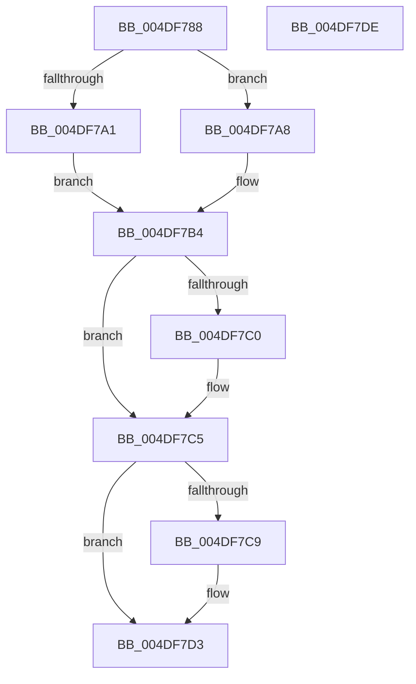

# MiDeleteZeroThreadContext

- RVA: `0x004DF788`–`0x004DF7DF` (길이 `87` bytes)
- VA: `0x00000001404DF788`
- 실행 섹션: `.text`
- PDB 이름 있음: `예`; PDB Function 태그: `아니요`
- unwind 정보 RVA: `0x0005CAAC`
- 디코드: `25`개 명령, `87/87` bytes 표시
- 미해석 바이트: `0` (있으면 어셈블리에 `.byte`로 보존)

> 이 문서는 커널 이미지의 기계어와 PDB 기호를 분석해 생성했습니다. 4번과 5번은 함수 원형과 자료형을 바이너리 사용 방식에서 추정한 C 해석이며 원본 소스 복구 결과는 아닙니다.

## 1. Dependencies

- 직접 호출 지점: **4**; 고유 호출 대상: **4**
- 직접 호출자로 확인된 함수: **2**
- RIP 상대 이미지 참조: **0**

### Outgoing calls
- `0x004DF7A1` → [MiDereferenceAnyActiveHugeContext](../2C/MiDereferenceAnyActiveHugeContext_function_002CB928.md) (function, `0x002CB928`)
- `0x004DF7AF` → [MiDeleteUltraThreadContext](../32/MiDeleteUltraThreadContext_function_00322C90.md) (function, `0x00322C90`)
- `0x004DF7C0` → [MiSignalZeroingPassComplete](../69/MiSignalZeroingPassComplete_function_00696690.md) (function, `0x00696690`)
- `0x004DF7CE` → [ExFreePoolWithTag](../../poolcode/B8/ExFreePoolWithTag_function_00B82870.md) (function, `0x00B82870`)

### Direct callers
- [MiBackgroundZeroNodePages](../2C/MiBackgroundZeroNodePages_function_002CB9B0.md) at `0x002CBABE`
- [MiInsertNewZeroThread](../69/MiInsertNewZeroThread_function_00696140.md) at `0x0069634D`

### Static image references
- 디코드된 RIP-relative 메모리 참조가 없습니다.

## 2. Other-region calls and transfers

- 다른 실행 섹션으로 향하는 call: **1**
  - `0x004DF7CE` → [ExFreePoolWithTag](../../poolcode/B8/ExFreePoolWithTag_function_00B82870.md) (`.text` → `POOLCODE`)
- 별도 외부 분기/꼬리 이동을 확인하지 못했습니다.

## 3. Assembly (complete function range)

```asm
004DF788  48 89 5C 24 08                  mov qword ptr [rsp + 8], rbx
004DF78D  57                              push rdi
004DF78E  48 83 EC 20                     sub rsp, 0x20
004DF792  48 83 B9 48 02 00 00 00         cmp qword ptr [rcx + 0x248], 0
004DF79A  8B FA                           mov edi, edx
004DF79C  48 8B D9                        mov rbx, rcx
004DF79F  74 07                           je 0x1404df7a8
004DF7A1  E8 82 C1 DE FF                  call 0x1402cb928
004DF7A6  EB 0C                           jmp 0x1404df7b4
004DF7A8  48 81 C1 C0 01 00 00            add rcx, 0x1c0
004DF7AF  E8 DC 34 E4 FF                  call 0x140322c90
004DF7B4  48 8B 8B 50 01 00 00            mov rcx, qword ptr [rbx + 0x150]
004DF7BB  48 85 C9                        test rcx, rcx
004DF7BE  74 05                           je 0x1404df7c5
004DF7C0  E8 CB 6E 1B 00                  call 0x140696690
004DF7C5  85 FF                           test edi, edi
004DF7C7  75 0A                           jne 0x1404df7d3
004DF7C9  33 D2                           xor edx, edx
004DF7CB  48 8B CB                        mov rcx, rbx
004DF7CE  E8 9D 30 6A 00                  call 0x140b82870
004DF7D3  48 8B 5C 24 30                  mov rbx, qword ptr [rsp + 0x30]
004DF7D8  48 83 C4 20                     add rsp, 0x20
004DF7DC  5F                              pop rdi
004DF7DD  C3                              ret
004DF7DE  CC                              int3
```

## 4. C-style interpretation (structured pseudocode)

```c
__int64 __fastcall MiDeleteZeroThreadContext(__int64 a1, int a2)
{
    __int64 result;
    __int64 v_rsp;
    unsigned __int64 v_stack_p8;

    v_stack_p8 = v_rbx;
    v_rsp = (v_rsp) - (32);
    if ((*(unsigned __int64 *)(a1 + 584)) == 0) goto loc_004DF7A8;
    result = MiDereferenceAnyActiveHugeContext(a1, a2, a3, a4);
    goto loc_004DF7B4;
loc_004DF7A8:
    a1 = (a1) + (448);
    result = MiDeleteUltraThreadContext(a1, a2, a3, a4);
loc_004DF7B4:
    if (*(unsigned __int64 *)(a1 + 336) != 0) {
        result = MiSignalZeroingPassComplete(*(unsigned __int64 *)(a1 + 336), a2, a3, a4);
    }
    if ((unsigned int)((unsigned int)(a2)) == 0) {
        a2 = 0;
        a1 = a1;
        result = ExFreePoolWithTag(a1, a2, a3, a4);
    }
    v_rsp = (v_rsp) + (32);
    return result;
}
```

## 5. (Beta) C Style

```c
int64_t MiDeleteZeroThreadContext(void *Arg1, int32_t Arg2)
{
    uint8_t *arg1 = (uint8_t *)Arg1;

    int64_t result;
    int64_t local_rsp;
    uint64_t v_stack_p8;

    v_stack_p8 = local_rbx;
    local_rsp = (local_rsp) - (32);
    if ((*(uint64_t *)(arg1 + 0x248)) == 0) goto loc_004DF7A8;
    result = MiDereferenceAnyActiveHugeContext(Arg1, Arg2, a3, a4);
    goto loc_004DF7B4;
loc_004DF7A8:
    Arg1 = (Arg1) + (448);
    result = MiDeleteUltraThreadContext(Arg1, Arg2, a3, a4);
loc_004DF7B4:
    if (*(uint64_t *)(arg1 + 0x150) != 0) {
        result = MiSignalZeroingPassComplete(*(uint64_t *)(arg1 + 0x150), Arg2, a3, a4);
    }
    if ((uint32_t)((uint32_t)(Arg2)) == 0) {
        Arg2 = 0;
        Arg1 = Arg1;
        result = ExFreePoolWithTag(Arg1, Arg2, a3, a4);
    }
    local_rsp = (local_rsp) + (32);
    return result;
}
```

### 관측된 메모리 오프셋

구조체 형식이 확인되지 않은 접근은 인자 기준의 오프셋으로만 기록했습니다.

| 기준 인자 | 오프셋 표현 | 폭 (bit) | 접근 |
|---|---:|---:|---|
| `Arg1` | `+ 0x150` | `64` | `R` |
| `Arg1` | `+ 0x248` | `64` | `R` |

## 6. Execution-region graph

[열기: 2D/3D 그래프와 함수 탐색 컨트롤 패널](../../../control-panel.html?section=text&rva=0x004DF788&view=graph)

- 2D 그래프는 위에서 아래로 흐르고, 3D 그래프는 빈 공간을 드래그해 회전합니다. Shift+드래그는 이동, 휠은 확대·축소, 함수 노드 선택은 대상 보고서 이동입니다.

### Static fallback


