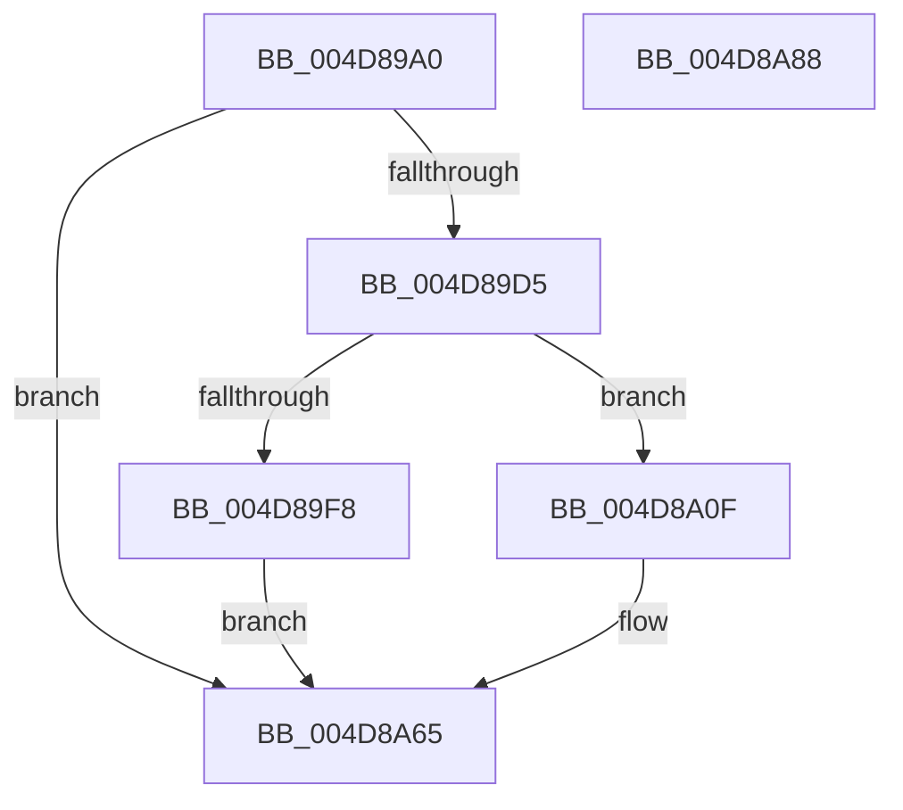

# MiDemoteSlabEntries

- RVA: `0x004D89A0`–`0x004D8A89` (길이 `233` bytes)
- VA: `0x00000001404D89A0`
- 실행 섹션: `.text`
- PDB 이름 있음: `예`; PDB Function 태그: `아니요`
- unwind 정보 RVA: `0x000BE7EC`
- 디코드: `53`개 명령, `233/233` bytes 표시
- 미해석 바이트: `0` (있으면 어셈블리에 `.byte`로 보존)

> 이 문서는 커널 이미지의 기계어와 PDB 기호를 분석해 생성했습니다. 4번과 5번은 함수 원형과 자료형을 바이너리 사용 방식에서 추정한 C 해석이며 원본 소스 복구 결과는 아닙니다.

## 1. Dependencies

- 직접 호출 지점: **7**; 고유 호출 대상: **6**
- 직접 호출자로 확인된 함수: **2**
- RIP 상대 이미지 참조: **2**

### Outgoing calls
- `0x004D89E4` → [KiSetSystemPriorityThread](../2D/KiSetSystemPriorityThread_function_002D9FF8.md) (function, `0x002D9FF8`)
- `0x004D8A08` → [KiClearSystemPriority](../2C/KiClearSystemPriority_function_002C05A8.md) (function, `0x002C05A8`)
- `0x004D8A1A` → [memset](../6C/memset_function_006C6C40.md) (function, `0x006C6C40`)
- `0x004D8A39` → [KeGenericCallDpcEx](../2C/KeGenericCallDpcEx_function_002C99F4.md) (function, `0x002C99F4`)
- `0x004D8A54` → [KiClearSystemPriority](../2C/KiClearSystemPriority_function_002C05A8.md) (function, `0x002C05A8`)
- `0x004D8A60` → [MiLogSlabEntriesDemote](../68/MiLogSlabEntriesDemote_function_0068EE4C.md) (function, `0x0068EE4C`)
- `0x004D8A70` → [_security_check_cookie](../6A/_security_check_cookie_function_006AC640.md) (function, `0x006AC640`)

### Direct callers
- [MiWaitForFreePage](../2A/MiWaitForFreePage_function_002A3324.md) at `0x002A3514`
- [MiFreeUnusedSlabPages](../2D/MiFreeUnusedSlabPages_function_002DAE48.md) at `0x002DAFAF`

### Static image references
- `0x004D89AF` → RVA `0x00E0A740` (`.data`; read)
- `0x004D8A2D` → RVA `0x0044C3C0` (`MiDemoteSlabEntriesDpc`; read)

## 2. Other-region calls and transfers

- 다른 실행 섹션으로 향하는 call: **0**
- 별도 외부 분기/꼬리 이동을 확인하지 못했습니다.

## 3. Assembly (complete function range)

```asm
004D89A0  48 89 5C 24 18                  mov qword ptr [rsp + 0x18], rbx
004D89A5  55                              push rbp
004D89A6  56                              push rsi
004D89A7  57                              push rdi
004D89A8  48 81 EC B0 00 00 00            sub rsp, 0xb0
004D89AF  48 8B 05 8A 1D 93 00            mov rax, qword ptr [rip + 0x931d8a]
004D89B6  48 33 C4                        xor rax, rsp
004D89B9  48 89 84 24 A0 00 00 00         mov qword ptr [rsp + 0xa0], rax
004D89C1  33 F6                           xor esi, esi
004D89C3  8B EA                           mov ebp, edx
004D89C5  48 8B D9                        mov rbx, rcx
004D89C8  48 39 B1 D8 4C 00 00            cmp qword ptr [rcx + 0x4cd8], rsi
004D89CF  0F 84 90 00 00 00               je 0x1404d8a65
004D89D5  65 48 8B 3C 25 88 01 00 00      mov rdi, qword ptr gs:[0x188]
004D89DE  8D 56 1E                        lea edx, [rsi + 0x1e]
004D89E1  48 8B CF                        mov rcx, rdi
004D89E4  E8 0F 16 E0 FF                  call 0x1402d9ff8
004D89E9  8D 4E 01                        lea ecx, [rsi + 1]
004D89EC  33 C0                           xor eax, eax
004D89EE  F0 0F B1 8B 50 45 00 00         lock cmpxchg dword ptr [rbx + 0x4550], ecx
004D89F6  74 17                           je 0x1404d8a0f
004D89F8  48 8D 54 24 20                  lea rdx, [rsp + 0x20]
004D89FD  C7 44 24 20 1E 00 00 00         mov dword ptr [rsp + 0x20], 0x1e
004D8A05  48 8B CF                        mov rcx, rdi
004D8A08  E8 9B 7B DE FF                  call 0x1402c05a8
004D8A0D  EB 56                           jmp 0x1404d8a65
004D8A0F  33 D2                           xor edx, edx
004D8A11  48 8D 4C 24 38                  lea rcx, [rsp + 0x38]
004D8A16  44 8D 42 58                     lea r8d, [rdx + 0x58]
004D8A1A  E8 21 E2 1E 00                  call 0x1406c6c40
004D8A1F  48 83 8C 24 90 00 00 00 FF      or qword ptr [rsp + 0x90], 0xffffffffffffffff
004D8A28  48 8D 54 24 30                  lea rdx, [rsp + 0x30]
004D8A2D  48 8D 0D 8C 39 F7 FF            lea rcx, [rip - 0x8c674]
004D8A34  48 89 5C 24 30                  mov qword ptr [rsp + 0x30], rbx
004D8A39  E8 B6 0F DF FF                  call 0x1402c99f4
004D8A3E  87 B3 50 45 00 00               xchg dword ptr [rbx + 0x4550], esi
004D8A44  48 8D 54 24 20                  lea rdx, [rsp + 0x20]
004D8A49  C7 44 24 20 1E 00 00 00         mov dword ptr [rsp + 0x20], 0x1e
004D8A51  48 8B CF                        mov rcx, rdi
004D8A54  E8 4F 7B DE FF                  call 0x1402c05a8
004D8A59  8B D5                           mov edx, ebp
004D8A5B  48 8D 4C 24 30                  lea rcx, [rsp + 0x30]
004D8A60  E8 E7 63 1B 00                  call 0x14068ee4c
004D8A65  48 8B 8C 24 A0 00 00 00         mov rcx, qword ptr [rsp + 0xa0]
004D8A6D  48 33 CC                        xor rcx, rsp
004D8A70  E8 CB 3B 1D 00                  call 0x1406ac640
004D8A75  48 8B 9C 24 E0 00 00 00         mov rbx, qword ptr [rsp + 0xe0]
004D8A7D  48 81 C4 B0 00 00 00            add rsp, 0xb0
004D8A84  5F                              pop rdi
004D8A85  5E                              pop rsi
004D8A86  5D                              pop rbp
004D8A87  C3                              ret
004D8A88  CC                              int3
```

## 4. C-style interpretation (structured pseudocode)

```c
__int64 __fastcall MiDemoteSlabEntries(__int64 a1, int a2)
{
    __int64 result;
    __int64 v_rsi;
    __int64 v_rsp;
    unsigned __int64 v_stack_m28;
    unsigned __int64 v_stack_m38;
    unsigned __int64 v_stack_m90;
    unsigned __int64 v_stack_m98;
    unsigned __int64 v_stack_mA8;
    unsigned __int64 v_stack_p18;

    v_stack_p18 = v_rbx;
    v_rsp = (v_rsp) - (176);
    result = (*(unsigned __int64 *)(v_rip + 9641354)) ^ (v_rsp);
    v_stack_m28 = result;
    v_rsi = 0;
    if ((*(unsigned __int64 *)(a1 + 19672)) == 0) goto loc_004D8A65;
    result = KiSetSystemPriorityThread(*(unsigned __int64 *)(gs_base + (0 + 392)), v_rsi + 30, a3, a4);
    result = 0;
    if (condition_is_equal) goto loc_004D8A0F;
    v_stack_mA8 = 30;
    result = KiClearSystemPriority(*(unsigned __int64 *)(gs_base + (0 + 392)), v_stack_mA8, a3, a4);
    goto loc_004D8A65;
loc_004D8A0F:
    a2 = 0;
    result = memset(v_stack_m90, a2, a2 + 88, a4);
    v_stack_m98 = a1;
    result = KeGenericCallDpcEx(v_rip - 575092, v_stack_m98, a2 + 88, a4);
    v_stack_mA8 = 30;
    result = KiClearSystemPriority(*(unsigned __int64 *)(gs_base + (0 + 392)), v_stack_mA8, a2 + 88, a4);
    result = MiLogSlabEntriesDemote(v_stack_m98, (unsigned int)((unsigned int)((unsigned int)(a2))), a2 + 88, a4);
loc_004D8A65:
    a1 = (v_stack_m28) ^ (v_rsp);
    result = _security_check_cookie(a1, (unsigned int)((unsigned int)((unsigned int)(a2))), a2 + 88, a4);
    v_rsp = (v_rsp) + (176);
    return result;
}
```

## 5. (Beta) C Style

```c
int64_t MiDemoteSlabEntries(void *Arg1, int32_t Arg2)
{
    uint8_t *arg1 = (uint8_t *)Arg1;

    int64_t result;
    int64_t local_rsi;
    int64_t local_rsp;
    uint64_t v_stack_m28;
    uint64_t v_stack_m38;
    uint64_t v_stack_m90;
    uint64_t v_stack_m98;
    uint64_t v_stack_mA8;
    uint64_t v_stack_p18;

    v_stack_p18 = local_rbx;
    local_rsp = (local_rsp) - (176);
    result = (*(uint64_t *)(v_rip + 0x931D8A)) ^ (local_rsp);
    v_stack_m28 = result;
    local_rsi = 0;
    if ((*(uint64_t *)(arg1 + 0x4CD8)) == 0) goto loc_004D8A65;
    result = KiSetSystemPriorityThread(*(uint64_t *)(gs_base + (0 + 0x188)), local_rsi + 30, a3, a4);
    result = 0;
    if (condition_is_equal) goto loc_004D8A0F;
    v_stack_mA8 = 30;
    result = KiClearSystemPriority(*(uint64_t *)(gs_base + (0 + 0x188)), v_stack_mA8, a3, a4);
    goto loc_004D8A65;
loc_004D8A0F:
    Arg2 = 0;
    result = memset(v_stack_m90, Arg2, Arg2 + 88, a4);
    v_stack_m98 = Arg1;
    result = KeGenericCallDpcEx(v_rip - 575092, v_stack_m98, Arg2 + 88, a4);
    v_stack_mA8 = 30;
    result = KiClearSystemPriority(*(uint64_t *)(gs_base + (0 + 0x188)), v_stack_mA8, Arg2 + 88, a4);
    result = MiLogSlabEntriesDemote(v_stack_m98, (uint32_t)((uint32_t)((uint32_t)(Arg2))), Arg2 + 88, a4);
loc_004D8A65:
    Arg1 = (v_stack_m28) ^ (local_rsp);
    result = _security_check_cookie(Arg1, (uint32_t)((uint32_t)((uint32_t)(Arg2))), Arg2 + 88, a4);
    local_rsp = (local_rsp) + (176);
    return result;
}
```

### 관측된 메모리 오프셋

구조체 형식이 확인되지 않은 접근은 인자 기준의 오프셋으로만 기록했습니다.

| 기준 인자 | 오프셋 표현 | 폭 (bit) | 접근 |
|---|---:|---:|---|
| `Arg1` | `+ 0x4550` | `32` | `R` |
| `Arg1` | `+ 0x4550` | `32` | `R/W` |
| `Arg1` | `+ 0x4CD8` | `64` | `R` |

## 6. Execution-region graph

[열기: 2D/3D 그래프와 함수 탐색 컨트롤 패널](../../../control-panel.html?section=text&rva=0x004D89A0&view=graph)

- 2D 그래프는 위에서 아래로 흐르고, 3D 그래프는 빈 공간을 드래그해 회전합니다. Shift+드래그는 이동, 휠은 확대·축소, 함수 노드 선택은 대상 보고서 이동입니다.

### Static fallback


