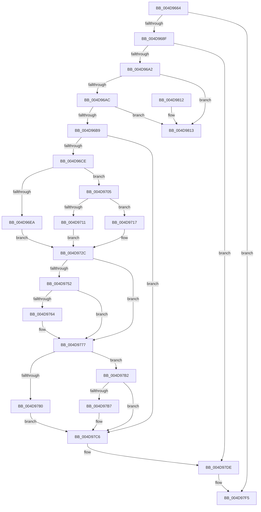

# MiDereferenceHugeContext

- RVA: `0x004D9664`–`0x004D981A` (길이 `438` bytes)
- VA: `0x00000001404D9664`
- 실행 섹션: `.text`
- PDB 이름 있음: `예`; PDB Function 태그: `아니요`
- unwind 정보 RVA: `0x00069AD0`
- 디코드: `103`개 명령, `438/438` bytes 표시
- 미해석 바이트: `0` (있으면 어셈블리에 `.byte`로 보존)

> 이 문서는 커널 이미지의 기계어와 PDB 기호를 분석해 생성했습니다. 4번과 5번은 함수 원형과 자료형을 바이너리 사용 방식에서 추정한 C 해석이며 원본 소스 복구 결과는 아닙니다.

## 1. Dependencies

- 직접 호출 지점: **8**; 고유 호출 대상: **8**
- 직접 호출자로 확인된 함수: **4**
- RIP 상대 이미지 참조: **3**

### Outgoing calls
- `0x004D96FE` → [MiLockHugePfnInternal](../3F/MiLockHugePfnInternal_function_003FBC80.md) (function, `0x003FBC80`)
- `0x004D9708` → [MiSafeLockPageAtDpc](../31/MiSafeLockPageAtDpc_function_0031C67C.md) (function, `0x0031C67C`)
- `0x004D975A` → [MiStopPageAccessor](../43/MiStopPageAccessor_function_00436BB8.md) (function, `0x00436BB8`)
- `0x004D9772` → [MiRewritePteWithLockBit](../32/MiRewritePteWithLockBit_function_00322FEC.md) (function, `0x00322FEC`)
- `0x004D97CD` → [MiFreeUltraMapping](../4F/MiFreeUltraMapping_function_004FAFD4.md) (function, `0x004FAFD4`)
- `0x004D97D9` → [MiDeleteUltraThreadContext](../32/MiDeleteUltraThreadContext_function_00322C90.md) (function, `0x00322C90`)
- `0x004D97E6` → [MiRemoveFaultNode](../4F/MiRemoveFaultNode_function_004FC440.md) (function, `0x004FC440`)
- `0x004D97F0` → [ExFreePoolWithTag](../../poolcode/B8/ExFreePoolWithTag_function_00B82870.md) (function, `0x00B82870`)

### Direct callers
- [MiDereferenceAnyActiveHugeContext](../2C/MiDereferenceAnyActiveHugeContext_function_002CB928.md) at `0x002CB98E`
- [MiGetBackgroundHugePageToZero](../31/MiGetBackgroundHugePageToZero_function_0031DD8C.md) at `0x0031DF6A`
- [sub_0031FC44](../31/Unknown_function_0031FC44.md) at `0x0031FD23`
- [MiGetUltraHugeAlreadyActive](../3E/MiGetUltraHugeAlreadyActive_function_003E269C.md) at `0x003E273A`

### Static image references
- `0x004D96EA` → RVA `0x00E300C0` (`.data`; read)
- `0x004D9764` → RVA `0x00010880` (`.rdata`; read)
- `0x004D978C` → RVA `0x00E300C8` (`.data`; read)

## 2. Other-region calls and transfers

- 다른 실행 섹션으로 향하는 call: **1**
  - `0x004D97F0` → [ExFreePoolWithTag](../../poolcode/B8/ExFreePoolWithTag_function_00B82870.md) (`.text` → `POOLCODE`)
- 별도 외부 분기/꼬리 이동을 확인하지 못했습니다.

## 3. Assembly (complete function range)

```asm
004D9664  48 89 5C 24 08                  mov qword ptr [rsp + 8], rbx
004D9669  48 89 6C 24 10                  mov qword ptr [rsp + 0x10], rbp
004D966E  48 89 74 24 18                  mov qword ptr [rsp + 0x18], rsi
004D9673  57                              push rdi
004D9674  48 83 EC 20                     sub rsp, 0x20
004D9678  48 8B 99 48 02 00 00            mov rbx, qword ptr [rcx + 0x248]
004D967F  48 8B E9                        mov rbp, rcx
004D9682  83 83 3C 02 00 00 FF            add dword ptr [rbx + 0x23c], -1
004D9689  0F 85 66 01 00 00               jne 0x1404d97f5
004D968F  48 8D 83 48 01 00 00            lea rax, [rbx + 0x148]
004D9696  48 8B 10                        mov rdx, qword ptr [rax]
004D9699  48 85 D2                        test rdx, rdx
004D969C  0F 84 3C 01 00 00               je 0x1404d97de
004D96A2  48 39 42 08                     cmp qword ptr [rdx + 8], rax
004D96A6  0F 85 67 01 00 00               jne 0x1404d9813
004D96AC  48 8B 48 08                     mov rcx, qword ptr [rax + 8]
004D96B0  48 39 01                        cmp qword ptr [rcx], rax
004D96B3  0F 85 5A 01 00 00               jne 0x1404d9813
004D96B9  48 89 11                        mov qword ptr [rcx], rdx
004D96BC  48 89 4A 08                     mov qword ptr [rdx + 8], rcx
004D96C0  48 8B 73 18                     mov rsi, qword ptr [rbx + 0x18]
004D96C4  40 F6 C6 08                     test sil, 8
004D96C8  0F 84 F8 00 00 00               je 0x1404d97c6
004D96CE  48 C1 EE 0C                     shr rsi, 0xc
004D96D2  48 B8 FF FF FF FF 3F 00 00 00   movabs rax, 0x3fffffffff
004D96DC  48 23 F0                        and rsi, rax
004D96DF  33 FF                           xor edi, edi
004D96E1  40 38 BB 44 01 00 00            cmp byte ptr [rbx + 0x144], dil
004D96E8  74 1B                           je 0x1404d9705
004D96EA  48 8B 05 CF 69 95 00            mov rax, qword ptr [rip + 0x9569cf]
004D96F1  81 E6 FF FF 3F 00               and esi, 0x3fffff
004D96F7  48 8D 3C F0                     lea rdi, [rax + rsi*8]
004D96FB  48 8B CF                        mov rcx, rdi
004D96FE  E8 7D 25 F2 FF                  call 0x1403fbc80
004D9703  EB 27                           jmp 0x1404d972c
004D9705  48 8B CE                        mov rcx, rsi
004D9708  E8 6F 2F E4 FF                  call 0x14031c67c
004D970D  3C 11                           cmp al, 0x11
004D970F  75 06                           jne 0x1404d9717
004D9711  48 8B 43 18                     mov rax, qword ptr [rbx + 0x18]
004D9715  EB 15                           jmp 0x1404d972c
004D9717  48 8D 3C 76                     lea rdi, [rsi + rsi*2]
004D971B  48 C1 E7 04                     shl rdi, 4
004D971F  48 B8 00 00 00 00 00 DE FF FF   movabs rax, 0xffffde0000000000
004D9729  48 03 F8                        add rdi, rax
004D972C  48 8B B3 30 02 00 00            mov rsi, qword ptr [rbx + 0x230]
004D9733  48 C1 EE 1B                     shr rsi, 0x1b
004D9737  81 E6 F8 FF 1F 00               and esi, 0x1ffff8
004D973D  48 B8 00 00 A0 7D FB F6 FF FF   movabs rax, 0xfffff6fb7da00000
004D9747  48 03 F0                        add rsi, rax
004D974A  48 8B 43 18                     mov rax, qword ptr [rbx + 0x18]
004D974E  A8 01                           test al, 1
004D9750  75 25                           jne 0x1404d9777
004D9752  45 33 C0                        xor r8d, r8d
004D9755  33 D2                           xor edx, edx
004D9757  48 8B CF                        mov rcx, rdi
004D975A  E8 59 D4 F5 FF                  call 0x140436bb8
004D975F  48 85 F6                        test rsi, rsi
004D9762  74 13                           je 0x1404d9777
004D9764  4C 8B 0D 15 71 B3 FF            mov r9, qword ptr [rip - 0x4c8eeb]
004D976B  4C 8B C6                        mov r8, rsi
004D976E  33 D2                           xor edx, edx
004D9770  33 C9                           xor ecx, ecx
004D9772  E8 75 98 E4 FF                  call 0x140322fec
004D9777  80 BB 44 01 00 00 00            cmp byte ptr [rbx + 0x144], 0
004D977E  74 32                           je 0x1404d97b2
004D9780  48 2B 3D 39 69 95 00            sub rdi, qword ptr [rip + 0x956939]
004D9787  BA 01 00 00 00                  mov edx, 1
004D978C  48 8B 05 35 69 95 00            mov rax, qword ptr [rip + 0x956935]
004D9793  48 C1 FF 03                     sar rdi, 3
004D9797  81 E7 FF FF 3F 00               and edi, 0x3fffff
004D979D  8B CF                           mov ecx, edi
004D979F  83 E1 1F                        and ecx, 0x1f
004D97A2  D3 E2                           shl edx, cl
004D97A4  8B CF                           mov ecx, edi
004D97A6  F7 D2                           not edx
004D97A8  48 C1 E9 05                     shr rcx, 5
004D97AC  F0 21 14 88                     lock and dword ptr [rax + rcx*4], edx
004D97B0  EB 14                           jmp 0x1404d97c6
004D97B2  48 85 FF                        test rdi, rdi
004D97B5  74 0F                           je 0x1404d97c6
004D97B7  48 B8 FF FF FF FF FF FF FF 7F   movabs rax, 0x7fffffffffffffff
004D97C1  F0 48 21 47 18                  lock and qword ptr [rdi + 0x18], rax
004D97C6  48 8B 8B 30 02 00 00            mov rcx, qword ptr [rbx + 0x230]
004D97CD  E8 02 18 02 00                  call 0x1404fafd4
004D97D2  48 8D 8B B0 01 00 00            lea rcx, [rbx + 0x1b0]
004D97D9  E8 B2 94 E4 FF                  call 0x140322c90
004D97DE  BA 01 00 00 00                  mov edx, 1
004D97E3  48 8B CB                        mov rcx, rbx
004D97E6  E8 55 2C 02 00                  call 0x1404fc440
004D97EB  33 D2                           xor edx, edx
004D97ED  48 8B CB                        mov rcx, rbx
004D97F0  E8 7B 90 6A 00                  call 0x140b82870
004D97F5  48 83 A5 48 02 00 00 00         and qword ptr [rbp + 0x248], 0
004D97FD  48 8B 6C 24 38                  mov rbp, qword ptr [rsp + 0x38]
004D9802  48 8B 5C 24 30                  mov rbx, qword ptr [rsp + 0x30]
004D9807  48 8B 74 24 40                  mov rsi, qword ptr [rsp + 0x40]
004D980C  48 83 C4 20                     add rsp, 0x20
004D9810  5F                              pop rdi
004D9811  C3                              ret
004D9812  CC                              int3
004D9813  B9 03 00 00 00                  mov ecx, 3
004D9818  CD 29                           int 0x29
```

## 4. C-style interpretation (structured pseudocode)

```c
__int64 __fastcall MiDereferenceHugeContext(__int64 a1, __int64 a2, int a3)
{
    __int64 result;
    __int64 v_rdi;
    __int64 v_rsi;
    __int64 v_rsp;
    unsigned __int64 v_stack_p10;
    unsigned __int64 v_stack_p18;
    unsigned __int64 v_stack_p8;

    v_stack_p8 = v_rbx;
    v_stack_p10 = v_rbp;
    v_stack_p18 = v_rsi;
    v_rsp = (v_rsp) - (32);
    if (condition_is_not_equal) goto loc_004D97F5;
    if (*(unsigned __int64 *)(*(unsigned __int64 *)(a1 + 584) + 328) == 0) goto loc_004D97DE;
    if ((*(unsigned __int64 *)(*(unsigned __int64 *)(*(unsigned __int64 *)(a1 + 584) + 328) + 8)) != (*(unsigned __int64 *)(a1 + 584) + 328)) goto loc_004D9813;
    if ((*(unsigned __int64 *)(*(unsigned __int64 *)(*(unsigned __int64 *)(a1 + 584) + 328 + 8))) != (*(unsigned __int64 *)(a1 + 584) + 328)) goto loc_004D9813;
    *(unsigned __int64 *)(*(unsigned __int64 *)(*(unsigned __int64 *)(a1 + 584) + 328 + 8)) = *(unsigned __int64 *)(*(unsigned __int64 *)(a1 + 584) + 328);
    *(unsigned __int64 *)(*(unsigned __int64 *)(*(unsigned __int64 *)(a1 + 584) + 328) + 8) = *(unsigned __int64 *)(*(unsigned __int64 *)(a1 + 584) + 328 + 8);
    if ((((unsigned __int8)(*(unsigned __int64 *)(*(unsigned __int64 *)(a1 + 584) + 24))) & (8)) == 0) goto loc_004D97C6;
    v_rsi = (*(unsigned __int64 *)(*(unsigned __int64 *)(a1 + 584) + 24)) >> (12);
    v_rsi = (v_rsi) & (*(unsigned __int64 *)(a1 + 584) + 328);
    v_rdi = 0;
    if ((*(unsigned __int8 *)(*(unsigned __int64 *)(a1 + 584) + 324)) == 0) goto loc_004D9705;
    v_rsi = (unsigned int)((v_rsi) & (0x3FFFFFULL));
    result = MiLockHugePfnInternal(*(unsigned __int64 *)(v_rip + 9791951) + v_rsi * 8, *(unsigned __int64 *)(*(unsigned __int64 *)(a1 + 584) + 328), a3, a4);
    goto loc_004D972C;
loc_004D9705:
    result = MiSafeLockPageAtDpc(v_rsi, *(unsigned __int64 *)(*(unsigned __int64 *)(a1 + 584) + 328), a3, a4);
    if (((unsigned __int8)(result)) != 17) goto loc_004D9717;
    goto loc_004D972C;
loc_004D9717:
    v_rdi = (v_rsi + v_rsi * 2) << (4);
    v_rdi = (v_rdi) + (*(unsigned __int64 *)(*(unsigned __int64 *)(a1 + 584) + 24));
loc_004D972C:
    v_rsi = (*(unsigned __int64 *)(*(unsigned __int64 *)(a1 + 584) + 560)) >> (27);
    v_rsi = (unsigned int)((v_rsi) & (0x1FFFF8ULL));
    v_rsi = (v_rsi) + (*(unsigned __int64 *)(*(unsigned __int64 *)(a1 + 584) + 24));
    if ((((unsigned __int8)(*(unsigned __int64 *)(*(unsigned __int64 *)(a1 + 584) + 24))) & (1)) != 0) goto loc_004D9777;
    a3 = 0;
    a2 = 0;
    result = MiStopPageAccessor(v_rdi, a2, a3, a4);
    if (v_rsi != 0) {
        a4 = *(unsigned __int64 *)(v_rip - 5017323);
        a3 = v_rsi;
        a2 = 0;
        a1 = 0;
        result = MiRewritePteWithLockBit(a1, a2, a3, a4);
    }
    if ((*(unsigned __int8 *)(*(unsigned __int64 *)(a1 + 584) + 324)) == 0) goto loc_004D97B2;
    v_rdi = (v_rdi) - (*(unsigned __int64 *)(v_rip + 9791801));
    v_rdi = (v_rdi) >> (3);
    v_rdi = (unsigned int)((v_rdi) & (0x3FFFFFULL));
    a1 = (unsigned int)(((unsigned int)((unsigned int)(v_rdi))) & (31));
    a2 = (unsigned int)((1) << ((unsigned __int8)(a1)));
    a2 = (unsigned int)(~(a2));
    a1 = ((unsigned int)((unsigned int)(v_rdi))) >> (5);
    goto loc_004D97C6;
loc_004D97B2:
    if (v_rdi != 0) {
    }
    result = MiFreeUltraMapping(*(unsigned __int64 *)(*(unsigned __int64 *)(a1 + 584) + 560), a2, a3, a4);
    result = MiDeleteUltraThreadContext(*(unsigned __int64 *)(a1 + 584) + 432, a2, a3, a4);
loc_004D97DE:
    result = MiRemoveFaultNode(*(unsigned __int64 *)(a1 + 584), 1, a3, a4);
    a2 = 0;
    result = ExFreePoolWithTag(*(unsigned __int64 *)(a1 + 584), a2, a3, a4);
loc_004D97F5:
    v_rsp = (v_rsp) + (32);
    return result;
loc_004D9813:
    return result;
}
```

## 5. (Beta) C Style

```c
int64_t MiDereferenceHugeContext(void *Arg1, int64_t Arg2, int32_t Arg3)
{
    uint8_t *arg1 = (uint8_t *)Arg1;

    int64_t result;
    int64_t local_rdi;
    int64_t local_rsi;
    int64_t local_rsp;
    uint64_t v_stack_p10;
    uint64_t v_stack_p18;
    uint64_t v_stack_p8;

    v_stack_p8 = local_rbx;
    v_stack_p10 = local_rbp;
    v_stack_p18 = local_rsi;
    local_rsp = (local_rsp) - (32);
    if (condition_is_not_equal) goto loc_004D97F5;
    if (*(uint64_t *)(*(uint64_t *)(arg1 + 0x248) + 0x148) == 0) goto loc_004D97DE;
    if ((*(uint64_t *)(*(uint64_t *)(*(uint64_t *)(arg1 + 0x248) + 0x148) + 0x8)) != (*(uint64_t *)(arg1 + 0x248) + 328)) goto loc_004D9813;
    if ((*(uint64_t *)(*(uint64_t *)(*(uint64_t *)(arg1 + 0x248) + 0x148 + 0x8))) != (*(uint64_t *)(arg1 + 0x248) + 328)) goto loc_004D9813;
    *(uint64_t *)(*(uint64_t *)(*(uint64_t *)(arg1 + 0x248) + 0x148 + 0x8)) = *(uint64_t *)(*(uint64_t *)(arg1 + 0x248) + 0x148);
    *(uint64_t *)(*(uint64_t *)(*(uint64_t *)(arg1 + 0x248) + 0x148) + 0x8) = *(uint64_t *)(*(uint64_t *)(arg1 + 0x248) + 0x148 + 0x8);
    if ((((uint8_t)(*(uint64_t *)(*(uint64_t *)(arg1 + 0x248) + 0x18))) & (8)) == 0) goto loc_004D97C6;
    local_rsi = (*(uint64_t *)(*(uint64_t *)(arg1 + 0x248) + 0x18)) >> (12);
    local_rsi = (local_rsi) & (*(uint64_t *)(arg1 + 0x248) + 328);
    local_rdi = 0;
    if ((*(uint8_t *)(*(uint64_t *)(arg1 + 0x248) + 0x144)) == 0) goto loc_004D9705;
    local_rsi = (uint32_t)((local_rsi) & (0x3FFFFFULL));
    result = MiLockHugePfnInternal(*(uint64_t *)(v_rip + 0x9569CF) + local_rsi * 8, *(uint64_t *)(*(uint64_t *)(arg1 + 0x248) + 0x148), Arg3, a4);
    goto loc_004D972C;
loc_004D9705:
    result = MiSafeLockPageAtDpc(local_rsi, *(uint64_t *)(*(uint64_t *)(arg1 + 0x248) + 0x148), Arg3, a4);
    if (((uint8_t)(result)) != 17) goto loc_004D9717;
    goto loc_004D972C;
loc_004D9717:
    local_rdi = (local_rsi + local_rsi * 2) << (4);
    local_rdi = (local_rdi) + (*(uint64_t *)(*(uint64_t *)(arg1 + 0x248) + 0x18));
loc_004D972C:
    local_rsi = (*(uint64_t *)(*(uint64_t *)(arg1 + 0x248) + 0x230)) >> (27);
    local_rsi = (uint32_t)((local_rsi) & (0x1FFFF8ULL));
    local_rsi = (local_rsi) + (*(uint64_t *)(*(uint64_t *)(arg1 + 0x248) + 0x18));
    if ((((uint8_t)(*(uint64_t *)(*(uint64_t *)(arg1 + 0x248) + 0x18))) & (1)) != 0) goto loc_004D9777;
    Arg3 = 0;
    Arg2 = 0;
    result = MiStopPageAccessor(local_rdi, Arg2, Arg3, a4);
    if (local_rsi != 0) {
        a4 = *(uint64_t *)(v_rip - 0x4C8EEB);
        Arg3 = local_rsi;
        Arg2 = 0;
        Arg1 = 0;
        result = MiRewritePteWithLockBit(Arg1, Arg2, Arg3, a4);
    }
    if ((*(uint8_t *)(*(uint64_t *)(arg1 + 0x248) + 0x144)) == 0) goto loc_004D97B2;
    local_rdi = (local_rdi) - (*(uint64_t *)(v_rip + 0x956939));
    local_rdi = (local_rdi) >> (3);
    local_rdi = (uint32_t)((local_rdi) & (0x3FFFFFULL));
    Arg1 = (uint32_t)(((uint32_t)((uint32_t)(local_rdi))) & (31));
    Arg2 = (uint32_t)((1) << ((uint8_t)(Arg1)));
    Arg2 = (uint32_t)(~(Arg2));
    Arg1 = ((uint32_t)((uint32_t)(local_rdi))) >> (5);
    goto loc_004D97C6;
loc_004D97B2:
    if (local_rdi != 0) {
    }
    result = MiFreeUltraMapping(*(uint64_t *)(*(uint64_t *)(arg1 + 0x248) + 0x230), Arg2, Arg3, a4);
    result = MiDeleteUltraThreadContext(*(uint64_t *)(arg1 + 0x248) + 432, Arg2, Arg3, a4);
loc_004D97DE:
    result = MiRemoveFaultNode(*(uint64_t *)(arg1 + 0x248), 1, Arg3, a4);
    Arg2 = 0;
    result = ExFreePoolWithTag(*(uint64_t *)(arg1 + 0x248), Arg2, Arg3, a4);
loc_004D97F5:
    local_rsp = (local_rsp) + (32);
    return result;
loc_004D9813:
    return result;
}
```

### 관측된 메모리 오프셋

구조체 형식이 확인되지 않은 접근은 인자 기준의 오프셋으로만 기록했습니다.

| 기준 인자 | 오프셋 표현 | 폭 (bit) | 접근 |
|---|---:|---:|---|
| `Arg1` | `+ 0x248` | `64` | `R` |
| `Arg1` | `+ 0x248` | `64` | `R/W` |

## 6. Execution-region graph

[열기: 2D/3D 그래프와 함수 탐색 컨트롤 패널](../../../control-panel.html?section=text&rva=0x004D9664&view=graph)

- 2D 그래프는 위에서 아래로 흐르고, 3D 그래프는 빈 공간을 드래그해 회전합니다. Shift+드래그는 이동, 휠은 확대·축소, 함수 노드 선택은 대상 보고서 이동입니다.

### Static fallback


