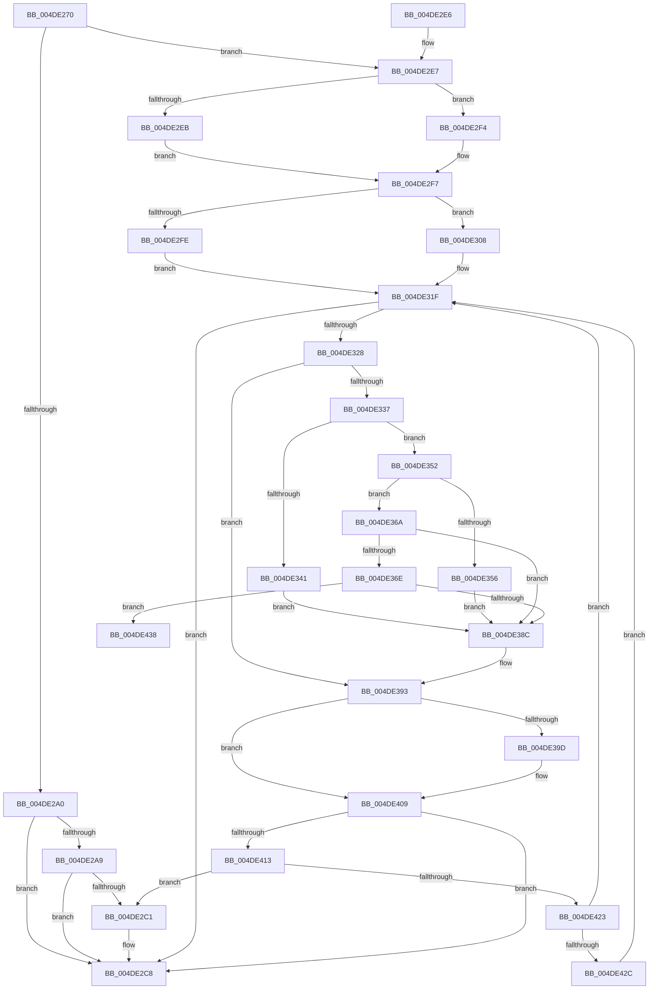

# MiDoGangAssignment

- RVA: `0x004DE270`–`0x004DE451` (길이 `481` bytes)
- VA: `0x00000001404DE270`
- 실행 섹션: `.text`
- PDB 이름 있음: `예`; PDB Function 태그: `아니요`
- unwind 정보 RVA: `0x000BEC4C`
- 디코드: `130`개 명령, `481/481` bytes 표시
- 미해석 바이트: `0` (있으면 어셈블리에 `.byte`로 보존)

> 이 문서는 커널 이미지의 기계어와 PDB 기호를 분석해 생성했습니다. 4번과 5번은 함수 원형과 자료형을 바이너리 사용 방식에서 추정한 C 해석이며 원본 소스 복구 결과는 아닙니다.

## 1. Dependencies

- 직접 호출 지점: **8**; 고유 호출 대상: **8**
- 직접 호출자로 확인된 함수: **2**
- RIP 상대 이미지 참조: **0**

### Outgoing calls
- `0x004DE2B6` → [MiInitializeLargeMdlLeafPfns](../2C/MiInitializeLargeMdlLeafPfns_function_002C8EA4.md) (function, `0x002C8EA4`)
- `0x004DE34B` → [KeZeroPages](../6B/KeZeroPages_function_006BA070.md) (function, `0x006BA070`)
- `0x004DE363` → [memset](../6C/memset_function_006C6C40.md) (function, `0x006C6C40`)
- `0x004DE37E` → [RtlCompareMemoryUlong](../6B/RtlCompareMemoryUlong_function_006BA6F0.md) (function, `0x006BA6F0`)
- `0x004DE3BF` → [MiCreatePfnTemplate](../67/MiCreatePfnTemplate_function_00671824.md) (function, `0x00671824`)
- `0x004DE3FD` → [MiInitializeNewPfns](../67/MiInitializeNewPfns_function_00670E94.md) (function, `0x00670E94`)
- `0x004DE416` → [KeShouldYieldProcessor](../27/KeShouldYieldProcessor_function_002773E0.md) (function, `0x002773E0`)
- `0x004DE44B` → [KeBugCheckEx](../4F/KeBugCheckEx_function_004FD660.md) (function, `0x004FD660`)

### Direct callers
- [MiStartDpcGang](../2C/MiStartDpcGang_function_002C8C34.md) at `0x002C8D7A`
- [MiDpcGangTarget](../69/MiDpcGangTarget_function_00697E60.md) at `0x00698059`

### Static image references
- 디코드된 RIP-relative 메모리 참조가 없습니다.

## 2. Other-region calls and transfers

- 다른 실행 섹션으로 향하는 call: **0**
- 별도 외부 분기/꼬리 이동을 확인하지 못했습니다.

## 3. Assembly (complete function range)

```asm
004DE270  48 89 5C 24 08                  mov qword ptr [rsp + 8], rbx
004DE275  48 89 6C 24 10                  mov qword ptr [rsp + 0x10], rbp
004DE27A  48 89 74 24 18                  mov qword ptr [rsp + 0x18], rsi
004DE27F  57                              push rdi
004DE280  41 54                           push r12
004DE282  41 55                           push r13
004DE284  41 56                           push r14
004DE286  41 57                           push r15
004DE288  48 83 EC 70                     sub rsp, 0x70
004DE28C  8B 81 B8 00 00 00               mov eax, dword ptr [rcx + 0xb8]
004DE292  41 BD 01 00 00 00               mov r13d, 1
004DE298  48 8B F9                        mov rdi, rcx
004DE29B  41 84 C5                        test r13b, al
004DE29E  75 47                           jne 0x1404de2e7
004DE2A0  48 8B 1A                        mov rbx, qword ptr [rdx]
004DE2A3  48 83 3B 00                     cmp qword ptr [rbx], 0
004DE2A7  74 1F                           je 0x1404de2c8
004DE2A9  48 8B 11                        mov rdx, qword ptr [rcx]
004DE2AC  44 89 A9 9C 00 00 00            mov dword ptr [rcx + 0x9c], r13d
004DE2B3  48 8B CB                        mov rcx, rbx
004DE2B6  E8 E9 AB DE FF                  call 0x1402c8ea4
004DE2BB  48 83 3B 00                     cmp qword ptr [rbx], 0
004DE2BF  74 07                           je 0x1404de2c8
004DE2C1  44 89 AF CC 00 00 00            mov dword ptr [rdi + 0xcc], r13d
004DE2C8  4C 8D 5C 24 70                  lea r11, [rsp + 0x70]
004DE2CD  49 8B 5B 30                     mov rbx, qword ptr [r11 + 0x30]
004DE2D1  49 8B 6B 38                     mov rbp, qword ptr [r11 + 0x38]
004DE2D5  49 8B 73 40                     mov rsi, qword ptr [r11 + 0x40]
004DE2D9  49 8B E3                        mov rsp, r11
004DE2DC  41 5F                           pop r15
004DE2DE  41 5E                           pop r14
004DE2E0  41 5D                           pop r13
004DE2E2  41 5C                           pop r12
004DE2E4  5F                              pop rdi
004DE2E5  C3                              ret
004DE2E6  CC                              int3
004DE2E7  A8 04                           test al, 4
004DE2E9  74 09                           je 0x1404de2f4
004DE2EB  4C 8B A1 A8 00 00 00            mov r12, qword ptr [rcx + 0xa8]
004DE2F2  EB 03                           jmp 0x1404de2f7
004DE2F4  45 33 E4                        xor r12d, r12d
004DE2F7  4C 8B 32                        mov r14, qword ptr [rdx]
004DE2FA  A8 38                           test al, 0x38
004DE2FC  75 0A                           jne 0x1404de308
004DE2FE  33 DB                           xor ebx, ebx
004DE300  41 BF 00 40 00 00               mov r15d, 0x4000
004DE306  EB 17                           jmp 0x1404de31f
004DE308  49 8B 1E                        mov rbx, qword ptr [r14]
004DE30B  41 BF 00 02 00 00               mov r15d, 0x200
004DE311  48 2B 19                        sub rbx, qword ptr [rcx]
004DE314  48 C1 E3 0C                     shl rbx, 0xc
004DE318  48 03 99 A0 00 00 00            add rbx, qword ptr [rcx + 0xa0]
004DE31F  49 8B 46 08                     mov rax, qword ptr [r14 + 8]
004DE323  48 85 C0                        test rax, rax
004DE326  74 A0                           je 0x1404de2c8
004DE328  4C 3B F8                        cmp r15, rax
004DE32B  49 8B F7                        mov rsi, r15
004DE32E  48 0F 47 F0                     cmova rsi, rax
004DE332  48 85 DB                        test rbx, rbx
004DE335  74 5C                           je 0x1404de393
004DE337  8B 87 B8 00 00 00               mov eax, dword ptr [rdi + 0xb8]
004DE33D  A8 08                           test al, 8
004DE33F  74 11                           je 0x1404de352
004DE341  48 8B D6                        mov rdx, rsi
004DE344  48 8B CB                        mov rcx, rbx
004DE347  48 C1 E2 0C                     shl rdx, 0xc
004DE34B  E8 20 BD 1D 00                  call 0x1406ba070
004DE350  EB 3A                           jmp 0x1404de38c
004DE352  A8 10                           test al, 0x10
004DE354  74 14                           je 0x1404de36a
004DE356  4C 8B C6                        mov r8, rsi
004DE359  83 CA FF                        or edx, 0xffffffff
004DE35C  49 C1 E0 0C                     shl r8, 0xc
004DE360  48 8B CB                        mov rcx, rbx
004DE363  E8 D8 88 1E 00                  call 0x1406c6c40
004DE368  EB 22                           jmp 0x1404de38c
004DE36A  A8 20                           test al, 0x20
004DE36C  74 1E                           je 0x1404de38c
004DE36E  48 8B EE                        mov rbp, rsi
004DE371  45 33 C0                        xor r8d, r8d
004DE374  48 C1 E5 0C                     shl rbp, 0xc
004DE378  48 8B CB                        mov rcx, rbx
004DE37B  48 8B D5                        mov rdx, rbp
004DE37E  E8 6D C3 1D 00                  call 0x1406ba6f0
004DE383  48 3B C5                        cmp rax, rbp
004DE386  0F 85 AC 00 00 00               jne 0x1404de438
004DE38C  44 89 AF 9C 00 00 00            mov dword ptr [rdi + 0x9c], r13d
004DE393  8B 87 B8 00 00 00               mov eax, dword ptr [rdi + 0xb8]
004DE399  A8 04                           test al, 4
004DE39B  74 6C                           je 0x1404de409
004DE39D  45 0F B7 04 24                  movzx r8d, word ptr [r12]
004DE3A2  48 8D 4C 24 40                  lea rcx, [rsp + 0x40]
004DE3A7  8B 97 B4 00 00 00               mov edx, dword ptr [rdi + 0xb4]
004DE3AD  0F 57 C0                        xorps xmm0, xmm0
004DE3B0  0F 11 44 24 40                  movups xmmword ptr [rsp + 0x40], xmm0
004DE3B5  0F 11 44 24 50                  movups xmmword ptr [rsp + 0x50], xmm0
004DE3BA  0F 11 44 24 60                  movups xmmword ptr [rsp + 0x60], xmm0
004DE3BF  E8 60 34 19 00                  call 0x140671824
004DE3C4  49 8B 06                        mov rax, qword ptr [r14]
004DE3C7  48 8D 0C 40                     lea rcx, [rax + rax*2]
004DE3CB  48 C1 E1 04                     shl rcx, 4
004DE3CF  48 B8 00 00 00 00 00 DE FF FF   movabs rax, 0xffffde0000000000
004DE3D9  48 83 64 24 30 00               and qword ptr [rsp + 0x30], 0
004DE3DF  4C 8D 44 24 40                  lea r8, [rsp + 0x40]
004DE3E4  48 83 64 24 28 00               and qword ptr [rsp + 0x28], 0
004DE3EA  48 03 C8                        add rcx, rax
004DE3ED  8B 87 B4 00 00 00               mov eax, dword ptr [rdi + 0xb4]
004DE3F3  4D 8B CC                        mov r9, r12
004DE3F6  48 8B D6                        mov rdx, rsi
004DE3F9  89 44 24 20                     mov dword ptr [rsp + 0x20], eax
004DE3FD  E8 92 2A 19 00                  call 0x140670e94
004DE402  44 89 AF 9C 00 00 00            mov dword ptr [rdi + 0x9c], r13d
004DE409  49 29 76 08                     sub qword ptr [r14 + 8], rsi
004DE40D  0F 84 B5 FE FF FF               je 0x1404de2c8
004DE413  49 01 36                        add qword ptr [r14], rsi
004DE416  E8 C5 8F D9 FF                  call 0x1402773e0
004DE41B  85 C0                           test eax, eax
004DE41D  0F 85 9E FE FF FF               jne 0x1404de2c1
004DE423  48 85 DB                        test rbx, rbx
004DE426  0F 84 F3 FE FF FF               je 0x1404de31f
004DE42C  48 C1 E6 0C                     shl rsi, 0xc
004DE430  48 03 DE                        add rbx, rsi
004DE433  E9 E7 FE FF FF                  jmp 0x1404de31f
004DE438  4D 8B 06                        mov r8, qword ptr [r14]
004DE43B  4C 8B C8                        mov r9, rax
004DE43E  48 8B D3                        mov rdx, rbx
004DE441  48 89 6C 24 20                  mov qword ptr [rsp + 0x20], rbp
004DE446  B9 27 01 00 00                  mov ecx, 0x127
004DE44B  E8 10 F2 01 00                  call 0x1404fd660
004DE450  CC                              int3
```

## 4. C-style interpretation (structured pseudocode)

```c
__int64 __fastcall MiDoGangAssignment(__int64 a1, __int64 a2)
{
    __int64 result;
    __int64 v_r12;
    __int64 v_rbp;
    __int64 v_rbx;
    __int64 v_rsi;
    __int64 v_rsp;
    unsigned __int64 v_stack_m10;
    unsigned __int64 v_stack_m20;
    unsigned __int64 v_stack_m28;
    unsigned __int64 v_stack_m30;
    unsigned __int64 v_stack_m40;
    unsigned __int64 v_stack_m48;
    unsigned int v_stack_m50;
    unsigned __int64 v_stack_p10;
    unsigned __int64 v_stack_p18;
    unsigned __int64 v_stack_p8;

    v_stack_p8 = v_rbx;
    v_stack_p10 = v_rbp;
    v_stack_p18 = v_rsi;
    v_rsp = (v_rsp) - (112);
    if (((1) & ((unsigned __int8)((unsigned int)(*(unsigned int *)(a1 + 184))))) != 0) goto loc_004DE2E7;
    if ((*(unsigned __int64 *)(*(unsigned __int64 *)(a2))) == 0) goto loc_004DE2C8;
    *(unsigned int *)(a1 + 156) = 1;
    result = MiInitializeLargeMdlLeafPfns(*(unsigned __int64 *)(a2), *(unsigned __int64 *)(a1), a3, a4);
    if ((*(unsigned __int64 *)(*(unsigned __int64 *)(a2))) != 0) {
        *(unsigned int *)(a1 + 204) = 1;
    }
    return result;
loc_004DE2E7:
    if ((((unsigned __int8)(result)) & (4)) == 0) goto loc_004DE2F4;
    goto loc_004DE2F7;
loc_004DE2F4:
    v_r12 = 0;
loc_004DE2F7:
    if ((((unsigned __int8)(result)) & (56)) != 0) goto loc_004DE308;
    v_rbx = 0;
    goto loc_004DE31F;
loc_004DE308:
    v_rbx = (*(unsigned __int64 *)(*(unsigned __int64 *)(*(unsigned __int64 *)(a1)))) - (*(unsigned __int64 *)(*(unsigned __int64 *)(a2)));
    v_rbx = (v_rbx) << (12);
    v_rbx = (v_rbx) + (*(unsigned __int64 *)(*(unsigned __int64 *)(a2) + 160));
loc_004DE31F:
    if (*(unsigned __int64 *)(*(unsigned __int64 *)(*(unsigned __int64 *)(a1)) + 8) == 0) goto loc_004DE2C8;
    v_rsi = 512;
    if (512 > (*(unsigned __int64 *)(*(unsigned __int64 *)(*(unsigned __int64 *)(a1)) + 8))) { v_rsi = *(unsigned __int64 *)(*(unsigned __int64 *)(*(unsigned __int64 *)(a1)) + 8); }
    if (v_rbx == 0) goto loc_004DE393;
    if ((((unsigned __int8)((unsigned int)(*(unsigned int *)(a1 + 184)))) & (8)) == 0) goto loc_004DE352;
    a2 = (v_rsi) << (12);
    result = KeZeroPages(v_rbx, a2, a3, a4);
    goto loc_004DE38C;
loc_004DE352:
    if ((((unsigned __int8)(result)) & (16)) == 0) goto loc_004DE36A;
    a2 = (unsigned int)((a2) | (0xFFFFFFFFULL));
    a3 = (v_rsi) << (12);
    result = memset(v_rbx, a2, a3, a4);
    goto loc_004DE38C;
loc_004DE36A:
    if ((((unsigned __int8)(result)) & (32)) == 0) goto loc_004DE38C;
    a3 = 0;
    v_rbp = (v_rsi) << (12);
    result = RtlCompareMemoryUlong(v_rbx, v_rbp, a3, a4);
    if (result != v_rbp) goto loc_004DE438;
loc_004DE38C:
    *(unsigned int *)(a1 + 156) = 1;
loc_004DE393:
    result = (unsigned int)(*(unsigned int *)(a1 + 184));
    if ((((unsigned __int8)((unsigned int)(*(unsigned int *)(a1 + 184)))) & (4)) != 0) {
        a3 = *(unsigned __int16 *)(v_r12);
        a1 = v_stack_m30;
        a2 = *(unsigned int *)(a1 + 180);
        v_stack_m30 = v_xmm0;
        v_stack_m20 = v_xmm0;
        v_stack_m10 = v_xmm0;
        result = MiCreatePfnTemplate(a1, a2, a3, a4);
        result = *(unsigned __int64 *)(*(unsigned __int64 *)(*(unsigned __int64 *)(a1)));
        a1 = result + result * 2;
        a1 = (a1) << (4);
        a3 = v_stack_m30;
        a1 = (a1) + (result);
        result = *(unsigned int *)(a1 + 180);
        a4 = 0;
        a2 = v_rsi;
        v_stack_m50 = (unsigned int)(result);
        result = MiInitializeNewPfns(a1, a2, a3, a4);
        *(unsigned int *)(a1 + 156) = 1;
    }
    if (condition_is_equal) goto loc_004DE2C8;
    result = KeShouldYieldProcessor(a1, a2, a3, a4);
    if ((unsigned int)(result) != 0) goto loc_004DE2C1;
    if (v_rbx == 0) goto loc_004DE31F;
    v_rsi = (v_rsi) << (12);
    v_rbx = (v_rbx) + (v_rsi);
    goto loc_004DE31F;
loc_004DE438:
    v_stack_m50 = v_rbp;
    result = KeBugCheckEx(295, v_rbx, *(unsigned __int64 *)(*(unsigned __int64 *)(*(unsigned __int64 *)(a1))), result);
    return result;
}
```

## 5. (Beta) C Style

```c
int64_t MiDoGangAssignment(void *Arg1, void *Arg2)
{
    uint8_t *arg1 = (uint8_t *)Arg1;
    uint8_t *arg2 = (uint8_t *)Arg2;

    int64_t result;
    int64_t local_r12;
    int64_t local_rbp;
    int64_t local_rbx;
    int64_t local_rsi;
    int64_t local_rsp;
    uint64_t v_stack_m10;
    uint64_t v_stack_m20;
    uint64_t v_stack_m28;
    uint64_t v_stack_m30;
    uint64_t v_stack_m40;
    uint64_t v_stack_m48;
    uint32_t v_stack_m50;
    uint64_t v_stack_p10;
    uint64_t v_stack_p18;
    uint64_t v_stack_p8;

    v_stack_p8 = local_rbx;
    v_stack_p10 = local_rbp;
    v_stack_p18 = local_rsi;
    local_rsp = (local_rsp) - (112);
    if (((1) & ((uint8_t)((uint32_t)(*(uint32_t *)(arg1 + 0xB8))))) != 0) goto loc_004DE2E7;
    if ((*(uint64_t *)(*(uint64_t *)(arg2))) == 0) goto loc_004DE2C8;
    *(uint32_t *)(arg1 + 0x9C) = 1;
    result = MiInitializeLargeMdlLeafPfns(*(uint64_t *)(arg2), *(uint64_t *)(arg1), a3, a4);
    if ((*(uint64_t *)(*(uint64_t *)(arg2))) != 0) {
        *(uint32_t *)(arg1 + 0xCC) = 1;
    }
    return result;
loc_004DE2E7:
    if ((((uint8_t)(result)) & (4)) == 0) goto loc_004DE2F4;
    goto loc_004DE2F7;
loc_004DE2F4:
    local_r12 = 0;
loc_004DE2F7:
    if ((((uint8_t)(result)) & (56)) != 0) goto loc_004DE308;
    local_rbx = 0;
    goto loc_004DE31F;
loc_004DE308:
    local_rbx = (*(uint64_t *)(*(uint64_t *)(*(uint64_t *)(arg1)))) - (*(uint64_t *)(*(uint64_t *)(arg2)));
    local_rbx = (local_rbx) << (12);
    local_rbx = (local_rbx) + (*(uint64_t *)(*(uint64_t *)(arg2) + 0xA0));
loc_004DE31F:
    if (*(uint64_t *)(*(uint64_t *)(*(uint64_t *)(arg1)) + 0x8) == 0) goto loc_004DE2C8;
    local_rsi = 512;
    if (512 > (*(uint64_t *)(*(uint64_t *)(*(uint64_t *)(arg1)) + 0x8))) { local_rsi = *(uint64_t *)(*(uint64_t *)(*(uint64_t *)(arg1)) + 0x8); }
    if (local_rbx == 0) goto loc_004DE393;
    if ((((uint8_t)((uint32_t)(*(uint32_t *)(arg1 + 0xB8)))) & (8)) == 0) goto loc_004DE352;
    Arg2 = (local_rsi) << (12);
    result = KeZeroPages(local_rbx, Arg2, a3, a4);
    goto loc_004DE38C;
loc_004DE352:
    if ((((uint8_t)(result)) & (16)) == 0) goto loc_004DE36A;
    Arg2 = (uint32_t)((Arg2) | (0xFFFFFFFFULL));
    a3 = (local_rsi) << (12);
    result = memset(local_rbx, Arg2, a3, a4);
    goto loc_004DE38C;
loc_004DE36A:
    if ((((uint8_t)(result)) & (32)) == 0) goto loc_004DE38C;
    a3 = 0;
    local_rbp = (local_rsi) << (12);
    result = RtlCompareMemoryUlong(local_rbx, local_rbp, a3, a4);
    if (result != local_rbp) goto loc_004DE438;
loc_004DE38C:
    *(uint32_t *)(arg1 + 0x9C) = 1;
loc_004DE393:
    result = (uint32_t)(*(uint32_t *)(arg1 + 0xB8));
    if ((((uint8_t)((uint32_t)(*(uint32_t *)(arg1 + 0xB8)))) & (4)) != 0) {
        a3 = *(uint16_t *)(local_r12);
        Arg1 = v_stack_m30;
        Arg2 = *(uint32_t *)(arg1 + 0xB4);
        v_stack_m30 = v_xmm0;
        v_stack_m20 = v_xmm0;
        v_stack_m10 = v_xmm0;
        result = MiCreatePfnTemplate(Arg1, Arg2, a3, a4);
        result = *(uint64_t *)(*(uint64_t *)(*(uint64_t *)(arg1)));
        Arg1 = result + result * 2;
        Arg1 = (Arg1) << (4);
        a3 = v_stack_m30;
        Arg1 = (Arg1) + (result);
        result = *(uint32_t *)(arg1 + 0xB4);
        a4 = 0;
        Arg2 = local_rsi;
        v_stack_m50 = (uint32_t)(result);
        result = MiInitializeNewPfns(Arg1, Arg2, a3, a4);
        *(uint32_t *)(arg1 + 0x9C) = 1;
    }
    if (condition_is_equal) goto loc_004DE2C8;
    result = KeShouldYieldProcessor(Arg1, Arg2, a3, a4);
    if ((uint32_t)(result) != 0) goto loc_004DE2C1;
    if (local_rbx == 0) goto loc_004DE31F;
    local_rsi = (local_rsi) << (12);
    local_rbx = (local_rbx) + (local_rsi);
    goto loc_004DE31F;
loc_004DE438:
    v_stack_m50 = local_rbp;
    result = KeBugCheckEx(295, local_rbx, *(uint64_t *)(*(uint64_t *)(*(uint64_t *)(arg1))), result);
    return result;
}
```

### 관측된 메모리 오프셋

구조체 형식이 확인되지 않은 접근은 인자 기준의 오프셋으로만 기록했습니다.

| 기준 인자 | 오프셋 표현 | 폭 (bit) | 접근 |
|---|---:|---:|---|
| `Arg1` | `+ 0x0` | `64` | `R` |
| `Arg1` | `+ 0x9C` | `32` | `W` |
| `Arg1` | `+ 0xA0` | `64` | `R` |
| `Arg1` | `+ 0xA8` | `64` | `R` |
| `Arg1` | `+ 0xB4` | `32` | `R` |
| `Arg1` | `+ 0xB8` | `32` | `R` |
| `Arg1` | `+ 0xCC` | `32` | `W` |
| `Arg2` | `+ 0x0` | `64` | `R` |

## 6. Execution-region graph

[열기: 2D/3D 그래프와 함수 탐색 컨트롤 패널](../../../control-panel.html?section=text&rva=0x004DE270&view=graph)

- 2D 그래프는 위에서 아래로 흐르고, 3D 그래프는 빈 공간을 드래그해 회전합니다. Shift+드래그는 이동, 휠은 확대·축소, 함수 노드 선택은 대상 보고서 이동입니다.

### Static fallback


