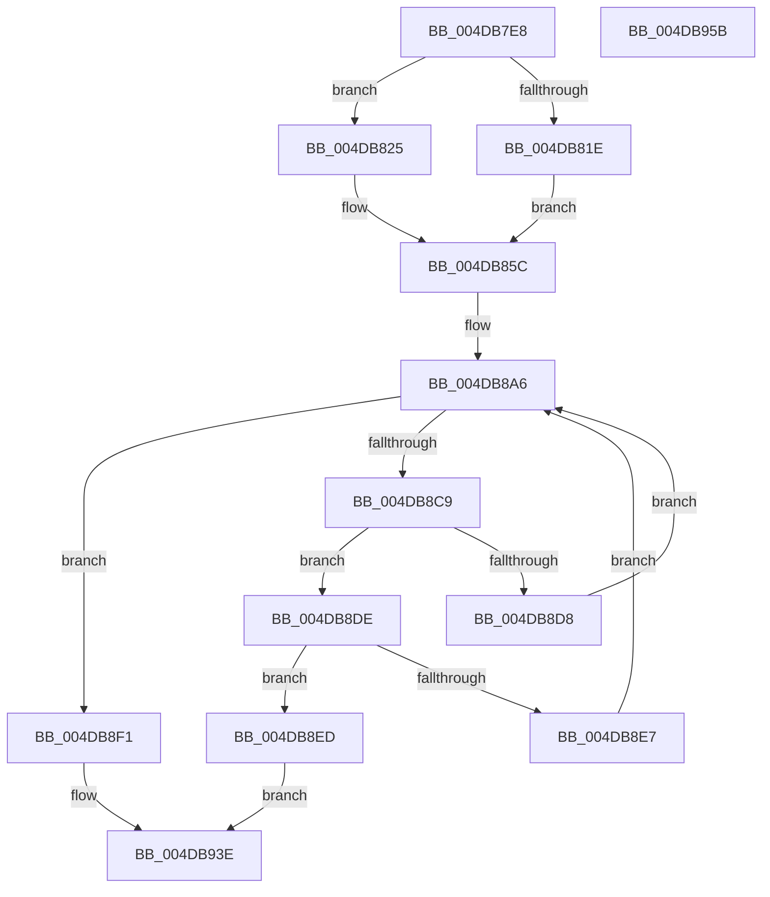

# MiFindLargeNodePage

- RVA: `0x004DB7E8`–`0x004DB95C` (길이 `372` bytes)
- VA: `0x00000001404DB7E8`
- 실행 섹션: `.text`
- PDB 이름 있음: `예`; PDB Function 태그: `아니요`
- unwind 정보 RVA: `0x0008C20C`
- 디코드: `97`개 명령, `372/372` bytes 표시
- 미해석 바이트: `0` (있으면 어셈블리에 `.byte`로 보존)

> 이 문서는 커널 이미지의 기계어와 PDB 기호를 분석해 생성했습니다. 4번과 5번은 함수 원형과 자료형을 바이너리 사용 방식에서 추정한 C 해석이며 원본 소스 복구 결과는 아닙니다.

## 1. Dependencies

- 직접 호출 지점: **3**; 고유 호출 대상: **3**
- 직접 호출자로 확인된 함수: **2**
- RIP 상대 이미지 참조: **3**

### Outgoing calls
- `0x004DB8BC` → [MiGetLargePageDemoteAsNeeded](../3B/MiGetLargePageDemoteAsNeeded_function_003B8440.md) (function, `0x003B8440`)
- `0x004DB8F4` → [MiGetPfnPageSizeIndex](../31/MiGetPfnPageSizeIndex_function_0031C710.md) (function, `0x0031C710`)
- `0x004DB936` → [MiUpdateLargePageBitMap](../37/MiUpdateLargePageBitMap_function_0037619C.md) (function, `0x0037619C`)

### Direct callers
- [MiFindContiguousPagesEx](../28/MiFindContiguousPagesEx_function_0028BDE0.md) at `0x0028C78A`
- [MiAllocatePartitionPhysicalPages](../../page/80/MiAllocatePartitionPhysicalPages_function_0080C9D4.md) at `0x0080CCC8`

### Static image references
- `0x004DB804` → RVA `0x00FC5000` (`ALMOSTRO`; read)
- `0x004DB80F` → RVA `0x00000000` (`image boundary/outside`; read)
- `0x004DB834` → RVA `0x00E2DBD0` (`.data`; read)

## 2. Other-region calls and transfers

- 다른 실행 섹션으로 향하는 call: **0**
- 별도 외부 분기/꼬리 이동을 확인하지 못했습니다.

## 3. Assembly (complete function range)

```asm
004DB7E8  48 89 5C 24 08                  mov qword ptr [rsp + 8], rbx
004DB7ED  48 89 6C 24 10                  mov qword ptr [rsp + 0x10], rbp
004DB7F2  48 89 74 24 18                  mov qword ptr [rsp + 0x18], rsi
004DB7F7  57                              push rdi
004DB7F8  41 54                           push r12
004DB7FA  41 55                           push r13
004DB7FC  41 56                           push r14
004DB7FE  41 57                           push r15
004DB800  48 83 EC 30                     sub rsp, 0x30
004DB804  44 0F B7 15 F4 97 AE 00         movzx r10d, word ptr [rip + 0xae97f4]
004DB80C  4C 8B F1                        mov r14, rcx
004DB80F  48 8D 0D EA 47 B2 FF            lea rcx, [rip - 0x4db816]
004DB816  45 8B E1                        mov r12d, r9d
004DB819  41 3B D2                        cmp edx, r10d
004DB81C  73 07                           jae 0x1404db825
004DB81E  33 FF                           xor edi, edi
004DB820  8D 6F 04                        lea ebp, [rdi + 4]
004DB823  EB 37                           jmp 0x1404db85c
004DB825  65 48 8B 04 25 88 01 00 00      mov rax, qword ptr gs:[0x188]
004DB82E  8B 90 4C 02 00 00               mov edx, dword ptr [rax + 0x24c]
004DB834  48 8B 05 95 23 95 00            mov rax, qword ptr [rip + 0x952395]
004DB83B  48 8B 94 D1 40 8C FC 00         mov rdx, qword ptr [rcx + rdx*8 + 0xfc8c40]
004DB843  8B 92 54 87 00 00               mov edx, dword ptr [rdx + 0x8754]
004DB849  44 0F AF D2                     imul r10d, edx
004DB84D  4A 8D 3C 90                     lea rdi, [rax + r10*4]
004DB851  0F B7 05 A8 97 AE 00            movzx eax, word ptr [rip + 0xae97a8]
004DB858  48 8D 2C 87                     lea rbp, [rdi + rax*4]
004DB85C  8B 84 24 80 00 00 00            mov eax, dword ptr [rsp + 0x80]
004DB863  24 01                           and al, 1
004DB865  F6 D8                           neg al
004DB867  1B C9                           sbb ecx, ecx
004DB869  F7 D1                           not ecx
004DB86B  83 E1 30                        and ecx, 0x30
004DB86E  44 0F 20 C0                     mov rax, cr8
004DB872  8B 9C 24 88 00 00 00            mov ebx, dword ptr [rsp + 0x88]
004DB879  44 8B F9                        mov r15d, ecx
004DB87C  4C 8B AC 24 90 00 00 00         mov r13, qword ptr [rsp + 0x90]
004DB884  41 83 CF 01                     or r15d, 1
004DB888  3C 02                           cmp al, 2
004DB88A  44 0F 45 F9                     cmovne r15d, ecx
004DB88E  83 E3 03                        and ebx, 3
004DB891  C1 E3 02                        shl ebx, 2
004DB894  41 83 E0 03                     and r8d, 3
004DB898  41 0B D8                        or ebx, r8d
004DB89B  83 E2 3F                        and edx, 0x3f
004DB89E  C1 E3 07                        shl ebx, 7
004DB8A1  0B DA                           or ebx, edx
004DB8A3  C1 E3 09                        shl ebx, 9
004DB8A6  4C 89 6C 24 28                  mov qword ptr [rsp + 0x28], r13
004DB8AB  45 8B CC                        mov r9d, r12d
004DB8AE  48 83 64 24 20 00               and qword ptr [rsp + 0x20], 0
004DB8B4  45 8B C7                        mov r8d, r15d
004DB8B7  8B D3                           mov edx, ebx
004DB8B9  49 8B CE                        mov rcx, r14
004DB8BC  E8 7F CB ED FF                  call 0x1403b8440
004DB8C1  48 8B F0                        mov rsi, rax
004DB8C4  48 85 C0                        test rax, rax
004DB8C7  75 28                           jne 0x1404db8f1
004DB8C9  8B C3                           mov eax, ebx
004DB8CB  0B 84 24 80 00 00 00            or eax, dword ptr [rsp + 0x80]
004DB8D2  0F BA E0 0F                     bt eax, 0xf
004DB8D6  72 06                           jb 0x1404db8de
004DB8D8  0F BA EB 0F                     bts ebx, 0xf
004DB8DC  EB C8                           jmp 0x1404db8a6
004DB8DE  48 83 C7 04                     add rdi, 4
004DB8E2  48 3B FD                        cmp rdi, rbp
004DB8E5  74 06                           je 0x1404db8ed
004DB8E7  0F BA F3 0F                     btr ebx, 0xf
004DB8EB  EB B9                           jmp 0x1404db8a6
004DB8ED  33 C0                           xor eax, eax
004DB8EF  EB 4D                           jmp 0x1404db93e
004DB8F1  48 8B CE                        mov rcx, rsi
004DB8F4  E8 17 0E E4 FF                  call 0x14031c710
004DB8F9  44 8B C0                        mov r8d, eax
004DB8FC  48 B8 00 00 00 00 00 DE FF FF   movabs rax, 0xffffde0000000000
004DB906  48 8B D6                        mov rdx, rsi
004DB909  41 B9 03 00 00 00               mov r9d, 3
004DB90F  48 2B D0                        sub rdx, rax
004DB912  49 8B CE                        mov rcx, r14
004DB915  48 C1 FA 04                     sar rdx, 4
004DB919  48 B8 AB AA AA AA AA AA AA AA   movabs rax, 0xaaaaaaaaaaaaaaab
004DB923  48 0F AF D0                     imul rdx, rax
004DB927  48 8D 05 D2 46 B2 FF            lea rax, [rip - 0x4db92e]
004DB92E  4E 8B 84 C0 60 1C 01 00         mov r8, qword ptr [rax + r8*8 + 0x11c60]
004DB936  E8 61 A8 E9 FF                  call 0x14037619c
004DB93B  48 8B C6                        mov rax, rsi
004DB93E  48 8B 5C 24 60                  mov rbx, qword ptr [rsp + 0x60]
004DB943  48 8B 6C 24 68                  mov rbp, qword ptr [rsp + 0x68]
004DB948  48 8B 74 24 70                  mov rsi, qword ptr [rsp + 0x70]
004DB94D  48 83 C4 30                     add rsp, 0x30
004DB951  41 5F                           pop r15
004DB953  41 5E                           pop r14
004DB955  41 5D                           pop r13
004DB957  41 5C                           pop r12
004DB959  5F                              pop rdi
004DB95A  C3                              ret
004DB95B  CC                              int3
```

## 4. C-style interpretation (structured pseudocode)

```c
__int64 __fastcall MiFindLargeNodePage(__int64 a1, int a2, int a3, int a4, unsigned int a5, unsigned int a6, __int64 a7)
{
    __int64 result;
    __int64 v_r10;
    __int64 v_r15;
    __int64 v_rbx;
    __int64 v_rdi;
    __int64 v_rsp;
    unsigned __int64 v_stack_m30;
    unsigned __int64 v_stack_m38;
    unsigned __int64 v_stack_p10;
    unsigned __int64 v_stack_p18;
    unsigned __int64 v_stack_p8;

    v_stack_p8 = v_rbx;
    v_stack_p10 = v_rbp;
    v_stack_p18 = v_rsi;
    v_rsp = (v_rsp) - (48);
    if (a2 >= ((unsigned int)(*(unsigned __int16 *)(v_rip + 11442164)))) goto loc_004DB825;
    v_rdi = 0;
    goto loc_004DB85C;
loc_004DB825:
    v_r10 = (unsigned int)((*(unsigned __int16 *)(v_rip + 11442164)) * ((unsigned int)((unsigned int)(*(unsigned int *)(*(unsigned __int64 *)(v_rip - 5093398 + (unsigned int)(*(unsigned int *)(*(unsigned __int64 *)(gs_base + (0 + 392)) + 588)) * 8 + 16550976) + 34644)))));
loc_004DB85C:
    result = (unsigned __int8)(((unsigned int)(a5)) & (1));
    result = (unsigned __int8)(-(result));
    a1 = (unsigned int)(~(v_rip - 5093398));
    a1 = (unsigned int)((a1) & (48));
    v_r15 = (unsigned int)(((unsigned int)((unsigned int)(a1))) | (1));
    if (((unsigned __int8)(v_cr8)) != 2) { v_r15 = (unsigned int)(a1); }
    v_rbx = (unsigned int)(((unsigned int)(a6)) & (3));
    v_rbx = (unsigned int)((v_rbx) << (2));
    a3 = (unsigned int)((a3) & (3));
    v_rbx = (unsigned int)((v_rbx) | (a3));
    a2 = (unsigned int)(((unsigned int)(*(unsigned int *)(*(unsigned __int64 *)(v_rip - 5093398 + (unsigned int)(*(unsigned int *)(*(unsigned __int64 *)(gs_base + (0 + 392)) + 588)) * 8 + 16550976) + 34644))) & (63));
    v_rbx = (unsigned int)((v_rbx) << (7));
    v_rbx = (unsigned int)((v_rbx) | (a2));
    v_rbx = (unsigned int)((v_rbx) << (9));
loc_004DB8A6:
    v_stack_m30 = a7;
    result = MiGetLargePageDemoteAsNeeded(a1, (unsigned int)((unsigned int)(v_rbx)), (unsigned int)((unsigned int)(v_r15)), (unsigned int)((unsigned int)((unsigned int)(a4))));
    if (result != 0) goto loc_004DB8F1;
    result = (unsigned int)(((unsigned int)((unsigned int)(v_rbx))) | (a5));
    if (condition_is_below) goto loc_004DB8DE;
    goto loc_004DB8A6;
loc_004DB8DE:
    v_rdi = (*(unsigned __int64 *)(v_rip + 9773973) + v_r10 * 4) + (4);
    if (v_rdi == (*(unsigned __int64 *)(v_rip + 9773973) + v_r10 * 4 + *(unsigned __int16 *)(v_rip + 11442088) * 4)) goto loc_004DB8ED;
    goto loc_004DB8A6;
loc_004DB8ED:
    result = 0;
    goto loc_004DB93E;
loc_004DB8F1:
    result = MiGetPfnPageSizeIndex(0, (unsigned int)((unsigned int)(v_rbx)), (unsigned int)((unsigned int)(v_r15)), (unsigned int)((unsigned int)((unsigned int)(a4))));
    a2 = (result) - (result);
    a2 = (a2) >> (4);
    a2 = (a2) * (result);
    result = MiUpdateLargePageBitMap(a1, a2, *(unsigned __int64 *)(v_rip - 5093678 + (unsigned int)((unsigned int)(result)) * 8 + 72800), 3);
loc_004DB93E:
    v_rsp = (v_rsp) + (48);
    return result;
}
```

## 5. (Beta) C Style

```c
int64_t MiFindLargeNodePage(int64_t Arg1, int32_t Arg2, int32_t Arg3, int32_t Arg4, uint32_t Arg5, uint32_t Arg6, int64_t Arg7)
{
    int64_t result;
    int64_t local_r10;
    int64_t local_r15;
    int64_t local_rbx;
    int64_t local_rdi;
    int64_t local_rsp;
    uint64_t v_stack_m30;
    uint64_t v_stack_m38;
    uint64_t v_stack_p10;
    uint64_t v_stack_p18;
    uint64_t v_stack_p8;

    v_stack_p8 = local_rbx;
    v_stack_p10 = local_rbp;
    v_stack_p18 = local_rsi;
    local_rsp = (local_rsp) - (48);
    if (Arg2 >= ((uint32_t)(*(uint16_t *)(v_rip + 0xAE97F4)))) goto loc_004DB825;
    local_rdi = 0;
    goto loc_004DB85C;
loc_004DB825:
    local_r10 = (uint32_t)((*(uint16_t *)(v_rip + 0xAE97F4)) * ((uint32_t)((uint32_t)(*(uint32_t *)(*(uint64_t *)(v_rip - 0x4DB816 + (uint32_t)(*(uint32_t *)(*(uint64_t *)(gs_base + (0 + 0x188)) + 0x24C)) * 8 + 0xFC8C40) + 0x8754)))));
loc_004DB85C:
    result = (uint8_t)(((uint32_t)(Arg5)) & (1));
    result = (uint8_t)(-(result));
    Arg1 = (uint32_t)(~(v_rip - 5093398));
    Arg1 = (uint32_t)((Arg1) & (48));
    local_r15 = (uint32_t)(((uint32_t)((uint32_t)(Arg1))) | (1));
    if (((uint8_t)(v_cr8)) != 2) { local_r15 = (uint32_t)(Arg1); }
    local_rbx = (uint32_t)(((uint32_t)(Arg6)) & (3));
    local_rbx = (uint32_t)((local_rbx) << (2));
    Arg3 = (uint32_t)((Arg3) & (3));
    local_rbx = (uint32_t)((local_rbx) | (Arg3));
    Arg2 = (uint32_t)(((uint32_t)(*(uint32_t *)(*(uint64_t *)(v_rip - 0x4DB816 + (uint32_t)(*(uint32_t *)(*(uint64_t *)(gs_base + (0 + 0x188)) + 0x24C)) * 8 + 0xFC8C40) + 0x8754))) & (63));
    local_rbx = (uint32_t)((local_rbx) << (7));
    local_rbx = (uint32_t)((local_rbx) | (Arg2));
    local_rbx = (uint32_t)((local_rbx) << (9));
loc_004DB8A6:
    v_stack_m30 = Arg7;
    result = MiGetLargePageDemoteAsNeeded(Arg1, (uint32_t)((uint32_t)(local_rbx)), (uint32_t)((uint32_t)(local_r15)), (uint32_t)((uint32_t)((uint32_t)(Arg4))));
    if (result != 0) goto loc_004DB8F1;
    result = (uint32_t)(((uint32_t)((uint32_t)(local_rbx))) | (Arg5));
    if (condition_is_below) goto loc_004DB8DE;
    goto loc_004DB8A6;
loc_004DB8DE:
    local_rdi = (*(uint64_t *)(v_rip + 0x952395) + local_r10 * 4) + (4);
    if (local_rdi == (*(uint64_t *)(v_rip + 0x952395) + local_r10 * 4 + *(uint16_t *)(v_rip + 0xAE97A8) * 4)) goto loc_004DB8ED;
    goto loc_004DB8A6;
loc_004DB8ED:
    result = 0;
    goto loc_004DB93E;
loc_004DB8F1:
    result = MiGetPfnPageSizeIndex(0, (uint32_t)((uint32_t)(local_rbx)), (uint32_t)((uint32_t)(local_r15)), (uint32_t)((uint32_t)((uint32_t)(Arg4))));
    Arg2 = (result) - (result);
    Arg2 = (Arg2) >> (4);
    Arg2 = (Arg2) * (result);
    result = MiUpdateLargePageBitMap(Arg1, Arg2, *(uint64_t *)(v_rip - 0x4DB92E + (uint32_t)((uint32_t)(result)) * 8 + 0x11C60), 3);
loc_004DB93E:
    local_rsp = (local_rsp) + (48);
    return result;
}
```

## 6. Execution-region graph

[열기: 2D/3D 그래프와 함수 탐색 컨트롤 패널](../../../control-panel.html?section=text&rva=0x004DB7E8&view=graph)

- 2D 그래프는 위에서 아래로 흐르고, 3D 그래프는 빈 공간을 드래그해 회전합니다. Shift+드래그는 이동, 휠은 확대·축소, 함수 노드 선택은 대상 보고서 이동입니다.

### Static fallback


