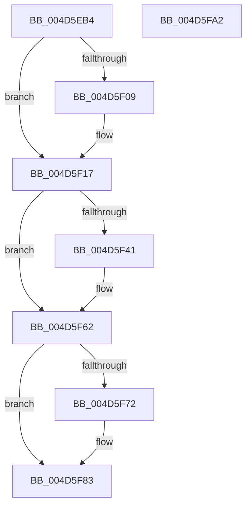

# MiFinishPageFileExtension

- RVA: `0x004D5EB4`–`0x004D5FA3` (길이 `239` bytes)
- VA: `0x00000001404D5EB4`
- 실행 섹션: `.text`
- PDB 이름 있음: `예`; PDB Function 태그: `아니요`
- unwind 정보 RVA: `0x0005FEF8`
- 디코드: `69`개 명령, `239/239` bytes 표시
- 미해석 바이트: `0` (있으면 어셈블리에 `.byte`로 보존)

> 이 문서는 커널 이미지의 기계어와 PDB 기호를 분석해 생성했습니다. 4번과 5번은 함수 원형과 자료형을 바이너리 사용 방식에서 추정한 C 해석이며 원본 소스 복구 결과는 아닙니다.

## 1. Dependencies

- 직접 호출 지점: **7**; 고유 호출 대상: **6**
- 직접 호출자로 확인된 함수: **2**
- RIP 상대 이미지 참조: **0**

### Outgoing calls
- `0x004D5EE4` → [ExAcquireSpinLockExclusive](../24/ExAcquireSpinLockExclusive_function_00248690.md) (function, `0x00248690`)
- `0x004D5EFB` → [RtlClearBits](../3E/RtlClearBits_function_003E1A90.md) (function, `0x003E1A90`)
- `0x004D5F12` → [RtlClearBits](../3E/RtlClearBits_function_003E1A90.md) (function, `0x003E1A90`)
- `0x004D5F4C` → [MiCoalescePageFileBitmapsCache](../3E/MiCoalescePageFileBitmapsCache_function_003E4540.md) (function, `0x003E4540`)
- `0x004D5F5D` → [MiUpdateReserveClusterInfo](../46/MiUpdateReserveClusterInfo_function_0046606C.md) (function, `0x0046606C`)
- `0x004D5F68` → [MiReleaseSpinLockExclusive](../24/MiReleaseSpinLockExclusive_function_002482C0.md) (function, `0x002482C0`)
- `0x004D5F7E` → [KeSetEvent](../33/KeSetEvent_function_0033F310.md) (function, `0x0033F310`)

### Direct callers
- [MiStoreExtendVirtualPagefile](../4F/MiStoreExtendVirtualPagefile_function_004F73AC.md) at `0x004F74A5`
- [MiAttemptPageFileExtension](../../page/7F/MiAttemptPageFileExtension_function_007FEA2C.md) at `0x007FEB80`

### Static image references
- 디코드된 RIP-relative 메모리 참조가 없습니다.

## 2. Other-region calls and transfers

- 다른 실행 섹션으로 향하는 call: **0**
- 별도 외부 분기/꼬리 이동을 확인하지 못했습니다.

## 3. Assembly (complete function range)

```asm
004D5EB4  48 8B C4                        mov rax, rsp
004D5EB7  48 89 58 08                     mov qword ptr [rax + 8], rbx
004D5EBB  48 89 68 10                     mov qword ptr [rax + 0x10], rbp
004D5EBF  48 89 70 18                     mov qword ptr [rax + 0x18], rsi
004D5EC3  48 89 78 20                     mov qword ptr [rax + 0x20], rdi
004D5EC7  41 54                           push r12
004D5EC9  41 56                           push r14
004D5ECB  41 57                           push r15
004D5ECD  48 83 EC 20                     sub rsp, 0x20
004D5ED1  48 8D AA C8 00 00 00            lea rbp, [rdx + 0xc8]
004D5ED8  4C 8B F9                        mov r15, rcx
004D5EDB  48 8B CD                        mov rcx, rbp
004D5EDE  41 8B F8                        mov edi, r8d
004D5EE1  48 8B DA                        mov rbx, rdx
004D5EE4  E8 A7 27 D7 FF                  call 0x140248690
004D5EE9  4C 8B 73 50                     mov r14, qword ptr [rbx + 0x50]
004D5EED  44 8B C7                        mov r8d, edi
004D5EF0  8B 33                           mov esi, dword ptr [rbx]
004D5EF2  44 8A E0                        mov r12b, al
004D5EF5  8B D6                           mov edx, esi
004D5EF7  49 8D 4E 08                     lea rcx, [r14 + 8]
004D5EFB  E8 90 BB F0 FF                  call 0x1403e1a90
004D5F00  F6 83 AC 00 00 00 40            test byte ptr [rbx + 0xac], 0x40
004D5F07  75 0E                           jne 0x1404d5f17
004D5F09  49 8D 4E 18                     lea rcx, [r14 + 0x18]
004D5F0D  44 8B C7                        mov r8d, edi
004D5F10  8B D6                           mov edx, esi
004D5F12  E8 79 BB F0 FF                  call 0x1403e1a90
004D5F17  8B 0B                           mov ecx, dword ptr [rbx]
004D5F19  03 CF                           add ecx, edi
004D5F1B  89 0B                           mov dword ptr [rbx], ecx
004D5F1D  8B 4B 0C                        mov ecx, dword ptr [rbx + 0xc]
004D5F20  03 CF                           add ecx, edi
004D5F22  89 4B 0C                        mov dword ptr [rbx + 0xc], ecx
004D5F25  8B 4B 14                        mov ecx, dword ptr [rbx + 0x14]
004D5F28  03 CF                           add ecx, edi
004D5F2A  89 4B 14                        mov dword ptr [rbx + 0x14], ecx
004D5F2D  40 8A BB AE 00 00 00            mov dil, byte ptr [rbx + 0xae]
004D5F34  40 80 E7 01                     and dil, 1
004D5F38  F6 83 AC 00 00 00 40            test byte ptr [rbx + 0xac], 0x40
004D5F3F  75 21                           jne 0x1404d5f62
004D5F41  FF 43 60                        inc dword ptr [rbx + 0x60]
004D5F44  44 8B C6                        mov r8d, esi
004D5F47  33 D2                           xor edx, edx
004D5F49  48 8B CB                        mov rcx, rbx
004D5F4C  E8 EF E5 F0 FF                  call 0x1403e4540
004D5F51  48 8B 8B D8 00 00 00            mov rcx, qword ptr [rbx + 0xd8]
004D5F58  45 33 C0                        xor r8d, r8d
004D5F5B  33 D2                           xor edx, edx
004D5F5D  E8 0A 01 F9 FF                  call 0x14046606c
004D5F62  41 8A D4                        mov dl, r12b
004D5F65  48 8B CD                        mov rcx, rbp
004D5F68  E8 53 23 D7 FF                  call 0x1402482c0
004D5F6D  40 84 FF                        test dil, dil
004D5F70  74 11                           je 0x1404d5f83
004D5F72  49 8D 8F A0 03 00 00            lea rcx, [r15 + 0x3a0]
004D5F79  45 33 C0                        xor r8d, r8d
004D5F7C  33 D2                           xor edx, edx
004D5F7E  E8 8D 93 E6 FF                  call 0x14033f310
004D5F83  48 8B 5C 24 40                  mov rbx, qword ptr [rsp + 0x40]
004D5F88  48 8B 6C 24 48                  mov rbp, qword ptr [rsp + 0x48]
004D5F8D  48 8B 74 24 50                  mov rsi, qword ptr [rsp + 0x50]
004D5F92  48 8B 7C 24 58                  mov rdi, qword ptr [rsp + 0x58]
004D5F97  48 83 C4 20                     add rsp, 0x20
004D5F9B  41 5F                           pop r15
004D5F9D  41 5E                           pop r14
004D5F9F  41 5C                           pop r12
004D5FA1  C3                              ret
004D5FA2  CC                              int3
```

## 4. C-style interpretation (structured pseudocode)

```c
__int64 __fastcall MiFinishPageFileExtension(__int64 a1, __int64 a2, int a3)
{
    __int64 result;
    __int64 v_rdi;
    __int64 v_rsp;
    unsigned __int64 v_stack_p10;
    unsigned __int64 v_stack_p18;
    unsigned __int64 v_stack_p20;
    unsigned __int64 v_stack_p8;

    *(unsigned __int64 *)(v_rsp + 8) = v_rbx;
    *(unsigned __int64 *)(v_rsp + 16) = v_rbp;
    *(unsigned __int64 *)(v_rsp + 24) = v_rsi;
    *(unsigned __int64 *)(v_rsp + 32) = v_rdi;
    v_rsp = (v_rsp) - (32);
    result = ExAcquireSpinLockExclusive(a2 + 200, a2, a3, a4);
    result = RtlClearBits(*(unsigned __int64 *)(a2 + 80) + 8, (unsigned int)((unsigned int)((unsigned int)(*(unsigned int *)(a2)))), (unsigned int)((unsigned int)((unsigned int)(a3))), a4);
    if (((*(unsigned __int8 *)(a2 + 172)) & (64)) == 0) {
        a1 = *(unsigned __int64 *)(a2 + 80) + 24;
        a3 = (unsigned int)((unsigned int)(a3));
        a2 = (unsigned int)((unsigned int)(*(unsigned int *)(a2)));
        result = RtlClearBits(a1, a2, a3, a4);
    }
    a1 = (unsigned int)(((unsigned int)(*(unsigned int *)(a2))) + ((unsigned int)((unsigned int)(a3))));
    *(unsigned int *)(a2) = (unsigned int)(a1);
    a1 = (unsigned int)(((unsigned int)(*(unsigned int *)(a2 + 12))) + ((unsigned int)((unsigned int)(a3))));
    *(unsigned int *)(a2 + 12) = (unsigned int)(a1);
    a1 = (unsigned int)(((unsigned int)(*(unsigned int *)(a2 + 20))) + ((unsigned int)((unsigned int)(a3))));
    *(unsigned int *)(a2 + 20) = (unsigned int)(a1);
    v_rdi = (unsigned __int8)((*(unsigned __int8 *)(a2 + 174)) & (1));
    if (((*(unsigned __int8 *)(a2 + 172)) & (64)) == 0) {
        a3 = (unsigned int)((unsigned int)(*(unsigned int *)(a2)));
        a2 = 0;
        a1 = 0;
        result = MiCoalescePageFileBitmapsCache(a1, a2, a3, a4);
        a1 = *(unsigned __int64 *)(a2 + 216);
        a3 = 0;
        a2 = 0;
        result = MiUpdateReserveClusterInfo(a1, a2, a3, a4);
    }
    result = MiReleaseSpinLockExclusive(a2 + 200, (unsigned __int8)((unsigned __int8)(result)), a3, a4);
    if ((unsigned __int8)(v_rdi) != 0) {
        a1 = a1 + 928;
        a3 = 0;
        a2 = 0;
        result = KeSetEvent(a1, a2, a3, a4);
    }
    v_rsp = (v_rsp) + (32);
    return result;
}
```

## 5. (Beta) C Style

```c
int64_t MiFinishPageFileExtension(void *Arg1, void *Arg2, int32_t Arg3)
{
    uint8_t *arg1 = (uint8_t *)Arg1;
    uint8_t *arg2 = (uint8_t *)Arg2;

    int64_t result;
    int64_t local_rdi;
    int64_t local_rsp;
    uint64_t v_stack_p10;
    uint64_t v_stack_p18;
    uint64_t v_stack_p20;
    uint64_t v_stack_p8;

    *(uint64_t *)(local_rsp + 0x8) = local_rbx;
    *(uint64_t *)(local_rsp + 0x10) = local_rbp;
    *(uint64_t *)(local_rsp + 0x18) = local_rsi;
    *(uint64_t *)(local_rsp + 0x20) = local_rdi;
    local_rsp = (local_rsp) - (32);
    result = ExAcquireSpinLockExclusive(Arg2 + 200, Arg2, Arg3, a4);
    result = RtlClearBits(*(uint64_t *)(arg2 + 0x50) + 8, (uint32_t)((uint32_t)((uint32_t)(*(uint32_t *)(arg2)))), (uint32_t)((uint32_t)((uint32_t)(Arg3))), a4);
    if (((*(uint8_t *)(arg2 + 0xAC)) & (64)) == 0) {
        Arg1 = *(uint64_t *)(arg2 + 0x50) + 24;
        Arg3 = (uint32_t)((uint32_t)(Arg3));
        Arg2 = (uint32_t)((uint32_t)(*(uint32_t *)(arg2)));
        result = RtlClearBits(Arg1, Arg2, Arg3, a4);
    }
    Arg1 = (uint32_t)(((uint32_t)(*(uint32_t *)(arg2))) + ((uint32_t)((uint32_t)(Arg3))));
    *(uint32_t *)(arg2) = (uint32_t)(Arg1);
    Arg1 = (uint32_t)(((uint32_t)(*(uint32_t *)(arg2 + 0xC))) + ((uint32_t)((uint32_t)(Arg3))));
    *(uint32_t *)(arg2 + 0xC) = (uint32_t)(Arg1);
    Arg1 = (uint32_t)(((uint32_t)(*(uint32_t *)(arg2 + 0x14))) + ((uint32_t)((uint32_t)(Arg3))));
    *(uint32_t *)(arg2 + 0x14) = (uint32_t)(Arg1);
    local_rdi = (uint8_t)((*(uint8_t *)(arg2 + 0xAE)) & (1));
    if (((*(uint8_t *)(arg2 + 0xAC)) & (64)) == 0) {
        Arg3 = (uint32_t)((uint32_t)(*(uint32_t *)(arg2)));
        Arg2 = 0;
        Arg1 = 0;
        result = MiCoalescePageFileBitmapsCache(Arg1, Arg2, Arg3, a4);
        Arg1 = *(uint64_t *)(arg2 + 0xD8);
        Arg3 = 0;
        Arg2 = 0;
        result = MiUpdateReserveClusterInfo(Arg1, Arg2, Arg3, a4);
    }
    result = MiReleaseSpinLockExclusive(Arg2 + 200, (uint8_t)((uint8_t)(result)), Arg3, a4);
    if ((uint8_t)(local_rdi) != 0) {
        Arg1 = Arg1 + 928;
        Arg3 = 0;
        Arg2 = 0;
        result = KeSetEvent(Arg1, Arg2, Arg3, a4);
    }
    local_rsp = (local_rsp) + (32);
    return result;
}
```

### 관측된 메모리 오프셋

구조체 형식이 확인되지 않은 접근은 인자 기준의 오프셋으로만 기록했습니다.

| 기준 인자 | 오프셋 표현 | 폭 (bit) | 접근 |
|---|---:|---:|---|
| `Arg1` | `+ 0x3A0` | `64` | `R` |
| `Arg2` | `+ 0x0` | `32` | `R` |
| `Arg2` | `+ 0x0` | `32` | `W` |
| `Arg2` | `+ 0xC` | `32` | `R` |
| `Arg2` | `+ 0xC` | `32` | `W` |
| `Arg2` | `+ 0x14` | `32` | `R` |
| `Arg2` | `+ 0x14` | `32` | `W` |
| `Arg2` | `+ 0x50` | `64` | `R` |
| `Arg2` | `+ 0x60` | `32` | `R/W` |
| `Arg2` | `+ 0xAC` | `8` | `R` |
| `Arg2` | `+ 0xAE` | `8` | `R` |
| `Arg2` | `+ 0xC8` | `64` | `R` |
| `Arg2` | `+ 0xD8` | `64` | `R` |

## 6. Execution-region graph

[열기: 2D/3D 그래프와 함수 탐색 컨트롤 패널](../../../control-panel.html?section=text&rva=0x004D5EB4&view=graph)

- 2D 그래프는 위에서 아래로 흐르고, 3D 그래프는 빈 공간을 드래그해 회전합니다. Shift+드래그는 이동, 휠은 확대·축소, 함수 노드 선택은 대상 보고서 이동입니다.

### Static fallback


