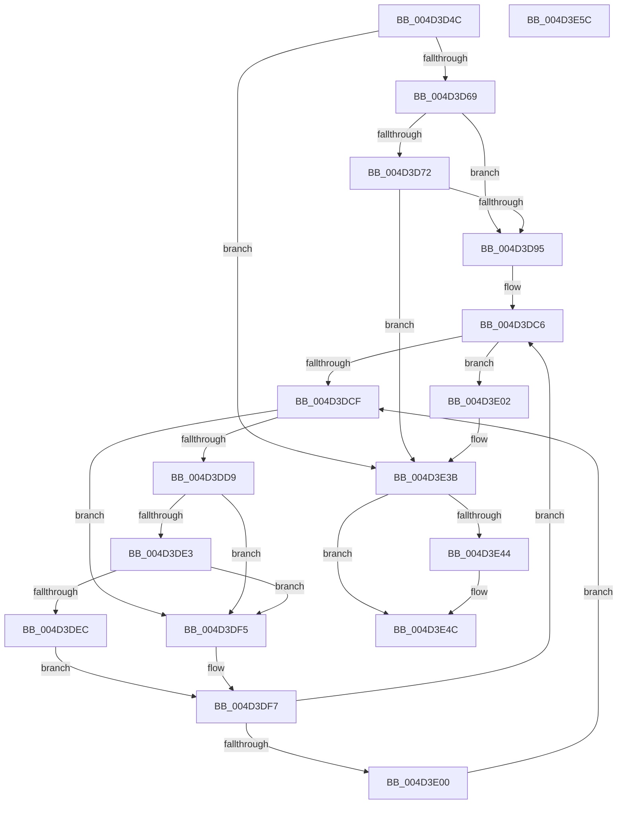

# MiFinishPageTableForLargePage

- RVA: `0x004D3D4C`–`0x004D3E5D` (길이 `273` bytes)
- VA: `0x00000001404D3D4C`
- 실행 섹션: `.text`
- PDB 이름 있음: `예`; PDB Function 태그: `아니요`
- unwind 정보 RVA: `0x00060BC4`
- 디코드: `69`개 명령, `273/273` bytes 표시
- 미해석 바이트: `0` (있으면 어셈블리에 `.byte`로 보존)

> 이 문서는 커널 이미지의 기계어와 PDB 기호를 분석해 생성했습니다. 4번과 5번은 함수 원형과 자료형을 바이너리 사용 방식에서 추정한 C 해석이며 원본 소스 복구 결과는 아닙니다.

## 1. Dependencies

- 직접 호출 지점: **5**; 고유 호출 대상: **5**
- 직접 호출자로 확인된 함수: **1**
- RIP 상대 이미지 참조: **2**

### Outgoing calls
- `0x004D3D7C` → [MiIncreaseUsedPtes](../24/MiIncreaseUsedPtes_function_00243630.md) (function, `0x00243630`)
- `0x004D3D99` → [MI_READ_PTE_LOCK_FREE](../28/MI_READ_PTE_LOCK_FREE_function_002828A0.md) (function, `0x002828A0`)
- `0x004D3DE3` → [KiCheckVpBackingLongSpinWaitHypercall](../30/KiCheckVpBackingLongSpinWaitHypercall_function_0030F490.md) (function, `0x0030F490`)
- `0x004D3DEE` → [HvlNotifyLongSpinWait](../30/HvlNotifyLongSpinWait_function_0030F460.md) (function, `0x0030F460`)
- `0x004D3E47` → [MiUnlockPageTable](../21/MiUnlockPageTable_function_00216EC0.md) (function, `0x00216EC0`)

### Direct callers
- [MiMapWithLargePages](../3B/MiMapWithLargePages_function_003B6624.md) at `0x003B6854`
- [MiMapWithLargePages](../3B/MiMapWithLargePages_function_003B6624.md) at `0x003B689B`
- [MiMapWithLargePages](../3B/MiMapWithLargePages_function_003B6624.md) at `0x003B68F8`

### Static image references
- `0x004D3DD1` → RVA `0x00FC52AC` (`ALMOSTRO`; reference)
- `0x004D3DD9` → RVA `0x00FC6AB8` (`ALMOSTRO`; read)

## 2. Other-region calls and transfers

- 다른 실행 섹션으로 향하는 call: **0**
- 별도 외부 분기/꼬리 이동을 확인하지 못했습니다.

## 3. Assembly (complete function range)

```asm
004D3D4C  48 89 5C 24 08                  mov qword ptr [rsp + 8], rbx
004D3D51  48 89 74 24 10                  mov qword ptr [rsp + 0x10], rsi
004D3D56  57                              push rdi
004D3D57  48 83 EC 20                     sub rsp, 0x20
004D3D5B  48 83 79 10 00                  cmp qword ptr [rcx + 0x10], 0
004D3D60  48 8B D9                        mov rbx, rcx
004D3D63  0F 84 D2 00 00 00               je 0x1404d3e3b
004D3D69  44 8B 41 18                     mov r8d, dword ptr [rcx + 0x18]
004D3D6D  45 85 C0                        test r8d, r8d
004D3D70  74 23                           je 0x1404d3d95
004D3D72  48 8B 51 08                     mov rdx, qword ptr [rcx + 8]
004D3D76  41 B9 06 00 00 00               mov r9d, 6
004D3D7C  E8 AF F8 D6 FF                  call 0x140243630
004D3D81  8B 43 18                        mov eax, dword ptr [rbx + 0x18]
004D3D84  48 29 43 10                     sub qword ptr [rbx + 0x10], rax
004D3D88  C7 43 18 00 00 00 00            mov dword ptr [rbx + 0x18], 0
004D3D8F  0F 84 A6 00 00 00               je 0x1404d3e3b
004D3D95  48 8B 4B 08                     mov rcx, qword ptr [rbx + 8]
004D3D99  E8 02 EB DA FF                  call 0x1402828a0
004D3D9E  48 C1 E8 0C                     shr rax, 0xc
004D3DA2  48 B9 FF FF FF FF FF 00 00 00   movabs rcx, 0xffffffffff
004D3DAC  48 23 C1                        and rax, rcx
004D3DAF  48 8D 3C 40                     lea rdi, [rax + rax*2]
004D3DB3  48 C1 E7 04                     shl rdi, 4
004D3DB7  48 B8 00 00 00 00 00 DE FF FF   movabs rax, 0xffffde0000000000
004D3DC1  48 03 F8                        add rdi, rax
004D3DC4  33 F6                           xor esi, esi
004D3DC6  F0 48 0F BA 6F 18 3F            lock bts qword ptr [rdi + 0x18], 0x3f
004D3DCD  73 33                           jae 0x1404d3e02
004D3DCF  FF C6                           inc esi
004D3DD1  85 35 D5 14 AF 00               test dword ptr [rip + 0xaf14d5], esi
004D3DD7  75 1C                           jne 0x1404d3df5
004D3DD9  8B 05 D9 2C AF 00               mov eax, dword ptr [rip + 0xaf2cd9]
004D3DDF  A8 40                           test al, 0x40
004D3DE1  74 12                           je 0x1404d3df5
004D3DE3  E8 A8 B6 E3 FF                  call 0x14030f490
004D3DE8  84 C0                           test al, al
004D3DEA  74 09                           je 0x1404d3df5
004D3DEC  8B CE                           mov ecx, esi
004D3DEE  E8 6D B6 E3 FF                  call 0x14030f460
004D3DF3  EB 02                           jmp 0x1404d3df7
004D3DF5  F3 90                           pause
004D3DF7  48 8B 47 18                     mov rax, qword ptr [rdi + 0x18]
004D3DFB  48 85 C0                        test rax, rax
004D3DFE  79 C6                           jns 0x1404d3dc6
004D3E00  EB CD                           jmp 0x1404d3dcf
004D3E02  48 8B 47 18                     mov rax, qword ptr [rdi + 0x18]
004D3E06  48 8B 53 10                     mov rdx, qword ptr [rbx + 0x10]
004D3E0A  48 03 D0                        add rdx, rax
004D3E0D  48 8B CA                        mov rcx, rdx
004D3E10  48 33 C8                        xor rcx, rax
004D3E13  48 B8 00 00 00 00 00 00 00 C0   movabs rax, 0xc000000000000000
004D3E1D  48 23 C8                        and rcx, rax
004D3E20  48 B8 FF FF FF FF FF FF FF 7F   movabs rax, 0x7fffffffffffffff
004D3E2A  48 33 CA                        xor rcx, rdx
004D3E2D  48 89 4F 18                     mov qword ptr [rdi + 0x18], rcx
004D3E31  F0 48 21 47 18                  lock and qword ptr [rdi + 0x18], rax
004D3E36  48 83 63 10 00                  and qword ptr [rbx + 0x10], 0
004D3E3B  48 8B 53 08                     mov rdx, qword ptr [rbx + 8]
004D3E3F  48 85 D2                        test rdx, rdx
004D3E42  74 08                           je 0x1404d3e4c
004D3E44  48 8B 0B                        mov rcx, qword ptr [rbx]
004D3E47  E8 74 30 D4 FF                  call 0x140216ec0
004D3E4C  48 8B 5C 24 30                  mov rbx, qword ptr [rsp + 0x30]
004D3E51  48 8B 74 24 38                  mov rsi, qword ptr [rsp + 0x38]
004D3E56  48 83 C4 20                     add rsp, 0x20
004D3E5A  5F                              pop rdi
004D3E5B  C3                              ret
004D3E5C  CC                              int3
```

## 4. C-style interpretation (structured pseudocode)

```c
__int64 __fastcall MiFinishPageTableForLargePage(__int64 a1)
{
    __int64 result;
    __int64 v_rdi;
    __int64 v_rsi;
    __int64 v_rsp;
    unsigned __int64 v_stack_p10;
    unsigned __int64 v_stack_p8;

    v_stack_p8 = v_rbx;
    v_stack_p10 = v_rsi;
    v_rsp = (v_rsp) - (32);
    if ((*(unsigned __int64 *)(a1 + 16)) == 0) goto loc_004D3E3B;
    if ((unsigned int)((unsigned int)(*(unsigned int *)(a1 + 24))) == 0) goto loc_004D3D95;
    result = MiIncreaseUsedPtes(a1, *(unsigned __int64 *)(a1 + 8), (unsigned int)(*(unsigned int *)(a1 + 24)), 6);
    *(unsigned int *)(a1 + 24) = 0;
    if ((unsigned int)((unsigned int)(*(unsigned int *)(a1 + 24))) == 0) goto loc_004D3E3B;
loc_004D3D95:
    result = MI_READ_PTE_LOCK_FREE(*(unsigned __int64 *)(a1 + 8), *(unsigned __int64 *)(a1 + 8), (unsigned int)(*(unsigned int *)(a1 + 24)), 6);
    result = (result) >> (12);
    result = (result) & (*(unsigned __int64 *)(a1 + 8));
    v_rdi = (result + result * 2) << (4);
    v_rdi = (v_rdi) + (result);
    v_rsi = 0;
loc_004D3DC6:
    if (condition_is_above_or_equal) goto loc_004D3E02;
loc_004D3DCF:
    v_rsi = (unsigned int)((v_rsi) + 1);
    if (((*(unsigned int *)(v_rip + 11474133)) & ((unsigned int)(v_rsi))) != 0) goto loc_004D3DF5;
    if ((((unsigned __int8)((unsigned int)(*(unsigned int *)(v_rip + 11480281)))) & (64)) == 0) goto loc_004D3DF5;
    result = KiCheckVpBackingLongSpinWaitHypercall(*(unsigned __int64 *)(a1 + 8), *(unsigned __int64 *)(a1 + 8), (unsigned int)(*(unsigned int *)(a1 + 24)), 6);
    if ((unsigned __int8)(result) == 0) goto loc_004D3DF5;
    result = HvlNotifyLongSpinWait((unsigned int)((unsigned int)(v_rsi)), *(unsigned __int64 *)(a1 + 8), (unsigned int)(*(unsigned int *)(a1 + 24)), 6);
    goto loc_004D3DF7;
loc_004D3DF5:
loc_004D3DF7:
    if (!sign_flag) goto loc_004D3DC6;
    goto loc_004D3DCF;
loc_004D3E02:
    a2 = (*(unsigned __int64 *)(a1 + 16)) + (*(unsigned __int64 *)(v_rdi + 24));
    a1 = (a2) ^ (*(unsigned __int64 *)(v_rdi + 24));
    a1 = (a1) & (*(unsigned __int64 *)(v_rdi + 24));
    a1 = (a1) ^ (a2);
    *(unsigned __int64 *)(v_rdi + 24) = a1;
loc_004D3E3B:
    result = *(unsigned __int64 *)(v_rdi + 24);
    if (*(unsigned __int64 *)(a1 + 8) != 0) {
        a1 = *(unsigned __int64 *)(a1);
        result = MiUnlockPageTable(a1, *(unsigned __int64 *)(a1 + 8), (unsigned int)(*(unsigned int *)(a1 + 24)), 6);
    }
    v_rsp = (v_rsp) + (32);
    return result;
}
```

## 5. (Beta) C Style

```c
int64_t MiFinishPageTableForLargePage(void *Arg1)
{
    uint8_t *arg1 = (uint8_t *)Arg1;

    int64_t result;
    int64_t local_rdi;
    int64_t local_rsi;
    int64_t local_rsp;
    uint64_t v_stack_p10;
    uint64_t v_stack_p8;

    v_stack_p8 = local_rbx;
    v_stack_p10 = local_rsi;
    local_rsp = (local_rsp) - (32);
    if ((*(uint64_t *)(arg1 + 0x10)) == 0) goto loc_004D3E3B;
    if ((uint32_t)((uint32_t)(*(uint32_t *)(arg1 + 0x18))) == 0) goto loc_004D3D95;
    result = MiIncreaseUsedPtes(Arg1, *(uint64_t *)(arg1 + 0x8), (uint32_t)(*(uint32_t *)(arg1 + 0x18)), 6);
    *(uint32_t *)(arg1 + 0x18) = 0;
    if ((uint32_t)((uint32_t)(*(uint32_t *)(arg1 + 0x18))) == 0) goto loc_004D3E3B;
loc_004D3D95:
    result = MI_READ_PTE_LOCK_FREE(*(uint64_t *)(arg1 + 0x8), *(uint64_t *)(arg1 + 0x8), (uint32_t)(*(uint32_t *)(arg1 + 0x18)), 6);
    result = (result) >> (12);
    result = (result) & (*(uint64_t *)(arg1 + 0x8));
    local_rdi = (result + result * 2) << (4);
    local_rdi = (local_rdi) + (result);
    local_rsi = 0;
loc_004D3DC6:
    if (condition_is_above_or_equal) goto loc_004D3E02;
loc_004D3DCF:
    local_rsi = (uint32_t)((local_rsi) + 1);
    if (((*(uint32_t *)(v_rip + 0xAF14D5)) & ((uint32_t)(local_rsi))) != 0) goto loc_004D3DF5;
    if ((((uint8_t)((uint32_t)(*(uint32_t *)(v_rip + 0xAF2CD9)))) & (64)) == 0) goto loc_004D3DF5;
    result = KiCheckVpBackingLongSpinWaitHypercall(*(uint64_t *)(arg1 + 0x8), *(uint64_t *)(arg1 + 0x8), (uint32_t)(*(uint32_t *)(arg1 + 0x18)), 6);
    if ((uint8_t)(result) == 0) goto loc_004D3DF5;
    result = HvlNotifyLongSpinWait((uint32_t)((uint32_t)(local_rsi)), *(uint64_t *)(arg1 + 0x8), (uint32_t)(*(uint32_t *)(arg1 + 0x18)), 6);
    goto loc_004D3DF7;
loc_004D3DF5:
loc_004D3DF7:
    if (!sign_flag) goto loc_004D3DC6;
    goto loc_004D3DCF;
loc_004D3E02:
    a2 = (*(uint64_t *)(arg1 + 0x10)) + (*(uint64_t *)(local_rdi + 0x18));
    Arg1 = (a2) ^ (*(uint64_t *)(local_rdi + 0x18));
    Arg1 = (Arg1) & (*(uint64_t *)(local_rdi + 0x18));
    Arg1 = (Arg1) ^ (a2);
    *(void **)(local_rdi + 0x18) = Arg1;
loc_004D3E3B:
    result = *(uint64_t *)(local_rdi + 0x18);
    if (*(uint64_t *)(arg1 + 0x8) != 0) {
        Arg1 = *(uint64_t *)(arg1);
        result = MiUnlockPageTable(Arg1, *(uint64_t *)(arg1 + 0x8), (uint32_t)(*(uint32_t *)(arg1 + 0x18)), 6);
    }
    local_rsp = (local_rsp) + (32);
    return result;
}
```

### 관측된 메모리 오프셋

구조체 형식이 확인되지 않은 접근은 인자 기준의 오프셋으로만 기록했습니다.

| 기준 인자 | 오프셋 표현 | 폭 (bit) | 접근 |
|---|---:|---:|---|
| `Arg1` | `+ 0x0` | `64` | `R` |
| `Arg1` | `+ 0x8` | `64` | `R` |
| `Arg1` | `+ 0x10` | `64` | `R` |
| `Arg1` | `+ 0x10` | `64` | `R/W` |
| `Arg1` | `+ 0x18` | `32` | `R` |
| `Arg1` | `+ 0x18` | `32` | `W` |

## 6. Execution-region graph

[열기: 2D/3D 그래프와 함수 탐색 컨트롤 패널](../../../control-panel.html?section=text&rva=0x004D3D4C&view=graph)

- 2D 그래프는 위에서 아래로 흐르고, 3D 그래프는 빈 공간을 드래그해 회전합니다. Shift+드래그는 이동, 휠은 확대·축소, 함수 노드 선택은 대상 보고서 이동입니다.

### Static fallback


