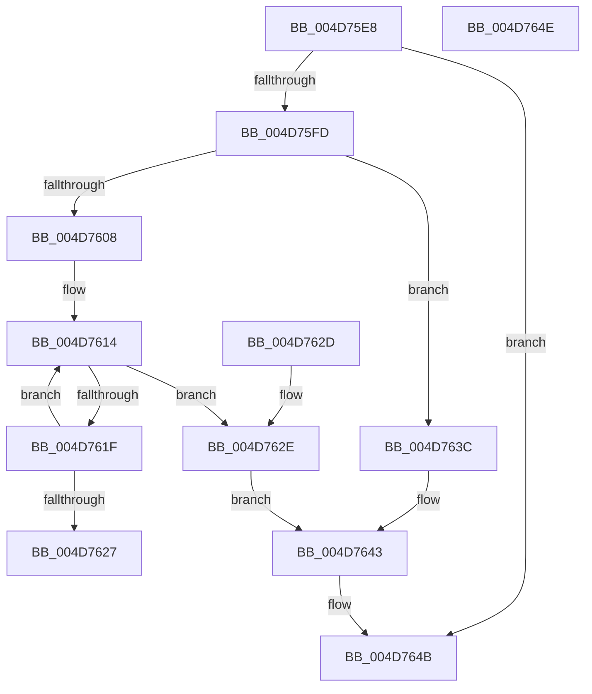

# MiGetBaseNameFromImageFileName

- RVA: `0x004D75E8`–`0x004D764F` (길이 `103` bytes)
- VA: `0x00000001404D75E8`
- 실행 섹션: `.text`
- PDB 이름 있음: `예`; PDB Function 태그: `아니요`
- unwind 정보 RVA: `0x000DB714`
- 디코드: `35`개 명령, `103/103` bytes 표시
- 미해석 바이트: `0` (있으면 어셈블리에 `.byte`로 보존)

> 이 문서는 커널 이미지의 기계어와 PDB 기호를 분석해 생성했습니다. 4번과 5번은 함수 원형과 자료형을 바이너리 사용 방식에서 추정한 C 해석이며 원본 소스 복구 결과는 아닙니다.

## 1. Dependencies

- 직접 호출 지점: **0**; 고유 호출 대상: **0**
- 직접 호출자로 확인된 함수: **2**
- RIP 상대 이미지 참조: **0**

### Outgoing calls
- 직접 디코드된 call 명령이 없습니다.

### Direct callers
- [MiCreateSectionForDriver](../../page/A2/MiCreateSectionForDriver_function_00A2477C.md) at `0x00A24822`
- [MiGenerateSystemImageNames](../../page/AD/MiGenerateSystemImageNames_function_00AD8CFC.md) at `0x00AD8D23`

### Static image references
- 디코드된 RIP-relative 메모리 참조가 없습니다.

## 2. Other-region calls and transfers

- 다른 실행 섹션으로 향하는 call: **0**
- 별도 외부 분기/꼬리 이동을 확인하지 못했습니다.

## 3. Assembly (complete function range)

```asm
004D75E8  45 33 C0                        xor r8d, r8d
004D75EB  48 8B C1                        mov rax, rcx
004D75EE  4C 89 42 08                     mov qword ptr [rdx + 8], r8
004D75F2  44 89 02                        mov dword ptr [rdx], r8d
004D75F5  0F B7 09                        movzx ecx, word ptr [rcx]
004D75F8  66 85 C9                        test cx, cx
004D75FB  74 4E                           je 0x1404d764b
004D75FD  4C 8B 48 08                     mov r9, qword ptr [rax + 8]
004D7601  66 41 83 39 5C                  cmp word ptr [r9], 0x5c
004D7606  75 34                           jne 0x1404d763c
004D7608  8B C1                           mov eax, ecx
004D760A  48 D1 E8                        shr rax, 1
004D760D  49 8D 0C 41                     lea rcx, [r9 + rax*2]
004D7611  48 8B C1                        mov rax, rcx
004D7614  4C 8D 40 FE                     lea r8, [rax - 2]
004D7618  66 41 83 38 5C                  cmp word ptr [r8], 0x5c
004D761D  74 0F                           je 0x1404d762e
004D761F  49 8B C0                        mov rax, r8
004D7622  4D 3B C1                        cmp r8, r9
004D7625  75 ED                           jne 0x1404d7614
004D7627  B8 EF 00 00 C0                  mov eax, 0xc00000ef
004D762C  C3                              ret
004D762D  CC                              int3
004D762E  48 2B C8                        sub rcx, rax
004D7631  48 D1 F9                        sar rcx, 1
004D7634  66 03 C9                        add cx, cx
004D7637  66 89 0A                        mov word ptr [rdx], cx
004D763A  EB 07                           jmp 0x1404d7643
004D763C  66 89 0A                        mov word ptr [rdx], cx
004D763F  48 8B 40 08                     mov rax, qword ptr [rax + 8]
004D7643  48 89 42 08                     mov qword ptr [rdx + 8], rax
004D7647  66 89 4A 02                     mov word ptr [rdx + 2], cx
004D764B  33 C0                           xor eax, eax
004D764D  C3                              ret
004D764E  CC                              int3
```

## 4. C-style interpretation (structured pseudocode)

```c
__int64 __fastcall MiGetBaseNameFromImageFileName(__int64 a1, __int64 a2, int a3)
{
    __int64 result;

    a3 = 0;
    *(unsigned __int64 *)(a2 + 8) = 0;
    *(unsigned int *)(a2) = 0;
    if ((unsigned __int16)(*(unsigned __int16 *)(a1)) == 0) goto loc_004D764B;
    if ((*(unsigned __int16 *)(*(unsigned __int64 *)(a1 + 8))) != 92) goto loc_004D763C;
    result = ((unsigned int)((unsigned int)(*(unsigned __int16 *)(a1)))) >> (1);
loc_004D7614:
    if ((*(unsigned __int16 *)(*(unsigned __int64 *)(a1 + 8) + result * 2 - 2)) == 92) goto loc_004D762E;
    if ((*(unsigned __int64 *)(a1 + 8) + result * 2 - 2) != (*(unsigned __int64 *)(a1 + 8))) goto loc_004D7614;
    return (unsigned int)(0xC00000EFULL);
loc_004D762E:
    a1 = (*(unsigned __int64 *)(a1 + 8) + result * 2) - ((unsigned int)(0xC00000EFULL));
    a1 = (a1) >> (1);
    a1 = (unsigned __int16)((a1) + ((unsigned __int16)(a1)));
    *(unsigned __int16 *)(a2) = (unsigned __int16)(a1);
    goto loc_004D7643;
loc_004D763C:
    *(unsigned __int16 *)(a2) = (unsigned __int16)(a1);
loc_004D7643:
    *(unsigned __int64 *)(a2 + 8) = *(unsigned __int64 *)((unsigned int)(0xC00000EFULL) + 8);
    *(unsigned __int16 *)(a2 + 2) = (unsigned __int16)(a1);
loc_004D764B:
    result = 0;
    return result;
}
```

## 5. (Beta) C Style

```c
int64_t MiGetBaseNameFromImageFileName(void *Arg1, void *Arg2, int32_t Arg3)
{
    uint8_t *arg1 = (uint8_t *)Arg1;
    uint8_t *arg2 = (uint8_t *)Arg2;

    int64_t result;

    Arg3 = 0;
    *(uint64_t *)(arg2 + 0x8) = 0;
    *(uint32_t *)(arg2) = 0;
    if ((uint16_t)(*(uint16_t *)(arg1)) == 0) goto loc_004D764B;
    if ((*(uint16_t *)(*(uint64_t *)(arg1 + 0x8))) != 92) goto loc_004D763C;
    result = ((uint32_t)((uint32_t)(*(uint16_t *)(arg1)))) >> (1);
loc_004D7614:
    if ((*(uint16_t *)(*(uint64_t *)(arg1 + 0x8) + result * 2 - 0x2)) == 92) goto loc_004D762E;
    if ((*(uint64_t *)(arg1 + 0x8) + result * 2 - 2) != (*(uint64_t *)(arg1 + 0x8))) goto loc_004D7614;
    return (uint32_t)(0xC00000EFULL);
loc_004D762E:
    Arg1 = (*(uint64_t *)(arg1 + 0x8) + result * 2) - ((uint32_t)(0xC00000EFULL));
    Arg1 = (Arg1) >> (1);
    Arg1 = (uint16_t)((Arg1) + ((uint16_t)(Arg1)));
    *(uint16_t *)(arg2) = (uint16_t)(Arg1);
    goto loc_004D7643;
loc_004D763C:
    *(uint16_t *)(arg2) = (uint16_t)(Arg1);
loc_004D7643:
    *(uint64_t *)(arg2 + 0x8) = *(uint64_t *)((uint32_t)(0xC00000EFULL) + 0x8);
    *(uint16_t *)(arg2 + 0x2) = (uint16_t)(Arg1);
loc_004D764B:
    result = 0;
    return result;
}
```

### 관측된 메모리 오프셋

구조체 형식이 확인되지 않은 접근은 인자 기준의 오프셋으로만 기록했습니다.

| 기준 인자 | 오프셋 표현 | 폭 (bit) | 접근 |
|---|---:|---:|---|
| `Arg1` | `+ 0x0` | `16` | `R` |
| `Arg1` | `+ 0x8` | `64` | `R` |
| `Arg2` | `+ 0x0` | `16` | `W` |
| `Arg2` | `+ 0x0` | `32` | `W` |
| `Arg2` | `+ 0x2` | `16` | `W` |
| `Arg2` | `+ 0x8` | `64` | `W` |

## 6. Execution-region graph

[열기: 2D/3D 그래프와 함수 탐색 컨트롤 패널](../../../control-panel.html?section=text&rva=0x004D75E8&view=graph)

- 2D 그래프는 위에서 아래로 흐르고, 3D 그래프는 빈 공간을 드래그해 회전합니다. Shift+드래그는 이동, 휠은 확대·축소, 함수 노드 선택은 대상 보고서 이동입니다.

### Static fallback


