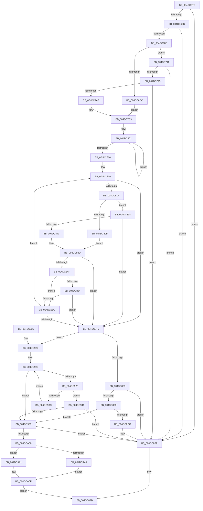

# MiGetClusterPage

- RVA: `0x004DC57C`–`0x004DCA82` (길이 `1,286` bytes)
- VA: `0x00000001404DC57C`
- 실행 섹션: `.text`
- PDB 이름 있음: `예`; PDB Function 태그: `아니요`
- unwind 정보 RVA: `0x000BEB04`
- 디코드: `307`개 명령, `1,286/1,286` bytes 표시
- 미해석 바이트: `0` (있으면 어셈블리에 `.byte`로 보존)

> 이 문서는 커널 이미지의 기계어와 PDB 기호를 분석해 생성했습니다. 4번과 5번은 함수 원형과 자료형을 바이너리 사용 방식에서 추정한 C 해석이며 원본 소스 복구 결과는 아닙니다.

## 1. Dependencies

- 직접 호출 지점: **16**; 고유 호출 대상: **14**
- 직접 호출자로 확인된 함수: **2**
- RIP 상대 이미지 참조: **2**

### Outgoing calls
- `0x004DC5F0` → [memset](../6C/memset_function_006C6C40.md) (function, `0x006C6C40`)
- `0x004DC606` → [memset](../6C/memset_function_006C6C40.md) (function, `0x006C6C40`)
- `0x004DC6A6` → [MiInitializePageColorBase](../32/MiInitializePageColorBase_function_00320410.md) (function, `0x00320410`)
- `0x004DC726` → [MiGetProtoPteAddress](../32/MiGetProtoPteAddress_function_0032E970.md) (function, `0x0032E970`)
- `0x004DC837` → [IS_PTE_NOT_DEMAND_ZERO](../22/IS_PTE_NOT_DEMAND_ZERO_function_0022F4D0.md) (function, `0x0022F4D0`)
- `0x004DC85D` → [MiIsPteEvaluated](../32/MiIsPteEvaluated_function_0032A36C.md) (function, `0x0032A36C`)
- `0x004DC88E` → [MiComputeZeroClusterMaximum](../44/MiComputeZeroClusterMaximum_function_0044B15C.md) (function, `0x0044B15C`)
- `0x004DC89C` → [MiProtectionToCacheAttribute](../2B/MiProtectionToCacheAttribute_function_002B8530.md) (function, `0x002B8530`)
- `0x004DC8CB` → [MiGetLargePage](../31/MiGetLargePage_function_0031E210.md) (function, `0x0031E210`)
- `0x004DC8DF` → [MiConvertLargeActivePageToChain](../31/MiConvertLargeActivePageToChain_function_0031D980.md) (function, `0x0031D980`)
- `0x004DC905` → [_security_check_cookie](../6A/_security_check_cookie_function_006AC640.md) (function, `0x006AC640`)
- `0x004DC995` → [MiProtectionToCacheAttribute](../2B/MiProtectionToCacheAttribute_function_002B8530.md) (function, `0x002B8530`)
- `0x004DC9E5` → [MiInitializePageChainPacket](../43/MiInitializePageChainPacket_function_004367C0.md) (function, `0x004367C0`)
- `0x004DC9EE` → [MiGetPageChain](../33/MiGetPageChain_function_00330130.md) (function, `0x00330130`)
- `0x004DCA07` → [MiUnlinkPageChainHead](../36/MiUnlinkPageChainHead_function_00365C40.md) (function, `0x00365C40`)
- `0x004DCA76` → [MiInsertPageChainHead](../2A/MiInsertPageChainHead_function_002A24EC.md) (function, `0x002A24EC`)

### Direct callers
- [sub_0032FBA9](../32/Unknown_function_0032FBA9.md) at `0x0032FBF2`
- [sub_006DBA48](../6D/Unknown_function_006DBA48.md) at `0x006DBA80`

### Static image references
- `0x004DC59B` → RVA `0x00E0A740` (`.data`; read)
- `0x004DC7D9` → RVA `0x00E30088` (`.data`; read)

## 2. Other-region calls and transfers

- 다른 실행 섹션으로 향하는 call: **0**
- 별도 외부 분기/꼬리 이동을 확인하지 못했습니다.

## 3. Assembly (complete function range)

```asm
004DC57C  48 89 5C 24 18                  mov qword ptr [rsp + 0x18], rbx
004DC581  55                              push rbp
004DC582  56                              push rsi
004DC583  57                              push rdi
004DC584  41 54                           push r12
004DC586  41 55                           push r13
004DC588  41 56                           push r14
004DC58A  41 57                           push r15
004DC58C  48 8D AC 24 B0 FE FF FF         lea rbp, [rsp - 0x150]
004DC594  48 81 EC 50 02 00 00            sub rsp, 0x250
004DC59B  48 8B 05 9E E1 92 00            mov rax, qword ptr [rip + 0x92e19e]
004DC5A2  48 33 C4                        xor rax, rsp
004DC5A5  48 89 85 40 01 00 00            mov qword ptr [rbp + 0x140], rax
004DC5AC  8B 85 B0 01 00 00               mov eax, dword ptr [rbp + 0x1b0]
004DC5B2  4C 8B FA                        mov r15, rdx
004DC5B5  4C 8B A5 C8 01 00 00            mov r12, qword ptr [rbp + 0x1c8]
004DC5BC  4C 8B E9                        mov r13, rcx
004DC5BF  48 89 55 A8                     mov qword ptr [rbp - 0x58], rdx
004DC5C3  48 8D 4D D0                     lea rcx, [rbp - 0x30]
004DC5C7  33 D2                           xor edx, edx
004DC5C9  89 44 24 78                     mov dword ptr [rsp + 0x78], eax
004DC5CD  48 8B 85 C0 01 00 00            mov rax, qword ptr [rbp + 0x1c0]
004DC5D4  0F 57 C0                        xorps xmm0, xmm0
004DC5D7  44 89 44 24 7C                  mov dword ptr [rsp + 0x7c], r8d
004DC5DC  4C 89 4D A0                     mov qword ptr [rbp - 0x60], r9
004DC5E0  44 8D 42 78                     lea r8d, [rdx + 0x78]
004DC5E4  48 89 45 90                     mov qword ptr [rbp - 0x70], rax
004DC5E8  4C 89 65 B0                     mov qword ptr [rbp - 0x50], r12
004DC5EC  0F 11 45 B8                     movups xmmword ptr [rbp - 0x48], xmm0
004DC5F0  E8 4B A6 1E 00                  call 0x1406c6c40
004DC5F5  33 F6                           xor esi, esi
004DC5F7  48 8D 4D 50                     lea rcx, [rbp + 0x50]
004DC5FB  33 D2                           xor edx, edx
004DC5FD  48 89 74 24 70                  mov qword ptr [rsp + 0x70], rsi
004DC602  44 8D 46 70                     lea r8d, [rsi + 0x70]
004DC606  E8 35 A6 1E 00                  call 0x1406c6c40
004DC60B  33 C0                           xor eax, eax
004DC60D  0F 57 C0                        xorps xmm0, xmm0
004DC610  41 0F 11 04 24                  movups xmmword ptr [r12], xmm0
004DC615  49 89 44 24 10                  mov qword ptr [r12 + 0x10], rax
004DC61A  49 8B D7                        mov rdx, r15
004DC61D  65 48 8B 04 25 88 01 00 00      mov rax, qword ptr gs:[0x188]
004DC626  48 81 E2 00 00 FF FF            and rdx, 0xffffffffffff0000
004DC62D  41 0F B6 4D 20                  movzx ecx, byte ptr [r13 + 0x20]
004DC632  48 C1 E1 20                     shl rcx, 0x20
004DC636  4C 8B B0 B8 00 00 00            mov r14, qword ptr [rax + 0xb8]
004DC63D  41 8B 45 18                     mov eax, dword ptr [r13 + 0x18]
004DC641  49 81 C6 00 04 00 00            add r14, 0x400
004DC648  48 0B C8                        or rcx, rax
004DC64B  4C 89 75 98                     mov qword ptr [rbp - 0x68], r14
004DC64F  48 8B C2                        mov rax, rdx
004DC652  48 89 55 80                     mov qword ptr [rbp - 0x80], rdx
004DC656  48 C1 E8 0C                     shr rax, 0xc
004DC65A  48 C7 45 88 00 00 01 00         mov qword ptr [rbp - 0x78], 0x10000
004DC662  48 3B C1                        cmp rax, rcx
004DC665  0F 82 8E 02 00 00               jb 0x1404dc8f9
004DC66B  41 8B 45 1C                     mov eax, dword ptr [r13 + 0x1c]
004DC66F  41 0F B6 4D 21                  movzx ecx, byte ptr [r13 + 0x21]
004DC674  48 C1 E1 20                     shl rcx, 0x20
004DC678  48 0B C8                        or rcx, rax
004DC67B  48 8D 82 FF FF 00 00            lea rax, [rdx + 0xffff]
004DC682  48 C1 E8 0C                     shr rax, 0xc
004DC686  48 3B C1                        cmp rax, rcx
004DC689  0F 87 6A 02 00 00               ja 0x1404dc8f9
004DC68F  41 8B 7D 30                     mov edi, dword ptr [r13 + 0x30]
004DC693  4C 8D 4D B8                     lea r9, [rbp - 0x48]
004DC697  C1 EF 0C                        shr edi, 0xc
004DC69A  8D 56 03                        lea edx, [rsi + 3]
004DC69D  83 E7 7F                        and edi, 0x7f
004DC6A0  49 8B CE                        mov rcx, r14
004DC6A3  44 8B C7                        mov r8d, edi
004DC6A6  E8 65 3D E4 FF                  call 0x140320410
004DC6AB  8B 5D C0                        mov ebx, dword ptr [rbp - 0x40]
004DC6AE  48 8D 45 80                     lea rax, [rbp - 0x80]
004DC6B2  C1 EB 09                        shr ebx, 9
004DC6B5  44 8D 4E 01                     lea r9d, [rsi + 1]
004DC6B9  83 E3 3F                        and ebx, 0x3f
004DC6BC  66 C7 45 D0 02 00               mov word ptr [rbp - 0x30], 2
004DC6C2  41 F7 45 30 00 00 20 00         test dword ptr [r13 + 0x30], 0x200000
004DC6CA  48 89 45 D8                     mov qword ptr [rbp - 0x28], rax
004DC6CE  4C 89 4D E0                     mov qword ptr [rbp - 0x20], r9
004DC6D2  48 89 75 E8                     mov qword ptr [rbp - 0x18], rsi
004DC6D6  48 89 75 F0                     mov qword ptr [rbp - 0x10], rsi
004DC6DA  74 35                           je 0x1404dc711
004DC6DC  4C 8B 45 80                     mov r8, qword ptr [rbp - 0x80]
004DC6E0  48 BA F8 FF FF FF 7F 00 00 00   movabs rdx, 0x7ffffffff8
004DC6EA  49 C1 E8 09                     shr r8, 9
004DC6EE  4C 23 C2                        and r8, rdx
004DC6F1  48 B8 00 00 00 00 80 F6 FF FF   movabs rax, 0xfffff68000000000
004DC6FB  48 8B C0                        mov rax, rax
004DC6FE  41 0F B7 8E AE 00 00 00         movzx ecx, word ptr [r14 + 0xae]
004DC706  4C 03 C0                        add r8, rax
004DC709  44 8B FE                        mov r15d, esi
004DC70C  E9 C8 00 00 00                  jmp 0x1404dc7d9
004DC711  49 8B D7                        mov rdx, r15
004DC714  4C 8D 4C 24 70                  lea r9, [rsp + 0x70]
004DC719  48 C1 EA 0C                     shr rdx, 0xc
004DC71D  41 B8 08 00 00 00               mov r8d, 8
004DC723  49 8B CD                        mov rcx, r13
004DC726  E8 45 22 E5 FF                  call 0x14032e970
004DC72B  4C 8B 54 24 70                  mov r10, qword ptr [rsp + 0x70]
004DC730  4C 8B C8                        mov r9, rax
004DC733  4D 8B C7                        mov r8, r15
004DC736  49 C7 C3 00 F0 FF FF            mov r11, 0xfffffffffffff000
004DC73D  4C 8B 7D 80                     mov r15, qword ptr [rbp - 0x80]
004DC741  4D 23 C3                        and r8, r11
004DC744  4D 2B C7                        sub r8, r15
004DC747  41 8B 4A 34                     mov ecx, dword ptr [r10 + 0x34]
004DC74B  49 8B 52 08                     mov rdx, qword ptr [r10 + 8]
004DC74F  81 E1 FF FF FF 3F               and ecx, 0x3fffffff
004DC755  41 8B 42 2C                     mov eax, dword ptr [r10 + 0x2c]
004DC759  48 2B C1                        sub rax, rcx
004DC75C  49 C1 E8 0C                     shr r8, 0xc
004DC760  48 8D 0C C2                     lea rcx, [rdx + rax*8]
004DC764  49 8B C1                        mov rax, r9
004DC767  49 23 C3                        and rax, r11
004DC76A  48 3B C2                        cmp rax, rdx
004DC76D  48 0F 47 D0                     cmova rdx, rax
004DC771  48 05 00 10 00 00               add rax, 0x1000
004DC777  48 3B C8                        cmp rcx, rax
004DC77A  48 0F 47 C8                     cmova rcx, rax
004DC77E  4A 8D 04 C5 00 00 00 00         lea rax, [r8*8]
004DC786  4D 8B C1                        mov r8, r9
004DC789  4C 2B C0                        sub r8, rax
004DC78C  4C 3B C2                        cmp r8, rdx
004DC78F  0F 82 64 01 00 00               jb 0x1404dc8f9
004DC795  4C 2B C8                        sub r9, rax
004DC798  49 83 E9 80                     sub r9, -0x80
004DC79C  4C 3B C9                        cmp r9, rcx
004DC79F  0F 87 54 01 00 00               ja 0x1404dc8f9
004DC7A5  48 B8 F8 FF FF FF 7F 00 00 00   movabs rax, 0x7ffffffff8
004DC7AF  49 C1 EF 09                     shr r15, 9
004DC7B3  4C 23 F8                        and r15, rax
004DC7B6  48 B8 00 00 00 00 80 F6 FF FF   movabs rax, 0xfffff68000000000
004DC7C0  48 8B C0                        mov rax, rax
004DC7C3  4C 03 F8                        add r15, rax
004DC7C6  41 B9 01 00 00 00               mov r9d, 1
004DC7CC  49 8B 02                        mov rax, qword ptr [r10]
004DC7CF  0F B7 48 3C                     movzx ecx, word ptr [rax + 0x3c]
004DC7D3  81 E1 FF 03 00 00               and ecx, 0x3ff
004DC7D9  48 8B 05 A8 38 95 00            mov rax, qword ptr [rip + 0x9538a8]
004DC7E0  48 8B 14 C8                     mov rdx, qword ptr [rax + rcx*8]
004DC7E4  8B C3                           mov eax, ebx
004DC7E6  48 69 C8 80 DF 00 00            imul rcx, rax, 0xdf80
004DC7ED  48 8B 42 10                     mov rax, qword ptr [rdx + 0x10]
004DC7F1  48 89 54 24 70                  mov qword ptr [rsp + 0x70], rdx
004DC7F6  44 88 8C 01 43 14 00 00         mov byte ptr [rcx + rax + 0x1443], r9b
004DC7FE  48 8B CE                        mov rcx, rsi
004DC801  49 8B 04 C8                     mov rax, qword ptr [r8 + rcx*8]
004DC805  48 89 84 CD C0 00 00 00         mov qword ptr [rbp + rcx*8 + 0xc0], rax
004DC80D  49 03 C9                        add rcx, r9
004DC810  48 83 F9 10                     cmp rcx, 0x10
004DC814  72 EB                           jb 0x1404dc801
004DC816  4C 8B F6                        mov r14, rsi
004DC819  49 83 FE 10                     cmp r14, 0x10
004DC81D  73 56                           jae 0x1404dc875
004DC81F  4A 8B 94 F5 C0 00 00 00         mov rdx, qword ptr [rbp + r14*8 + 0xc0]
004DC827  39 B5 B8 01 00 00               cmp dword ptr [rbp + 0x1b8], esi
004DC82D  75 05                           jne 0x1404dc834
004DC82F  48 85 D2                        test rdx, rdx
004DC832  EB 19                           jmp 0x1404dc84d
004DC834  48 8B CA                        mov rcx, rdx
004DC837  E8 94 2C D5 FF                  call 0x14022f4d0
004DC83C  85 C0                           test eax, eax
004DC83E  75 35                           jne 0x1404dc875
004DC840  48 C1 EA 05                     shr rdx, 5
004DC844  83 E2 1F                        and edx, 0x1f
004DC847  3B 95 B8 01 00 00               cmp edx, dword ptr [rbp + 0x1b8]
004DC84D  75 26                           jne 0x1404dc875
004DC84F  4D 85 FF                        test r15, r15
004DC852  74 18                           je 0x1404dc86c
004DC854  8B 95 B8 01 00 00               mov edx, dword ptr [rbp + 0x1b8]
004DC85A  49 8B CF                        mov rcx, r15
004DC85D  E8 0A DB E4 FF                  call 0x14032a36c
004DC862  41 B9 01 00 00 00               mov r9d, 1
004DC868  85 C0                           test eax, eax
004DC86A  75 09                           jne 0x1404dc875
004DC86C  4D 03 F1                        add r14, r9
004DC86F  4C 3B 75 A0                     cmp r14, qword ptr [rbp - 0x60]
004DC873  75 A4                           jne 0x1404dc819
004DC875  49 83 CF FF                     or r15, 0xffffffffffffffff
004DC879  49 83 FE 10                     cmp r14, 0x10
004DC87D  0F 85 A3 00 00 00               jne 0x1404dc926
004DC883  48 8B 55 98                     mov rdx, qword ptr [rbp - 0x68]
004DC887  48 8D 4D D0                     lea rcx, [rbp - 0x30]
004DC88B  4D 8B C5                        mov r8, r13
004DC88E  E8 C9 E8 F6 FF                  call 0x14044b15c
004DC893  49 3B C6                        cmp rax, r14
004DC896  75 61                           jne 0x1404dc8f9
004DC898  8B 4C 24 78                     mov ecx, dword ptr [rsp + 0x78]
004DC89C  E8 8F BC DD FF                  call 0x1402b8530
004DC8A1  48 8B 4D 90                     mov rcx, qword ptr [rbp - 0x70]
004DC8A5  45 8D 47 03                     lea r8d, [r15 + 3]
004DC8A9  48 8B 55 80                     mov rdx, qword ptr [rbp - 0x80]
004DC8AD  44 8B CB                        mov r9d, ebx
004DC8B0  48 89 74 24 38                  mov qword ptr [rsp + 0x38], rsi
004DC8B5  48 89 4C 24 30                  mov qword ptr [rsp + 0x30], rcx
004DC8BA  48 8B 4C 24 70                  mov rcx, qword ptr [rsp + 0x70]
004DC8BF  C7 44 24 28 12 00 00 00         mov dword ptr [rsp + 0x28], 0x12
004DC8C7  89 44 24 20                     mov dword ptr [rsp + 0x20], eax
004DC8CB  E8 40 19 E4 FF                  call 0x14031e210
004DC8D0  48 8B D8                        mov rbx, rax
004DC8D3  48 85 C0                        test rax, rax
004DC8D6  0F 84 84 00 00 00               je 0x1404dc960
004DC8DC  48 8B C8                        mov rcx, rax
004DC8DF  E8 9C 10 E4 FF                  call 0x14031d980
004DC8E4  48 8D 83 D0 02 00 00            lea rax, [rbx + 0x2d0]
004DC8EB  49 89 1C 24                     mov qword ptr [r12], rbx
004DC8EF  49 89 44 24 08                  mov qword ptr [r12 + 8], rax
004DC8F4  4D 89 74 24 10                  mov qword ptr [r12 + 0x10], r14
004DC8F9  33 C0                           xor eax, eax
004DC8FB  48 8B 8D 40 01 00 00            mov rcx, qword ptr [rbp + 0x140]
004DC902  48 33 CC                        xor rcx, rsp
004DC905  E8 36 FD 1C 00                  call 0x1406ac640
004DC90A  48 8B 9C 24 A0 02 00 00         mov rbx, qword ptr [rsp + 0x2a0]
004DC912  48 81 C4 50 02 00 00            add rsp, 0x250
004DC919  41 5F                           pop r15
004DC91B  41 5E                           pop r14
004DC91D  41 5D                           pop r13
004DC91F  41 5C                           pop r12
004DC921  5F                              pop rdi
004DC922  5E                              pop rsi
004DC923  5D                              pop rbp
004DC924  C3                              ret
004DC925  CC                              int3
004DC926  4C 8B F6                        mov r14, rsi
004DC929  49 83 FE 10                     cmp r14, 0x10
004DC92D  73 31                           jae 0x1404dc960
004DC92F  4A 8B 84 F5 C0 00 00 00         mov rax, qword ptr [rbp + r14*8 + 0xc0]
004DC937  41 84 C1                        test r9b, al
004DC93A  75 05                           jne 0x1404dc941
004DC93C  4D 03 F1                        add r14, r9
004DC93F  EB E8                           jmp 0x1404dc929
004DC941  4C 8B F8                        mov r15, rax
004DC944  48 B8 FF FF FF FF FF 00 00 00   movabs rax, 0xffffffffff
004DC94E  49 C1 EF 0C                     shr r15, 0xc
004DC952  4C 23 F8                        and r15, rax
004DC955  49 8B C7                        mov rax, r15
004DC958  83 E0 0F                        and eax, 0xf
004DC95B  49 3B C6                        cmp rax, r14
004DC95E  75 99                           jne 0x1404dc8f9
004DC960  4C 8B 4D A8                     mov r9, qword ptr [rbp - 0x58]
004DC964  49 BD F8 FF FF FF 7F 00 00 00   movabs r13, 0x7ffffffff8
004DC96E  48 8B 45 80                     mov rax, qword ptr [rbp - 0x80]
004DC972  49 8B D9                        mov rbx, r9
004DC975  8B 4C 24 78                     mov ecx, dword ptr [rsp + 0x78]
004DC979  48 C1 E8 09                     shr rax, 9
004DC97D  49 23 C5                        and rax, r13
004DC980  48 C1 EB 09                     shr rbx, 9
004DC984  49 23 DD                        and rbx, r13
004DC987  4C 8B E3                        mov r12, rbx
004DC98A  4C 2B E0                        sub r12, rax
004DC98D  49 C1 FC 03                     sar r12, 3
004DC991  41 83 E4 0F                     and r12d, 0xf
004DC995  E8 96 BB DD FF                  call 0x1402b8530
004DC99A  44 8B 44 24 7C                  mov r8d, dword ptr [rsp + 0x7c]
004DC99F  48 8D 4D 50                     lea rcx, [rbp + 0x50]
004DC9A3  48 8B 55 98                     mov rdx, qword ptr [rbp - 0x68]
004DC9A7  48 89 4C 24 60                  mov qword ptr [rsp + 0x60], rcx
004DC9AC  48 8B 4D 90                     mov rcx, qword ptr [rbp - 0x70]
004DC9B0  48 C7 44 24 58 01 00 00 00      mov qword ptr [rsp + 0x58], 1
004DC9B9  48 89 74 24 50                  mov qword ptr [rsp + 0x50], rsi
004DC9BE  C7 44 24 48 09 00 00 00         mov dword ptr [rsp + 0x48], 9
004DC9C6  48 89 4C 24 40                  mov qword ptr [rsp + 0x40], rcx
004DC9CB  48 8B 4C 24 70                  mov rcx, qword ptr [rsp + 0x70]
004DC9D0  4C 89 64 24 38                  mov qword ptr [rsp + 0x38], r12
004DC9D5  C7 44 24 30 31 00 00 00         mov dword ptr [rsp + 0x30], 0x31
004DC9DD  89 44 24 28                     mov dword ptr [rsp + 0x28], eax
004DC9E1  89 7C 24 20                     mov dword ptr [rsp + 0x20], edi
004DC9E5  E8 D6 9D F5 FF                  call 0x1404367c0
004DC9EA  48 8D 4D 50                     lea rcx, [rbp + 0x50]
004DC9EE  E8 3D 37 E5 FF                  call 0x140330130
004DC9F3  48 39 B5 B8 00 00 00            cmp qword ptr [rbp + 0xb8], rsi
004DC9FA  0F 84 F9 FE FF FF               je 0x1404dc8f9
004DCA00  48 8D 8D A8 00 00 00            lea rcx, [rbp + 0xa8]
004DCA07  E8 34 92 E8 FF                  call 0x140365c40
004DCA0C  4C 8B C0                        mov r8, rax
004DCA0F  48 B8 00 00 00 00 00 DE FF FF   movabs rax, 0xffffde0000000000
004DCA19  49 8B C8                        mov rcx, r8
004DCA1C  48 2B C8                        sub rcx, rax
004DCA1F  48 B8 AB AA AA AA AA AA AA 2A   movabs rax, 0x2aaaaaaaaaaaaaab
004DCA29  48 F7 E9                        imul rcx
004DCA2C  48 C1 FA 03                     sar rdx, 3
004DCA30  48 8B C2                        mov rax, rdx
004DCA33  48 C1 E8 3F                     shr rax, 0x3f
004DCA37  48 03 D0                        add rdx, rax
004DCA3A  49 83 FE 10                     cmp r14, 0x10
004DCA3E  74 21                           je 0x1404dca61
004DCA40  48 8B 45 80                     mov rax, qword ptr [rbp - 0x80]
004DCA44  48 C1 E8 09                     shr rax, 9
004DCA48  49 23 C5                        and rax, r13
004DCA4B  48 2B D8                        sub rbx, rax
004DCA4E  48 C1 FB 03                     sar rbx, 3
004DCA52  49 2B DE                        sub rbx, r14
004DCA55  49 03 DF                        add rbx, r15
004DCA58  48 3B DA                        cmp rbx, rdx
004DCA5B  40 0F 95 C6                     setne sil
004DCA5F  EB 0E                           jmp 0x1404dca6f
004DCA61  83 E2 0F                        and edx, 0xf
004DCA64  B8 01 00 00 00                  mov eax, 1
004DCA69  49 3B D4                        cmp rdx, r12
004DCA6C  0F 45 F0                        cmovne esi, eax
004DCA6F  48 8B 4D B0                     mov rcx, qword ptr [rbp - 0x50]
004DCA73  49 8B D0                        mov rdx, r8
004DCA76  E8 71 5A DC FF                  call 0x1402a24ec
004DCA7B  8B C6                           mov eax, esi
004DCA7D  E9 79 FE FF FF                  jmp 0x1404dc8fb
```

## 4. C-style interpretation (structured pseudocode)

```c
__int64 __fastcall MiGetClusterPage(__int64 a1, __int64 a2, int a3, __int64 a4, unsigned int a5, unsigned int a6, __int64 a7, __int64 a8)
{
    __int64 result;
    __int64 v_r12;
    __int64 v_r14;
    __int64 v_r15;
    __int64 v_rbx;
    __int64 v_rdi;
    __int64 v_rsi;
    __int64 v_rsp;
    unsigned __int64 v_stack_m138;
    unsigned __int64 v_stack_m188;
    unsigned __int64 v_stack_m198;
    unsigned __int64 v_stack_m1A0;
    unsigned __int64 v_stack_m1A8;
    unsigned __int64 v_stack_m1B0;
    unsigned __int64 v_stack_m1B8;
    unsigned int v_stack_m1C8;
    unsigned __int64 v_stack_m1D0;
    unsigned __int64 v_stack_m1D8;
    unsigned __int64 v_stack_m1E0;
    unsigned __int64 v_stack_m1E8;
    unsigned __int64 v_stack_m1F0;
    unsigned __int64 v_stack_m1F8;
    unsigned __int64 v_stack_m200;
    unsigned __int64 v_stack_m208;
    unsigned int v_stack_m20C;
    unsigned int v_stack_m210;
    unsigned __int64 v_stack_m218;
    unsigned __int64 v_stack_m250;
    unsigned __int64 v_stack_m258;
    unsigned int v_stack_m260;
    unsigned int v_stack_m268;
    unsigned __int64 v_stack_m48;
    unsigned __int64 v_stack_mD0;
    unsigned __int64 v_stack_mE0;
    unsigned __int64 v_stack_p18;
    unsigned int v_stack_p20;
    unsigned int v_stack_p28;
    unsigned int v_stack_p30;
    unsigned __int64 v_stack_p38;
    unsigned __int64 v_stack_p40;
    unsigned int v_stack_p48;
    unsigned __int64 v_stack_p50;
    unsigned __int64 v_stack_p58;
    unsigned __int64 v_stack_p60;
    unsigned __int64 v_stack_p70;
    unsigned int v_stack_p78;
    unsigned int v_stack_p7C;

    v_stack_p18 = v_rbx;
    v_rsp = (v_rsp) - (592);
    result = (*(unsigned __int64 *)(v_rip + 9626014)) ^ (v_rsp);
    v_stack_m48 = result;
    v_stack_m1E0 = a2;
    a2 = 0;
    v_stack_m210 = (unsigned int)((unsigned int)(a5));
    v_stack_m20C = a3;
    v_stack_m1E8 = a4;
    v_stack_m1F8 = a7;
    v_stack_m1D8 = a8;
    v_stack_m1D0 = v_xmm0;
    result = memset(v_stack_m1B8, a2, a2 + 120, a4);
    v_rsi = 0;
    a2 = 0;
    v_stack_m218 = 0;
    result = memset(v_stack_m138, a2, v_rsi + 112, a4);
    result = 0;
    *(unsigned __int64 *)(a8) = v_xmm0;
    *(unsigned __int64 *)(a8 + 16) = 0;
    a2 = (0) & (0xFFFFFFFFFFFF0000ULL);
    a1 = (*(unsigned __int8 *)(a1 + 32)) << (32);
    v_r14 = (*(unsigned __int64 *)(*(unsigned __int64 *)(gs_base + (0 + 392)) + 184)) + (0x400ULL);
    a1 = (a1) | ((unsigned int)(*(unsigned int *)(a1 + 24)));
    v_stack_m1F0 = v_r14;
    v_stack_m208 = a2;
    result = (a2) >> (12);
    v_stack_m200 = 0x10000ULL;
    if (result < a1) goto loc_004DC8F9;
    a1 = (*(unsigned __int8 *)(a1 + 33)) << (32);
    a1 = (a1) | ((unsigned int)(*(unsigned int *)(a1 + 28)));
    result = (a2 + 65535) >> (12);
    if (result > a1) goto loc_004DC8F9;
    v_rdi = (unsigned int)(((unsigned int)(*(unsigned int *)(a1 + 48))) >> (12));
    v_rdi = (unsigned int)((v_rdi) & (127));
    result = MiInitializePageColorBase(v_r14, v_rsi + 3, (unsigned int)((unsigned int)(v_rdi)), v_stack_m1D0);
    v_rbx = (unsigned int)(((unsigned int)(v_stack_m1C8)) >> (9));
    v_rbx = (unsigned int)((v_rbx) & (63));
    v_stack_m1B8 = 2;
    v_stack_m1B0 = v_stack_m208;
    v_stack_m1A8 = v_rsi + 1;
    v_stack_m1A0 = 0;
    v_stack_m198 = 0;
    if (((*(unsigned int *)(a1 + 48)) & (0x200000ULL)) == 0) goto loc_004DC711;
    a3 = (v_stack_m208) >> (9);
    a3 = (a3) & (v_rsi + 3);
    a3 = (a3) + (v_stack_m208);
    goto loc_004DC7D9;
loc_004DC711:
    a2 = (0) >> (12);
    result = MiGetProtoPteAddress(a1, a2, 8, v_stack_m218);
    a3 = (0) & (0xFFFFFFFFFFFFF000ULL);
    a3 = (a3) - (v_stack_m208);
    a1 = (unsigned int)(((unsigned int)(*(unsigned int *)(v_stack_m218 + 52))) & (0x3FFFFFFFULL));
    result = ((unsigned int)(*(unsigned int *)(v_stack_m218 + 44))) - (a1);
    a3 = (a3) >> (12);
    result = (result) & (0xFFFFFFFFFFFFF000ULL);
    a2 = *(unsigned __int64 *)(v_stack_m218 + 8);
    if (result > (*(unsigned __int64 *)(v_stack_m218 + 8))) { a2 = result; }
    result = (result) + (0x1000ULL);
    a1 = *(unsigned __int64 *)(v_stack_m218 + 8) + result * 8;
    if ((*(unsigned __int64 *)(v_stack_m218 + 8) + result * 8) > result) { a1 = result; }
    a3 = (result) - (a3 * 8);
    if (a3 < a2) goto loc_004DC8F9;
    a4 = (result) - (a3 * 8);
    a4 = (a4) - (-128);
    if (a4 > a1) goto loc_004DC8F9;
    v_r15 = (v_stack_m208) >> (9);
    v_r15 = (v_r15) & (a3 * 8);
    v_r15 = (v_r15) + (a3 * 8);
    a1 = (unsigned int)((*(unsigned __int16 *)(*(unsigned __int64 *)(v_stack_m218) + 60)) & (0x3FFULL));
loc_004DC7D9:
    a1 = (a1) * ((unsigned int)((unsigned int)(v_rbx)));
    v_stack_m218 = *(unsigned __int64 *)(*(unsigned __int64 *)(v_rip + 9779368) + a1 * 8);
    *(unsigned __int8 *)(a1 + *(unsigned __int64 *)(*(unsigned __int64 *)(*(unsigned __int64 *)(v_rip + 9779368) + a1 * 8) + 16) * 1 + 5187) = 1;
loc_004DC801:
    *(unsigned __int64 *)(v_stack_m188 + 0 * 8 + 192) = *(unsigned __int64 *)(a3 + 0 * 8);
    a1 = (0) + (1);
    if (a1 < 16) goto loc_004DC801;
loc_004DC819:
    if (0 >= 16) goto loc_004DC875;
    if (a6 != 0) goto loc_004DC834;
    goto loc_004DC84D;
loc_004DC834:
    result = IS_PTE_NOT_DEMAND_ZERO(*(unsigned __int64 *)(v_stack_m188 + 0 * 8 + 192), *(unsigned __int64 *)(v_stack_m188 + 0 * 8 + 192), a3, 1);
    if ((unsigned int)(result) != 0) goto loc_004DC875;
    a2 = (*(unsigned __int64 *)(v_stack_m188 + 0 * 8 + 192)) >> (5);
    a2 = (unsigned int)((a2) & (31));
loc_004DC84D:
    if (((unsigned int)(a2)) != a6) goto loc_004DC875;
    if (v_r15 == 0) goto loc_004DC86C;
    result = MiIsPteEvaluated(v_r15, (unsigned int)(a6), a3, 1);
    if ((unsigned int)(result) != 0) goto loc_004DC875;
loc_004DC86C:
    v_r14 = (0) + (1);
    if (v_r14 != v_stack_m1E8) goto loc_004DC819;
loc_004DC875:
    v_r15 = (v_r15) | (-1);
    if (v_r14 != 16) goto loc_004DC926;
    result = MiComputeZeroClusterMaximum(v_stack_m1B8, v_stack_m1F0, a1, 1);
    if (result != v_r14) goto loc_004DC8F9;
    result = MiProtectionToCacheAttribute((unsigned int)(v_stack_m210), v_stack_m1F0, a1, 1);
    v_stack_m250 = 0;
    v_stack_m258 = v_stack_m1F8;
    v_stack_m260 = 18;
    v_stack_m268 = (unsigned int)(result);
    result = MiGetLargePage(v_stack_m218, v_stack_m208, v_r15 + 3, (unsigned int)((unsigned int)(v_rbx)));
    if (result == 0) goto loc_004DC960;
    result = MiConvertLargeActivePageToChain(result, v_stack_m208, v_r15 + 3, (unsigned int)((unsigned int)(v_rbx)));
    *(unsigned __int64 *)(a8) = result;
    *(unsigned __int64 *)(a8 + 8) = result + 720;
    *(unsigned __int64 *)(a8 + 16) = v_r14;
loc_004DC8F9:
    result = 0;
loc_004DC8FB:
    a1 = (v_stack_m48) ^ (v_rsp);
    result = _security_check_cookie(a1, v_stack_m208, v_r15 + 3, (unsigned int)((unsigned int)(v_rbx)));
    v_rsp = (v_rsp) + (592);
    return result;
loc_004DC926:
loc_004DC929:
    if (0 >= 16) goto loc_004DC960;
    if ((((unsigned __int8)((unsigned int)((unsigned int)(v_rbx)))) & ((unsigned __int8)(*(unsigned __int64 *)(v_stack_m188 + 0 * 8 + 192)))) != 0) goto loc_004DC941;
    v_r14 = (0) + ((unsigned int)((unsigned int)(v_rbx)));
    goto loc_004DC929;
loc_004DC941:
    v_r15 = (*(unsigned __int64 *)(v_stack_m188 + 0 * 8 + 192)) >> (12);
    v_r15 = (v_r15) & (*(unsigned __int64 *)(v_stack_m188 + 0 * 8 + 192));
    result = (unsigned int)((v_r15) & (15));
    if (result != v_r14) goto loc_004DC8F9;
loc_004DC960:
    result = (v_stack_m208) >> (9);
    result = (result) & (a1);
    v_rbx = (v_stack_m1E0) >> (9);
    v_rbx = (v_rbx) & (a1);
    v_r12 = (v_rbx) - (result);
    v_r12 = (v_r12) >> (3);
    v_r12 = (unsigned int)((v_r12) & (15));
    result = MiProtectionToCacheAttribute((unsigned int)(v_stack_p78), v_stack_m208, v_r15 + 3, v_stack_m1E0);
    v_stack_p60 = v_stack_m138;
    v_stack_p58 = 1;
    v_stack_p50 = 0;
    v_stack_p48 = 9;
    v_stack_p40 = v_stack_m1F8;
    v_stack_p38 = v_r12;
    v_stack_p30 = 49;
    v_stack_p28 = (unsigned int)(result);
    v_stack_p20 = (unsigned int)(v_rdi);
    result = MiInitializePageChainPacket(v_stack_p70, v_stack_m1F0, (unsigned int)(v_stack_p7C), v_stack_m1E0);
    result = MiGetPageChain(v_stack_m138, v_stack_m1F0, (unsigned int)(v_stack_p7C), v_stack_m1E0);
    if (v_stack_mD0 == 0) goto loc_004DC8F9;
    result = MiUnlinkPageChainHead(v_stack_mE0, v_stack_m1F0, (unsigned int)(v_stack_p7C), v_stack_m1E0);
    a1 = (result) - (result);
    a2 = (v_stack_m1F0) >> (3);
    result = (a2) >> (63);
    a2 = (a2) + (result);
    if (v_r14 == 16) goto loc_004DCA61;
    result = (v_stack_m208) >> (9);
    result = (result) & (a1);
    v_rbx = (v_rbx) - (result);
    v_rbx = (v_rbx) >> (3);
    v_rbx = (v_rbx) - (v_r14);
    v_rbx = (v_rbx) + (v_r15);
    v_rsi = (v_rbx != a2) ? 1 : 0;
    goto loc_004DCA6F;
loc_004DCA61:
    a2 = (unsigned int)((a2) & (15));
    if (a2 != v_r12) { v_rsi = 1; }
loc_004DCA6F:
    result = MiInsertPageChainHead(v_stack_m1D8, result, result, v_stack_m1E0);
    goto loc_004DC8FB;
}
```

## 5. (Beta) C Style

```c
int64_t MiGetClusterPage(void *Arg1, void *Arg2, int32_t Arg3, int64_t Arg4, uint32_t Arg5, uint32_t Arg6, int64_t Arg7, void *Arg8)
{
    uint8_t *arg1 = (uint8_t *)Arg1;
    uint8_t *arg2 = (uint8_t *)Arg2;
    uint8_t *arg8 = (uint8_t *)Arg8;

    int64_t result;
    int64_t local_r12;
    int64_t local_r14;
    int64_t local_r15;
    int64_t local_rbx;
    int64_t local_rdi;
    int64_t local_rsi;
    int64_t local_rsp;
    uint64_t v_stack_m138;
    uint64_t v_stack_m188;
    uint64_t v_stack_m198;
    uint64_t v_stack_m1A0;
    uint64_t v_stack_m1A8;
    uint64_t v_stack_m1B0;
    uint64_t v_stack_m1B8;
    uint32_t v_stack_m1C8;
    uint64_t v_stack_m1D0;
    uint64_t v_stack_m1D8;
    uint64_t v_stack_m1E0;
    uint64_t v_stack_m1E8;
    uint64_t v_stack_m1F0;
    uint64_t v_stack_m1F8;
    uint64_t v_stack_m200;
    uint64_t v_stack_m208;
    uint32_t v_stack_m20C;
    uint32_t v_stack_m210;
    uint64_t v_stack_m218;
    uint64_t v_stack_m250;
    uint64_t v_stack_m258;
    uint32_t v_stack_m260;
    uint32_t v_stack_m268;
    uint64_t v_stack_m48;
    uint64_t v_stack_mD0;
    uint64_t v_stack_mE0;
    uint64_t v_stack_p18;
    uint32_t v_stack_p20;
    uint32_t v_stack_p28;
    uint32_t v_stack_p30;
    uint64_t v_stack_p38;
    uint64_t v_stack_p40;
    uint32_t v_stack_p48;
    uint64_t v_stack_p50;
    uint64_t v_stack_p58;
    uint64_t v_stack_p60;
    uint64_t v_stack_p70;
    uint32_t v_stack_p78;
    uint32_t v_stack_p7C;

    v_stack_p18 = local_rbx;
    local_rsp = (local_rsp) - (592);
    result = (*(uint64_t *)(v_rip + 0x92E19E)) ^ (local_rsp);
    v_stack_m48 = result;
    v_stack_m1E0 = Arg2;
    Arg2 = 0;
    v_stack_m210 = (uint32_t)((uint32_t)(Arg5));
    v_stack_m20C = Arg3;
    v_stack_m1E8 = Arg4;
    v_stack_m1F8 = Arg7;
    v_stack_m1D8 = Arg8;
    v_stack_m1D0 = v_xmm0;
    result = memset(v_stack_m1B8, Arg2, Arg2 + 120, Arg4);
    local_rsi = 0;
    Arg2 = 0;
    v_stack_m218 = 0;
    result = memset(v_stack_m138, Arg2, local_rsi + 112, Arg4);
    result = 0;
    *(uint64_t *)(arg8) = v_xmm0;
    *(uint64_t *)(arg8 + 0x10) = 0;
    Arg2 = (0) & (0xFFFFFFFFFFFF0000ULL);
    Arg1 = (*(uint8_t *)(arg1 + 0x20)) << (32);
    local_r14 = (*(uint64_t *)(*(uint64_t *)(gs_base + (0 + 0x188)) + 0xB8)) + (0x400ULL);
    Arg1 = (Arg1) | ((uint32_t)(*(uint32_t *)(arg1 + 0x18)));
    v_stack_m1F0 = local_r14;
    v_stack_m208 = Arg2;
    result = (Arg2) >> (12);
    v_stack_m200 = 0x10000ULL;
    if (result < Arg1) goto loc_004DC8F9;
    Arg1 = (*(uint8_t *)(arg1 + 0x21)) << (32);
    Arg1 = (Arg1) | ((uint32_t)(*(uint32_t *)(arg1 + 0x1C)));
    result = (Arg2 + 65535) >> (12);
    if (result > Arg1) goto loc_004DC8F9;
    local_rdi = (uint32_t)(((uint32_t)(*(uint32_t *)(arg1 + 0x30))) >> (12));
    local_rdi = (uint32_t)((local_rdi) & (127));
    result = MiInitializePageColorBase(local_r14, local_rsi + 3, (uint32_t)((uint32_t)(local_rdi)), v_stack_m1D0);
    local_rbx = (uint32_t)(((uint32_t)(v_stack_m1C8)) >> (9));
    local_rbx = (uint32_t)((local_rbx) & (63));
    v_stack_m1B8 = 2;
    v_stack_m1B0 = v_stack_m208;
    v_stack_m1A8 = local_rsi + 1;
    v_stack_m1A0 = 0;
    v_stack_m198 = 0;
    if (((*(uint32_t *)(arg1 + 0x30)) & (0x200000ULL)) == 0) goto loc_004DC711;
    Arg3 = (v_stack_m208) >> (9);
    Arg3 = (Arg3) & (local_rsi + 3);
    Arg3 = (Arg3) + (v_stack_m208);
    goto loc_004DC7D9;
loc_004DC711:
    Arg2 = (0) >> (12);
    result = MiGetProtoPteAddress(Arg1, Arg2, 8, v_stack_m218);
    Arg3 = (0) & (0xFFFFFFFFFFFFF000ULL);
    Arg3 = (Arg3) - (v_stack_m208);
    Arg1 = (uint32_t)(((uint32_t)(*(uint32_t *)(v_stack_m218 + 0x34))) & (0x3FFFFFFFULL));
    result = ((uint32_t)(*(uint32_t *)(v_stack_m218 + 0x2C))) - (Arg1);
    Arg3 = (Arg3) >> (12);
    result = (result) & (0xFFFFFFFFFFFFF000ULL);
    Arg2 = *(uint64_t *)(v_stack_m218 + 0x8);
    if (result > (*(uint64_t *)(v_stack_m218 + 0x8))) { Arg2 = result; }
    result = (result) + (0x1000ULL);
    Arg1 = *(uint64_t *)(v_stack_m218 + 0x8) + result * 8;
    if ((*(uint64_t *)(v_stack_m218 + 0x8) + result * 8) > result) { Arg1 = result; }
    Arg3 = (result) - (Arg3 * 8);
    if (Arg3 < Arg2) goto loc_004DC8F9;
    Arg4 = (result) - (Arg3 * 8);
    Arg4 = (Arg4) - (-128);
    if (Arg4 > Arg1) goto loc_004DC8F9;
    local_r15 = (v_stack_m208) >> (9);
    local_r15 = (local_r15) & (Arg3 * 8);
    local_r15 = (local_r15) + (Arg3 * 8);
    Arg1 = (uint32_t)((*(uint16_t *)(*(uint64_t *)(v_stack_m218) + 0x3C)) & (0x3FFULL));
loc_004DC7D9:
    Arg1 = (Arg1) * ((uint32_t)((uint32_t)(local_rbx)));
    v_stack_m218 = *(uint64_t *)(*(uint64_t *)(v_rip + 0x9538A8) + arg1 * 8);
    *(uint8_t *)(arg1 + *(uint64_t *)(*(uint64_t *)(*(uint64_t *)(v_rip + 0x9538A8) + arg1 * 8) + 0x10) * 1 + 0x1443) = 1;
loc_004DC801:
    *(uint64_t *)(v_stack_m188 + 0x0 * 8 + 0xC0) = *(uint64_t *)(Arg3 + 0x0 * 8);
    Arg1 = (0) + (1);
    if (Arg1 < 16) goto loc_004DC801;
loc_004DC819:
    if (0 >= 16) goto loc_004DC875;
    if (Arg6 != 0) goto loc_004DC834;
    goto loc_004DC84D;
loc_004DC834:
    result = IS_PTE_NOT_DEMAND_ZERO(*(uint64_t *)(v_stack_m188 + 0x0 * 8 + 0xC0), *(uint64_t *)(v_stack_m188 + 0x0 * 8 + 0xC0), Arg3, 1);
    if ((uint32_t)(result) != 0) goto loc_004DC875;
    Arg2 = (*(uint64_t *)(v_stack_m188 + 0x0 * 8 + 0xC0)) >> (5);
    Arg2 = (uint32_t)((Arg2) & (31));
loc_004DC84D:
    if (((uint32_t)(Arg2)) != Arg6) goto loc_004DC875;
    if (local_r15 == 0) goto loc_004DC86C;
    result = MiIsPteEvaluated(local_r15, (uint32_t)(Arg6), Arg3, 1);
    if ((uint32_t)(result) != 0) goto loc_004DC875;
loc_004DC86C:
    local_r14 = (0) + (1);
    if (local_r14 != v_stack_m1E8) goto loc_004DC819;
loc_004DC875:
    local_r15 = (local_r15) | (-1);
    if (local_r14 != 16) goto loc_004DC926;
    result = MiComputeZeroClusterMaximum(v_stack_m1B8, v_stack_m1F0, Arg1, 1);
    if (result != local_r14) goto loc_004DC8F9;
    result = MiProtectionToCacheAttribute((uint32_t)(v_stack_m210), v_stack_m1F0, Arg1, 1);
    v_stack_m250 = 0;
    v_stack_m258 = v_stack_m1F8;
    v_stack_m260 = 18;
    v_stack_m268 = (uint32_t)(result);
    result = MiGetLargePage(v_stack_m218, v_stack_m208, local_r15 + 3, (uint32_t)((uint32_t)(local_rbx)));
    if (result == 0) goto loc_004DC960;
    result = MiConvertLargeActivePageToChain(result, v_stack_m208, local_r15 + 3, (uint32_t)((uint32_t)(local_rbx)));
    *(uint64_t *)(arg8) = result;
    *(uint64_t *)(arg8 + 0x8) = result + 720;
    *(uint64_t *)(arg8 + 0x10) = local_r14;
loc_004DC8F9:
    result = 0;
loc_004DC8FB:
    Arg1 = (v_stack_m48) ^ (local_rsp);
    result = _security_check_cookie(Arg1, v_stack_m208, local_r15 + 3, (uint32_t)((uint32_t)(local_rbx)));
    local_rsp = (local_rsp) + (592);
    return result;
loc_004DC926:
loc_004DC929:
    if (0 >= 16) goto loc_004DC960;
    if ((((uint8_t)((uint32_t)((uint32_t)(local_rbx)))) & ((uint8_t)(*(uint64_t *)(v_stack_m188 + 0x0 * 8 + 0xC0)))) != 0) goto loc_004DC941;
    local_r14 = (0) + ((uint32_t)((uint32_t)(local_rbx)));
    goto loc_004DC929;
loc_004DC941:
    local_r15 = (*(uint64_t *)(v_stack_m188 + 0x0 * 8 + 0xC0)) >> (12);
    local_r15 = (local_r15) & (*(uint64_t *)(v_stack_m188 + 0x0 * 8 + 0xC0));
    result = (uint32_t)((local_r15) & (15));
    if (result != local_r14) goto loc_004DC8F9;
loc_004DC960:
    result = (v_stack_m208) >> (9);
    result = (result) & (Arg1);
    local_rbx = (v_stack_m1E0) >> (9);
    local_rbx = (local_rbx) & (Arg1);
    local_r12 = (local_rbx) - (result);
    local_r12 = (local_r12) >> (3);
    local_r12 = (uint32_t)((local_r12) & (15));
    result = MiProtectionToCacheAttribute((uint32_t)(v_stack_p78), v_stack_m208, local_r15 + 3, v_stack_m1E0);
    v_stack_p60 = v_stack_m138;
    v_stack_p58 = 1;
    v_stack_p50 = 0;
    v_stack_p48 = 9;
    v_stack_p40 = v_stack_m1F8;
    v_stack_p38 = local_r12;
    v_stack_p30 = 49;
    v_stack_p28 = (uint32_t)(result);
    v_stack_p20 = (uint32_t)(local_rdi);
    result = MiInitializePageChainPacket(v_stack_p70, v_stack_m1F0, (uint32_t)(v_stack_p7C), v_stack_m1E0);
    result = MiGetPageChain(v_stack_m138, v_stack_m1F0, (uint32_t)(v_stack_p7C), v_stack_m1E0);
    if (v_stack_mD0 == 0) goto loc_004DC8F9;
    result = MiUnlinkPageChainHead(v_stack_mE0, v_stack_m1F0, (uint32_t)(v_stack_p7C), v_stack_m1E0);
    Arg1 = (result) - (result);
    Arg2 = (v_stack_m1F0) >> (3);
    result = (Arg2) >> (63);
    Arg2 = (Arg2) + (result);
    if (local_r14 == 16) goto loc_004DCA61;
    result = (v_stack_m208) >> (9);
    result = (result) & (Arg1);
    local_rbx = (local_rbx) - (result);
    local_rbx = (local_rbx) >> (3);
    local_rbx = (local_rbx) - (local_r14);
    local_rbx = (local_rbx) + (local_r15);
    local_rsi = (local_rbx != Arg2) ? 1 : 0;
    goto loc_004DCA6F;
loc_004DCA61:
    Arg2 = (uint32_t)((Arg2) & (15));
    if (Arg2 != local_r12) { local_rsi = 1; }
loc_004DCA6F:
    result = MiInsertPageChainHead(v_stack_m1D8, result, result, v_stack_m1E0);
    goto loc_004DC8FB;
}
```

### 관측된 메모리 오프셋

구조체 형식이 확인되지 않은 접근은 인자 기준의 오프셋으로만 기록했습니다.

| 기준 인자 | 오프셋 표현 | 폭 (bit) | 접근 |
|---|---:|---:|---|
| `Arg1` | `+ 0x18` | `32` | `R` |
| `Arg1` | `+ 0x1C` | `32` | `R` |
| `Arg1` | `+ 0x20` | `8` | `R` |
| `Arg1` | `+ 0x21` | `8` | `R` |
| `Arg1` | `+ 0x30` | `32` | `R` |
| `Arg2` | `+ 0xFFFF` | `64` | `R` |
| `Arg8` | `+ 0x0` | `64` | `W` |
| `Arg8` | `+ 0x0` | `128` | `R` |
| `Arg8` | `+ 0x8` | `64` | `W` |
| `Arg8` | `+ 0x10` | `64` | `W` |

## 6. Execution-region graph

[열기: 2D/3D 그래프와 함수 탐색 컨트롤 패널](../../../control-panel.html?section=text&rva=0x004DC57C&view=graph)

- 2D 그래프는 위에서 아래로 흐르고, 3D 그래프는 빈 공간을 드래그해 회전합니다. Shift+드래그는 이동, 휠은 확대·축소, 함수 노드 선택은 대상 보고서 이동입니다.

### Static fallback


