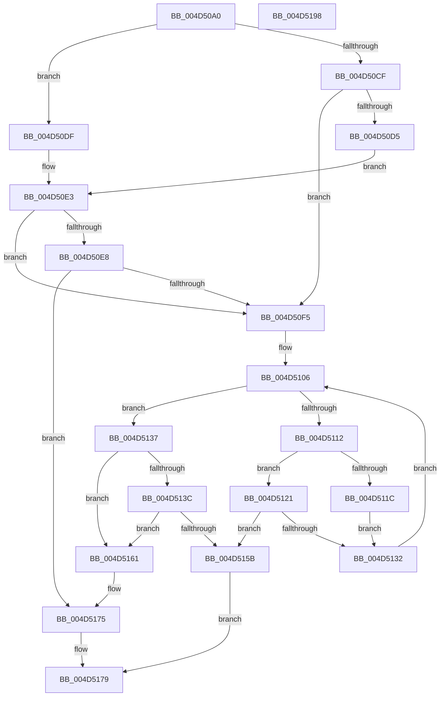

# MiGetPageFromSlabAllocatorByIdentity

- RVA: `0x004D50A0`–`0x004D5199` (길이 `249` bytes)
- VA: `0x00000001404D50A0`
- 실행 섹션: `.text`
- PDB 이름 있음: `예`; PDB Function 태그: `아니요`
- unwind 정보 RVA: `0x0005FEF8`
- 디코드: `75`개 명령, `249/249` bytes 표시
- 미해석 바이트: `0` (있으면 어셈블리에 `.byte`로 보존)

> 이 문서는 커널 이미지의 기계어와 PDB 기호를 분석해 생성했습니다. 4번과 5번은 함수 원형과 자료형을 바이너리 사용 방식에서 추정한 C 해석이며 원본 소스 복구 결과는 아닙니다.

## 1. Dependencies

- 직접 호출 지점: **3**; 고유 호출 대상: **2**
- 직접 호출자로 확인된 함수: **1**
- RIP 상대 이미지 참조: **0**

### Outgoing calls
- `0x004D5127` → [MiGetPageFromSlabEntry](../37/MiGetPageFromSlabEntry_function_00377768.md) (function, `0x00377768`)
- `0x004D5150` → [MiGetPageFromSlabEntry](../37/MiGetPageFromSlabEntry_function_00377768.md) (function, `0x00377768`)
- `0x004D5170` → [MiSetHintSlabEntry](../46/MiSetHintSlabEntry_function_00466760.md) (function, `0x00466760`)

### Direct callers
- [MiGetPageFromSlabAllocator](../37/MiGetPageFromSlabAllocator_function_00377294.md) at `0x003776FE`

### Static image references
- 디코드된 RIP-relative 메모리 참조가 없습니다.

## 2. Other-region calls and transfers

- 다른 실행 섹션으로 향하는 call: **0**
- 별도 외부 분기/꼬리 이동을 확인하지 못했습니다.

## 3. Assembly (complete function range)

```asm
004D50A0  48 8B C4                        mov rax, rsp
004D50A3  48 89 58 08                     mov qword ptr [rax + 8], rbx
004D50A7  48 89 68 10                     mov qword ptr [rax + 0x10], rbp
004D50AB  48 89 70 18                     mov qword ptr [rax + 0x18], rsi
004D50AF  48 89 78 20                     mov qword ptr [rax + 0x20], rdi
004D50B3  41 54                           push r12
004D50B5  41 56                           push r14
004D50B7  41 57                           push r15
004D50B9  48 83 EC 20                     sub rsp, 0x20
004D50BD  83 B9 80 00 00 00 08            cmp dword ptr [rcx + 0x80], 8
004D50C4  4D 8B E0                        mov r12, r8
004D50C7  0F B6 EA                        movzx ebp, dl
004D50CA  48 8B D9                        mov rbx, rcx
004D50CD  75 10                           jne 0x1404d50df
004D50CF  40 80 FD FF                     cmp bpl, 0xff
004D50D3  74 20                           je 0x1404d50f5
004D50D5  48 8B 41 20                     mov rax, qword ptr [rcx + 0x20]
004D50D9  48 8D 04 E8                     lea rax, [rax + rbp*8]
004D50DD  EB 04                           jmp 0x1404d50e3
004D50DF  48 8D 41 20                     lea rax, [rcx + 0x20]
004D50E3  48 85 C0                        test rax, rax
004D50E6  74 0D                           je 0x1404d50f5
004D50E8  48 8B 00                        mov rax, qword ptr [rax]
004D50EB  48 83 F8 01                     cmp rax, 1
004D50EF  0F 84 80 00 00 00               je 0x1404d5175
004D50F5  48 8B 41 58                     mov rax, qword ptr [rcx + 0x58]
004D50F9  33 F6                           xor esi, esi
004D50FB  4C 8B FD                        mov r15, rbp
004D50FE  49 C1 E7 04                     shl r15, 4
004D5102  4D 8B 34 07                     mov r14, qword ptr [r15 + rax]
004D5106  48 8B 4B 58                     mov rcx, qword ptr [rbx + 0x58]
004D510A  49 03 CF                        add rcx, r15
004D510D  4C 3B F1                        cmp r14, rcx
004D5110  74 25                           je 0x1404d5137
004D5112  49 8D 7E E8                     lea rdi, [r14 - 0x18]
004D5116  48 3B 7B 30                     cmp rdi, qword ptr [rbx + 0x30]
004D511A  75 05                           jne 0x1404d5121
004D511C  48 8B F7                        mov rsi, rdi
004D511F  EB 11                           jmp 0x1404d5132
004D5121  48 8B D3                        mov rdx, rbx
004D5124  48 8B CF                        mov rcx, rdi
004D5127  E8 3C 26 EA FF                  call 0x140377768
004D512C  48 83 F8 FF                     cmp rax, -1
004D5130  75 29                           jne 0x1404d515b
004D5132  4D 8B 36                        mov r14, qword ptr [r14]
004D5135  EB CF                           jmp 0x1404d5106
004D5137  48 85 F6                        test rsi, rsi
004D513A  74 25                           je 0x1404d5161
004D513C  48 8B C6                        mov rax, rsi
004D513F  48 8B D3                        mov rdx, rbx
004D5142  48 83 C8 02                     or rax, 2
004D5146  48 8B CE                        mov rcx, rsi
004D5149  48 89 43 30                     mov qword ptr [rbx + 0x30], rax
004D514D  48 8B FE                        mov rdi, rsi
004D5150  E8 13 26 EA FF                  call 0x140377768
004D5155  48 83 F8 FF                     cmp rax, -1
004D5159  74 06                           je 0x1404d5161
004D515B  49 89 3C 24                     mov qword ptr [r12], rdi
004D515F  EB 18                           jmp 0x1404d5179
004D5161  41 B9 01 00 00 00               mov r9d, 1
004D5167  40 8A D5                        mov dl, bpl
004D516A  45 8B C1                        mov r8d, r9d
004D516D  48 8B CB                        mov rcx, rbx
004D5170  E8 EB 15 F9 FF                  call 0x140466760
004D5175  48 83 C8 FF                     or rax, 0xffffffffffffffff
004D5179  48 8B 5C 24 40                  mov rbx, qword ptr [rsp + 0x40]
004D517E  48 8B 6C 24 48                  mov rbp, qword ptr [rsp + 0x48]
004D5183  48 8B 74 24 50                  mov rsi, qword ptr [rsp + 0x50]
004D5188  48 8B 7C 24 58                  mov rdi, qword ptr [rsp + 0x58]
004D518D  48 83 C4 20                     add rsp, 0x20
004D5191  41 5F                           pop r15
004D5193  41 5E                           pop r14
004D5195  41 5C                           pop r12
004D5197  C3                              ret
004D5198  CC                              int3
```

## 4. C-style interpretation (structured pseudocode)

```c
__int64 __fastcall MiGetPageFromSlabAllocatorByIdentity(__int64 a1, unsigned __int8 a2, __int64 a3)
{
    __int64 result;
    __int64 v_r15;
    __int64 v_rsi;
    __int64 v_rsp;
    unsigned __int64 v_stack_p10;
    unsigned __int64 v_stack_p18;
    unsigned __int64 v_stack_p20;
    unsigned __int64 v_stack_p8;

    *(unsigned __int64 *)(v_rsp + 8) = v_rbx;
    *(unsigned __int64 *)(v_rsp + 16) = v_rbp;
    *(unsigned __int64 *)(v_rsp + 24) = v_rsi;
    *(unsigned __int64 *)(v_rsp + 32) = v_rdi;
    v_rsp = (v_rsp) - (32);
    if ((*(unsigned int *)(a1 + 128)) != 8) goto loc_004D50DF;
    if (a2 == 255) goto loc_004D50F5;
    goto loc_004D50E3;
loc_004D50DF:
loc_004D50E3:
    if (a1 + 32 == 0) goto loc_004D50F5;
    if ((*(unsigned __int64 *)(a1 + 32)) == 1) goto loc_004D5175;
loc_004D50F5:
    v_rsi = 0;
    v_r15 = (a2) << (4);
loc_004D5106:
    a1 = (*(unsigned __int64 *)(a1 + 88)) + (v_r15);
    if ((*(unsigned __int64 *)(v_r15 + *(unsigned __int64 *)(a1 + 88) * 1)) == a1) goto loc_004D5137;
    if ((*(unsigned __int64 *)(v_r15 + *(unsigned __int64 *)(a1 + 88) * 1) - 24) != (*(unsigned __int64 *)(a1 + 48))) goto loc_004D5121;
    goto loc_004D5132;
loc_004D5121:
    result = MiGetPageFromSlabEntry(*(unsigned __int64 *)(v_r15 + *(unsigned __int64 *)(a1 + 88) * 1) - 24, a1, a3, a4);
    if (result != -1) goto loc_004D515B;
loc_004D5132:
    goto loc_004D5106;
loc_004D5137:
    if (*(unsigned __int64 *)(v_r15 + *(unsigned __int64 *)(a1 + 88) * 1) - 24 == 0) goto loc_004D5161;
    result = (*(unsigned __int64 *)(v_r15 + *(unsigned __int64 *)(a1 + 88) * 1) - 24) | (2);
    *(unsigned __int64 *)(a1 + 48) = result;
    result = MiGetPageFromSlabEntry(*(unsigned __int64 *)(v_r15 + *(unsigned __int64 *)(a1 + 88) * 1) - 24, a1, a3, a4);
    if (result == -1) goto loc_004D5161;
loc_004D515B:
    *(unsigned __int64 *)(a3) = *(unsigned __int64 *)(v_r15 + *(unsigned __int64 *)(a1 + 88) * 1) - 24;
    goto loc_004D5179;
loc_004D5161:
    result = MiSetHintSlabEntry(a1, a2, 1, 1);
loc_004D5175:
    result = (result) | (-1);
loc_004D5179:
    v_rsp = (v_rsp) + (32);
    return result;
}
```

## 5. (Beta) C Style

```c
int64_t MiGetPageFromSlabAllocatorByIdentity(void *Arg1, uint8_t Arg2, void *Arg3)
{
    uint8_t *arg1 = (uint8_t *)Arg1;
    uint8_t *arg3 = (uint8_t *)Arg3;

    int64_t result;
    int64_t local_r15;
    int64_t local_rsi;
    int64_t local_rsp;
    uint64_t v_stack_p10;
    uint64_t v_stack_p18;
    uint64_t v_stack_p20;
    uint64_t v_stack_p8;

    *(uint64_t *)(local_rsp + 0x8) = local_rbx;
    *(uint64_t *)(local_rsp + 0x10) = local_rbp;
    *(uint64_t *)(local_rsp + 0x18) = local_rsi;
    *(uint64_t *)(local_rsp + 0x20) = local_rdi;
    local_rsp = (local_rsp) - (32);
    if ((*(uint32_t *)(arg1 + 0x80)) != 8) goto loc_004D50DF;
    if (Arg2 == 255) goto loc_004D50F5;
    goto loc_004D50E3;
loc_004D50DF:
loc_004D50E3:
    if (Arg1 + 32 == 0) goto loc_004D50F5;
    if ((*(uint64_t *)(arg1 + 0x20)) == 1) goto loc_004D5175;
loc_004D50F5:
    local_rsi = 0;
    local_r15 = (Arg2) << (4);
loc_004D5106:
    Arg1 = (*(uint64_t *)(arg1 + 0x58)) + (local_r15);
    if ((*(uint64_t *)(local_r15 + *(uint64_t *)(arg1 + 0x58) * 1)) == Arg1) goto loc_004D5137;
    if ((*(uint64_t *)(local_r15 + *(uint64_t *)(arg1 + 0x58) * 1) - 24) != (*(uint64_t *)(arg1 + 0x30))) goto loc_004D5121;
    goto loc_004D5132;
loc_004D5121:
    result = MiGetPageFromSlabEntry(*(uint64_t *)(local_r15 + *(uint64_t *)(arg1 + 0x58) * 1) - 24, Arg1, Arg3, a4);
    if (result != -1) goto loc_004D515B;
loc_004D5132:
    goto loc_004D5106;
loc_004D5137:
    if (*(uint64_t *)(local_r15 + *(uint64_t *)(arg1 + 0x58) * 1) - 24 == 0) goto loc_004D5161;
    result = (*(uint64_t *)(local_r15 + *(uint64_t *)(arg1 + 0x58) * 1) - 24) | (2);
    *(uint64_t *)(arg1 + 0x30) = result;
    result = MiGetPageFromSlabEntry(*(uint64_t *)(local_r15 + *(uint64_t *)(arg1 + 0x58) * 1) - 24, Arg1, Arg3, a4);
    if (result == -1) goto loc_004D5161;
loc_004D515B:
    *(uint64_t *)(arg3) = *(uint64_t *)(local_r15 + *(uint64_t *)(arg1 + 0x58) * 1) - 24;
    goto loc_004D5179;
loc_004D5161:
    result = MiSetHintSlabEntry(Arg1, Arg2, 1, 1);
loc_004D5175:
    result = (result) | (-1);
loc_004D5179:
    local_rsp = (local_rsp) + (32);
    return result;
}
```

### 관측된 메모리 오프셋

구조체 형식이 확인되지 않은 접근은 인자 기준의 오프셋으로만 기록했습니다.

| 기준 인자 | 오프셋 표현 | 폭 (bit) | 접근 |
|---|---:|---:|---|
| `Arg1` | `+ 0x20` | `64` | `R` |
| `Arg1` | `+ 0x30` | `64` | `R` |
| `Arg1` | `+ 0x30` | `64` | `W` |
| `Arg1` | `+ 0x58` | `64` | `R` |
| `Arg1` | `+ 0x80` | `32` | `R` |
| `Arg3` | `+ 0x0` | `64` | `W` |

## 6. Execution-region graph

[열기: 2D/3D 그래프와 함수 탐색 컨트롤 패널](../../../control-panel.html?section=text&rva=0x004D50A0&view=graph)

- 2D 그래프는 위에서 아래로 흐르고, 3D 그래프는 빈 공간을 드래그해 회전합니다. Shift+드래그는 이동, 휠은 확대·축소, 함수 노드 선택은 대상 보고서 이동입니다.

### Static fallback


