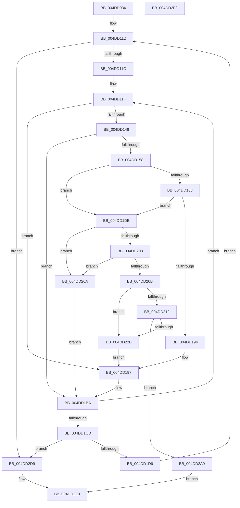

# MiGetSingleHugeRangeToZero

- RVA: `0x004DD034`–`0x004DD2F4` (길이 `704` bytes)
- VA: `0x00000001404DD034`
- 실행 섹션: `.text`
- PDB 이름 있음: `예`; PDB Function 태그: `아니요`
- unwind 정보 RVA: `0x000BEB88`
- 디코드: `184`개 명령, `704/704` bytes 표시
- 미해석 바이트: `0` (있으면 어셈블리에 `.byte`로 보존)

> 이 문서는 커널 이미지의 기계어와 PDB 기호를 분석해 생성했습니다. 4번과 5번은 함수 원형과 자료형을 바이너리 사용 방식에서 추정한 C 해석이며 원본 소스 복구 결과는 아닙니다.

## 1. Dependencies

- 직접 호출 지점: **3**; 고유 호출 대상: **3**
- 직접 호출자로 확인된 함수: **1**
- RIP 상대 이미지 참조: **4**

### Outgoing calls
- `0x004DD098` → [MiInitializePageColorBase](../32/MiInitializePageColorBase_function_00320410.md) (function, `0x00320410`)
- `0x004DD1E1` → [MiLockHugePfnInternal](../3F/MiLockHugePfnInternal_function_003FBC80.md) (function, `0x003FBC80`)
- `0x004DD222` → [MiBeginPageAccessor](../43/MiBeginPageAccessor_function_0043BBE0.md) (function, `0x0043BBE0`)

### Direct callers
- [MiGetBackgroundHugePageToZero](../31/MiGetBackgroundHugePageToZero_function_0031DD8C.md) at `0x0031DE65`

### Static image references
- `0x004DD09D` → RVA `0x00E2DCC0` (`.data`; read)
- `0x004DD146` → RVA `0x00E300B8` (`.data`; read)
- `0x004DD158` → RVA `0x00E300C0` (`.data`; read)
- `0x004DD16E` → RVA `0x00E300C8` (`.data`; read)

## 2. Other-region calls and transfers

- 다른 실행 섹션으로 향하는 call: **0**
- 별도 외부 분기/꼬리 이동을 확인하지 못했습니다.

## 3. Assembly (complete function range)

```asm
004DD034  4C 89 44 24 18                  mov qword ptr [rsp + 0x18], r8
004DD039  48 89 4C 24 08                  mov qword ptr [rsp + 8], rcx
004DD03E  53                              push rbx
004DD03F  56                              push rsi
004DD040  57                              push rdi
004DD041  41 54                           push r12
004DD043  41 55                           push r13
004DD045  41 56                           push r14
004DD047  41 57                           push r15
004DD049  48 83 EC 40                     sub rsp, 0x40
004DD04D  48 8B 82 88 3A 00 00            mov rax, qword ptr [rdx + 0x3a88]
004DD054  4C 8D 4C 24 30                  lea r9, [rsp + 0x30]
004DD059  49 8B F8                        mov rdi, r8
004DD05C  48 8B F2                        mov rsi, rdx
004DD05F  4C 8B C2                        mov r8, rdx
004DD062  49 BF 3F EE A0 D9 7C 5A 1E F5   movabs r15, 0xf51e5a7cd9a0ee3f
004DD06C  33 DB                           xor ebx, ebx
004DD06E  0F 57 C0                        xorps xmm0, xmm0
004DD071  4C 2B 40 10                     sub r8, qword ptr [rax + 0x10]
004DD075  33 D2                           xor edx, edx
004DD077  0F B7 08                        movzx ecx, word ptr [rax]
004DD07A  49 C1 F8 07                     sar r8, 7
004DD07E  4D 0F AF C7                     imul r8, r15
004DD082  0F 11 44 24 30                  movups xmmword ptr [rsp + 0x30], xmm0
004DD087  66 89 8C 24 88 00 00 00         mov word ptr [rsp + 0x88], cx
004DD08F  44 8D 73 01                     lea r14d, [rbx + 1]
004DD093  45 03 C6                        add r8d, r14d
004DD096  33 C9                           xor ecx, ecx
004DD098  E8 73 33 E4 FF                  call 0x140320410
004DD09D  8B 05 1D 0C 95 00               mov eax, dword ptr [rip + 0x950c1d]
004DD0A3  45 33 ED                        xor r13d, r13d
004DD0A6  89 84 24 98 00 00 00            mov dword ptr [rsp + 0x98], eax
004DD0AD  41 8B C6                        mov eax, r14d
004DD0B0  F0 0F C1 07                     lock xadd dword ptr [rdi], eax
004DD0B4  48 8B 4C 24 38                  mov rcx, qword ptr [rsp + 0x38]
004DD0B9  4C 8D 15 00 0C 95 00            lea r10, [rip + 0x950c00]
004DD0C0  4C 8B C9                        mov r9, rcx
004DD0C3  33 D2                           xor edx, edx
004DD0C5  49 C1 E9 10                     shr r9, 0x10
004DD0C9  41 83 E1 03                     and r9d, 3
004DD0CD  4C 89 4C 24 20                  mov qword ptr [rsp + 0x20], r9
004DD0D2  43 F7 34 8A                     div dword ptr [r10 + r9*4]
004DD0D6  8B 05 E4 0B 95 00               mov eax, dword ptr [rip + 0x950be4]
004DD0DC  33 D1                           xor edx, ecx
004DD0DE  0F B6 FA                        movzx edi, dl
004DD0E1  48 8B 96 88 3A 00 00            mov rdx, qword ptr [rsi + 0x3a88]
004DD0E8  33 F9                           xor edi, ecx
004DD0EA  48 2B 72 10                     sub rsi, qword ptr [rdx + 0x10]
004DD0EE  48 C1 FE 07                     sar rsi, 7
004DD0F2  49 0F AF F7                     imul rsi, r15
004DD0F6  0F AF F0                        imul esi, eax
004DD0F9  8D 0C 36                        lea ecx, [rsi + rsi]
004DD0FC  48 03 C8                        add rcx, rax
004DD0FF  48 8B 82 10 41 00 00            mov rax, qword ptr [rdx + 0x4110]
004DD106  45 33 FF                        xor r15d, r15d
004DD109  48 8D 0C C8                     lea rcx, [rax + rcx*8]
004DD10D  48 89 4C 24 28                  mov qword ptr [rsp + 0x28], rcx
004DD112  41 83 FF 02                     cmp r15d, 2
004DD116  0F 83 BD 01 00 00               jae 0x1404dd2d9
004DD11C  45 33 E4                        xor r12d, r12d
004DD11F  40 0F B6 C7                     movzx eax, dil
004DD123  48 8B 04 C1                     mov rax, qword ptr [rcx + rax*8]
004DD127  48 C1 E8 25                     shr rax, 0x25
004DD12B  48 33 D8                        xor rbx, rax
004DD12E  48 8B D0                        mov rdx, rax
004DD131  48 81 E3 00 00 C0 FF            and rbx, 0xffffffffffc00000
004DD138  81 E2 FF FF 3F 00               and edx, 0x3fffff
004DD13E  48 33 D8                        xor rbx, rax
004DD141  48 85 D2                        test rdx, rdx
004DD144  74 51                           je 0x1404dd197
004DD146  48 8B 05 6B 2F 95 00            mov rax, qword ptr [rip + 0x952f6b]
004DD14D  48 0F A3 10                     bt qword ptr [rax], rdx
004DD151  0F 92 C0                        setb al
004DD154  84 C0                           test al, al
004DD156  74 62                           je 0x1404dd1ba
004DD158  48 8B 05 61 2F 95 00            mov rax, qword ptr [rip + 0x952f61]
004DD15F  48 8D 34 D0                     lea rsi, [rax + rdx*8]
004DD163  45 85 FF                        test r15d, r15d
004DD166  75 76                           jne 0x1404dd1de
004DD168  48 8B CE                        mov rcx, rsi
004DD16B  48 2B C8                        sub rcx, rax
004DD16E  48 8B 05 53 2F 95 00            mov rax, qword ptr [rip + 0x952f53]
004DD175  48 C1 F9 03                     sar rcx, 3
004DD179  81 E1 FF FF 3F 00               and ecx, 0x3fffff
004DD17F  8B D1                           mov edx, ecx
004DD181  83 E1 1F                        and ecx, 0x1f
004DD184  48 C1 EA 05                     shr rdx, 5
004DD188  44 8B 04 90                     mov r8d, dword ptr [rax + rdx*4]
004DD18C  41 D3 F8                        sar r8d, cl
004DD18F  45 84 C6                        test r14b, r8b
004DD192  74 4A                           je 0x1404dd1de
004DD194  45 8B EE                        mov r13d, r14d
004DD197  48 8B 8C 24 90 00 00 00         mov rcx, qword ptr [rsp + 0x90]
004DD19F  41 8B C6                        mov eax, r14d
004DD1A2  F0 0F C1 01                     lock xadd dword ptr [rcx], eax
004DD1A6  33 D2                           xor edx, edx
004DD1A8  43 F7 34 8A                     div dword ptr [r10 + r9*4]
004DD1AC  33 54 24 38                     xor edx, dword ptr [rsp + 0x38]
004DD1B0  0F B6 FA                        movzx edi, dl
004DD1B3  33 7C 24 38                     xor edi, dword ptr [rsp + 0x38]
004DD1B7  45 03 E6                        add r12d, r14d
004DD1BA  48 8B 4C 24 28                  mov rcx, qword ptr [rsp + 0x28]
004DD1BF  44 3B A4 24 98 00 00 00         cmp r12d, dword ptr [rsp + 0x98]
004DD1C7  0F 85 52 FF FF FF               jne 0x1404dd11f
004DD1CD  45 85 ED                        test r13d, r13d
004DD1D0  0F 84 03 01 00 00               je 0x1404dd2d9
004DD1D6  45 03 FE                        add r15d, r14d
004DD1D9  E9 34 FF FF FF                  jmp 0x1404dd112
004DD1DE  48 8B CE                        mov rcx, rsi
004DD1E1  E8 9A EA F1 FF                  call 0x1403fbc80
004DD1E6  48 8B 16                        mov rdx, qword ptr [rsi]
004DD1E9  0F B7 84 24 88 00 00 00         movzx eax, word ptr [rsp + 0x88]
004DD1F1  48 8B CA                        mov rcx, rdx
004DD1F4  48 C1 E9 04                     shr rcx, 4
004DD1F8  81 E1 FF 07 00 00               and ecx, 0x7ff
004DD1FE  48 3B C8                        cmp rcx, rax
004DD201  75 67                           jne 0x1404dd26a
004DD203  8B C2                           mov eax, edx
004DD205  24 07                           and al, 7
004DD207  3C 02                           cmp al, 2
004DD209  75 5F                           jne 0x1404dd26a
004DD20B  48 0F BA E2 3B                  bt rdx, 0x3b
004DD210  72 19                           jb 0x1404dd22b
004DD212  48 8B 8C 24 80 00 00 00         mov rcx, qword ptr [rsp + 0x80]
004DD21A  45 8B CE                        mov r9d, r14d
004DD21D  4C 8B C6                        mov r8, rsi
004DD220  33 D2                           xor edx, edx
004DD222  E8 B9 E9 F5 FF                  call 0x14043bbe0
004DD227  85 C0                           test eax, eax
004DD229  75 7E                           jne 0x1404dd2a9
004DD22B  48 2B 35 8E 2E 95 00            sub rsi, qword ptr [rip + 0x952e8e]
004DD232  41 8B D6                        mov edx, r14d
004DD235  48 8B 05 8C 2E 95 00            mov rax, qword ptr [rip + 0x952e8c]
004DD23C  48 C1 FE 03                     sar rsi, 3
004DD240  81 E6 FF FF 3F 00               and esi, 0x3fffff
004DD246  8B CE                           mov ecx, esi
004DD248  83 E1 1F                        and ecx, 0x1f
004DD24B  D3 E2                           shl edx, cl
004DD24D  8B CE                           mov ecx, esi
004DD24F  F7 D2                           not edx
004DD251  48 C1 E9 05                     shr rcx, 5
004DD255  F0 21 14 88                     lock and dword ptr [rax + rcx*4], edx
004DD259  4C 8B 4C 24 20                  mov r9, qword ptr [rsp + 0x20]
004DD25E  4C 8D 15 5B 0A 95 00            lea r10, [rip + 0x950a5b]
004DD265  E9 2D FF FF FF                  jmp 0x1404dd197
004DD26A  48 2B 35 4F 2E 95 00            sub rsi, qword ptr [rip + 0x952e4f]
004DD271  41 8B D6                        mov edx, r14d
004DD274  48 8B 05 4D 2E 95 00            mov rax, qword ptr [rip + 0x952e4d]
004DD27B  48 C1 FE 03                     sar rsi, 3
004DD27F  81 E6 FF FF 3F 00               and esi, 0x3fffff
004DD285  8B CE                           mov ecx, esi
004DD287  83 E1 1F                        and ecx, 0x1f
004DD28A  D3 E2                           shl edx, cl
004DD28C  8B CE                           mov ecx, esi
004DD28E  F7 D2                           not edx
004DD290  48 C1 E9 05                     shr rcx, 5
004DD294  F0 21 14 88                     lock and dword ptr [rax + rcx*4], edx
004DD298  4C 8B 4C 24 20                  mov r9, qword ptr [rsp + 0x20]
004DD29D  4C 8D 15 1C 0A 95 00            lea r10, [rip + 0x950a1c]
004DD2A4  E9 11 FF FF FF                  jmp 0x1404dd1ba
004DD2A9  48 2B 35 10 2E 95 00            sub rsi, qword ptr [rip + 0x952e10]
004DD2B0  48 C1 FE 03                     sar rsi, 3
004DD2B4  81 E6 FF FF 3F 00               and esi, 0x3fffff
004DD2BA  8B CE                           mov ecx, esi
004DD2BC  8B D6                           mov edx, esi
004DD2BE  83 E1 1F                        and ecx, 0x1f
004DD2C1  41 D3 E6                        shl r14d, cl
004DD2C4  48 8B 0D FD 2D 95 00            mov rcx, qword ptr [rip + 0x952dfd]
004DD2CB  41 F7 D6                        not r14d
004DD2CE  48 C1 EA 05                     shr rdx, 5
004DD2D2  F0 44 21 34 91                  lock and dword ptr [rcx + rdx*4], r14d
004DD2D7  EB 07                           jmp 0x1404dd2e0
004DD2D9  48 81 E3 00 00 C0 FF            and rbx, 0xffffffffffc00000
004DD2E0  48 8B C3                        mov rax, rbx
004DD2E3  48 83 C4 40                     add rsp, 0x40
004DD2E7  41 5F                           pop r15
004DD2E9  41 5E                           pop r14
004DD2EB  41 5D                           pop r13
004DD2ED  41 5C                           pop r12
004DD2EF  5F                              pop rdi
004DD2F0  5E                              pop rsi
004DD2F1  5B                              pop rbx
004DD2F2  C3                              ret
004DD2F3  CC                              int3
```

## 4. C-style interpretation (structured pseudocode)

```c
__int64 __fastcall MiGetSingleHugeRangeToZero(__int64 a1, __int64 a2, __int64 a3)
{
    __int64 result;
    __int64 v_r12;
    __int64 v_r13;
    __int64 v_r14;
    __int64 v_r15;
    __int64 v_rbx;
    __int64 v_rdi;
    __int64 v_rsi;
    __int64 v_rsp;
    unsigned __int64 v_stack_m40;
    unsigned __int64 v_stack_m48;
    unsigned __int64 v_stack_m50;
    unsigned __int64 v_stack_m58;
    unsigned __int16 v_stack_p10;
    unsigned __int64 v_stack_p18;
    unsigned int v_stack_p20;
    unsigned __int64 v_stack_p8;

    v_stack_p18 = a3;
    v_stack_p8 = a1;
    v_rsp = (v_rsp) - (64);
    v_rbx = 0;
    a3 = (a2) - (*(unsigned __int64 *)(*(unsigned __int64 *)(a2 + 14984) + 16));
    a2 = 0;
    a3 = (a3) >> (7);
    a3 = (a3) * (v_r15);
    v_stack_m48 = v_xmm0;
    v_stack_p10 = (unsigned __int16)(*(unsigned __int16 *)(*(unsigned __int64 *)(a2 + 14984)));
    a3 = (unsigned int)((a3) + ((unsigned int)(v_rbx + 1)));
    a1 = 0;
    result = MiInitializePageColorBase(a1, a2, a3, v_stack_m48);
    v_r13 = 0;
    v_stack_p20 = (unsigned int)((unsigned int)(*(unsigned int *)(v_rip + 9767965)));
    a2 = 0;
    a4 = (v_stack_m40) >> (16);
    a4 = (unsigned int)((a4) & (3));
    v_stack_m58 = a4;
    a2 = (unsigned int)((a2) ^ ((unsigned int)(v_stack_m40)));
    v_rdi = (unsigned int)(((unsigned __int8)(a2)) ^ ((unsigned int)(v_stack_m40)));
    v_rsi = (a2) - (*(unsigned __int64 *)(*(unsigned __int64 *)(a2 + 14984) + 16));
    v_rsi = (v_rsi) >> (7);
    v_rsi = (v_rsi) * (v_r15);
    v_rsi = (unsigned int)((v_rsi) * ((unsigned int)((unsigned int)(*(unsigned int *)(v_rip + 9767908)))));
    a1 = (v_rsi + v_rsi * 1) + ((unsigned int)(*(unsigned int *)(v_rip + 9767908)));
    v_r15 = 0;
    v_stack_m50 = *(unsigned __int64 *)(*(unsigned __int64 *)(a2 + 14984) + 16656) + a1 * 8;
loc_004DD112:
    if (0 >= 2) goto loc_004DD2D9;
    v_r12 = 0;
loc_004DD11F:
    result = (*(unsigned __int64 *)(*(unsigned __int64 *)(*(unsigned __int64 *)(a2 + 14984) + 16656) + a1 * 8 + (unsigned __int8)(v_rdi) * 8)) >> (37);
    v_rbx = (v_rbx) ^ (result);
    v_rbx = (v_rbx) & (0xFFFFFFFFFFC00000ULL);
    a2 = (unsigned int)((result) & (0x3FFFFFULL));
    v_rbx = (v_rbx) ^ (result);
    if (a2 == 0) goto loc_004DD197;
    result = (condition_is_below) ? 1 : 0;
    if ((unsigned __int8)(result) == 0) goto loc_004DD1BA;
    if (0 != 0) goto loc_004DD1DE;
    a1 = (*(unsigned __int64 *)(v_rip + 9776993) + a2 * 8) - (*(unsigned __int64 *)(v_rip + 9776993));
    a1 = (a1) >> (3);
    a1 = (unsigned int)((a1) & (0x3FFFFFULL));
    a1 = (unsigned int)((a1) & (31));
    a2 = ((unsigned int)((unsigned int)(a1))) >> (5);
    a3 = (unsigned int)(((unsigned int)(*(unsigned int *)(*(unsigned __int64 *)(v_rip + 9776979) + a2 * 4))) >> ((unsigned __int8)(a1)));
    if ((((unsigned __int8)(v_rbx + 1)) & ((unsigned __int8)(a3))) == 0) goto loc_004DD1DE;
loc_004DD197:
    a2 = 0;
    a2 = (unsigned int)((a2) ^ (v_stack_m40));
    v_rdi = (unsigned int)(((unsigned __int8)(a2)) ^ (v_stack_m40));
    v_r12 = (unsigned int)((v_r12) + ((unsigned int)(v_rbx + 1)));
loc_004DD1BA:
    if (((unsigned int)(v_r12)) != v_stack_p20) goto loc_004DD11F;
    if ((unsigned int)((unsigned int)((unsigned int)(v_rbx + 1))) == 0) goto loc_004DD2D9;
    v_r15 = (unsigned int)((v_r15) + ((unsigned int)(v_rbx + 1)));
    goto loc_004DD112;
loc_004DD1DE:
    result = MiLockHugePfnInternal(*(unsigned __int64 *)(v_rip + 9776993) + a2 * 8, a2, a3, a4);
    a1 = (*(unsigned __int64 *)(*(unsigned __int64 *)(v_rip + 9776993) + a2 * 8)) >> (4);
    a1 = (unsigned int)((a1) & (0x7FFULL));
    if (a1 != v_stack_p10) goto loc_004DD26A;
    result = (unsigned __int8)(((unsigned int)((unsigned int)(*(unsigned __int64 *)(*(unsigned __int64 *)(v_rip + 9776993) + a2 * 8)))) & (7));
    if (((unsigned __int8)(result)) != 2) goto loc_004DD26A;
    if (((unsigned __int8)(result)) < 2) goto loc_004DD22B;
    a2 = 0;
    result = MiBeginPageAccessor(v_stack_p8, a2, *(unsigned __int64 *)(v_rip + 9776993) + a2 * 8, (unsigned int)((unsigned int)(v_rbx + 1)));
    if ((unsigned int)(result) != 0) goto loc_004DD2A9;
loc_004DD22B:
    v_rsi = (*(unsigned __int64 *)(v_rip + 9776993) + a2 * 8) - (*(unsigned __int64 *)(v_rip + 9776782));
    v_rsi = (v_rsi) >> (3);
    v_rsi = (unsigned int)((v_rsi) & (0x3FFFFFULL));
    a1 = (unsigned int)(((unsigned int)((unsigned int)(v_rsi))) & (31));
    a2 = (unsigned int)(((unsigned int)((unsigned int)(v_rbx + 1))) << ((unsigned __int8)(a1)));
    a2 = (unsigned int)(~(a2));
    a1 = ((unsigned int)((unsigned int)(v_rsi))) >> (5);
    goto loc_004DD197;
loc_004DD26A:
    v_rsi = (v_rsi) - (*(unsigned __int64 *)(v_rip + 9776719));
    v_rsi = (v_rsi) >> (3);
    v_rsi = (unsigned int)((v_rsi) & (0x3FFFFFULL));
    a1 = (unsigned int)(((unsigned int)((unsigned int)(v_rsi))) & (31));
    a2 = (unsigned int)(((unsigned int)((unsigned int)(v_rbx + 1))) << ((unsigned __int8)(a1)));
    a2 = (unsigned int)(~(a2));
    a1 = ((unsigned int)((unsigned int)(v_rsi))) >> (5);
    goto loc_004DD1BA;
loc_004DD2A9:
    v_rsi = (v_rsi) - (*(unsigned __int64 *)(v_rip + 9776656));
    v_rsi = (v_rsi) >> (3);
    v_rsi = (unsigned int)((v_rsi) & (0x3FFFFFULL));
    a1 = (unsigned int)(((unsigned int)((unsigned int)(v_rsi))) & (31));
    v_r14 = (unsigned int)((v_rbx + 1) << ((unsigned __int8)(a1)));
    v_r14 = (unsigned int)(~(v_r14));
    a2 = ((unsigned int)((unsigned int)(v_rsi))) >> (5);
    goto loc_004DD2E0;
loc_004DD2D9:
    v_rbx = (v_rbx) & (0xFFFFFFFFFFC00000ULL);
loc_004DD2E0:
    v_rsp = (v_rsp) + (64);
    return v_rbx;
}
```

## 5. (Beta) C Style

```c
int64_t MiGetSingleHugeRangeToZero(int64_t Arg1, void *Arg2, void *Arg3)
{
    uint8_t *arg2 = (uint8_t *)Arg2;
    uint8_t *arg3 = (uint8_t *)Arg3;

    int64_t result;
    int64_t local_r12;
    int64_t local_r13;
    int64_t local_r14;
    int64_t local_r15;
    int64_t local_rbx;
    int64_t local_rdi;
    int64_t local_rsi;
    int64_t local_rsp;
    uint64_t v_stack_m40;
    uint64_t v_stack_m48;
    uint64_t v_stack_m50;
    uint64_t v_stack_m58;
    uint16_t v_stack_p10;
    uint64_t v_stack_p18;
    uint32_t v_stack_p20;
    uint64_t v_stack_p8;

    v_stack_p18 = Arg3;
    v_stack_p8 = Arg1;
    local_rsp = (local_rsp) - (64);
    local_rbx = 0;
    Arg3 = (Arg2) - (*(uint64_t *)(*(uint64_t *)(arg2 + 0x3A88) + 0x10));
    Arg2 = 0;
    Arg3 = (Arg3) >> (7);
    Arg3 = (Arg3) * (local_r15);
    v_stack_m48 = v_xmm0;
    v_stack_p10 = (uint16_t)(*(uint16_t *)(*(uint64_t *)(arg2 + 0x3A88)));
    Arg3 = (uint32_t)((Arg3) + ((uint32_t)(local_rbx + 1)));
    Arg1 = 0;
    result = MiInitializePageColorBase(Arg1, Arg2, Arg3, v_stack_m48);
    local_r13 = 0;
    v_stack_p20 = (uint32_t)((uint32_t)(*(uint32_t *)(v_rip + 0x950C1D)));
    Arg2 = 0;
    a4 = (v_stack_m40) >> (16);
    a4 = (uint32_t)((a4) & (3));
    v_stack_m58 = a4;
    Arg2 = (uint32_t)((Arg2) ^ ((uint32_t)(v_stack_m40)));
    local_rdi = (uint32_t)(((uint8_t)(Arg2)) ^ ((uint32_t)(v_stack_m40)));
    local_rsi = (Arg2) - (*(uint64_t *)(*(uint64_t *)(arg2 + 0x3A88) + 0x10));
    local_rsi = (local_rsi) >> (7);
    local_rsi = (local_rsi) * (local_r15);
    local_rsi = (uint32_t)((local_rsi) * ((uint32_t)((uint32_t)(*(uint32_t *)(v_rip + 0x950BE4)))));
    Arg1 = (local_rsi + local_rsi * 1) + ((uint32_t)(*(uint32_t *)(v_rip + 0x950BE4)));
    local_r15 = 0;
    v_stack_m50 = *(uint64_t *)(*(uint64_t *)(arg2 + 0x3A88) + 0x4110) + Arg1 * 8;
loc_004DD112:
    if (0 >= 2) goto loc_004DD2D9;
    local_r12 = 0;
loc_004DD11F:
    result = (*(uint64_t *)(*(uint64_t *)(*(uint64_t *)(arg2 + 0x3A88) + 0x4110) + Arg1 * 8 + (uint8_t)(local_rdi) * 8)) >> (37);
    local_rbx = (local_rbx) ^ (result);
    local_rbx = (local_rbx) & (0xFFFFFFFFFFC00000ULL);
    Arg2 = (uint32_t)((result) & (0x3FFFFFULL));
    local_rbx = (local_rbx) ^ (result);
    if (Arg2 == NULL) goto loc_004DD197;
    result = (condition_is_below) ? 1 : 0;
    if ((uint8_t)(result) == 0) goto loc_004DD1BA;
    if (0 != 0) goto loc_004DD1DE;
    Arg1 = (*(uint64_t *)(v_rip + 0x952F61) + Arg2 * 8) - (*(uint64_t *)(v_rip + 0x952F61));
    Arg1 = (Arg1) >> (3);
    Arg1 = (uint32_t)((Arg1) & (0x3FFFFFULL));
    Arg1 = (uint32_t)((Arg1) & (31));
    Arg2 = ((uint32_t)((uint32_t)(Arg1))) >> (5);
    Arg3 = (uint32_t)(((uint32_t)(*(uint32_t *)(*(uint64_t *)(v_rip + 0x952F53) + arg2 * 4))) >> ((uint8_t)(Arg1)));
    if ((((uint8_t)(local_rbx + 1)) & ((uint8_t)(Arg3))) == 0) goto loc_004DD1DE;
loc_004DD197:
    Arg2 = 0;
    Arg2 = (uint32_t)((Arg2) ^ (v_stack_m40));
    local_rdi = (uint32_t)(((uint8_t)(Arg2)) ^ (v_stack_m40));
    local_r12 = (uint32_t)((local_r12) + ((uint32_t)(local_rbx + 1)));
loc_004DD1BA:
    if (((uint32_t)(local_r12)) != v_stack_p20) goto loc_004DD11F;
    if ((uint32_t)((uint32_t)((uint32_t)(local_rbx + 1))) == 0) goto loc_004DD2D9;
    local_r15 = (uint32_t)((local_r15) + ((uint32_t)(local_rbx + 1)));
    goto loc_004DD112;
loc_004DD1DE:
    result = MiLockHugePfnInternal(*(uint64_t *)(v_rip + 0x952F61) + Arg2 * 8, Arg2, Arg3, a4);
    Arg1 = (*(uint64_t *)(*(uint64_t *)(v_rip + 0x952F61) + arg2 * 8)) >> (4);
    Arg1 = (uint32_t)((Arg1) & (0x7FFULL));
    if (Arg1 != v_stack_p10) goto loc_004DD26A;
    result = (uint8_t)(((uint32_t)((uint32_t)(*(uint64_t *)(*(uint64_t *)(v_rip + 0x952F61) + arg2 * 8)))) & (7));
    if (((uint8_t)(result)) != 2) goto loc_004DD26A;
    if (((uint8_t)(result)) < 2) goto loc_004DD22B;
    Arg2 = 0;
    result = MiBeginPageAccessor(v_stack_p8, Arg2, *(uint64_t *)(v_rip + 0x952F61) + Arg2 * 8, (uint32_t)((uint32_t)(local_rbx + 1)));
    if ((uint32_t)(result) != 0) goto loc_004DD2A9;
loc_004DD22B:
    local_rsi = (*(uint64_t *)(v_rip + 0x952F61) + Arg2 * 8) - (*(uint64_t *)(v_rip + 0x952E8E));
    local_rsi = (local_rsi) >> (3);
    local_rsi = (uint32_t)((local_rsi) & (0x3FFFFFULL));
    Arg1 = (uint32_t)(((uint32_t)((uint32_t)(local_rsi))) & (31));
    Arg2 = (uint32_t)(((uint32_t)((uint32_t)(local_rbx + 1))) << ((uint8_t)(Arg1)));
    Arg2 = (uint32_t)(~(Arg2));
    Arg1 = ((uint32_t)((uint32_t)(local_rsi))) >> (5);
    goto loc_004DD197;
loc_004DD26A:
    local_rsi = (local_rsi) - (*(uint64_t *)(v_rip + 0x952E4F));
    local_rsi = (local_rsi) >> (3);
    local_rsi = (uint32_t)((local_rsi) & (0x3FFFFFULL));
    Arg1 = (uint32_t)(((uint32_t)((uint32_t)(local_rsi))) & (31));
    Arg2 = (uint32_t)(((uint32_t)((uint32_t)(local_rbx + 1))) << ((uint8_t)(Arg1)));
    Arg2 = (uint32_t)(~(Arg2));
    Arg1 = ((uint32_t)((uint32_t)(local_rsi))) >> (5);
    goto loc_004DD1BA;
loc_004DD2A9:
    local_rsi = (local_rsi) - (*(uint64_t *)(v_rip + 0x952E10));
    local_rsi = (local_rsi) >> (3);
    local_rsi = (uint32_t)((local_rsi) & (0x3FFFFFULL));
    Arg1 = (uint32_t)(((uint32_t)((uint32_t)(local_rsi))) & (31));
    local_r14 = (uint32_t)((local_rbx + 1) << ((uint8_t)(Arg1)));
    local_r14 = (uint32_t)(~(local_r14));
    Arg2 = ((uint32_t)((uint32_t)(local_rsi))) >> (5);
    goto loc_004DD2E0;
loc_004DD2D9:
    local_rbx = (local_rbx) & (0xFFFFFFFFFFC00000ULL);
loc_004DD2E0:
    local_rsp = (local_rsp) + (64);
    return local_rbx;
}
```

### 관측된 메모리 오프셋

구조체 형식이 확인되지 않은 접근은 인자 기준의 오프셋으로만 기록했습니다.

| 기준 인자 | 오프셋 표현 | 폭 (bit) | 접근 |
|---|---:|---:|---|
| `Arg2` | `+ 0x3A88` | `64` | `R` |
| `Arg3` | `+ 0x0` | `32` | `R/W` |

## 6. Execution-region graph

[열기: 2D/3D 그래프와 함수 탐색 컨트롤 패널](../../../control-panel.html?section=text&rva=0x004DD034&view=graph)

- 2D 그래프는 위에서 아래로 흐르고, 3D 그래프는 빈 공간을 드래그해 회전합니다. Shift+드래그는 이동, 휠은 확대·축소, 함수 노드 선택은 대상 보고서 이동입니다.

### Static fallback


