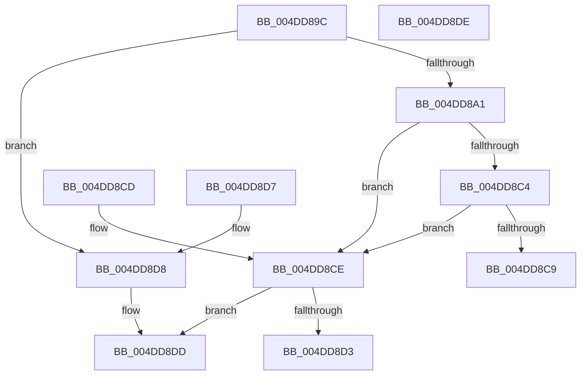

# MiGetValidAweProtection

- RVA: `0x004DD89C`–`0x004DD8DF` (길이 `67` bytes)
- VA: `0x00000001404DD89C`
- 실행 섹션: `.text`
- PDB 이름 있음: `예`; PDB Function 태그: `아니요`
- unwind 정보 RVA: `0x000DB714`
- 디코드: `27`개 명령, `67/67` bytes 표시
- 미해석 바이트: `0` (있으면 어셈블리에 `.byte`로 보존)

> 이 문서는 커널 이미지의 기계어와 PDB 기호를 분석해 생성했습니다. 4번과 5번은 함수 원형과 자료형을 바이너리 사용 방식에서 추정한 C 해석이며 원본 소스 복구 결과는 아닙니다.

## 1. Dependencies

- 직접 호출 지점: **0**; 고유 호출 대상: **0**
- 직접 호출자로 확인된 함수: **1**
- RIP 상대 이미지 참조: **0**

### Outgoing calls
- 직접 디코드된 call 명령이 없습니다.

### Direct callers
- [MiGetWorkingSetInfoList](../2A/MiGetWorkingSetInfoList_function_002AF770.md) at `0x002B0A63`

### Static image references
- 디코드된 RIP-relative 메모리 참조가 없습니다.

## 2. Other-region calls and transfers

- 다른 실행 섹션으로 향하는 call: **0**
- 별도 외부 분기/꼬리 이동을 확인하지 못했습니다.

## 3. Assembly (complete function range)

```asm
004DD89C  F6 C2 01                        test dl, 1
004DD89F  74 37                           je 0x1404dd8d8
004DD8A1  8B 49 30                        mov ecx, dword ptr [rcx + 0x30]
004DD8A4  81 E2 00 08 00 00               and edx, 0x800
004DD8AA  48 F7 DA                        neg rdx
004DD8AD  1B C0                           sbb eax, eax
004DD8AF  C1 E9 07                        shr ecx, 7
004DD8B2  83 E1 1F                        and ecx, 0x1f
004DD8B5  83 E0 03                        and eax, 3
004DD8B8  8B D1                           mov edx, ecx
004DD8BA  FF C0                           inc eax
004DD8BC  C1 EA 03                        shr edx, 3
004DD8BF  83 FA 03                        cmp edx, 3
004DD8C2  75 0A                           jne 0x1404dd8ce
004DD8C4  F6 C1 07                        test cl, 7
004DD8C7  74 05                           je 0x1404dd8ce
004DD8C9  83 C8 18                        or eax, 0x18
004DD8CC  C3                              ret
004DD8CD  CC                              int3
004DD8CE  83 FA 01                        cmp edx, 1
004DD8D1  75 0A                           jne 0x1404dd8dd
004DD8D3  83 C8 08                        or eax, 8
004DD8D6  C3                              ret
004DD8D7  CC                              int3
004DD8D8  B8 18 00 00 00                  mov eax, 0x18
004DD8DD  C3                              ret
004DD8DE  CC                              int3
```

## 4. C-style interpretation (structured pseudocode)

```c
__int64 __fastcall MiGetValidAweProtection(__int64 a1, int a2)
{
    __int64 result;

    if ((((unsigned __int8)(a2)) & (1)) == 0) goto loc_004DD8D8;
    a2 = (unsigned int)((a2) & (0x800ULL));
    a2 = -(a2);
    a1 = (unsigned int)(((unsigned int)(*(unsigned int *)(a1 + 48))) >> (7));
    a1 = (unsigned int)((a1) & (31));
    result = (unsigned int)((result) & (3));
    result = (unsigned int)((result) + 1);
    a2 = (unsigned int)(((unsigned int)((unsigned int)(a1))) >> (3));
    if (a2 != 3) goto loc_004DD8CE;
    if ((((unsigned __int8)(a1)) & (7)) == 0) goto loc_004DD8CE;
    result = (unsigned int)((result) | (24));
    return result;
loc_004DD8CE:
    if (a2 != 1) goto loc_004DD8DD;
    result = (unsigned int)((result) | (8));
    return result;
loc_004DD8D8:
loc_004DD8DD:
    return 24;
}
```

## 5. (Beta) C Style

```c
int64_t MiGetValidAweProtection(void *Arg1, int32_t Arg2)
{
    uint8_t *arg1 = (uint8_t *)Arg1;

    int64_t result;

    if ((((uint8_t)(Arg2)) & (1)) == 0) goto loc_004DD8D8;
    Arg2 = (uint32_t)((Arg2) & (0x800ULL));
    Arg2 = -(Arg2);
    Arg1 = (uint32_t)(((uint32_t)(*(uint32_t *)(arg1 + 0x30))) >> (7));
    Arg1 = (uint32_t)((Arg1) & (31));
    result = (uint32_t)((result) & (3));
    result = (uint32_t)((result) + 1);
    Arg2 = (uint32_t)(((uint32_t)((uint32_t)(Arg1))) >> (3));
    if (Arg2 != 3) goto loc_004DD8CE;
    if ((((uint8_t)(Arg1)) & (7)) == 0) goto loc_004DD8CE;
    result = (uint32_t)((result) | (24));
    return result;
loc_004DD8CE:
    if (Arg2 != 1) goto loc_004DD8DD;
    result = (uint32_t)((result) | (8));
    return result;
loc_004DD8D8:
loc_004DD8DD:
    return 24;
}
```

### 관측된 메모리 오프셋

구조체 형식이 확인되지 않은 접근은 인자 기준의 오프셋으로만 기록했습니다.

| 기준 인자 | 오프셋 표현 | 폭 (bit) | 접근 |
|---|---:|---:|---|
| `Arg1` | `+ 0x30` | `32` | `R` |

## 6. Execution-region graph

[열기: 2D/3D 그래프와 함수 탐색 컨트롤 패널](../../../control-panel.html?section=text&rva=0x004DD89C&view=graph)

- 2D 그래프는 위에서 아래로 흐르고, 3D 그래프는 빈 공간을 드래그해 회전합니다. Shift+드래그는 이동, 휠은 확대·축소, 함수 노드 선택은 대상 보고서 이동입니다.

### Static fallback


