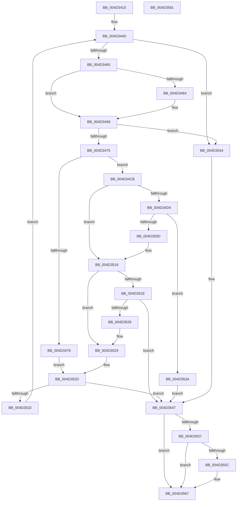

# MiIncrementLargeSubsections

- RVA: `0x004D3410`–`0x004D3582` (길이 `370` bytes)
- VA: `0x00000001404D3410`
- 실행 섹션: `.text`
- PDB 이름 있음: `예`; PDB Function 태그: `아니요`
- unwind 정보 RVA: `0x000BDF48`
- 디코드: `118`개 명령, `370/370` bytes 표시
- 미해석 바이트: `0` (있으면 어셈블리에 `.byte`로 보존)

> 이 문서는 커널 이미지의 기계어와 PDB 기호를 분석해 생성했습니다. 4번과 5번은 함수 원형과 자료형을 바이너리 사용 방식에서 추정한 C 해석이며 원본 소스 복구 결과는 아닙니다.

## 1. Dependencies

- 직접 호출 지점: **10**; 고유 호출 대상: **7**
- 직접 호출자로 확인된 함수: **3**
- RIP 상대 이미지 참조: **0**

### Outgoing calls
- `0x004D3443` → [ExAcquireSpinLockExclusive](../24/ExAcquireSpinLockExclusive_function_00248690.md) (function, `0x00248690`)
- `0x004D34B4` → [MiReleaseSpinLockExclusive](../24/MiReleaseSpinLockExclusive_function_002482C0.md) (function, `0x002482C0`)
- `0x004D34C4` → [KeWaitForGate](../2C/KeWaitForGate_function_002CA794.md) (function, `0x002CA794`)
- `0x004D34D9` → [MiReleaseSpinLockExclusive](../24/MiReleaseSpinLockExclusive_function_002482C0.md) (function, `0x002482C0`)
- `0x004D34E1` → [MiEnableLargeSubsection](../68/MiEnableLargeSubsection_function_00680BC4.md) (function, `0x00680BC4`)
- `0x004D34EB` → [ExAcquireSpinLockExclusive](../24/ExAcquireSpinLockExclusive_function_00248690.md) (function, `0x00248690`)
- `0x004D34F9` → [MiBuildWakeList](../44/MiBuildWakeList_function_0044BE90.md) (function, `0x0044BE90`)
- `0x004D3501` → [MiReleaseControlAreaWaiters](../28/MiReleaseControlAreaWaiters_function_002865F0.md) (function, `0x002865F0`)
- `0x004D354D` → [MiReleaseSpinLockExclusive](../24/MiReleaseSpinLockExclusive_function_002482C0.md) (function, `0x002482C0`)
- `0x004D3562` → [MiDecrementLargeSubsections](MiDecrementLargeSubsections_function_004D2BE0.md) (function, `0x004D2BE0`)

### Direct callers
- [sub_006E720A](../6E/Unknown_function_006E720A.md) at `0x006E7229`
- [MiCloneLargeFileOnlyVad](../../page/80/MiCloneLargeFileOnlyVad_function_00800A64.md) at `0x00800AC2`
- [sub_008859DF](../../page/88/Unknown_function_008859DF.md) at `0x008859F3`

### Static image references
- 디코드된 RIP-relative 메모리 참조가 없습니다.

## 2. Other-region calls and transfers

- 다른 실행 섹션으로 향하는 call: **0**
- 별도 외부 분기/꼬리 이동을 확인하지 못했습니다.

## 3. Assembly (complete function range)

```asm
004D3410  48 89 5C 24 10                  mov qword ptr [rsp + 0x10], rbx
004D3415  55                              push rbp
004D3416  56                              push rsi
004D3417  57                              push rdi
004D3418  41 54                           push r12
004D341A  41 55                           push r13
004D341C  41 56                           push r14
004D341E  41 57                           push r15
004D3420  48 8B EC                        mov rbp, rsp
004D3423  48 83 EC 50                     sub rsp, 0x50
004D3427  48 8B 19                        mov rbx, qword ptr [rcx]
004D342A  4C 8B E9                        mov r13, rcx
004D342D  48 8B F9                        mov rdi, rcx
004D3430  48 89 5D 50                     mov qword ptr [rbp + 0x50], rbx
004D3434  33 F6                           xor esi, esi
004D3436  45 33 FF                        xor r15d, r15d
004D3439  4C 8B F2                        mov r14, rdx
004D343C  4C 8D 63 48                     lea r12, [rbx + 0x48]
004D3440  49 8B CC                        mov rcx, r12
004D3443  E8 48 52 D7 FF                  call 0x140248690
004D3448  8A C8                           mov cl, al
004D344A  88 45 40                        mov byte ptr [rbp + 0x40], al
004D344D  8B 47 30                        mov eax, dword ptr [rdi + 0x30]
004D3450  BA 01 00 00 00                  mov edx, 1
004D3455  C1 E8 1E                        shr eax, 0x1e
004D3458  85 C0                           test eax, eax
004D345A  0F 84 E4 00 00 00               je 0x1404d3544
004D3460  3B C2                           cmp eax, edx
004D3462  75 05                           jne 0x1404d3469
004D3464  3B F2                           cmp esi, edx
004D3466  0F 42 F2                        cmovb esi, edx
004D3469  8B 47 6C                        mov eax, dword ptr [rdi + 0x6c]
004D346C  83 F8 FF                        cmp eax, -1
004D346F  0F 84 CF 00 00 00               je 0x1404d3544
004D3475  3B C2                           cmp eax, edx
004D3477  75 52                           jne 0x1404d34cb
004D3479  83 65 DC 00                     and dword ptr [rbp - 0x24], 0
004D347D  48 8D 45 E8                     lea rax, [rbp - 0x18]
004D3481  83 65 E4 00                     and dword ptr [rbp - 0x1c], 0
004D3485  8A D1                           mov dl, cl
004D3487  48 89 45 F0                     mov qword ptr [rbp - 0x10], rax
004D348B  49 8B CC                        mov rcx, r12
004D348E  48 8D 45 E8                     lea rax, [rbp - 0x18]
004D3492  C7 45 E0 07 01 06 00            mov dword ptr [rbp - 0x20], 0x60107
004D3499  48 89 45 E8                     mov qword ptr [rbp - 0x18], rax
004D349D  48 8B 43 50                     mov rax, qword ptr [rbx + 0x50]
004D34A1  48 89 45 D0                     mov qword ptr [rbp - 0x30], rax
004D34A5  48 8D 45 D0                     lea rax, [rbp - 0x30]
004D34A9  48 89 43 50                     mov qword ptr [rbx + 0x50], rax
004D34AD  C7 45 D8 00 02 00 00            mov dword ptr [rbp - 0x28], 0x200
004D34B4  E8 07 4E D7 FF                  call 0x1402482c0
004D34B9  45 33 C0                        xor r8d, r8d
004D34BC  48 8D 4D E0                     lea rcx, [rbp - 0x20]
004D34C0  41 8D 50 13                     lea edx, [r8 + 0x13]
004D34C4  E8 CB 72 DF FF                  call 0x1402ca794
004D34C9  EB 62                           jmp 0x1404d352d
004D34CB  FF C0                           inc eax
004D34CD  89 47 6C                        mov dword ptr [rdi + 0x6c], eax
004D34D0  3B C2                           cmp eax, edx
004D34D2  75 42                           jne 0x1404d3516
004D34D4  8A D1                           mov dl, cl
004D34D6  49 8B CC                        mov rcx, r12
004D34D9  E8 E2 4D D7 FF                  call 0x1402482c0
004D34DE  48 8B CF                        mov rcx, rdi
004D34E1  E8 DE D6 1A 00                  call 0x140680bc4
004D34E6  49 8B CC                        mov rcx, r12
004D34E9  8B D8                           mov ebx, eax
004D34EB  E8 A0 51 D7 FF                  call 0x140248690
004D34F0  48 8B 4D 50                     mov rcx, qword ptr [rbp + 0x50]
004D34F4  BA 00 02 00 00                  mov edx, 0x200
004D34F9  E8 92 89 F7 FF                  call 0x14044be90
004D34FE  48 8B C8                        mov rcx, rax
004D3501  E8 EA 30 DB FF                  call 0x1402865f0
004D3506  8B 47 6C                        mov eax, dword ptr [rdi + 0x6c]
004D3509  85 DB                           test ebx, ebx
004D350B  74 2D                           je 0x1404d353a
004D350D  48 8B 5D 50                     mov rbx, qword ptr [rbp + 0x50]
004D3511  FF C0                           inc eax
004D3513  89 47 6C                        mov dword ptr [rdi + 0x6c], eax
004D3516  4C 8B FF                        mov r15, rdi
004D3519  4D 85 F6                        test r14, r14
004D351C  74 0B                           je 0x1404d3529
004D351E  8B 47 2C                        mov eax, dword ptr [rdi + 0x2c]
004D3521  4C 3B F0                        cmp r14, rax
004D3524  76 21                           jbe 0x1404d3547
004D3526  4C 2B F0                        sub r14, rax
004D3529  48 8B 7F 10                     mov rdi, qword ptr [rdi + 0x10]
004D352D  48 85 FF                        test rdi, rdi
004D3530  74 15                           je 0x1404d3547
004D3532  8A 4D 40                        mov cl, byte ptr [rbp + 0x40]
004D3535  E9 13 FF FF FF                  jmp 0x1404d344d
004D353A  83 CE FF                        or esi, 0xffffffff
004D353D  FF C8                           dec eax
004D353F  89 47 6C                        mov dword ptr [rdi + 0x6c], eax
004D3542  EB 03                           jmp 0x1404d3547
004D3544  83 CE FF                        or esi, 0xffffffff
004D3547  8A 55 40                        mov dl, byte ptr [rbp + 0x40]
004D354A  49 8B CC                        mov rcx, r12
004D354D  E8 6E 4D D7 FF                  call 0x1402482c0
004D3552  83 FE FF                        cmp esi, -1
004D3555  75 10                           jne 0x1404d3567
004D3557  4D 85 FF                        test r15, r15
004D355A  74 0B                           je 0x1404d3567
004D355C  49 8B D7                        mov rdx, r15
004D355F  49 8B CD                        mov rcx, r13
004D3562  E8 79 F6 FF FF                  call 0x1404d2be0
004D3567  48 8B 9C 24 98 00 00 00         mov rbx, qword ptr [rsp + 0x98]
004D356F  8B C6                           mov eax, esi
004D3571  48 83 C4 50                     add rsp, 0x50
004D3575  41 5F                           pop r15
004D3577  41 5E                           pop r14
004D3579  41 5D                           pop r13
004D357B  41 5C                           pop r12
004D357D  5F                              pop rdi
004D357E  5E                              pop rsi
004D357F  5D                              pop rbp
004D3580  C3                              ret
004D3581  CC                              int3
```

## 4. C-style interpretation (structured pseudocode)

```c
__int64 __fastcall MiIncrementLargeSubsections(__int64 a1, __int64 a2, int a3)
{
    __int64 result;
    __int64 v_r14;
    __int64 v_r15;
    __int64 v_rsi;
    __int64 v_rsp;
    unsigned __int64 v_stack_m48;
    unsigned __int64 v_stack_m50;
    unsigned int v_stack_m54;
    unsigned int v_stack_m58;
    unsigned int v_stack_m5C;
    unsigned int v_stack_m60;
    unsigned __int64 v_stack_m68;
    unsigned __int64 v_stack_p10;
    unsigned __int64 v_stack_p18;
    unsigned __int8 v_stack_p8;

    v_stack_p10 = v_rbx;
    v_rsp = (v_rsp) - (80);
    v_stack_p18 = *(unsigned __int64 *)(a1);
    v_rsi = 0;
    v_r15 = 0;
    result = ExAcquireSpinLockExclusive(*(unsigned __int64 *)(a1) + 72, a2, a3, a4);
    v_stack_p8 = (unsigned __int8)(result);
loc_004D344D:
    result = (unsigned int)(((unsigned int)(*(unsigned int *)(a1 + 48))) >> (30));
    if ((unsigned int)(result) == 0) goto loc_004D3544;
    if (((unsigned int)(result)) == 1) {
        if (0 < 1) { v_rsi = 1; }
    }
    if (((unsigned int)((unsigned int)(*(unsigned int *)(a1 + 108)))) == -1) goto loc_004D3544;
    if (((unsigned int)((unsigned int)(*(unsigned int *)(a1 + 108)))) != 1) goto loc_004D34CB;
    v_stack_m48 = v_stack_m50;
    v_stack_m58 = 0x60107ULL;
    v_stack_m50 = v_stack_m50;
    v_stack_m68 = *(unsigned __int64 *)(*(unsigned __int64 *)(a1) + 80);
    *(unsigned __int64 *)(*(unsigned __int64 *)(a1) + 80) = v_stack_m68;
    v_stack_m60 = 512;
    result = MiReleaseSpinLockExclusive(*(unsigned __int64 *)(a1) + 72, (unsigned __int8)((unsigned __int8)(result)), a3, a4);
    a3 = 0;
    result = KeWaitForGate(v_stack_m58, a3 + 19, a3, a4);
    goto loc_004D352D;
loc_004D34CB:
    result = (unsigned int)((result) + 1);
    *(unsigned int *)(a1 + 108) = (unsigned int)(result);
    if (((unsigned int)(result)) != ((unsigned int)(a3 + 19))) goto loc_004D3516;
    result = MiReleaseSpinLockExclusive(*(unsigned __int64 *)(a1) + 72, (unsigned __int8)(v_stack_m58), a3, a4);
    result = MiEnableLargeSubsection(a1, (unsigned __int8)(v_stack_m58), a3, a4);
    result = ExAcquireSpinLockExclusive(*(unsigned __int64 *)(a1) + 72, (unsigned __int8)(v_stack_m58), a3, a4);
    result = MiBuildWakeList(v_stack_p18, 512, a3, a4);
    result = MiReleaseControlAreaWaiters(result, 512, a3, a4);
    if ((unsigned int)((unsigned int)((unsigned int)(result))) == 0) goto loc_004D353A;
    result = (unsigned int)(((unsigned int)(*(unsigned int *)(a1 + 108))) + 1);
    *(unsigned int *)(a1 + 108) = (unsigned int)(result);
loc_004D3516:
    if (a2 == 0) goto loc_004D3529;
    if (a2 <= ((unsigned int)(*(unsigned int *)(a1 + 44)))) goto loc_004D3547;
    v_r14 = (a2) - ((unsigned int)(*(unsigned int *)(a1 + 44)));
loc_004D3529:
loc_004D352D:
    if (*(unsigned __int64 *)(a1 + 16) == 0) goto loc_004D3547;
    goto loc_004D344D;
loc_004D353A:
    v_rsi = (unsigned int)((v_rsi) | (0xFFFFFFFFULL));
    result = (unsigned int)(((unsigned int)(*(unsigned int *)(a1 + 44))) - 1);
    *(unsigned int *)(*(unsigned __int64 *)(a1 + 16) + 108) = (unsigned int)(result);
    goto loc_004D3547;
loc_004D3544:
    v_rsi = (unsigned int)((v_rsi) | (0xFFFFFFFFULL));
loc_004D3547:
    result = MiReleaseSpinLockExclusive(*(unsigned __int64 *)(a1) + 72, v_stack_p8, a3, a4);
    if (((unsigned int)(v_rsi)) != -1) goto loc_004D3567;
    if (a1 != 0) {
        a2 = a1;
        a1 = a1;
        result = MiDecrementLargeSubsections(a1, a2, a3, a4);
    }
    v_rsp = (v_rsp) + (80);
    return (unsigned int)((unsigned int)(v_rsi));
}
```

## 5. (Beta) C Style

```c
int64_t MiIncrementLargeSubsections(void *Arg1, int64_t Arg2, int32_t Arg3)
{
    uint8_t *arg1 = (uint8_t *)Arg1;

    int64_t result;
    int64_t local_r14;
    int64_t local_r15;
    int64_t local_rsi;
    int64_t local_rsp;
    uint64_t v_stack_m48;
    uint64_t v_stack_m50;
    uint32_t v_stack_m54;
    uint32_t v_stack_m58;
    uint32_t v_stack_m5C;
    uint32_t v_stack_m60;
    uint64_t v_stack_m68;
    uint64_t v_stack_p10;
    uint64_t v_stack_p18;
    uint8_t v_stack_p8;

    v_stack_p10 = local_rbx;
    local_rsp = (local_rsp) - (80);
    v_stack_p18 = *(uint64_t *)(arg1);
    local_rsi = 0;
    local_r15 = 0;
    result = ExAcquireSpinLockExclusive(*(uint64_t *)(arg1) + 72, Arg2, Arg3, a4);
    v_stack_p8 = (uint8_t)(result);
loc_004D344D:
    result = (uint32_t)(((uint32_t)(*(uint32_t *)(arg1 + 0x30))) >> (30));
    if ((uint32_t)(result) == 0) goto loc_004D3544;
    if (((uint32_t)(result)) == 1) {
        if (0 < 1) { local_rsi = 1; }
    }
    if (((uint32_t)((uint32_t)(*(uint32_t *)(arg1 + 0x6C)))) == -1) goto loc_004D3544;
    if (((uint32_t)((uint32_t)(*(uint32_t *)(arg1 + 0x6C)))) != 1) goto loc_004D34CB;
    v_stack_m48 = v_stack_m50;
    v_stack_m58 = 0x60107ULL;
    v_stack_m50 = v_stack_m50;
    v_stack_m68 = *(uint64_t *)(*(uint64_t *)(arg1) + 0x50);
    *(uint64_t *)(*(uint64_t *)(arg1) + 0x50) = v_stack_m68;
    v_stack_m60 = 512;
    result = MiReleaseSpinLockExclusive(*(uint64_t *)(arg1) + 72, (uint8_t)((uint8_t)(result)), Arg3, a4);
    Arg3 = 0;
    result = KeWaitForGate(v_stack_m58, Arg3 + 19, Arg3, a4);
    goto loc_004D352D;
loc_004D34CB:
    result = (uint32_t)((result) + 1);
    *(uint32_t *)(arg1 + 0x6C) = (uint32_t)(result);
    if (((uint32_t)(result)) != ((uint32_t)(Arg3 + 19))) goto loc_004D3516;
    result = MiReleaseSpinLockExclusive(*(uint64_t *)(arg1) + 72, (uint8_t)(v_stack_m58), Arg3, a4);
    result = MiEnableLargeSubsection(Arg1, (uint8_t)(v_stack_m58), Arg3, a4);
    result = ExAcquireSpinLockExclusive(*(uint64_t *)(arg1) + 72, (uint8_t)(v_stack_m58), Arg3, a4);
    result = MiBuildWakeList(v_stack_p18, 512, Arg3, a4);
    result = MiReleaseControlAreaWaiters(result, 512, Arg3, a4);
    if ((uint32_t)((uint32_t)((uint32_t)(result))) == 0) goto loc_004D353A;
    result = (uint32_t)(((uint32_t)(*(uint32_t *)(arg1 + 0x6C))) + 1);
    *(uint32_t *)(arg1 + 0x6C) = (uint32_t)(result);
loc_004D3516:
    if (Arg2 == 0) goto loc_004D3529;
    if (Arg2 <= ((uint32_t)(*(uint32_t *)(arg1 + 0x2C)))) goto loc_004D3547;
    local_r14 = (Arg2) - ((uint32_t)(*(uint32_t *)(arg1 + 0x2C)));
loc_004D3529:
loc_004D352D:
    if (*(uint64_t *)(arg1 + 0x10) == 0) goto loc_004D3547;
    goto loc_004D344D;
loc_004D353A:
    local_rsi = (uint32_t)((local_rsi) | (0xFFFFFFFFULL));
    result = (uint32_t)(((uint32_t)(*(uint32_t *)(arg1 + 0x2C))) - 1);
    *(uint32_t *)(*(uint64_t *)(arg1 + 0x10) + 0x6C) = (uint32_t)(result);
    goto loc_004D3547;
loc_004D3544:
    local_rsi = (uint32_t)((local_rsi) | (0xFFFFFFFFULL));
loc_004D3547:
    result = MiReleaseSpinLockExclusive(*(uint64_t *)(arg1) + 72, v_stack_p8, Arg3, a4);
    if (((uint32_t)(local_rsi)) != -1) goto loc_004D3567;
    if (Arg1 != NULL) {
        Arg2 = Arg1;
        Arg1 = Arg1;
        result = MiDecrementLargeSubsections(Arg1, Arg2, Arg3, a4);
    }
    local_rsp = (local_rsp) + (80);
    return (uint32_t)((uint32_t)(local_rsi));
}
```

### 관측된 메모리 오프셋

구조체 형식이 확인되지 않은 접근은 인자 기준의 오프셋으로만 기록했습니다.

| 기준 인자 | 오프셋 표현 | 폭 (bit) | 접근 |
|---|---:|---:|---|
| `Arg1` | `+ 0x0` | `64` | `R` |

## 6. Execution-region graph

[열기: 2D/3D 그래프와 함수 탐색 컨트롤 패널](../../../control-panel.html?section=text&rva=0x004D3410&view=graph)

- 2D 그래프는 위에서 아래로 흐르고, 3D 그래프는 빈 공간을 드래그해 회전합니다. Shift+드래그는 이동, 휠은 확대·축소, 함수 노드 선택은 대상 보고서 이동입니다.

### Static fallback


